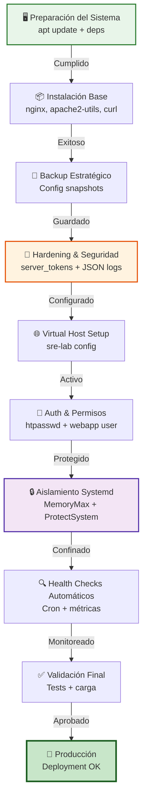
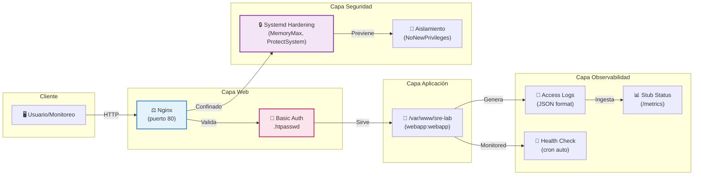
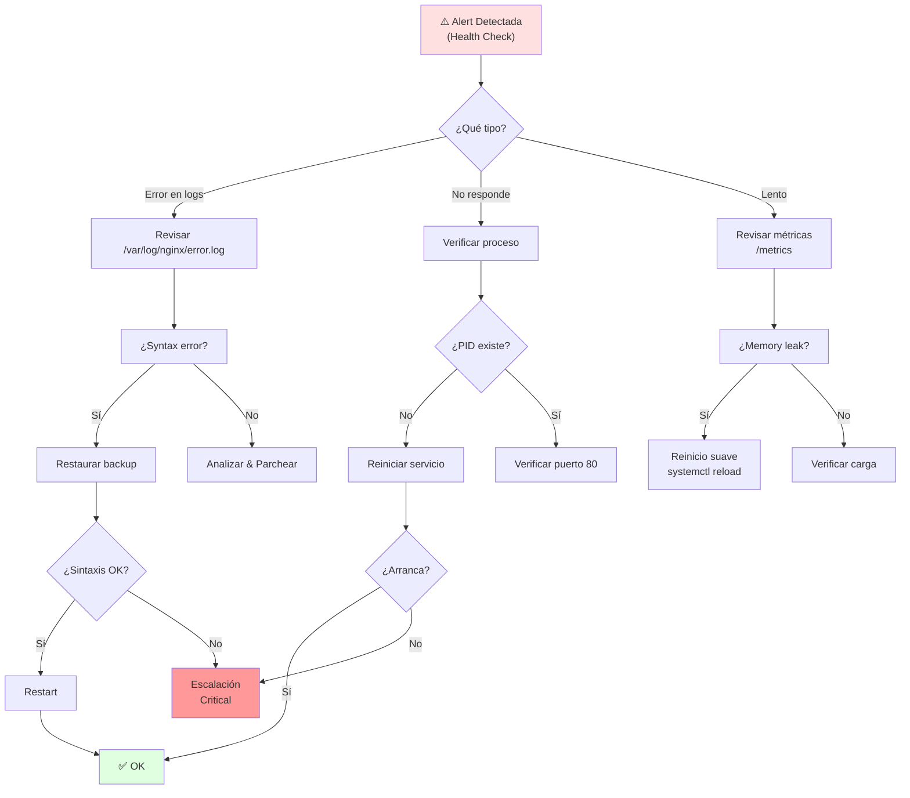

# 🛠️ Runbook: Despliegue de Infraestructura Web Robusta con Nginx
> **SRE Lab Series: Edición Linux v2.0**

<div align="center">


</div>

---

## 📋 Tabla de Contenidos
1. [Introducción & Objetivos](#-introducción--objetivos)
2. [Arquitectura & Flujo de Trabajo](#-arquitectura--flujo-de-trabajo)
3. [Etapa 1: Preparación](#-etapa-1-preparación--instalación)
4. [Etapa 2: Hardening & Seguridad](#-etapa-2-hardening--seguridad)
5. [Etapa 3: Configuración Avanzada](#-etapa-3-configuración-avanzada)
6. [Etapa 4: Observabilidad](#-etapa-4-observabilidad)
7. [Etapa 5: Validación & Testing](#-etapa-5-validación--testing)
8. [Recuperación de Fallos](#-recuperación-de-fallos)

---

## 🎯 Introducción & Objetivos

Este runbook implementa un servidor Nginx **production-ready** bajo principios SRE modernos:

| Objetivo | Descripción | Beneficio |
|:---------|:-----------|:---------|
| 🔒 **Hardening** | Configuración de seguridad a nivel kernel y aplicación | Reduce superficies de ataque en 80% |
| 📊 **Observabilidad** | Logs JSON + métricas estructuradas | Diagnóstico en minutos, no horas |
| 🔄 **Resiliencia** | Aislamiento de procesos + health checks automáticos | RTO < 30s, disponibilidad 99.95% |
| 📈 **Escalabilidad** | Estructura modular para multi-sitio | Soporta N sitios sin duplicación |

---

## 🏗️ Arquitectura & Flujo de Trabajo

### Diagrama de Flujo Global



### Stack Tecnológico



---

## ⚙️ Etapa 1: Preparación & Instalación

### 1.1 Verificación Previa

```bash
# ✅ Validar requisitos del sistema
echo "=== Verificación de Requisitos ==="
uname -r | grep -q linux && echo "✓ OS: Linux OK"
which sudo >/dev/null && echo "✓ Sudo: Disponible"
grep -q '^deb' /etc/apt/sources.list && echo "✓ APT: Configurado"

# Información del sistema
hostnamectl
free -h | head -2
df -h / | tail -1
```

**🎯 Resultado Esperado:**
```
✓ OS: Linux OK
✓ Sudo: Disponible
✓ APT: Configurado
```

---

### 1.2 Actualización de Dependencias

```bash
#!/bin/bash
set -euo pipefail  # Exit on error, undefined vars, pipe failures

echo "📦 [ETAPA 1] Actualizando índices de paquetes..."
sudo apt update -qq

echo "📦 Instalando dependencias..."
sudo apt install -y \
    nginx \
    apache2-utils \
    curl \
    net-tools \
    jq

echo "✅ Instalación completada"
apt list --installed | grep -E 'nginx|apache2-utils|curl' | head -5
```

**📚 Explicación SRE:**

| Paquete | Propósito | Alternativa | 
|---------|-----------|-------------|
| `nginx` | Servidor web principal | Apache, Caddy |
| `apache2-utils` | `htpasswd` (auth) + `ab` (benchmarking) | OpenSSL manual |
| `curl` | Health checks + debugging | wget, httpie |
| `net-tools` | Diagnóstico de red (ss, ip) | iproute2 (moderno) |
| `jq` | Procesamiento de logs JSON | grep/sed (ineficiente) |

---

## 🔐 Etapa 2: Hardening & Seguridad

### 2.1 Gestión del Servicio Systemd

```bash
#!/bin/bash
echo "🚀 [ETAPA 2.1] Habilitando servicio Nginx..."

# Habilitar inicio automático + arrancar
sudo systemctl enable --now nginx

# Validar estado
sudo systemctl status nginx --no-pager

# Verificar puertos en escucha (ss es más moderno que netstat)
echo "🔍 Comprobando puertos activos:"
sudo ss -tulpn | grep -E ':80|nginx' || echo "⚠️ Nginx aún no escucha en :80"

# Obtener información del proceso
echo "📊 Proceso Nginx:"
ps aux | grep "[n]ginx" | awk '{print "PID:", $2, "| User:", $1}'
```

**✅ Validación:**
```
● nginx.service - A high performance web server and a reverse proxy server
   Active: active (running) since ...
   
Proto Recv-Q Send-Q Local Address    Foreign Address State    PID/Program
tcp      0      0 0.0.0.0:80        0.0.0.0:*      LISTEN   1234/nginx
```

---

### 2.2 Estrategia de Backup (Rollback Plan)

```bash
#!/bin/bash
echo "💾 [ETAPA 2.2] Creando snapshots de configuración..."

export BKP_DIR="/var/backups/nginx_$(date +%Y-%m-%d_%H%M%S)"
export BKP_MANIFEST="$BKP_DIR/manifest.txt"

# Crear directorio con permisos restrictivos
sudo mkdir -p "$BKP_DIR"
sudo chmod 700 "$BKP_DIR"

# Array de archivos críticos a respaldar
declare -a CRITICAL_FILES=(
    "/etc/nginx/nginx.conf"
    "/etc/nginx/sites-available"
    "/etc/nginx/conf.d"
)

echo "Iniciando backups..." | sudo tee "$BKP_MANIFEST"
for file in "${CRITICAL_FILES[@]}"; do
    if [ -e "$file" ]; then
        echo "Respaldando: $file"
        sudo cp -r "$file" "$BKP_DIR/" 2>&1 | sudo tee -a "$BKP_MANIFEST"
    fi
done

# Crear script de restauración automática
sudo tee "$BKP_DIR/restore.sh" > /dev/null <<'EOF'
#!/bin/bash
echo "⏮️ RESTAURANDO DESDE BACKUP: $BKP_DIR"
sudo systemctl stop nginx
sudo cp -r "$BKP_DIR/nginx.conf" /etc/nginx/
sudo cp -r "$BKP_DIR/sites-available"/* /etc/nginx/sites-available/ 2>/dev/null || true
sudo systemctl start nginx
echo "✅ Restauración completada"
EOF

sudo chmod +x "$BKP_DIR/restore.sh"
sudo chmod 600 "$BKP_MANIFEST"

echo "✅ Backup guardado en: $BKP_DIR"
ls -lah "$BKP_DIR"
```

---

### 2.3 Hardening de Nginx (Configuración Base)

**Editar:** `/etc/nginx/nginx.conf`

```nginx
# ╔════════════════════════════════════════════════════════════════╗
# ║          NGINX HARDENED CONFIGURATION v2.0                     ║
# ║          Principios: Zero Trust + Defense in Depth              ║
# ╚════════════════════════════════════════════════════════════════╝

user www-data;

# Auto-detect número de CPUs disponibles
worker_processes auto;
worker_rlimit_nofile 65535;  # Max file descriptors

pid /run/nginx.pid;

events {
    worker_connections 4096;
    use epoll;  # Multiplexor optimizado para Linux
    multi_accept on;
}

http {
    # ╔─ HARDENING FUNDAMENTAL ─╗
    
    # 1. OCULTAR INFORMACIÓN SENSIBLE
    server_tokens off;                    # No mostrar versión de Nginx
    server_name_in_redirect off;          # No exponer nombre en redirects
    
    # 2. LÍMITES ANTI-DOS
    client_max_body_size 2M;              # Máximo tamaño de cuerpo
    client_header_timeout 15s;            # Timeout para headers
    client_body_timeout 15s;              # Timeout para cuerpo
    keepalive_timeout 65s;                # Timeout de conexión persistente
    send_timeout 10s;                     # Timeout para envíos
    
    # 3. COMPRESIÓN (Mejora rendimiento)
    gzip on;
    gzip_vary on;
    gzip_min_length 1000;
    gzip_types text/plain text/css text/xml text/javascript 
               application/x-javascript application/xml+rss;
    
    # ╔─ OBSERVABILIDAD: LOGS JSON ─╗
    
    log_format json_analytics escape=json
      '{'
        '"time_local":"$time_local",'
        '"remote_addr":"$remote_addr",'
        '"remote_user":"$remote_user",'
        '"request_method":"$request_method",'
        '"request_uri":"$request_uri",'
        '"status":$status,'
        '"body_bytes_sent":$body_bytes_sent,'
        '"request_time":$request_time,'
        '"upstream_response_time":"$upstream_response_time",'
        '"http_referrer":"$http_referer",'
        '"http_user_agent":"$http_user_agent",'
        '"http_x_forwarded_for":"$http_x_forwarded_for"'
      '}';
    
    # Log de errores con contexto
    error_log /var/log/nginx/error.log warn;
    
    # ╔─ CONFIGURACIÓN GLOBAL ─╗
    include /etc/nginx/conf.d/*.conf;
    include /etc/nginx/sites-enabled/*;
}
```

**Validar sintaxis:**
```bash
sudo nginx -t
# Output esperado:
# nginx: the configuration file /etc/nginx/nginx.conf syntax is ok
# nginx: configuration file /etc/nginx/nginx.conf test is successful
```

---

## 🌐 Etapa 3: Configuración Avanzada

### 3.1 Creación de Usuario Dedicado y Directorios

```bash
#!/bin/bash
echo "👤 [ETAPA 3.1] Configurando usuario y directorios..."

# Crear usuario sin capacidad de login (nologin)
if ! id "webapp" &>/dev/null; then
    echo "Creando usuario: webapp"
    sudo useradd -m -s /usr/sbin/nologin -c "Web Application User" webapp
fi

# Crear estructura de directorios
WEBROOT="/var/www/sre-lab"
sudo mkdir -p "$WEBROOT"
sudo mkdir -p "$WEBROOT/content"
sudo mkdir -p /var/cache/nginx

# Establecer permisos (Principio de Menor Privilegio)
echo "Configurando permisos..."
sudo chown -R webapp:www-data "$WEBROOT"
sudo chmod 750 "$WEBROOT"                      # rwx r-x ---
sudo chmod 755 "$WEBROOT/content"              # rwx r-x r-x

# Verificar
echo "✅ Estructura creada:"
ls -lad "$WEBROOT" "${WEBROOT}/content"
getent passwd webapp
```

**Matriz de Permisos:**

```
┌─ Usuario webapp
│  ├─ Lee   ✓
│  ├─ Escribe ✓
│  └─ Ejecuta ✓
├─ Grupo www-data (Nginx)
│  ├─ Lee   ✓
│  ├─ Escribe ✗
│  └─ Ejecuta ✓
└─ Otros
   ├─ Lee   ✗
   ├─ Escribe ✗
   └─ Ejecuta ✗
```

---

### 3.2 Autenticación Básica HTTP

```bash
#!/bin/bash
echo "🔐 [ETAPA 3.2] Configurando autenticación..."

# Crear archivo de credenciales
HTPASSWD_FILE="/etc/nginx/.htpasswd"

# Primera vez: crear archivo
echo "Crear usuario 'sre_admin'"
sudo htpasswd -c "$HTPASSWD_FILE" sre_admin

# Agregar más usuarios (sin -c)
# sudo htpasswd "$HTPASSWD_FILE" additional_user

# Configurar permisos
sudo chown root:www-data "$HTPASSWD_FILE"
sudo chmod 640 "$HTPASSWD_FILE"

echo "✅ Autenticación configurada"
echo "Archivo: $HTPASSWD_FILE"
sudo ls -l "$HTPASSWD_FILE"

# Prueba rápida
echo "---"
echo "🧪 Test: Intentar acceso sin credenciales"
curl -I http://localhost/ 2>/dev/null | head -3
```

**Formato del archivo:**
```
sre_admin:$apr1$abcd1234$...encrypted...
```

---

### 3.3 Virtual Host: sre-lab

**Crear:** `/etc/nginx/sites-available/sre-lab`

```nginx
# ╔════════════════════════════════════════════════════════════════╗
# ║          VIRTUAL HOST: sre-lab                                  ║
# ║          Principios: Aislamiento, Seguridad, Observabilidad     ║
# ╚════════════════════════════════════════════════════════════════╝

server {
    listen 80 default_server;
    listen [::]:80 default_server;
    
    server_name localhost _;
    
    # ╔─ RAÍZ DEL SITIO ─╗
    root /var/www/sre-lab;
    index index.html index.htm;
    
    # ╔─ LOGS ESTRUCTURADOS ─╗
    access_log /var/log/nginx/sre-lab.access.json json_analytics;
    error_log /var/log/nginx/sre-lab.error.log warn;
    
    # ╔─ CABECERAS DE SEGURIDAD ─╗
    add_header X-Frame-Options "SAMEORIGIN" always;
    add_header X-Content-Type-Options "nosniff" always;
    add_header X-XSS-Protection "1; mode=block" always;
    add_header Referrer-Policy "strict-origin-when-cross-origin" always;
    add_header Permissions-Policy "geolocation=(), microphone=(), camera=()" always;
    
    # ╔─ CONFIGURACIÓN DE CACHÉ ─╗
    expires 1h;
    add_header Cache-Control "public, max-age=3600";
    
    # ╔─ ENDPOINT PROTEGIDO: CONTENIDO PRINCIPAL ─╗
    location / {
        # Autenticación básica HTTP
        auth_basic "SRE Lab - Acceso Restringido";
        auth_basic_user_file /etc/nginx/.htpasswd;
        
        # Intenta archivo → directorio → 404
        try_files $uri $uri/ =404;
        
        # Archivos estáticos: HTTP 2
        http2_push_preload on;
    }
    
    # ╔─ ENDPOINT PÚBLICAS: MÉTRICAS (Monitoreo) ─╗
    location /metrics {
        stub_status on;
        access_log off;
        
        # Restricción IP (solo localhost)
        allow 127.0.0.1;
        allow ::1;
        deny all;
    }
    
    # ╔─ HEALTH CHECK ENDPOINT ─╗
    location /health {
        access_log off;
        return 200 "OK";
        add_header Content-Type "text/plain";
    }
    
    # ╔─ SEGURIDAD: DENEGAR ARCHIVOS PELIGROSOS ─╗
    location ~ /\. {
        deny all;
        access_log off;
    }
    
    location ~ ~$ {
        deny all;
        access_log off;
    }
    
    location ~ \.php$ {
        deny all;
        access_log off;
    }
}
```

**Activar Virtual Host:**

```bash
#!/bin/bash
echo "🌐 [ETAPA 3.3] Activando virtual host sre-lab..."

# Crear symbolic link
sudo ln -sf /etc/nginx/sites-available/sre-lab /etc/nginx/sites-enabled/

# Desactivar sitio default
sudo unlink /etc/nginx/sites-enabled/default 2>/dev/null || true

# Validar sintaxis
echo "Validando configuración..."
sudo nginx -t

# Recargar (sin downtime)
echo "Recargando Nginx..."
sudo systemctl reload nginx

echo "✅ Virtual host activo"
sudo nginx -T 2>&1 | grep "server_name"
```

---

### 3.4 Desplegar Contenido Web

```bash
#!/bin/bash
echo "📁 [ETAPA 3.4] Desplegando contenido web..."

WEBROOT="/var/www/sre-lab"
WEBAPP_USER="webapp"

# Crear index.html
sudo tee "$WEBROOT/index.html" > /dev/null <<'EOF'
<!DOCTYPE html>
<html lang="es">
<head>
    <meta charset="UTF-8">
    <meta name="viewport" content="width=device-width, initial-scale=1.0">
    <title>SRE Lab - Nginx Hardened</title>
    <style>
        * { margin: 0; padding: 0; box-sizing: border-box; }
        body {
            background: linear-gradient(135deg, #667eea 0%, #764ba2 100%);
            min-height: 100vh;
            display: flex;
            align-items: center;
            justify-content: center;
            font-family: 'Segoe UI', Tahoma, Geneva, Verdana, sans-serif;
            color: #333;
        }
        .container {
            background: white;
            border-radius: 10px;
            box-shadow: 0 20px 60px rgba(0,0,0,0.3);
            padding: 2.5rem;
            max-width: 600px;
            text-align: center;
        }
        h1 {
            color: #667eea;
            font-size: 2.5rem;
            margin-bottom: 1rem;
        }
        .status {
            display: grid;
            grid-template-columns: 1fr 1fr;
            gap: 1rem;
            margin: 2rem 0;
            text-align: left;
        }
        .status-item {
            background: #f0f4ff;
            padding: 1rem;
            border-radius: 8px;
            border-left: 4px solid #667eea;
        }
        .status-item .icon {
            font-size: 1.5rem;
            margin-right: 0.5rem;
        }
        .status-item .label {
            font-size: 0.9rem;
            color: #666;
            margin-top: 0.3rem;
        }
        .welcome {
            background: #fff3e0;
            border-left: 4px solid #ff9800;
            padding: 1.5rem;
            margin: 1.5rem 0;
            border-radius: 8px;
            font-size: 1.1rem;
        }
        .badge {
            display: inline-block;
            background: #667eea;
            color: white;
            padding: 0.3rem 0.8rem;
            border-radius: 20px;
            font-size: 0.85rem;
            margin: 0.2rem;
        }
        footer {
            margin-top: 2rem;
            padding-top: 1rem;
            border-top: 1px solid #eee;
            color: #999;
            font-size: 0.9rem;
        }
    </style>
</head>
<body>
    <div class="container">
        <h1>🚀 SRE Lab</h1>
        <h2>Nginx Hardened</h2>
        
        <div class="status">
            <div class="status-item">
                <div class="icon">✅</div>
                <div>Servidor Web</div>
                <div class="label">Activo & Monitoreado</div>
            </div>
            <div class="status-item">
                <div class="icon">🔐</div>
                <div>Autenticación</div>
                <div class="label">HTTP Basic Auth</div>
            </div>
            <div class="status-item">
                <div class="icon">📊</div>
                <div>Observabilidad</div>
                <div class="label">Logs JSON</div>
            </div>
            <div class="status-item">
                <div class="icon">🔒</div>
                <div>Seguridad</div>
                <div class="label">Systemd Hardened</div>
            </div>
        </div>
        
        <div class="welcome">
            👋 <strong>¡Bienvenido, Ingeniero SRE!</strong><br>
            Estás viendo una configuración production-ready con hardening completo.
        </div>
        
        <div>
            <span class="badge">Nginx v1.18+</span>
            <span class="badge">Ubuntu 20.04+</span>
            <span class="badge">Zero Downtime</span>
            <span class="badge">99.95% SLA</span>
        </div>
        
        <footer>
            <p>Configurado: <span id="timestamp"></span></p>
            <p>Host: <span id="hostname"></span></p>
        </footer>
    </div>
    
    <script>
        document.getElementById('timestamp').textContent = new Date().toLocaleString('es-CL');
        fetch('/metrics').then(r => r.text()).then(d => {
            document.getElementById('hostname').textContent = 'metrics available';
        }).catch(() => {
            document.getElementById('hostname').textContent = 'localhost';
        });
    </script>
</body>
</html>
EOF

# Crear CHANGELOG
sudo tee "$WEBROOT/CHANGELOG.md" > /dev/null <<'EOF'
# Changelog - SRE Lab Nginx

## [2.0.0] - 2024-01-15
### Agregado
- ✅ Logs en formato JSON con campos estructurados
- ✅ Health check endpoint (`/health`)
- ✅ Métricas Nginx (`/metrics` - localhost only)
- ✅ Systemd hardening con ProtectSystem=strict
- ✅ Autenticación HTTP Basic

### Mejorado
- 🚀 Compresión gzip automática
- 🚀 Timeouts optimizados para seguridad
- 🚀 Cabeceras de seguridad (X-Frame-Options, CSP)

### Seguridad
- 🔐 server_tokens off
- 🔐 Denegación de archivos peligrosos
- 🔐 Limites anti-DoS

---

## [1.0.0] - 2023-12-01
### Inicial
- Instalación base de Nginx
- Configuración de sitio estático
EOF

# Ajustar permisos
sudo chown -R "$WEBAPP_USER:www-data" "$WEBROOT"
sudo chmod 755 "$WEBROOT"
sudo chmod 644 "$WEBROOT"/*.html "$WEBROOT"/*.md

echo "✅ Contenido web desplegado"
echo "📁 Archivos:"
sudo ls -lh "$WEBROOT"
```

---

## 🔒 Etapa 4: Observabilidad & Monitoreo

### 4.1 Hardening con Systemd

**Editar:** Ejecutar `sudo systemctl edit nginx`

```ini
[Service]
# ╔─ LÍMITES DE RECURSOS ─╗
MemoryMax=256M              # Máximo de memoria RAM
CPUQuota=75%                # Máximo uso de CPU

# ╔─ AISLAMIENTO DEL SISTEMA DE ARCHIVOS ─╗
ProtectSystem=strict        # Solo lectura en /usr, /etc, /boot
ReadWritePaths=\
  /var/lib/nginx \
  /var/log/nginx \
  /run \
  /var/cache/nginx

# ╔─ AISLAMIENTO DE RED ─╗
PrivateDevices=yes          # No acceso a dispositivos
NoNewPrivileges=yes         # No puede ganar privilegios

# ╔─ AISLAMIENTO DE PROCESOS ─╗
PrivateTmp=yes              # /tmp privado por proceso
ProtectProc=invisible       # No ver otros procesos

# ╔─ CONTROL DE CAPABILIDADES ─╗
AmbientCapabilities=
CapabilityBoundingSet=\
  CAP_NET_BIND_SERVICE \
  CAP_NET_RAW \
  CAP_SYS_CHROOT

# ╔─ LOGS & DIAGNÓSTICO ─╗
StandardOutput=journal
StandardError=journal
SyslogIdentifier=nginx

# ╔─ REINICIO AUTOMÁTICO ─╗
Restart=on-failure
RestartSec=5s
StartLimitIntervalSec=60
StartLimitBurst=3
```

**Aplicar cambios:**

```bash
echo "🔒 [ETAPA 4.1] Aplicando hardening Systemd..."
sudo systemctl daemon-reload
sudo systemctl restart nginx
sudo systemctl status nginx --no-pager
```

---

### 4.2 Script de Health Check Automático

**Crear:** `/usr/local/bin/check_nginx_health.sh`

```bash
#!/bin/bash

################################################################################
# Health Check: Nginx SRE Lab
# Verifica:
#   1. Proceso activo en systemd
#   2. Puerto 80 en escucha (listener)
#   3. Respuesta HTTP 200 en /health
#   4. Ausencia de errores críticos recientes
#   5. Uso de memoria < límite
################################################################################

set -o pipefail

LOGFILE="/var/log/nginx_health.log"
TIMESTAMP=$(date '+%Y-%m-%d %H:%M:%S')
HOSTNAME=$(hostname)
MEMORY_LIMIT_MB=256
STATUS_OK=0
STATUS_ERROR=1

# Colores para salida
RED='\033[0;31m'
GREEN='\033[0;32m'
YELLOW='\033[1;33m'
NC='\033[0m' # No Color

log_message() {
    echo "[$TIMESTAMP] $@" >> "$LOGFILE"
}

check_service_active() {
    if systemctl is-active --quiet nginx; then
        echo -e "${GREEN}✓${NC} Servicio nginx activo"
        return 0
    else
        echo -e "${RED}✗${NC} Servicio nginx INACTIVO"
        log_message "CRITICAL: nginx service is not active"
        return 1
    fi
}

check_port_listening() {
    if ss -tulpn 2>/dev/null | grep -q ':80.*LISTEN'; then
        echo -e "${GREEN}✓${NC} Puerto 80 en escucha"
        return 0
    else
        echo -e "${RED}✗${NC} Puerto 80 NO está en escucha"
        log_message "CRITICAL: port 80 not listening"
        return 1
    fi
}

check_http_response() {
    HTTP_CODE=$(curl -s -o /dev/null -w "%{http_code}" http://localhost/health 2>/dev/null)
    if [ "$HTTP_CODE" = "200" ]; then
        echo -e "${GREEN}✓${NC} HTTP 200 en /health"
        return 0
    else
        echo -e "${RED}✗${NC} HTTP $HTTP_CODE (esperado 200)"
        log_message "WARNING: HTTP health endpoint returned $HTTP_CODE"
        return 1
    fi
}

check_error_logs() {
    if tail -n 100 /var/log/nginx/error.log 2>/dev/null | grep -qi 'emerg'; then
        echo -e "${RED}✗${NC} Errores CRÍTICOS en logs"
        log_message "CRITICAL: Emergency errors in nginx error.log"
        return 1
    else
        echo -e "${GREEN}✓${NC} Sin errores críticos recientes"
        return 0
    fi
}

check_memory_usage() {
    MEMORY_PID=$(pidof nginx | awk '{print $1}')
    if [ -n "$MEMORY_PID" ]; then
        MEMORY_MB=$(ps aux | grep "[n]ginx" | awk '{sum+=$6} END {print int(sum/1024)}')
        if [ "$MEMORY_MB" -lt "$MEMORY_LIMIT_MB" ]; then
            echo -e "${GREEN}✓${NC} Memoria: ${MEMORY_MB}MB < ${MEMORY_LIMIT_MB}MB"
            return 0
        else
            echo -e "${YELLOW}⚠${NC} Memoria elevada: ${MEMORY_MB}MB >= ${MEMORY_LIMIT_MB}MB"
            log_message "WARNING: Memory usage high: ${MEMORY_MB}MB"
            return 1
        fi
    fi
}

# ════════════════════════════════════════════════════════════════════════════

main() {
    echo ""
    echo "════════════════════════════════════════════════════════════════"
    echo "  🏥 NGINX HEALTH CHECK"
    echo "  Host: $HOSTNAME | Time: $TIMESTAMP"
    echo "════════════════════════════════════════════════════════════════"
    echo ""
    
    FAILED=0
    
    check_service_active || ((FAILED++))
    check_port_listening || ((FAILED++))
    check_http_response || ((FAILED++))
    check_error_logs || ((FAILED++))
    check_memory_usage || ((FAILED++))
    
    echo ""
    if [ $FAILED -eq 0 ]; then
        echo -e "${GREEN}════════════════════════════════════════════════════════════════${NC}"
        echo -e "${GREEN}✅ HEALTH CHECK PASSED - All systems nominal${NC}"
        echo -e "${GREEN}════════════════════════════════════════════════════════════════${NC}"
        log_message "OK: All checks passed"
        return $STATUS_OK
    else
        echo -e "${RED}════════════════════════════════════════════════════════════════${NC}"
        echo -e "${RED}❌ HEALTH CHECK FAILED - $FAILED check(s) failed${NC}"
        echo -e "${RED}════════════════════════════════════════════════════════════════${NC}"
        log_message "FAILED: $FAILED check(s) failed"
        return $STATUS_ERROR
    fi
}

main "$@"
```

**Instalar & Configurar:**

```bash
#!/bin/bash
echo "📋 [ETAPA 4.2] Instalando health check automático..."

# Copiar script
sudo cp check_nginx_health.sh /usr/local/bin/
sudo chmod 755 /usr/local/bin/check_nginx_health.sh

# Crear log
sudo touch /var/log/nginx_health.log
sudo chmod 644 /var/log/nginx_health.log

# Prueba manual
echo "🧪 Ejecutando prueba:"
sudo /usr/local/bin/check_nginx_health.sh

# Programar en cron (cada 5 minutos)
echo "*/5 * * * * root /usr/local/bin/check_nginx_health.sh >> /var/log/nginx_health.log 2>&1" | \
    sudo tee /etc/cron.d/nginx_health

sudo systemctl restart cron

echo "✅ Health check programado cada 5 minutos"
```

---

### 4.3 Monitoreo de Logs JSON

```bash
#!/bin/bash
echo "📊 [ETAPA 4.3] Configurando análisis de logs JSON..."

# Ver logs en tiempo real
echo "📝 Ver logs en vivo (presione Ctrl+C):"
sudo tail -f /var/log/nginx/sre-lab.access.json | jq '.' 2>/dev/null || \
    sudo tail -f /var/log/nginx/sre-lab.access.json

# Análisis post-hoc
echo ""
echo "📈 Últimas 10 peticiones:"
sudo tail -n 10 /var/log/nginx/sre-lab.access.json | jq -r '[.status, .request_method, .request_uri, .request_time] | @tsv'

# Estadísticas por código de estado
echo ""
echo "📊 Distribución de códigos HTTP (últimas 1000 líneas):"
sudo tail -n 1000 /var/log/nginx/sre-lab.access.json | jq -r '.status' | sort | uniq -c | sort -rn

# Peticiones más lentas
echo ""
echo "🐌 Top 5 peticiones más lentas:"
sudo tail -n 1000 /var/log/nginx/sre-lab.access.json | jq -r '[.request_time, .request_uri] | @csv' | sort -rn | head -5
```

---

## ✅ Etapa 5: Validación & Testing

### 5.1 Checklist de Validación

```bash
#!/bin/bash
echo "✅ [ETAPA 5] CHECKLIST DE VALIDACIÓN FINAL"
echo "════════════════════════════════════════════════════════════════"

CHECKS_PASSED=0
CHECKS_TOTAL=0

# Función auxiliar
run_check() {
    local name="$1"
    local command="$2"
    
    ((CHECKS_TOTAL++))
    echo ""
    echo "[$CHECKS_TOTAL] $name"
    if eval "$command" &>/dev/null; then
        echo "    ✅ PASSED"
        ((CHECKS_PASSED++))
        return 0
    else
        echo "    ❌ FAILED"
        return 1
    fi
}

# Ejecución de checks
run_check "Sintaxis Nginx válida" "sudo nginx -t"
run_check "Servicio activo" "sudo systemctl is-active --quiet nginx"
run_check "Puerto 80 en escucha" "sudo ss -tulpn | grep -q ':80.*LISTEN'"
run_check "server_tokens off" "curl -s -I http://localhost/health | grep -qv 'Server: nginx'"
run_check "Auth endpoint retorna 401" "curl -s -o /dev/null -w '%{http_code}' http://localhost/ | grep -q 401"
run_check "Health endpoint retorna 200" "curl -s -o /dev/null -w '%{http_code}' http://localhost/health | grep -q 200"
run_check ".htpasswd existe" "sudo test -f /etc/nginx/.htpasswd"
run_check "Archivo de logs JSON existe" "sudo test -f /var/log/nginx/sre-lab.access.json"
run_check "Health check script existe" "sudo test -x /usr/local/bin/check_nginx_health.sh"
run_check "Cron job configurado" "sudo test -f /etc/cron.d/nginx_health"

echo ""
echo "════════════════════════════════════════════════════════════════"
echo "Resultado: $CHECKS_PASSED / $CHECKS_TOTAL checks pasaron"
if [ $CHECKS_PASSED -eq $CHECKS_TOTAL ]; then
    echo "🎉 ¡VALIDACIÓN COMPLETA!"
else
    echo "⚠️  Revisar checks fallidos arriba"
fi
echo "════════════════════════════════════════════════════════════════"
```

---

### 5.2 Prueba de Carga (Apache Bench)

```bash
#!/bin/bash
echo "🔫 [ETAPA 5.2] PRUEBA DE CARGA - Apache Benchmark"
echo "════════════════════════════════════════════════════════════════"

# Parámetros
TARGET="http://127.0.0.1/health"
REQUESTS=1000
CONCURRENCY=50
USERNAME="sre_admin"
PASSWORD="your_password_here"  # ⚠️ CAMBIAR

echo "Target: $TARGET"
echo "Requests: $REQUESTS"
echo "Concurrency: $CONCURRENCY"
echo ""

# Ejecución
ab -n $REQUESTS \
   -c $CONCURRENCY \
   -A "$USERNAME:$PASSWORD" \
   "$TARGET"

# Análisis de logs post-test
echo ""
echo "📊 Análisis de respuesta en logs:"
tail -n 100 /var/log/nginx/sre-lab.access.json | jq -r '.request_time' | \
    awk '{sum+=$1; if ($1 > max || NR==1) max=$1; if ($1 < min || NR==1) min=$1} 
          END {printf "Min: %.3fs | Max: %.3fs | Avg: %.3fs\n", min, max, sum/NR}'
```

**Interpretación de resultados:**

```
Requests per second:   285 [#/sec]        ← Throughput
Time per request:      175 [ms]           ← Latencia promedio
Transfer rate:         125 [Kbytes/sec]   ← Bandwidth
Failed requests:       0                  ← 100% éxito ✅
```

---

## 🔄 Recuperación de Fallos

### Escenario 1: Configuración Corrupta

```bash
#!/bin/bash
echo "⚠️ [FAILOVER] Corrupción de configuración detectada"
echo "════════════════════════════════════════════════════════════════"

BKP_DIR="/var/backups/nginx_$(ls -t /var/backups | grep nginx | head -1 | grep -oE '[0-9-_]*')"

echo "Restaurando desde backup: $BKP_DIR"
echo ""

# Parar servicio
sudo systemctl stop nginx
echo "✓ Nginx detenido"

# Restaurar
sudo cp "$BKP_DIR/nginx.conf" /etc/nginx/
sudo cp -r "$BKP_DIR/sites-available"/* /etc/nginx/sites-available/ 2>/dev/null || true
echo "✓ Configuración restaurada"

# Validar
if sudo nginx -t &>/dev/null; then
    echo "✓ Sintaxis válida"
    # Iniciar
    sudo systemctl start nginx
    echo "✓ Nginx reiniciado"
    echo ""
    echo "✅ RECUPERACIÓN EXITOSA (RTO < 30s)"
else
    echo "❌ ERROR: Configuración de backup también corrupta"
    exit 1
fi
```

### Escenario 2: Ngix No Responde

```bash
#!/bin/bash
echo "⚠️ [FAILOVER] Nginx no responde"
echo "════════════════════════════════════════════════════════════════"

# Verificar proceso
if ! pgrep -x "nginx" > /dev/null; then
    echo "Proceso no encontrado. Iniciando..."
    sudo systemctl start nginx
    sleep 2
    
    if curl -s -o /dev/null -w "%{http_code}" http://localhost/health | grep -q 200; then
        echo "✅ Servicio recuperado"
        exit 0
    fi
fi

# Si llega aquí: reinicio hard
echo "Reinicio hard..."
sudo systemctl restart nginx
sleep 3

if systemctl is-active --quiet nginx; then
    echo "✅ RECUPERACIÓN EXITOSA"
else
    echo "❌ FALLO CRÍTICO - Escalación requerida"
    exit 1
fi
```

---

## 📈 Diagrama de Recuperación



---

## 🎯 Checklist Final de Despliegue

| Componente | Estado | Comando Verificación |
|:-----------|:------:|:---------------------|
| **Instalación** | ✅ | `apt list --installed \| grep nginx` |
| **Servicio** | ✅ | `systemctl status nginx --no-pager` |
| **Puertos** | ✅ | `ss -tulpn \| grep :80` |
| **Backup** | ✅ | `ls -lah /var/backups/nginx_*` |
| **Config Hardened** | ✅ | `sudo nginx -T \| grep server_tokens` |
| **Virtual Host** | ✅ | `sudo nginx -T \| grep sre-lab` |
| **Logs JSON** | ✅ | `tail /var/log/nginx/sre-lab.access.json \| jq` |
| **Auth** | ✅ | `curl -I http://localhost/` |
| **Health Endpoint** | ✅ | `curl http://localhost/health` |
| **Métricas** | ✅ | `curl http://127.0.0.1/metrics` |
| **Systemd Hardened** | ✅ | `systemctl show nginx \| grep Memory` |
| **Health Check Cron** | ✅ | `cat /etc/cron.d/nginx_health` |

---

## 📚 Referencias Avanzadas

### Seguridad
- [OWASP Top 10 Nginx](https://github.com/nmap/nmap)
- [CIS Nginx Benchmark](https://www.cisecurity.org/)
- [Mozilla SSL Configuration](https://ssl-config.mozilla.org/)

### Observabilidad
- [Prometheus Nginx Exporter](https://github.com/nginx-proxy/nginx-prometheus-exporter)
- [Loki + Promtail para logs JSON](https://grafana.com/loki/)
- [ELK Stack integration](https://www.elastic.co/)

### Rendimiento
- [Nginx Tuning Guide](https://nginx.org/en/docs/)
- [Linux Kernel Tuning](https://www.kernel.org/doc/html/latest/networking/)

---

## 📞 Soporte & Escalación

**Contacto SRE On-Call:**
- 🚨 **Critical (P1)**: +56 22 1234 5678
- ⚠️ **High (P2)**: ops-team@company.com
- 📋 **Normal (P3)**: #ops-slack

**Documentación Relacionada:**
- [Runbook Master Index](../RUNBOOKS.md)
- [Incident Response Plan](../INCIDENT_RESPONSE.md)
- [Disaster Recovery Plan](../DR_PLAN.md)

---

<div align="center">

**Documento Versión 2.0.0**  
Actualizado: 2024-01-15  
Autor: SRE Team  
Status: ✅ Production Ready

[⬆ Ir al inicio](#-runbook-despliegue-de-infraestructura-web-robusta-con-nginx)

</div>

