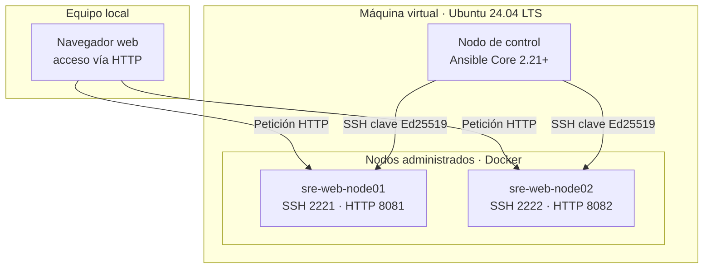

# Especialización SRE Linux v2.0

## Clase 1: Ansible Fundamentals & Configuration as Code

<p align="center">
  
  
  
  
</p>

<p align="center">
  
  
  
  
</p>

---

## Descripción general

Esta clase abre la especialización con los fundamentos de **Ansible**, la herramienta de automatización agentless más utilizada en operaciones de infraestructura moderna. El enfoque es completamente práctico: cada concepto se valida con comandos reales sobre servidores Linux, sin depender de cuentas cloud ni de costos de proveedores externos.

Trabajarás sobre un laboratorio autocontenido, construido con contenedores Docker efímeros que actúan como nodos administrados, mientras tu máquina virtual cumple el rol de nodo de control.

Al finalizar la sesión vas a poder:

- Explicar por qué Ansible no necesita agentes instalados en los nodos administrados y cómo resuelve esto usando SSH y Python.
- Estructurar un inventario (`inventory.ini`) y un archivo de configuración (`ansible.cfg`) con claves SSH aisladas del resto del sistema.
- Ejecutar comandos ad-hoc para auditar recursos en varios servidores al mismo tiempo.
- Comprobar en la práctica qué significa la idempotencia y por qué es central en la filosofía de Ansible.
- Escribir un playbook en YAML usando la sintaxis moderna FQCN (`ansible.builtin.*`).
- Renderizar plantillas dinámicas con Jinja2, inyectando variables de grupo y datos recogidos automáticamente de cada host.

---

## Arquitectura del laboratorio

El laboratorio evita cualquier dependencia externa: todo corre dentro de una sola máquina virtual Ubuntu 24.04 LTS, usando Docker para simular dos servidores remotos independientes.



El nodo de control se comunica con cada contenedor mediante claves SSH tipo Ed25519, aisladas exclusivamente para este laboratorio. Cada nodo expone además un puerto HTTP propio, lo que permite verificar visualmente el resultado del aprovisionamiento apenas se ejecuta el playbook.

---

## Flujo de trabajo de la clase

```mermaid
flowchart LR
    A["Levantar nodos<br/>Docker"] --> B["Verificar conectividad<br/>ansible.builtin.ping"]
    B --> C["Auditoría ad-hoc<br/>kernel y RAM"]
    C --> D["Escribir site.yml<br/>FQCN"]
    D --> E["Validar sintaxis<br/>--syntax-check"]
    E --> F["Simular ejecución<br/>--check"]
    F --> G["Aprovisionar Nginx<br/>real"]
    G --> H["Refactorizar con<br/>group_vars y Jinja2"]
    H --> I["Dashboard dinámico<br/>por servidor"]
```



Este recorrido reproduce el ciclo de trabajo real de un ingeniero SRE frente a Ansible: primero se valida la conexión, luego se prueba en modo simulación, y solo después se aplica el cambio sobre la infraestructura.

---

## Contenido de la clase

La sesión está dividida en tres ejercicios de treinta minutos cada uno, pensados para avanzar de lo más simple a lo más completo.

### Ejercicio 1 · Conexión y comandos ad-hoc

Se levantan los dos nodos administrados (`sre-web-node01` y `sre-web-node02`) usando Docker. Se verifica la conectividad con `ansible all -m ansible.builtin.ping` y se realiza una primera auditoría de recursos (kernel, memoria RAM). También se demuestra la idempotencia creando directorios de log y repitiendo la misma tarea varias veces sin que el estado del sistema cambie de forma indebida.

### Ejercicio 2 · Primer playbook y servidor web Nginx

Se construye el playbook declarativo `site.yml`, que aprovisiona un servidor Nginx utilizando módulos con nomenclatura FQCN (`ansible.builtin.apt`, `ansible.builtin.service`). Antes de aplicar cualquier cambio se valida la sintaxis con `--syntax-check` y se simula la ejecución con `--check`, confirmando que el playbook es idempotente.

### Ejercicio 3 · Refactorización con Jinja2 y variables

Las variables se organizan por grupo en `group_vars/webservers/vars.yml`. A partir de allí se construye una plantilla `templates/index.j2` que genera un dashboard HTML5 con estilos propios. El módulo `ansible.builtin.template` inyecta datos dinámicos en tiempo real, incluyendo información recogida automáticamente por Ansible como `ansible_facts['hostname']`, de modo que cada servidor termina mostrando una página personalizada.

---

## Estructura del repositorio

| Archivo o carpeta | Descripción |
|---|---|
| `RUNBOOK.md` | Guía paso a paso con todos los comandos y explicaciones técnicas de la clase. |
| `Dockerfile` | Receta para construir la imagen Ubuntu 24.04 LTS con SSH habilitado. |
| `ansible.cfg` | Configuración global del comportamiento de Ansible. |
| `inventory.ini` | Definición de hosts, puertos de gestión y grupos de trabajo. |
| `site.yml` | Playbook principal de aprovisionamiento. |
| `group_vars/` | Variables centralizadas organizadas por grupo del inventario. |
| `templates/` | Plantillas `.j2` que se compilan de forma dinámica. |
| `cleanup.sh` | Script para destruir el laboratorio y liberar espacio en disco. |

---

## Requisitos previos

- Sistema operativo Ubuntu 24.04 LTS, o una máquina virtual equivalente.
- Docker Engine instalado y en ejecución.
- Conocimientos básicos de línea de comandos Linux: navegación de directorios, permisos y uso de SSH.

---

## Limpieza del entorno

Cuando termines la clase y quieras liberar los recursos utilizados en la máquina virtual, ejecuta el script de limpieza:

```bash
./cleanup.sh
```

Esto detiene y elimina los contenedores del laboratorio, además de liberar el espacio en disco asociado.

---

<p align="center">
  Desarrollado para la Especialización SRE Linux v2.0
</p>

