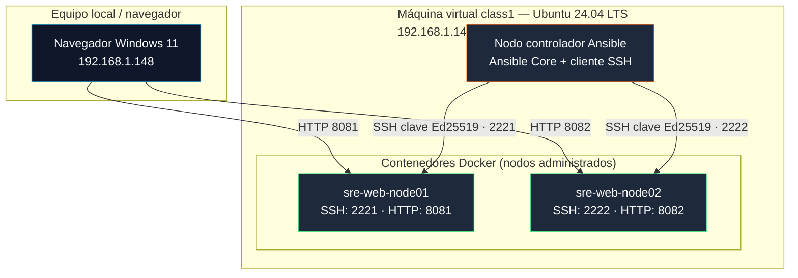

# Runbook: Ansible Fundamentals & Configuration as Code

**Especialización SRE Linux — Nivel inicial a intermedio**

[](https://www.ansible.com/)
[](https://ubuntu.com/)
[](https://www.python.org/)
[](https://www.docker.com/)
[](#)

---

## Tabla de contenidos

1. [Visión general del curso](#visión-general-del-curso)
2. [Preguntas de contexto](#preguntas-de-contexto)
3. [Arquitectura del laboratorio](#arquitectura-del-laboratorio)
4. [Estructura de directorios](#estructura-de-directorios)
5. [Fase 1: Preparación del nodo controlador](#fase-1-preparación-del-nodo-controlador)
6. [Fase 2: Construcción del laboratorio Docker](#fase-2-construcción-del-laboratorio-docker)
7. [Fase 3: Archivos de configuración de Ansible](#fase-3-archivos-de-configuración-de-ansible)
8. [Ejercicio 1: Conexión y comandos ad-hoc](#ejercicio-1-conexión-y-comandos-ad-hoc)
9. [Ejercicio 2: Primer playbook con Nginx](#ejercicio-2-primer-playbook-con-nginx)
10. [Ejercicio 3: Plantillas dinámicas con Jinja2](#ejercicio-3-plantillas-dinámicas-con-jinja2)
11. [Fase 4: Script de limpieza](#fase-4-script-de-limpieza)
12. [Resumen y reglas de oro](#resumen-y-reglas-de-oro)

---

## Visión general del curso

Este runbook contiene la guía de ejecución paso a paso para la clase práctica de automatización con Ansible. Se trabaja bajo un enfoque práctico: cada comando se ejecuta, se observa el resultado y se explica el porqué. El objetivo es que el estudiante quede en condiciones de aprovisionar, configurar y auditar infraestructura Linux de forma declarativa e idempotente.

### Preguntas de contexto

**¿Por qué Ansible y no Puppet o Chef?**

| Criterio | Ansible |
|---|---|
| Arquitectura | Agentless. No requiere demonios ni clientes en los servidores administrados; la comunicación es 100% SSH nativo más intérprete de Python. |
| Curva de aprendizaje | Sintaxis declarativa en YAML, legible sin entrenamiento previo. |
| Idempotencia | Ejecutar una tarea una o cien veces entrega el mismo estado final, sin corromper servicios. |

**¿Cómo se relacionan Terraform y Ansible?**

| Herramienta | Responsabilidad |
|---|---|
| Terraform (IaC) | Aprovisiona la infraestructura pesada: máquinas virtuales, VPCs, subredes, storage. |
| Ansible (CaC) | Gestiona la configuración interna del sistema operativo una vez que la máquina ya existe: instala software, aplica plantillas, administra usuarios y servicios. |

---

## Arquitectura del laboratorio

El laboratorio corre sobre una máquina virtual Ubuntu 24.04 LTS alojada en VirtualBox, con red en modo puente. El acceso web se realiza exponiendo puertos desde los contenedores Docker hacia la IP del hipervisor.



El flujo de trabajo general de la clase sigue esta secuencia:


---

## Estructura de directorios

Todos los archivos del curso quedan organizados dentro del directorio de trabajo `/home/gmt/ansible-class/`:

```text
/home/gmt/ansible-class/
├── Dockerfile                  # Receta de la imagen de los nodos de laboratorio
├── ansible.cfg                 # Configuración global de Ansible
├── inventory.ini               # Inventario de hosts, puertos y variables
├── site.yml                    # Playbook de aprovisionamiento
├── cleanup.sh                  # Script de destrucción y limpieza
├── group_vars/
│   └── webservers/
│       └── vars.yml            # Variables del grupo [webservers]
└── templates/
    └── index.j2                # Plantilla HTML5 procesada con Jinja2
```

---

## Fase 1: Preparación del nodo controlador

**Tiempo estimado: 15 minutos**

Se instalan las dependencias del sistema y se genera un par de claves SSH dedicado exclusivamente a este proyecto.

### Paso 1.1 — Instalar paquetes base

```bash
sudo apt update && sudo apt install -y python3 docker.io curl ansible
```

| Paquete | Función |
|---|---|
| `python3` | Intérprete requerido para procesar los módulos de Ansible. |
| `docker.io` | Motor de virtualización liviana para los contenedores del laboratorio. |
| `curl` | Cliente HTTP para verificar respuestas web localmente. |
| `ansible` | Paquete del sistema que provee los ejecutables de `ansible-core`. |

### Paso 1.2 — Verificar la versión instalada

```bash
ansible --version
```

Objetivo: confirmar que se está usando `ansible-core` 2.21 o superior, sobre Python 3.12+.

### Paso 1.3 — Generar una clave SSH dedicada

Por buenas prácticas de SRE, se aíslan las credenciales generando una clave con nombre propio, `id_ansible_lab`, en lugar de reutilizar la clave personal del usuario.

```bash
test -f ~/.ssh/id_ansible_lab || ssh-keygen -t ed25519 -N "" -f ~/.ssh/id_ansible_lab
```

| Parámetro | Detalle |
|---|---|
| `-t ed25519` | Algoritmo de firma asimétrica Ed25519, más rápido y seguro que RSA. |
| `-N ""` | Sin frase de paso, para permitir automatización desatendida. |
| `-f ~/.ssh/id_ansible_lab` | Ruta y nombre específico del archivo de clave. |

### Paso 1.4 — Verificar las claves generadas

```bash
ls -l ~/.ssh/id_ansible_lab*
```

Debe listar el par de archivos: `id_ansible_lab` (privada) e `id_ansible_lab.pub` (pública).

---

## Fase 2: Construcción del laboratorio Docker

**Tiempo estimado: 25 minutos**

Se construyen y levantan dos contenedores Linux, inyectando la clave pública durante la construcción de la imagen.

### Paso 2.1 — Crear el directorio de trabajo y el Dockerfile

```bash
mkdir -p ~/ansible-class && cd ~/ansible-class

# Guardar el contenido de la clave pública en una variable
KEY_CONTENT=$(cat ~/.ssh/id_ansible_lab.pub)

# Crear el Dockerfile inyectando la clave
cat << EOF > Dockerfile
FROM ubuntu:24.04

RUN apt update && apt install -y openssh-server python3 sudo curl && \
    mkdir -p /var/run/sshd /root/.ssh && \
    chmod 700 /root/.ssh && \
    echo "$KEY_CONTENT" > /root/.ssh/authorized_keys && \
    chmod 600 /root/.ssh/authorized_keys && \
    echo 'PermitRootLogin yes' >> /etc/ssh/sshd_config

EXPOSE 22 80
CMD ["/usr/sbin/sshd", "-D"]
EOF
```

**Detalle técnico del Dockerfile:**

- `chmod 700 /root/.ssh`: otorga permisos de lectura, escritura y ejecución únicamente al propietario del directorio; es un requisito estricto de OpenSSH.
- `chmod 600 /root/.ssh/authorized_keys`: restringe la lectura y escritura al propietario, evitando la exposición de claves.
- `PermitRootLogin yes`: habilita la autenticación SSH del usuario root mediante clave autorizada.

### Paso 2.2 — Construir la imagen

```bash
docker build -t sre-node:24.04 .
```

Compila la receta declarada en el `Dockerfile` y etiqueta la imagen resultante como `sre-node:24.04`.

### Paso 2.3 — Levantar los contenedores

```bash
# Limpieza preventiva
docker rm -f sre-web-node01 sre-web-node02 2>/dev/null

# Nodo 1
docker run -d --name sre-web-node01 \
  -p 2221:22 \
  -p 8081:80 \
  sre-node:24.04

# Nodo 2
docker run -d --name sre-web-node02 \
  -p 2222:22 \
  -p 8082:80 \
  sre-node:24.04
```

| Contenedor | Puerto host SSH | Puerto contenedor SSH | Puerto host HTTP | Puerto contenedor HTTP |
|---|---|---|---|---|
| `sre-web-node01` | 2221 | 22 | 8081 | 80 |
| `sre-web-node02` | 2222 | 22 | 8082 | 80 |

### Paso 2.4 — Verificar el estado de los contenedores

```bash
docker ps --format "table {{.Names}}\t{{.Status}}\t{{.Ports}}"
```

### Paso 2.5 — Limpiar known_hosts y probar la conexión

Se eliminan registros previos en `known_hosts` para evitar bloqueos por cambio de firma digital.

```bash
ssh-keygen -f ~/.ssh/known_hosts -R '[127.0.0.1]:2221' -R '[127.0.0.1]:2222' 2>/dev/null
```

Prueba de conexión directa:

```bash
ssh -i ~/.ssh/id_ansible_lab -o StrictHostKeyChecking=no -o UserKnownHostsFile=/dev/null -p 2221 root@127.0.0.1 "hostname -I"
ssh -i ~/.ssh/id_ansible_lab -o StrictHostKeyChecking=no -o UserKnownHostsFile=/dev/null -p 2222 root@127.0.0.1 "hostname -I"
```

---

## Fase 3: Archivos de configuración de Ansible

**Tiempo estimado: 15 minutos**

### Paso 3.1 — Crear el inventario (`inventory.ini`)

```ini
[webservers]
sre-web-node01 ansible_host=127.0.0.1 ansible_port=2221
sre-web-node02 ansible_host=127.0.0.1 ansible_port=2222

[all:vars]
ansible_python_interpreter=/usr/bin/python3
```

| Directiva | Función |
|---|---|
| `[webservers]` | Grupo de trabajo que reúne los nodos web. |
| `ansible_host` | Dirección de red a la que conecta Ansible. |
| `ansible_port` | Puerto SSH mapeado para cada contenedor. |
| `ansible_python_interpreter` | Fuerza el uso de Python 3 en el nodo administrado. |

### Paso 3.2 — Crear la configuración global (`ansible.cfg`)

```ini
[defaults]
inventory = ./inventory.ini
host_key_checking = False
remote_user = root
private_key_file = ~/.ssh/id_ansible_lab
interpreter_python = auto_silent
```

| Directiva | Función |
|---|---|
| `host_key_checking = False` | Desactiva la confirmación interactiva de firmas SSH. |
| `private_key_file` | Ruta explícita a la clave privada creada en la Fase 1. |

---

## Ejercicio 1: Conexión y comandos ad-hoc

**Tiempo estimado: 15 minutos**

### Paso 4.1 — Probar conectividad con el módulo ping

```bash
ansible all -m ansible.builtin.ping
```

Se utiliza el nombre completo de colección (`ansible.builtin.ping`) siguiendo las convenciones actuales de Ansible. La respuesta esperada muestra `"ping": "pong"` en color verde.

### Paso 4.2 — Ejecutar comandos de auditoría

```bash
# Consultar la versión del kernel
ansible webservers -m ansible.builtin.command -a "uname -r"

# Consultar el uso de memoria RAM
ansible webservers -m ansible.builtin.command -a "free -h"
```

### Paso 4.3 — Demostración de idempotencia

```bash
# Primera ejecución: crea el directorio (estado CHANGED)
ansible webservers -m ansible.builtin.file -a "path=/var/log/app_sre state=directory mode='0755'"

# Segunda ejecución: el estado ya existe (estado OK)
ansible webservers -m ansible.builtin.file -a "path=/var/log/app_sre state=directory mode='0755'"
```

---

## Ejercicio 2: Primer playbook con Nginx

**Tiempo estimado: 25 minutos**

### Paso 5.1 — Crear el playbook (`site.yml`)

```yaml
---
- name: Aprovisionamiento de Infraestructura Web SRE
  hosts: webservers
  gather_facts: true

  tasks:
    - name: Actualizar la cache de paquetes APT
      ansible.builtin.apt:
        update_cache: true
        cache_valid_time: 3600

    - name: Instalar el servidor web Nginx
      ansible.builtin.apt:
        name: nginx
        state: present

    - name: Personalizar la pagina web de bienvenida
      ansible.builtin.copy:
        content: "<h1>Servidor {{ ansible_facts['hostname'] }} provisionado con Ansible FQCN - SRE 2026</h1>\n"
        dest: /var/www/html/index.html
        owner: www-data
        group: www-data
        mode: '0644'

    - name: Asegurar que el servicio Nginx este iniciado
      ansible.builtin.service:
        name: nginx
        state: started
```

| Elemento | Descripción |
|---|---|
| `gather_facts: true` | Recopila las variables internas del sistema objetivo. |
| `ansible_facts['hostname']` | Sintaxis de mapa de datos, sin advertencias de obsolescencia. |

### Paso 5.2 — Validar sintaxis y ejecutar

```bash
# Comprobar sintaxis
ansible-playbook site.yml --syntax-check

# Ejecutar
ansible-playbook site.yml
```

### Paso 5.3 — Verificar idempotencia con --check

```bash
ansible-playbook site.yml --check
```

El resultado esperado es `changed=0`, confirmando que no existen desviaciones respecto a la configuración declarada.

### Paso 5.4 — Verificación desde el navegador

Con la IP asignada a la máquina virtual:

- Nodo 1: `http://192.168.1.148:8081`
- Nodo 2: `http://192.168.1.148:8082`

---

## Ejercicio 3: Plantillas dinámicas con Jinja2

**Tiempo estimado: 25 minutos**

Se refactoriza el proyecto incorporando una plantilla HTML5 dinámica y organizando las variables en directorios dedicados.

### Paso 6.1 — Crear los directorios estándar

```bash
mkdir -p templates group_vars/webservers
```

### Paso 6.2 — Crear el archivo de variables de grupo

```yaml
# group_vars/webservers/vars.yml
---
site_title: "Dashboard SRE Linux - 2026"
site_message: "Servidor Web Aprovisionado Exitosamente"
site_author: "Mentoria SRE - Ansible Expert"
```

### Paso 6.3 — Crear la plantilla Jinja2 (`templates/index.j2`)

```html
<!DOCTYPE html>
<html lang="es">
<head>
    <meta charset="UTF-8">
    <title>{{ site_title }}</title>
    <style>
        body { font-family: 'Segoe UI', Tahoma, Geneva, Verdana, sans-serif; margin: 0; padding: 40px; background: #0f172a; color: #f8fafc; }
        .card { max-width: 700px; margin: 0 auto; background: #1e293b; border-radius: 12px; padding: 30px; box-shadow: 0 10px 25px rgba(0,0,0,0.5); border: 1px solid #334155; }
        h1 { color: #38bdf8; margin-top: 0; font-size: 26px; border-bottom: 2px solid #334155; padding-bottom: 10px; }
        .info-group { margin: 15px 0; background: #0f172a; padding: 12px 18px; border-radius: 8px; border-left: 4px solid #38bdf8; }
        .label { font-weight: bold; color: #94a3b8; font-size: 14px; text-transform: uppercase; }
        .value { font-size: 18px; color: #f1f5f9; margin-top: 4px; font-family: monospace; }
        .badge { display: inline-block; background: #166534; color: #4ade80; padding: 4px 12px; border-radius: 20px; font-size: 12px; font-weight: bold; }
        .footer { margin-top: 25px; text-align: center; font-size: 13px; color: #64748b; border-top: 1px solid #334155; padding-top: 15px; }
    </style>
</head>
<body>
    <div class="card">
        <h1>{{ site_message }} <span class="badge">SRE ONLINE</span></h1>

        <div class="info-group">
            <div class="label">Identificador de servidor (hostname)</div>
            <div class="value">{{ ansible_facts['hostname'] }}</div>
        </div>

        <div class="info-group">
            <div class="label">Direccion IP remota registrada</div>
            <div class="value">{{ ansible_facts['default_ipv4']['address'] | default('127.0.0.1') }}</div>
        </div>

        <div class="info-group">
            <div class="label">Sistema operativo y distribucion</div>
            <div class="value">{{ ansible_facts['distribution'] }} {{ ansible_facts['distribution_version'] }} ({{ ansible_facts['architecture'] }})</div>
        </div>

        <div class="info-group">
            <div class="label">Version de Python en el nodo target</div>
            <div class="value">{{ ansible_facts['python_version'] }}</div>
        </div>

        <div class="footer">
            Automatizado con Ansible FQCN — {{ site_author }} - 2026
        </div>
    </div>
</body>
</html>
```

### Paso 6.4 — Refactorizar `site.yml` usando el módulo template

```yaml
---
- name: Aprovisionamiento Web Dinamico SRE
  hosts: webservers
  gather_facts: true

  tasks:
    - name: Instalar el servidor web Nginx
      ansible.builtin.apt:
        name: nginx
        state: present

    - name: Desplegar pagina web dinamica usando Plantilla Jinja2
      ansible.builtin.template:
        src: templates/index.j2
        dest: /var/www/html/index.html
        owner: www-data
        group: www-data
        mode: '0644'

    - name: Asegurar que el servicio Nginx este iniciado
      ansible.builtin.service:
        name: nginx
        state: started
```

### Paso 6.5 — Aplicar el playbook y validar en el navegador

```bash
ansible-playbook site.yml
```

Al refrescar el navegador:

- `http://192.168.1.148:8081` muestra el dashboard con los datos del Nodo 1 (`sre-web-node01`).
- `http://192.168.1.148:8082` muestra el dashboard con los datos del Nodo 2 (`sre-web-node02`).

---

## Fase 4: Script de limpieza

Para dejar la máquina libre de recursos y evitar errores en futuras ejecuciones, se crea un script de limpieza.

### Paso 7.1 — Crear `cleanup.sh`

```bash
cat << 'EOF' > cleanup.sh
#!/bin/bash
echo "Iniciando limpieza del laboratorio de Ansible..."

# Detener y borrar contenedores
docker rm -f sre-web-node01 sre-web-node02 2>/dev/null

# Eliminar imagen Docker local
docker rmi sre-node:24.04 2>/dev/null

# Limpiar huellas SSH temporales
ssh-keygen -f ~/.ssh/known_hosts -R '[127.0.0.1]:2221' 2>/dev/null
ssh-keygen -f ~/.ssh/known_hosts -R '[127.0.0.1]:2222' 2>/dev/null

echo "Laboratorio destruido y entorno limpio correctamente."
EOF

chmod +x cleanup.sh
```

### Paso 7.2 — Ejecutar la limpieza

Cuando se desee reiniciar el laboratorio o cerrar la clase:

```bash
./cleanup.sh
```

---

## Resumen y reglas de oro

### Comandos frecuentes

| Objetivo | Comando |
|---|---|
| Comprobar conectividad | `ansible all -m ansible.builtin.ping` |
| Ejecutar comando ad-hoc | `ansible webservers -m ansible.builtin.command -a "free -h"` |
| Simular playbook (dry-run) | `ansible-playbook site.yml --check` |

### Reglas para producción

- Usar siempre nombres completos de colección (FQCN): por ejemplo, `ansible.builtin.apt` en lugar de `apt`.
- Usar el formato de mapa para acceder a variables del sistema: `ansible_facts['hostname']` en lugar de la sintaxis antigua con punto.
- Aislar las claves de acceso: nunca reutilizar la misma clave SSH en distintos entornos de trabajo.

---

*Runbook elaborado para la especialización SRE Linux. Contenido pensado para ejecutarse de forma guiada, verificando cada paso antes de avanzar al siguiente.*

