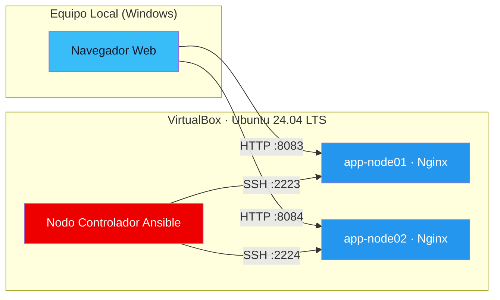
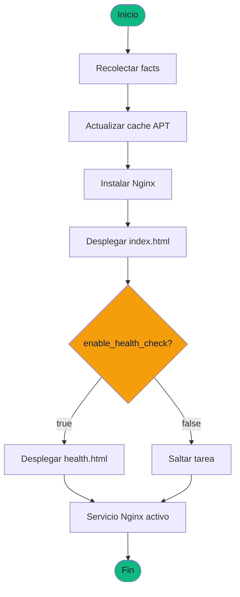

# Runbook: Aprovisionamiento Web y Endpoint de Monitoreo


## Sobre este taller

Les voy a guiar paso a paso en la construcción de un entorno de aprovisionamiento web con monitoreo básico. Vamos a levantar dos nodos administrados sobre Docker, y escribiré con ustedes un playbook declarativo e idempotente, usando la nomenclatura completa de colecciones (`ansible.builtin.*`).

Trabajaremos sobre Ubuntu Server 24.04 LTS, dentro de una máquina virtual.

## Arquitectura del laboratorio



## Estructura del proyecto

Antes de escribir código, así vamos a organizar el directorio `~/desafio-ansible/`:

```
desafio-ansible/
├── Dockerfile
├── ansible.cfg
├── inventory.ini
├── deploy.yml
├── cleanup.sh
├── group_vars/
│   └── webservers/
│       └── vars.yml
└── templates/
    ├── index.j2
    └── health.j2
```

---

## Fase 1 · Preparación del entorno de control

### 1.1 Directorio y llaves SSH dedicadas

Uso una clave exclusiva para este laboratorio, para no mezclar credenciales con mis llaves personales. Elijo Ed25519 por su rendimiento y robustez frente a RSA.

```bash
mkdir -p ~/desafio-ansible && cd ~/desafio-ansible

test -f ~/.ssh/id_desafio_ansible || ssh-keygen -t ed25519 -N "" -f ~/.ssh/id_desafio_ansible
```

### 1.2 Dockerfile con la clave inyectada

```bash
KEY_CONTENT=$(cat ~/.ssh/id_desafio_ansible.pub)

cat << EOF > Dockerfile
FROM ubuntu:24.04

RUN apt update && apt install -y openssh-server python3 sudo curl && \
    mkdir -p /var/run/sshd /root/.ssh && \
    chmod 700 /root/.ssh && \
    echo "$KEY_CONTENT" > /root/.ssh/authorized_keys && \
    chmod 600 /root/.ssh/authorized_keys && \
    echo 'PermitRootLogin yes' >> /etc/ssh/sshd_config

EXPOSE 22 80
CMD ["/usr/sbin/sshd", "-D"]
EOF
```

> **Ojo con los permisos.** OpenSSH exige `700` en `.ssh` y `600` en `authorized_keys`. Si no respetan esto, rechaza la conexión por seguridad.

### 1.3 Construcción de la imagen y arranque de nodos

```bash
docker build -t desafio-node:24.04 .

docker rm -f app-node01 app-node02 2>/dev/null

docker run -d --name app-node01 -p 2223:22 -p 8083:80 desafio-node:24.04
docker run -d --name app-node02 -p 2224:22 -p 8084:80 desafio-node:24.04
```

| Contenedor | Puerto SSH | Puerto HTTP |
|---|---|---|
| app-node01 | 2223 | 8083 |
| app-node02 | 2224 | 8084 |

### 1.4 Limpieza de huellas SSH y prueba de acceso

```bash
ssh-keygen -f ~/.ssh/known_hosts -R '[127.0.0.1]:2223' -R '[127.0.0.1]:2224' 2>/dev/null

ssh -i ~/.ssh/id_desafio_ansible -o StrictHostKeyChecking=no -o UserKnownHostsFile=/dev/null -p 2223 root@127.0.0.1 "hostname -I"
ssh -i ~/.ssh/id_desafio_ansible -o StrictHostKeyChecking=no -o UserKnownHostsFile=/dev/null -p 2224 root@127.0.0.1 "hostname -I"
```

Si ambos comandos devuelven la IP interna sin pedir contraseña, la capa de autenticación está lista.

---

## Fase 2 · Inventario y parámetros globales

### 2.1 Inventario (`inventory.ini`)

```bash
cat << 'EOF' > inventory.ini
[webservers]
app-node01 ansible_host=127.0.0.1 ansible_port=2223
app-node02 ansible_host=127.0.0.1 ansible_port=2224

[all:vars]
ansible_python_interpreter=/usr/bin/python3
EOF
```

### 2.2 Configuración global (`ansible.cfg`)

```bash
cat << 'EOF' > ansible.cfg
[defaults]
inventory = ./inventory.ini
host_key_checking = False
remote_user = root
private_key_file = ~/.ssh/id_desafio_ansible
interpreter_python = auto_silent
EOF
```

`host_key_checking = False` evita la validación interactiva de llaves, algo ideal en laboratorios con contenedores efímeros.

### 2.3 Verificación de conectividad

```bash
ansible all -m ansible.builtin.ping
```

La respuesta `"pong"` confirma que Ansible se conectó por SSH y ejecutó Python remoto con éxito.

---

## Fase 3 · Variables y plantillas Jinja2

```bash
mkdir -p templates group_vars/webservers
```

### 3.1 Variables de grupo (`group_vars/webservers/vars.yml`)

```bash
cat << 'EOF' > group_vars/webservers/vars.yml
---
environment_name: "Staging"
app_owner: "SRE Student Team"
enable_health_check: true
EOF
```

### 3.2 Plantilla principal (`templates/index.j2`)

```bash
cat << 'EOF' > templates/index.j2
<!DOCTYPE html>
<html lang="es">
<head>
    <meta charset="UTF-8">
    <title>App - {{ environment_name }}</title>
    <style>
        body { font-family: Arial, sans-serif; margin: 40px; background: #0f172a; color: #f8fafc; }
        .box { background: #1e293b; padding: 25px; border-radius: 10px; border: 1px solid #334155; }
        h1 { color: #38bdf8; }
    </style>
</head>
<body>
    <div class="box">
        <h1>Aplicacion Web [Ambiente: {{ environment_name }}]</h1>
        <p><strong>Servidor Objetivo:</strong> {{ ansible_facts['hostname'] }}</p>
        <p><strong>IP Registrada:</strong> {{ ansible_facts['default_ipv4']['address'] | default('127.0.0.1') }}</p>
        <p><strong>Equipo Responsable:</strong> {{ app_owner }}</p>
    </div>
</body>
</html>
EOF
```

### 3.3 Plantilla de monitoreo (`templates/health.j2`)

```bash
cat << 'EOF' > templates/health.j2
<!DOCTYPE html>
<html lang="es">
<head>
    <meta charset="UTF-8">
    <title>Health Check</title>
    <style>
        body { font-family: monospace; padding: 20px; background: #111827; color: #10b981; }
        .status { font-size: 20px; font-weight: bold; }
    </style>
</head>
<body>
    <div class="status">STATUS: UP / HEALTHY</div>
    <hr>
    <p>Host: {{ ansible_facts['hostname'] }}</p>
    <p>Memoria Libre: {{ ansible_facts['memfree_mb'] }} MB</p>
    <p>Timestamp Evaluacion: {{ ansible_facts['date_time']['iso8601'] }}</p>
</body>
</html>
EOF
```

---

## Fase 4 · Playbook de aprovisionamiento

### 4.1 El playbook (`deploy.yml`)

Presten atención a la directiva `when:`, que controla la ejecución condicional según el valor de nuestras variables.

```bash
cat << 'EOF' > deploy.yml
---
- name: Desafio de Aprovisionamiento Web y Monitoreo SRE
  hosts: webservers
  gather_facts: true

  tasks:
    - name: Actualizar la cache de APT
      ansible.builtin.apt:
        update_cache: true
        cache_valid_time: 3600

    - name: Instalar el servidor Nginx
      ansible.builtin.apt:
        name: nginx
        state: present

    - name: Desplegar pagina principal index.html
      ansible.builtin.template:
        src: templates/index.j2
        dest: /var/www/html/index.html
        owner: www-data
        group: www-data
        mode: '0644'

    - name: Desplegar endpoint de salud /health.html
      ansible.builtin.template:
        src: templates/health.j2
        dest: /var/www/html/health.html
        owner: www-data
        group: www-data
        mode: '0644'
      when: enable_health_check | default(false)

    - name: Asegurar servicio Nginx activo
      ansible.builtin.service:
        name: nginx
        state: started
EOF
```

### 4.2 Flujo de ejecución del playbook



### 4.3 Validar sintaxis y ejecutar

```bash
ansible-playbook deploy.yml --syntax-check
ansible-playbook deploy.yml
```

Van a ver tareas marcadas como `changed`: confirma que Ansible aplicó cambios reales sobre los contenedores.

### 4.4 Comprobar idempotencia

La prueba definitiva de un buen código de infraestructura es volver a ejecutarlo sin cambios:

```bash
ansible-playbook deploy.yml --check
```

Si el `PLAY RECAP` muestra `changed=0`, el estado real coincide exactamente con lo declarado.

---

## Validación de servicios y endpoints

```bash
curl -s http://127.0.0.1:8083 | grep "Aplicacion Web"
curl -s http://127.0.0.1:8084 | grep "Aplicacion Web"

curl -s http://127.0.0.1:8083/health.html | grep "STATUS:"
curl -s http://127.0.0.1:8084/health.html | grep "STATUS:"
```

Desde el navegador, con la IP asignada a la VM (ejemplo `192.168.1.148`):

| Servicio | URL |
|---|---|
| Página Nodo 1 | http://192.168.1.148:8083 |
| Health Nodo 1 | http://192.168.1.148:8083/health.html |
| Página Nodo 2 | http://192.168.1.148:8084 |
| Health Nodo 2 | http://192.168.1.148:8084/health.html |

---

## Limpieza del entorno

Al terminar, destruyo los recursos efímeros con este script:

```bash
cat << 'EOF' > cleanup.sh
#!/bin/bash
echo "Iniciando limpieza del entorno..."

docker rm -f app-node01 app-node02 2>/dev/null
docker rmi desafio-node:24.04 2>/dev/null

ssh-keygen -f ~/.ssh/known_hosts -R '[127.0.0.1]:2223' 2>/dev/null
ssh-keygen -f ~/.ssh/known_hosts -R '[127.0.0.1]:2224' 2>/dev/null

echo "Entorno destruido y limpio correctamente."
EOF

chmod +x cleanup.sh
```

```bash
./cleanup.sh
```

---


