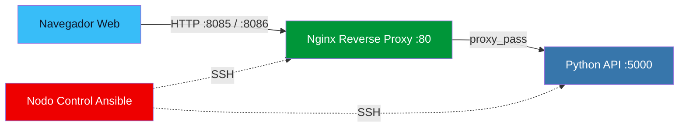
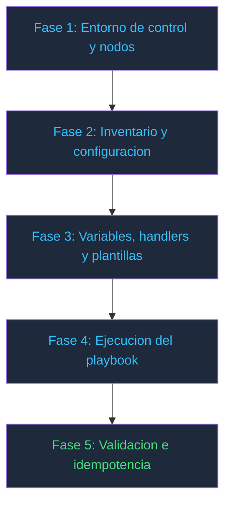

# Runbook: Reverse Proxy Nginx + Microservicio Backend Python con Ansible


---

## Presentación del workshop

Hola a todos. En esta sesión vamos a desplegar una arquitectura de dos capas sobre Ubuntu Server 24.04 LTS.

Vamos a configurar un **Nginx como Reverse Proxy** en el puerto 80, que reenvía el tráfico a un **microservicio Python** que escucha en el puerto 5000. Todo esto lo automatizamos con Ansible, usando plantillas Jinja2, variables de grupo y handlers.

---

## Flujo de tráfico



---

## Orden lógico de las fases



**Por qué este orden:**

1. No hay automatización posible sin servidores objetivo ni llaves SSH.
2. Ansible necesita saber a qué IPs conectarse y con qué parámetros globales.
3. Hay que preparar variables y plantillas antes de renderizarlas.
4. Se ejecutan las tareas en orden: carpetas, archivos, backend Python, luego Nginx.
5. Se valida que el servicio responda y que el playbook sea idempotente.

---

## Estructura final del proyecto

```
~/sre-linux-mastery/Fase3/Workshop_3_ansible/
├── Dockerfile
├── ansible.cfg
├── inventory.ini
├── site.yml
├── cleanup.sh
├── group_vars/
│   └── webservers/
│       └── vars.yml
├── handlers/
│   └── main.yml
└── templates/
    ├── app_backend.py.j2
    ├── index.html.j2
    └── nginx_proxy.conf.j2
```

---

## Fase 1 — Entorno de control y nodos objetivo

**Objetivo:** crear dos servidores de prueba aislados usando contenedores Docker que simulan Ubuntu 24.04 LTS.

### Paso 1.1 — Carpeta de trabajo y llaves SSH

```bash
mkdir -p ~/sre-linux-mastery/Fase3/Workshop_3_ansible
cd ~/sre-linux-mastery/Fase3/Workshop_3_ansible

test -f ~/.ssh/id_lab2_ansible || ssh-keygen -t ed25519 -N "" -f ~/.ssh/id_lab2_ansible
```

Genera un par de llaves Ed25519 sin contraseña, dedicadas al laboratorio, para no comprometer llaves personales o de producción.

### Paso 1.2 — Imagen Docker de los nodos

```bash
KEY_CONTENT=$(cat ~/.ssh/id_lab2_ansible.pub)

cat << EOF > Dockerfile
FROM ubuntu:24.04

RUN apt update && apt install -y openssh-server python3 python3-pip sudo curl nginx && \
    mkdir -p /var/run/sshd /root/.ssh && \
    chmod 700 /root/.ssh && \
    echo "$KEY_CONTENT" > /root/.ssh/authorized_keys && \
    chmod 600 /root/.ssh/authorized_keys && \
    echo 'PermitRootLogin yes' >> /etc/ssh/sshd_config

EXPOSE 22 80 5000
CMD ["/usr/sbin/sshd", "-D"]
EOF
```

Inyecta la llave pública en la imagen, instala SSH, Python 3 y Nginx. Los permisos `700` en `.ssh` y `600` en `authorized_keys` son obligatorios para OpenSSH; sin ellos la conexión se rechaza.

### Paso 1.3 — Construcción y despliegue de contenedores

```bash
docker build -t lab2-node:24.04 .

docker rm -f sre-app-node01 sre-app-node02 2>/dev/null

docker run -d --name sre-app-node01 -p 2225:22 -p 8085:80 lab2-node:24.04
docker run -d --name sre-app-node02 -p 2226:22 -p 8086:80 lab2-node:24.04
```

| Contenedor | Puerto SSH en host | Puerto HTTP en host |
|---|---|---|
| sre-app-node01 | 2225 | 8085 |
| sre-app-node02 | 2226 | 8086 |

### Paso 1.4 — Limpieza de firmas y prueba de conexión

```bash
ssh-keygen -f ~/.ssh/known_hosts -R '[127.0.0.1]:2225' -R '[127.0.0.1]:2226' 2>/dev/null

ssh -i ~/.ssh/id_lab2_ansible -o StrictHostKeyChecking=no -o UserKnownHostsFile=/dev/null -p 2225 root@127.0.0.1 "hostname -I"
ssh -i ~/.ssh/id_lab2_ansible -o StrictHostKeyChecking=no -o UserKnownHostsFile=/dev/null -p 2226 root@127.0.0.1 "hostname -I"
```

Elimina firmas SSH previas para evitar bloqueos y confirma que la capa de red y autenticación está lista antes de usar Ansible.

---

## Fase 2 — Inventario y configuración global

**Objetivo:** indicarle a Ansible dónde están los servidores y qué reglas globales aplicar.

### Paso 2.1 — Inventario (`inventory.ini`)

```bash
cat << 'EOF' > inventory.ini
[webservers]
sre-app-node01 ansible_host=127.0.0.1 ansible_port=2225
sre-app-node02 ansible_host=127.0.0.1 ansible_port=2226

[all:vars]
ansible_python_interpreter=/usr/bin/python3
EOF
```

### Paso 2.2 — Configuración global (`ansible.cfg`)

```bash
cat << 'EOF' > ansible.cfg
[defaults]
inventory = ./inventory.ini
host_key_checking = False
remote_user = root
private_key_file = ~/.ssh/id_lab2_ansible
interpreter_python = auto_silent
EOF
```

Deshabilita la confirmación manual de huellas SSH y define usuario y llave privada por defecto.

### Paso 2.3 — Validar conectividad

```bash
ansible all -m ansible.builtin.ping
```

Resultado esperado: respuesta `"ping": "pong"` en ambos nodos.

---

## Fase 3 — Variables, handlers y plantillas Jinja2

**Objetivo:** separar datos fijos del playbook y desacoplar el diseño mediante plantillas.

### Paso 3.1 — Carpetas

```bash
mkdir -p templates group_vars/webservers handlers
```

### Paso 3.2 — Variables de grupo (`group_vars/webservers/vars.yml`)

```bash
cat << 'EOF' > group_vars/webservers/vars.yml
---
app_port: 5000
app_name: "SRE Microservice Backend"
app_directory: "/opt/sre_app"
nginx_server_name: "sre-proxy.local"
EOF
```

### Paso 3.3 — Handlers (`handlers/main.yml`)

```bash
cat << 'EOF' > handlers/main.yml
---
- name: Recargar Nginx
  ansible.builtin.service:
    name: nginx
    state: reloaded

- name: Reiniciar Nginx
  ansible.builtin.service:
    name: nginx
    state: restarted
EOF
```

Un handler solo se dispara cuando una tarea previa lo notifica (`notify`). Esto evita reinicios de servicio innecesarios.

### Paso 3.4 — Interfaz web (`templates/index.html.j2`)

```bash
cat << 'EOF' > templates/index.html.j2
<!DOCTYPE html>
<html lang="es">
<head>
    <meta charset="UTF-8">
    <meta name="viewport" content="width=device-width, initial-scale=1.0">
    <title>{{ app_name }}</title>
    <style>
        * { box-sizing: border-box; margin: 0; padding: 0; }
        body {
            font-family: 'Segoe UI', system-ui, -apple-system, sans-serif;
            background: #0f172a;
            color: #f8fafc;
            display: flex;
            justify-content: center;
            align-items: center;
            min-height: 100vh;
            padding: 20px;
        }
        .card {
            background: #1e293b;
            border-radius: 16px;
            padding: 35px;
            max-width: 650px;
            width: 100%;
            box-shadow: 0 20px 25px -5px rgba(0, 0, 0, 0.5);
            border: 1px solid #334155;
        }
        .header {
            display: flex;
            justify-content: space-between;
            align-items: center;
            border-bottom: 2px solid #334155;
            padding-bottom: 20px;
            margin-bottom: 25px;
        }
        .title { font-size: 22px; font-weight: 700; color: #38bdf8; }
        .badge {
            background: #166534;
            color: #4ade80;
            padding: 6px 14px;
            border-radius: 20px;
            font-size: 13px;
            font-weight: 700;
            border: 1px solid #22c55e;
        }
        .grid { display: grid; gap: 16px; }
        .info-item {
            background: #0f172a;
            padding: 16px;
            border-radius: 10px;
            border-left: 4px solid #38bdf8;
        }
        .label { font-size: 12px; color: #94a3b8; text-transform: uppercase; font-weight: 600; }
        .value { font-size: 18px; color: #f1f5f9; font-family: monospace; margin-top: 6px; font-weight: 600; }
        .footer {
            margin-top: 25px;
            text-align: center;
            font-size: 13px;
            color: #64748b;
            border-top: 1px solid #334155;
            padding-top: 15px;
        }
    </style>
</head>
<body>
    <div class="card">
        <div class="header">
            <div class="title">{{ app_name }}</div>
            <div class="badge">SYSTEM ONLINE</div>
        </div>
        <div class="grid">
            <div class="info-item">
                <div class="label">Identificador del Nodo (Hostname)</div>
                <div class="value">{{ ansible_facts['hostname'] }}</div>
            </div>
            <div class="info-item">
                <div class="label">Direccion IP Interna del Contenedor</div>
                <div class="value">{{ ansible_facts['default_ipv4']['address'] | default('127.0.0.1') }}</div>
            </div>
            <div class="info-item">
                <div class="label">Motor Backend Exec-Engine</div>
                <div class="value">Python 3 HTTP Server (Reverse Proxy Nginx)</div>
            </div>
        </div>
        <div class="footer">
            Infraestructura Aprovisionada con <strong>Ansible Automation</strong> — SRE 2026
        </div>
    </div>
</body>
</html>
EOF
```

Usa datos dinámicos de los `ansible_facts` (hostname e IP) para mostrar de qué nodo viene la respuesta.

### Paso 3.5 — Backend Python (`templates/app_backend.py.j2`)

```bash
cat << 'EOF' > templates/app_backend.py.j2
import http.server
import socketserver
import json
import os

PORT = {{ app_port }}

class SREHandler(http.server.SimpleHTTPRequestHandler):
    def do_GET(self):
        if self.path == '/api/json':
            self.send_response(200)
            self.send_header("Content-type", "application/json")
            self.end_headers()
            payload = {
                "service": "{{ app_name }}",
                "hostname": "{{ ansible_facts['hostname'] }}",
                "ip_address": "{{ ansible_facts['default_ipv4']['address'] | default('127.0.0.1') }}",
                "status": "HEALTHY"
            }
            self.wfile.write(json.dumps(payload, indent=2).encode('utf-8'))
            return

        self.send_response(200)
        self.send_header("Content-type", "text/html; charset=utf-8")
        self.end_headers()

        index_path = "/opt/sre_app/index.html"
        if os.path.exists(index_path):
            with open(index_path, "rb") as f:
                self.wfile.write(f.read())
        else:
            self.wfile.write(b"<h1>Error: index.html no encontrado</h1>")

socketserver.TCPServer.allow_reuse_address = True
with socketserver.TCPServer(("", PORT), SREHandler) as httpd:
    httpd.serve_forever()
EOF
```

Atiende peticiones en el puerto 5000. La ruta `/api/json` entrega un JSON de estado; la raíz entrega el `index.html`. `allow_reuse_address = True` evita bloqueos del puerto al reiniciar.

### Paso 3.6 — Reverse Proxy Nginx (`templates/nginx_proxy.conf.j2`)

```bash
cat << 'EOF' > templates/nginx_proxy.conf.j2
server {
    listen 80;
    server_name {{ nginx_server_name }};

    location / {
        proxy_pass http://127.0.0.1:{{ app_port }};
        proxy_set_header Host $host;
        proxy_set_header X-Real-IP $remote_addr;
        proxy_set_header X-Forwarded-For $proxy_add_x_forwarded_for;
    }

    location /health {
        default_type application/json;
        return 200 '{"proxy_status": "UP", "target_node": "{{ ansible_facts['hostname'] }}"}';
    }
}
EOF
```

Escucha en el puerto 80 y reenvía todo hacia `127.0.0.1:5000`, agregando las cabeceras de proxy estándar.

---

## Fase 4 — Playbook principal (`site.yml`)

```bash
cat << 'EOF' > site.yml
---
- name: Aprovisionamiento de Reverse Proxy y Microservicio Backend SRE
  hosts: webservers
  gather_facts: true

  handlers:
    - import_tasks: handlers/main.yml

  tasks:
    - name: Crear directorio para la aplicacion backend
      ansible.builtin.file:
        path: "{{ app_directory }}"
        state: directory
        owner: www-data
        group: www-data
        mode: '0755'

    - name: Desplegar script backend en Python
      ansible.builtin.template:
        src: templates/app_backend.py.j2
        dest: "{{ app_directory }}/app.py"
        owner: www-data
        group: www-data
        mode: '0755'

    - name: Desplegar interfaz HTML
      ansible.builtin.template:
        src: templates/index.html.j2
        dest: "{{ app_directory }}/index.html"
        owner: www-data
        group: www-data
        mode: '0644'

    - name: Iniciar aplicacion Backend Python
      ansible.builtin.shell: "python3 {{ app_directory }}/app.py > {{ app_directory }}/app.log 2>&1 &"
      async: 10
      poll: 0

    - name: Configurar sitio Nginx Reverse Proxy
      ansible.builtin.template:
        src: templates/nginx_proxy.conf.j2
        dest: /etc/nginx/sites-available/sre_proxy.conf
        owner: root
        group: root
        mode: '0644'
      notify: Recargar Nginx

    - name: Habilitar el sitio en Nginx (Enlace Simbolico)
      ansible.builtin.file:
        src: /etc/nginx/sites-available/sre_proxy.conf
        dest: /etc/nginx/sites-enabled/sre_proxy.conf
        state: link
      notify: Recargar Nginx

    - name: Deshabilitar el sitio default de Nginx
      ansible.builtin.file:
        path: /etc/nginx/sites-enabled/default
        state: absent
      notify: Recargar Nginx

    - name: Asegurar que Nginx esta activo
      ansible.builtin.service:
        name: nginx
        state: started
EOF
```

**Sobre la tarea clave `Iniciar aplicacion Backend Python`:** usa `async: 10` y `poll: 0`. Esto le dice a Ansible que lance el proceso Python en segundo plano y libere la sesión SSH de inmediato, sin esperar a que el proceso termine. Así el servidor Python queda corriendo en el puerto 5000 sin bloquear el resto del playbook.

---

## Fase 5 — Ejecución, verificación e idempotencia

### Paso 5.1 — Chequeo de sintaxis

```bash
ansible-playbook site.yml --syntax-check
```

### Paso 5.2 — Ejecución del despliegue

```bash
ansible-playbook site.yml
```

En esta primera corrida, las tareas aparecen en `changed`, confirmando que Ansible creó carpetas, desplegó archivos e inició los servicios.

### Paso 5.3 — Validar idempotencia

```bash
ansible-playbook site.yml --check
```


El `PLAY RECAP` de la segunda corrida debe mostrar `changed=0`. Esto confirma que la infraestructura ya está en el estado deseado y que el playbook no hace cambios innecesarios.

### Paso 5.4 — Pruebas de servicio

```bash
# Interfaz del Nodo 01
curl -s http://127.0.0.1:8085 | grep "SRE Microservice Backend"

# Interfaz del Nodo 02
curl -s http://127.0.0.1:8086 | grep "SRE Microservice Backend"

# Endpoint API en JSON
curl -s http://127.0.0.1:8085/api/json
```

Si abren en el navegador `http://127.0.0.1:8085` y `http://127.0.0.1:8086`, van a ver la interfaz oscura mostrando el hostname y la IP de cada contenedor.

---

## Limpieza del entorno

```bash
cat << 'EOF' > cleanup.sh
#!/bin/bash
echo "Iniciando limpieza del workshop..."

docker rm -f sre-app-node01 sre-app-node02 2>/dev/null
docker rmi lab2-node:24.04 2>/dev/null

ssh-keygen -f ~/.ssh/known_hosts -R '[127.0.0.1]:2225' 2>/dev/null
ssh-keygen -f ~/.ssh/known_hosts -R '[127.0.0.1]:2226' 2>/dev/null

echo "Entorno limpio y libre de recursos."
EOF

chmod +x cleanup.sh
./cleanup.sh
```

---

## Cierre

Completamos la automatización de un Reverse Proxy Nginx conectado a un backend Python. Aplicamos separación de variables, plantillas Jinja2, handlers y una tarea asíncrona, respetando siempre la idempotencia del playbook.

