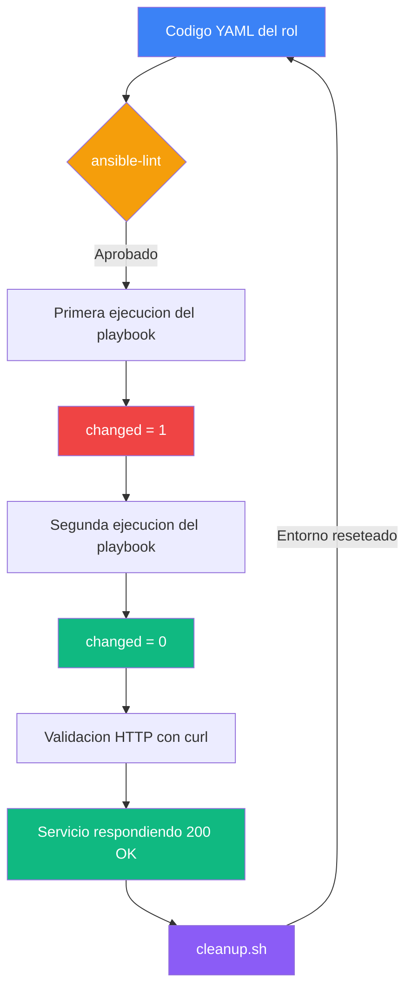
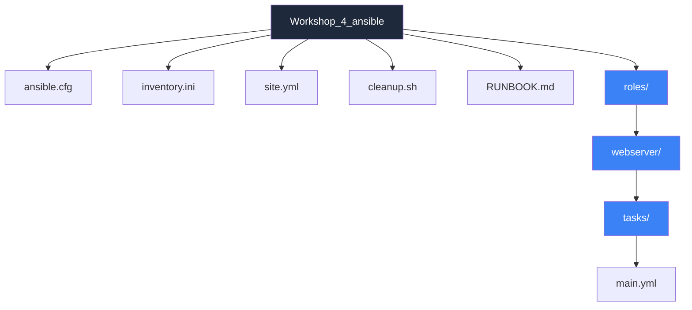
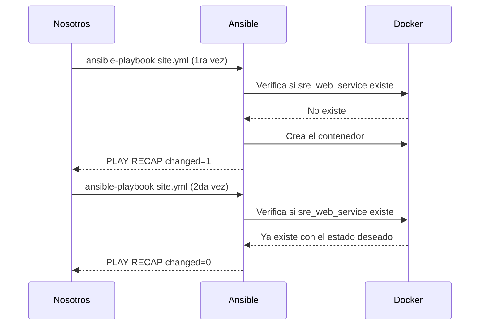

# RUNBOOK — Workshop 4: Automatización y Configuration as Code con Ansible


---

## 1. Qué vamos a lograr en este taller

Aquí les voy a mostrar la diferencia entre ejecutar comandos sueltos y trabajar bajo el paradigma de **Configuration as Code (CaC)**. Nuestro trabajo como SRE no es lanzar comandos uno por uno, sino garantizar que la infraestructura llegue a un estado deseado, de forma repetible y sin sorpresas. Eso es la idempotencia, y la vamos a comprobar con nuestras propias manos.

### Flujo completo del laboratorio



---

## 2. Componentes que vamos a usar

| Componente | Versión requerida | Para qué la usamos |
|---|---|---|
| Ubuntu Linux | 24.04 LTS (WSL2) | Sistema base donde trabajamos |
| Docker Engine | 29.x o CE oficial | Simula la infraestructura como contenedor |
| Ansible Core | 2.21+ | Motor de automatización |
| Ansible Lint | 26.x+ | Revisa que el código cumpla buenas prácticas |
| Collection community.docker | última estable | Le da a Ansible los módulos para hablar con Docker |

---

## 3. Fase 1 — Preparar el entorno base

Con esto instalamos todo lo que necesitamos y dejamos a nuestro usuario operando Docker sin pedir privilegios cada vez.

```bash
# Actualizar repositorios e instalar paquetes principales
sudo apt update && sudo apt install -y docker-ce docker-ce-cli containerd.io docker-buildx-plugin docker-compose-plugin python3-pip git

# Iniciar el servicio de Docker
sudo service docker start

# Agregar nuestro usuario al grupo docker
sudo usermod -aG docker $USER
newgrp docker

# Instalar Ansible y su linter
pip install ansible ansible-lint --break-system-packages

# Instalar la coleccion para administrar contenedores
ansible-galaxy collection install community.docker
```

---

## 4. Fase 2 — Construir la estructura del proyecto

Nos ubicamos en el directorio del taller:

```bash
cd ~/sre-linux-mastery/Fase3/Workshop_4_ansible
```

### Estructura final que vamos a construir



### 4.1 Motor de Ansible — `ansible.cfg`

Define dónde está el inventario, cómo se ve la salida y evita advertencias del intérprete de Python.

```bash
cat << 'EOF' > ansible.cfg
[defaults]
inventory = inventory.ini
host_key_checking = False
stdout_callback = default
interpreter_python = auto_silent

[callback_default]
result_format = yaml
EOF
```

### 4.2 Inventario local — `inventory.ini`

Le decimos a Ansible que va a trabajar sobre esta misma máquina, sin SSH.

```bash
cat << 'EOF' > inventory.ini
[local]
localhost ansible_connection=local
EOF
```

### 4.3 Rol declarativo — `roles/webserver/tasks/main.yml`

Aquí describimos el estado deseado, no los pasos. Le decimos a Ansible qué queremos que exista, y él se encarga de lograrlo.

```bash
mkdir -p roles/webserver/tasks

cat << 'EOF' > roles/webserver/tasks/main.yml
---
- name: Garantizar estado activo del servicio Docker
  ansible.builtin.service:
    name: docker
    state: started

- name: Desplegar contenedor Nginx (Estado Deseado - CaC)
  community.docker.docker_container:
    name: sre_web_service
    image: nginx:alpine
    state: started
    restart_policy: always
    published_ports:
      - "8080:80"
EOF
```

### 4.4 Playbook principal — `site.yml`

Este es el punto de entrada que llama a nuestro rol.

```bash
cat << 'EOF' > site.yml
---
- name: Workshop 4 - Aprovisionamiento e Idempotencia CaC
  hosts: local
  gather_facts: false
  roles:
    - role: webserver
EOF
```

---

## 5. Fase 3 — Control de calidad

Antes de aplicar cualquier cambio real, validamos que nuestro código cumpla el estándar de producción:

```bash
ansible-lint site.yml
```

Resultado que deben ver:

```
Passed: 0 failure(s), 0 warning(s) in 2 files processed of 2 encountered. Last profile that met the validation criteria was 'production'.
```

---

## 6. Fase 4 — Ejecución y prueba de idempotencia

Esta es la parte central del taller. Vamos a correr el mismo playbook dos veces y comparar resultados.



### 6.1 Primera ejecución

```bash
ansible-playbook site.yml
```

Aquí el contenedor no existe todavía, así que Ansible hace el trabajo. Fíjense en el PLAY RECAP: `changed=1` significa que se crearon recursos.

### 6.2 Segunda ejecución — la prueba real de idempotencia

```bash
ansible-playbook site.yml
```

Corremos exactamente el mismo comando. Ansible revisa el estado actual, ve que ya coincide con lo declarado, y no toca nada. `changed=0` es la prueba de que nuestra configuración es estable y repetible.

---

## 7. Fase 5 — Validar que el servicio responde

Comprobamos que el contenedor está sirviendo tráfico en el puerto 8080:

```bash
curl -I http://localhost:8080
```

Respuesta esperada:

```
HTTP/1.1 200 OK
Server: nginx/1.31.3
Content-Type: text/html
```

---

## 8. Fase 6 — Reiniciar el laboratorio

Si quieren repetir el taller desde cero, sin residuos del intento anterior, este script hace toda la limpieza:

```bash
cat << 'EOF' > cleanup.sh
#!/usr/bin/env bash
set -e

echo "[SRE CLEANUP] Iniciando restablecimiento del entorno..."

# Detener y remover el contenedor de prueba si existe
if [ $(docker ps -a -q -f name=sre_web_service) ]; then
    echo "[DOCKER] Removiendo contenedor sre_web_service..."
    docker rm -f sre_web_service
else
    echo "[DOCKER] No existe el contenedor sre_web_service."
fi

# Limpieza de cache y archivos temporales de Ansible
echo "[ANSIBLE] Eliminando archivos temporales y caches..."
rm -rf .ansible .ansible_retry *.retry __pycache__

echo "[SRE CLEANUP] Entorno restablecido a estado inicial. Listo para reejecutar el taller."
EOF

chmod +x cleanup.sh
```

Y para ejecutarlo:

```bash
./cleanup.sh
```

---

## 9. Mapa de archivos del proyecto

| Archivo | Para qué sirve |
|---|---|
| `ansible.cfg` | Ajusta el comportamiento y la salida del motor Ansible |
| `inventory.ini` | Define sobre qué máquina se ejecuta todo |
| `site.yml` | Playbook de entrada que invoca el rol `webserver` |
| `roles/webserver/tasks/main.yml` | Lógica de aprovisionamiento del contenedor Nginx |
| `cleanup.sh` | Resetea el entorno para repetir el taller |
| `RUNBOOK.md` | Esta guía |

---

## 10. Verificación final

Corran esto para confirmar que todo quedó en su lugar:

```bash
./cleanup.sh
tree
```

Estructura esperada:

```
.
├── roles
│   └── webserver
│       └── tasks
│           └── main.yml
├── ansible.cfg
├── cleanup.sh
├── inventory.ini
├── RUNBOOK.md
└── site.yml
```

Si esa es la salida que ven, el taller quedó listo para correrse desde cero cuantas veces quieran.

