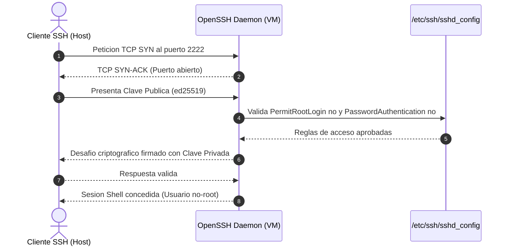
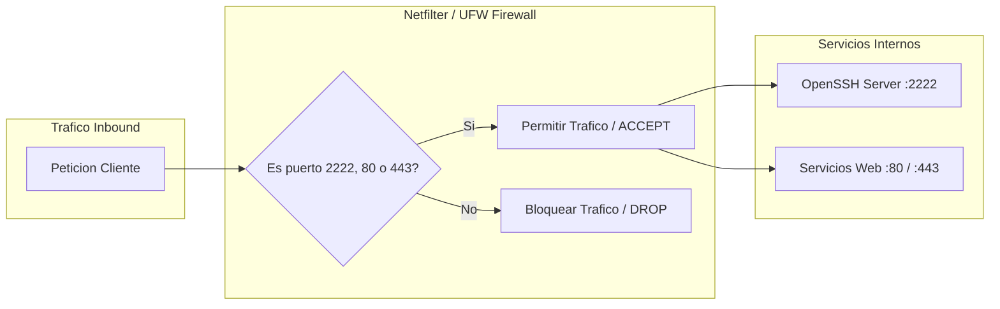
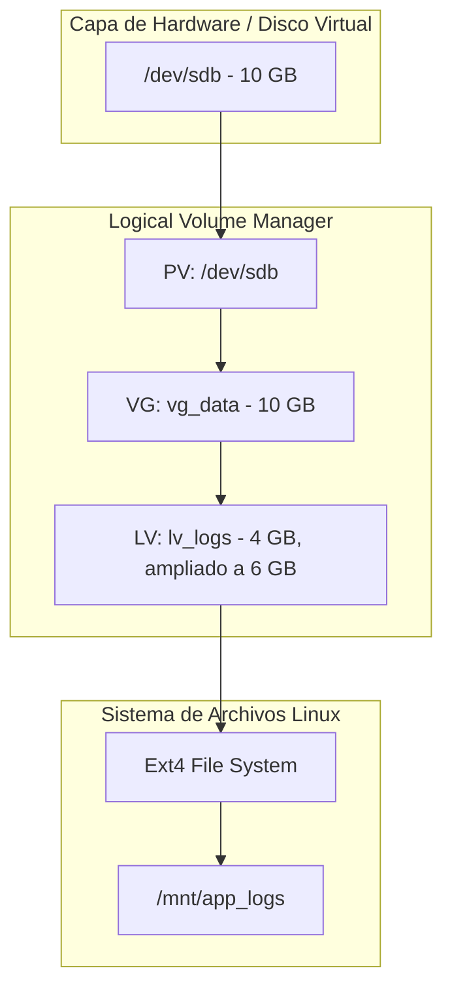
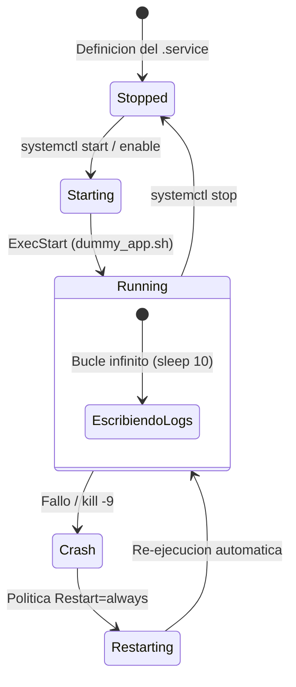
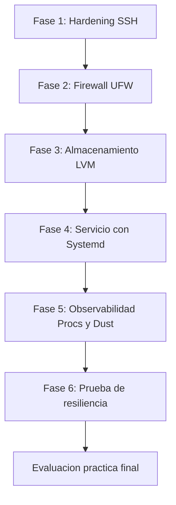

# Runbook de Laboratorio: Administración Avanzada de Linux y Fundamentos SRE


---

## Bienvenida al workshop

Este runbook es la guía oficial del laboratorio práctico de Administración Avanzada de Linux y Fundamentos SRE. Está pensado para que lo sigas paso a paso, en tu propia máquina virtual, sin saltarte fases: cada una construye sobre la anterior y al final vas a tener un servidor endurecido, con almacenamiento flexible, un servicio propio corriendo bajo `systemd`, y las herramientas de observabilidad para diagnosticarlo todo.

No hace falta que memorices nada. La idea es que entiendas qué hace cada comando y por qué se usa, para que puedas explicarlo con tus propias palabras al final del taller.

### Información del documento

| Campo | Detalle |
|---|---|
| **Dirigido a** | Estudiantes de Administración de Sistemas, DevOps e Ingeniería SRE |
| **Objetivo** | Desarrollar competencias operativas en entornos Linux enterprise: seguridad, gestión de almacenamiento, automatización de demonios y observabilidad moderna |
| **Entorno de trabajo** | Máquina virtual con Ubuntu Server 24.04 LTS, acceso de consola inicial y red configurada |
| **Duración estimada** | 3 a 4 horas |
| **Modalidad** | Individual, con máquina virtual propia por estudiante |

### Requisitos previos

Antes de arrancar, verifica que tienes lo siguiente:

- Una máquina virtual con **Ubuntu Server 24.04 LTS** ya instalada y con acceso de consola (por ejemplo, desde VirtualBox, VMware o tu hipervisor de preferencia).
- Acceso de consola local con un usuario que tenga privilegios de `sudo`, al menos para el arranque inicial.
- Un segundo disco virtual de 10 GB conectado a la VM (lo vamos a usar recién en la Fase 3, para LVM).
- Una máquina anfitriona (tu notebook o PC) con un cliente SSH disponible.
- Conectividad de red entre tu equipo y la VM.

### Cómo está organizado este laboratorio

El taller avanza en seis fases, cada una con su propio objetivo y sus propias validaciones:

1. **Fase 1** — Bastionado del servicio SSH y gestión de acceso.
2. **Fase 2** — Configuración de red y filtrado con UFW.
3. **Fase 3** — Almacenamiento flexible con LVM.
4. **Fase 4** — Automatización de servicios con `systemd`.
5. **Fase 5** — Diagnóstico y observabilidad con herramientas modernas.
6. **Fase 6** — Pruebas de resiliencia y evaluación final.

Cada paso incluye el comando exacto a ejecutar, una explicación de qué hace, por qué se usa en un contexto real de producción, y el resultado que deberías ver en tu terminal. Si en algún punto tu salida no coincide con la esperada, detente ahí y revisa antes de seguir avanzando: los errores de configuración en SSH o en `/etc/fstab` pueden dejarte fuera del sistema.

---

## Fase 1: Bastionado del servicio SSH (Hardening) y gestión de acceso

**Objetivo de la fase:** asegurar la puerta de entrada al servidor eliminando los vectores de ataque por fuerza bruta más comunes.

### Contexto técnico

Por defecto, OpenSSH escucha en el puerto TCP 22 y permite la autenticación mediante contraseña. Los atacantes escanean de forma continua bloques de IP públicas buscando este puerto abierto para lanzar ataques de fuerza bruta.

Esta fase aplica dos principios fundamentales de seguridad recomendados por NIST SP 800-123: **reducción de la superficie de ataque**, cambiando el puerto predeterminado, y **autenticación fuerte e inalterable**, basada en pares de claves criptográficas asimétricas.

### Diagrama de flujo de la autenticación SSH



### Paso 1.1 — Creación del usuario administrador y delegación de privilegios

Ejecuta en la VM:

```bash
sudo adduser adminstudent
```

**Qué hace:** crea un nuevo usuario en el sistema, genera su directorio personal (`/home/adminstudent`), le asigna la shell `/bin/bash` por defecto y solicita la creación de una contraseña.

**Por qué se usa:** administrar un sistema directamente como `root` elimina la trazabilidad de las acciones y aumenta el riesgo de cometer errores destructivos de forma involuntaria. Trabajar con un usuario nominal y `sudo` deja registro de quién hizo qué.

**Resultado esperado:** un prompt pidiendo la contraseña y los datos del perfil, y la confirmación de que se creó `/home/adminstudent`.

```bash
sudo usermod -aG sudo adminstudent
```

**Qué hace:** agrega (`-a`, de *append*) al usuario `adminstudent` al grupo secundario (`-G`) llamado `sudo`.

**Por qué se usa:** los miembros del grupo `sudo` en Ubuntu pueden ejecutar comandos con privilegios elevados autenticándose con su propia contraseña, y esto queda auditado en los registros de `pam_sudo`.

**Resultado esperado:** la terminal vuelve al prompt sin mensajes de error.

### Paso 1.2 — Generación e instalación del par de claves SSH asimétricas

> Importante: este paso se ejecuta desde tu máquina anfitriona (tu notebook o PC), no desde la VM.

```bash
ssh-keygen -t ed25519 -C "lab-sre-key"
```

**Qué hace:** genera un par de claves criptográficas, una privada y una pública, usando el algoritmo de curva elíptica Ed25519.

**Por qué se usa:** Ed25519 ofrece mayor seguridad con claves más cortas y un procesamiento más rápido que el clásico RSA de 2048 o 4096 bits.

**Resultado esperado:** dos archivos nuevos en `~/.ssh/`: `id_ed25519` (clave privada) e `id_ed25519.pub` (clave pública).

```bash
ssh-copy-id -i ~/.ssh/id_ed25519.pub adminstudent@<IP_DE_LA_VM>
```

**Qué hace:** se conecta a la VM y copia el contenido del archivo `.pub` dentro de `~/.ssh/authorized_keys` del usuario `adminstudent`, con los permisos POSIX correctos (`600`).

**Por qué se usa:** automatiza el despliegue de la clave pública, evitando el riesgo de configurar mal los permisos de los archivos de autenticación de OpenSSH.

**Resultado esperado:** un mensaje confirmando `Number of key(s) added: 1`.

### Paso 1.3 — Modificación del archivo de configuración del demonio `sshd`

```bash
sudo vi /etc/ssh/sshd_config.d/50-cloud-init.conf
```

**Qué hace:** abre el editor `vi` para modificar el archivo de inclusión modular del servicio OpenSSH en Ubuntu Server 24.04 LTS.

**Por qué se usa:** `vi` está presente en prácticamente cualquier servidor Linux. Editamos dentro de `/etc/ssh/sshd_config.d/` en lugar del archivo principal `/etc/ssh/sshd_config` para que las actualizaciones del sistema no sobrescriban nuestros cambios.

**Guía rápida de edición en `vi`:**

1. Presiona `i` para entrar en modo inserción.
2. Agrega o modifica los valores que necesites.
3. Presiona `Esc` para volver al modo comando.
4. Escribe `:wq` y presiona `Enter` para guardar y salir.

**Parámetros a incluir dentro del archivo:**

```text
Port 2222
PermitRootLogin no
PasswordAuthentication no
PubkeyAuthentication yes
MaxAuthTries 3
```

**Explicación línea por línea:**

- `Port 2222`: mueve el puerto de escucha del estándar 22 a un puerto alternativo, para reducir el ruido en los logs generado por escáneres automáticos.
- `PermitRootLogin no`: bloquea cualquier intento de inicio de sesión directo con el usuario `root` a través de la red.
- `PasswordAuthentication no`: desactiva el inicio de sesión con contraseña tradicional, obligando al uso de claves SSH.
- `PubkeyAuthentication yes`: habilita formalmente la validación mediante clave pública.
- `MaxAuthTries 3`: define el máximo de intentos fallidos de autenticación por conexión antes de cerrar el socket.

### Paso 1.4 — Validación sintáctica y reinicio del servicio

```bash
sudo sshd -t
```

**Qué hace:** analiza la sintaxis completa de los archivos de configuración de `sshd`, sin aplicar cambios ni reiniciar el proceso.

**Por qué se usa:** evita dejar el servidor inaccesible por un error tipográfico en la configuración. Este paso es obligatorio antes de reiniciar el servicio.

**Resultado esperado:** si la configuración está correcta, el comando no muestra mensajes y devuelve un código de salida `0`.

```bash
sudo systemctl restart sshd
```

**Qué hace:** reinicia el demonio OpenSSH para cargar las nuevas directivas.

**Por qué se usa:** los demonios en Linux leen su configuración solamente al iniciar, o cuando reciben una señal explícita de recarga (`SIGHUP`).

**Resultado esperado:** el servicio se reinicia en segundo plano sin interrumpir tu sesión SSH activa.

> Checkpoint de la fase 1: antes de seguir, abre una terminal nueva y confirma que puedes conectarte con `ssh -p 2222 adminstudent@<IP_DE_LA_VM>` usando tu clave. No cierres la sesión que ya tienes abierta hasta confirmarlo.

---

## Fase 2: Configuración de red y filtrado con UFW

**Objetivo de la fase:** aplicar el principio de mínimo privilegio en la capa de transporte, exponiendo únicamente los puertos que el servidor realmente necesita.

### Contexto técnico

El filtrado de red a nivel de host garantiza que la máquina virtual exponga exclusivamente los sockets necesarios para cumplir sus funciones. Ubuntu Server utiliza **UFW** (*Uncomplicated Firewall*) como interfaz simplificada para administrar la infraestructura de `netfilter`/`nftables` del kernel Linux.

### Diagrama de la arquitectura de filtrado de red



### Paso 2.1 — Establecimiento de políticas por defecto

```bash
sudo ufw default deny incoming
```

**Qué hace:** configura la política predeterminada del firewall para descartar cualquier paquete entrante hacia la interfaz de red.

**Por qué se usa:** implementa una postura de seguridad de confianza cero. Todo tráfico entrante que no se autorice explícitamente queda bloqueado.

**Resultado esperado:** `Default incoming policy changed to 'deny'`.

```bash
sudo ufw default allow outgoing
```

**Qué hace:** permite que todo paquete generado por el sistema salga libremente hacia la red.

**Por qué se usa:** el servidor necesita descargar paquetes, actualizar el sistema operativo y sincronizar tiempo por NTP sin bloqueos salientes en este entorno de laboratorio.

**Resultado esperado:** `Default outgoing policy changed to 'allow'`.

### Paso 2.2 — Apertura de puertos específicos y habilitación del servicio

```bash
sudo ufw allow 2222/tcp comment 'SSH Custom Port'
```

**Qué hace:** inserta una regla explícita en la cadena de `nftables` que permite el tráfico entrante en el puerto TCP 2222, con una etiqueta descriptiva.

**Por qué se usa:** habilita el acceso de administración SSH que configuramos en la Fase 1.

> Atención: si no ejecutas este paso antes de activar UFW, vas a perder el acceso al servidor.

```bash
sudo ufw allow 80/tcp comment 'HTTP'
sudo ufw allow 443/tcp comment 'HTTPS'
```

**Qué hace:** habilita el tráfico entrante para HTTP (puerto 80) y HTTPS (puerto 443).

**Por qué se usa:** deja la máquina virtual preparada para alojar aplicaciones web o funcionar como punto de terminación TLS en laboratorios futuros.

**Resultado esperado:** confirmación de que se agregaron las reglas para IPv4 e IPv6.

```bash
sudo ufw enable
```

**Qué hace:** activa la infraestructura de filtrado de UFW y la habilita para iniciarse automáticamente en cada arranque del sistema.

**Por qué se usa:** aplica las reglas en el kernel en tiempo real.

**Resultado esperado:** `Firewall is active and enabled on system startup`.

```bash
sudo ufw status verbose
```

**Qué hace:** imprime el estado operativo del firewall, la política por defecto y el listado detallado de todas las reglas activas.

**Por qué se usa:** te permite auditar que las reglas declaradas coincidan con lo que realmente necesitas.

**Resultado esperado:** una tabla mostrando el estado `active`, las políticas base y la lista de puertos TCP permitidos.

> Checkpoint de la fase 2: verifica con `sudo ufw status verbose` que solo aparecen habilitados los puertos 2222, 80 y 443. Si ves el puerto 22 abierto, revisa el orden en que ejecutaste los comandos.

---

## Fase 3: Almacenamiento flexible con LVM (Logical Volume Manager)

**Objetivo de la fase:** aislar particiones y administrar el espacio en disco de forma dinámica, sin depender del tamaño fijo de un disco físico.

### Contexto técnico

Las aplicaciones y servicios generan logs de forma continua. Si un directorio como `/var` o `/mnt` está montado sobre la partición raíz (`/`) y esta se llena por completo, el sistema operativo puede colapsar.

**LVM** resuelve este problema abstrayendo los discos físicos en una capa lógica flexible, dividida en tres niveles:

1. **Physical Volume (PV):** el disco físico o partición cruda.
2. **Volume Group (VG):** la agrupación de uno o más PV en un pool global de almacenamiento.
3. **Logical Volume (LV):** las particiones lógicas creadas dentro del VG, sobre las cuales se instala un sistema de archivos como `ext4`.

### Diagrama de la estructura LVM



### Paso 3.1 — Inicialización del volumen físico y creación del grupo de volúmenes

> Requisito: haber agregado un segundo disco virtual `/dev/sdb` de 10 GB a la VM desde el hipervisor, antes de continuar.

```bash
sudo pvcreate /dev/sdb
```

**Qué hace:** escribe las estructuras de metadatos de LVM al inicio del dispositivo `/dev/sdb`.

**Por qué se usa:** convierte el disco crudo en un Physical Volume reconocible por la subcapa LVM del kernel.

**Resultado esperado:** `Physical volume "/dev/sdb" successfully created.`

```bash
sudo vgcreate vg_data /dev/sdb
```

**Qué hace:** crea un Volume Group llamado `vg_data`, asociando el PV `/dev/sdb` recién inicializado.

**Por qué se usa:** agrupa los recursos de almacenamiento físico en un único pool virtual unificado.

**Resultado esperado:** `Volume group "vg_data" successfully created`.

### Paso 3.2 — Creación, formateo y montaje del volumen lógico

```bash
sudo lvcreate -L 4G -n lv_logs vg_data
```

**Qué hace:** asigna 4 GB del pool `vg_data` para crear un Logical Volume llamado `lv_logs`.

**Por qué se usa:** reserva un espacio delimitado, exclusivo para el almacenamiento de logs.

**Resultado esperado:** `Logical volume "lv_logs" created.`

```bash
sudo mkfs.ext4 /dev/vg_data/lv_logs
```

**Qué hace:** construye la estructura del sistema de archivos `ext4` (tablas de inodos, bloques de datos, superbloque) dentro del volumen lógico.

**Por qué se usa:** un bloque de almacenamiento sin sistema de archivos no puede organizar archivos ni directorios.

**Resultado esperado:** una salida detallando la creación del superbloque y la asignación de inodos.

```bash
sudo mkdir -p /mnt/app_logs
```

**Qué hace:** crea el directorio que va a servir como punto de montaje.

**Por qué se usa:** los sistemas de archivos en Linux deben acoplarse dentro del árbol de directorios global.

**Resultado esperado:** el directorio queda creado en el sistema de archivos.

### Paso 3.3 — Configuración de persistencia en `/etc/fstab`

```bash
sudo blkid /dev/vg_data/lv_logs
```

**Qué hace:** muestra el UUID y el tipo de sistema de archivos del bloque especificado.

**Por qué se usa:** usar nombres de dispositivo como `/dev/sdb` en archivos de montaje automático es mala práctica, porque la asignación de letras puede cambiar entre reinicios. El UUID se mantiene siempre igual.

**Resultado esperado:** una salida similar a:

```text
/dev/vg_data/lv_logs: UUID="a1b2c3d4-e5f6-7890-abcd-1234567890ab" TYPE="ext4"
```

```bash
sudo vi /etc/fstab
```

**Qué hace:** abre el archivo de tabla de sistemas de archivos con el editor `vi`.

**Línea a agregar al final del archivo** (reemplaza el UUID por el que obtuviste en el paso anterior):

```text
UUID=a1b2c3d4-e5f6-7890-abcd-1234567890ab  /mnt/app_logs  ext4  defaults  0  2
```

**Explicación de los parámetros:**

- `UUID=...`: identificador único del volumen.
- `/mnt/app_logs`: punto de montaje asignado.
- `ext4`: formato del sistema de archivos.
- `defaults`: aplica los permisos por defecto (`rw`, `suid`, `dev`, `exec`, `auto`, `nouser`, `async`).
- `0`: desactiva el respaldo mediante la herramienta obsoleta `dump`.
- `2`: orden de verificación de integridad (`fsck`) durante el arranque; se usa `1` para la raíz `/` y `2` para el resto de los volúmenes.

```bash
sudo mount -a
```

**Qué hace:** intenta montar todos los sistemas de archivos declarados en `/etc/fstab` que aún no estén montados.

**Por qué se usa:** valida que la línea que agregaste en `/etc/fstab` sea correcta. Si hay un error ahí y reinicias el sistema, el servidor puede entrar en modo de emergencia.

**Resultado esperado:** ningún error en la salida de la terminal.

### Paso 3.4 — Ampliación de almacenamiento en caliente

```bash
sudo lvextend -L +2G /dev/vg_data/lv_logs
```

**Qué hace:** añade 2 GB adicionales al volumen lógico `lv_logs`, aprovechando el espacio libre de `vg_data`.

**Por qué se usa:** demuestra la capacidad principal de LVM, expandir volúmenes sin desmontarlos ni apagar el servidor.

**Resultado esperado:** `Logical volume vg_data/lv_logs successfully resized`.

```bash
sudo resize2fs /dev/vg_data/lv_logs
```

**Qué hace:** notifica al sistema de archivos `ext4` que debe expandir sus estructuras internas para ocupar todo el nuevo espacio asignado por LVM.

**Por qué se usa:** ampliar el volumen lógico equivale a agrandar el disco; `resize2fs` es el paso necesario para que el sistema de archivos aproveche ese espacio nuevo.

**Resultado esperado:** `The filesystem on /dev/vg_data/lv_logs is now X blocks long`.

> Checkpoint de la fase 3: confirma con `df -h /mnt/app_logs` que el volumen muestra 6 GB de capacidad total.

---

## Fase 4: Creación de servicios del sistema con Systemd

**Objetivo de la fase:** automatizar el ciclo de vida de una aplicación y darle resiliencia frente a fallos.

### Contexto técnico

En Linux moderno, `systemd` es el sistema de inicialización (PID 1) y el administrador de servicios. Se encarga de que las aplicaciones corran como demonios, maneja sus dependencias, limita sus privilegios y aplica políticas de auto-recuperación ante fallos.

### Diagrama del ciclo de vida del servicio en Systemd



### Paso 4.1 — Desarrollo del script simulador de carga

```bash
sudo vi /usr/local/bin/dummy_app.sh
```

**Qué hace:** abre el editor `vi` para crear un ejecutable que va a actuar como nuestra aplicación en segundo plano.

**Código del archivo:**

```bash
#!/bin/bash
while true; do
  echo "[$(date '+%Y-%m-%d %H:%M:%S')] Servicio dummy ejecutandose correctamente en SRE Lab..." >> /mnt/app_logs/dummy.log
  sleep 10
done
```

**Explicación del script:** un bucle infinito que toma la fecha y hora del sistema y la escribe en el archivo de log ubicado dentro del volumen LVM creado en la Fase 3, pausando 10 segundos en cada ciclo.

```bash
sudo chmod +x /usr/local/bin/dummy_app.sh
```

**Qué hace:** asigna el bit de ejecución al archivo.

**Por qué se usa:** el kernel Linux impide ejecutar cualquier archivo si no tiene el permiso de ejecución concedido explícitamente.

**Resultado esperado:** el archivo cambia sus permisos a `-rwxr-xr-x`.

### Paso 4.2 — Creación de la unidad de servicio

```bash
sudo vi /etc/systemd/system/dummy-app.service
```

**Qué hace:** crea el archivo de configuración para que `systemd` reconozca y administre la aplicación como un demonio nativo del sistema.

**Contenido completo del archivo:**

```ini
[Unit]
Description=Servicio Dummy para Practica SRE y SysOps
After=network.target

[Service]
Type=simple
ExecStart=/usr/local/bin/dummy_app.sh
Restart=always
RestartSec=5s
User=nobody
Group=nogroup

[Install]
WantedBy=multi-user.target
```

**Explicación técnica de las directivas:**

- `[Unit]`: bloque de metadatos del servicio. `After=network.target` indica que este servicio no debe iniciarse hasta que la red esté operativa.
- `[Service]`: define el comportamiento de ejecución.
  - `Type=simple`: el proceso lanzado por `ExecStart` es el proceso principal del servicio.
  - `Restart=always`: si el proceso termina por cualquier motivo (error, cuelgue o `SIGKILL`), `systemd` lo vuelve a ejecutar automáticamente.
  - `RestartSec=5s`: espera 5 segundos antes de reintentar el reinicio.
  - `User=nobody` / `Group=nogroup`: práctica de seguridad de sysops. El proceso no corre como `root`; si alguien comprometiera el script, solo obtendría los permisos mínimos del usuario sin privilegios `nobody`.
- `[Install]`: `WantedBy=multi-user.target` vincula el servicio con el arranque estándar en modo multiusuario.

### Paso 4.3 — Registro, activación y verificación del servicio

```bash
sudo systemctl daemon-reload
```

**Qué hace:** notifica a `systemd` que reescanee `/etc/systemd/system/` para cargar en memoria las unidades nuevas o modificadas.

**Por qué se usa:** `systemd` no lee el disco de forma continua, guarda en caché la configuración de las unidades por rendimiento.

```bash
sudo systemctl enable --now dummy-app.service
```

**Qué hace:** combina dos acciones. `enable` crea el enlace simbólico en `/etc/systemd/system/multi-user.target.wants/` para que el servicio arranque junto con el sistema, y `--now` lo inicia de inmediato.

**Resultado esperado:** confirmación de creación del enlace simbólico (`Created symlink...`).

```bash
sudo systemctl status dummy-app.service
```

**Qué hace:** consulta el estado actual, el PID, el consumo de memoria y los últimos mensajes de log emitidos por el servicio.

**Resultado esperado:** el indicador `active (running)` destacado, junto con la traza de los últimos logs del proceso.

> Checkpoint de la fase 4: espera unos 30 segundos y revisa `cat /mnt/app_logs/dummy.log` para confirmar que el servicio efectivamente está escribiendo líneas nuevas.

---

## Fase 5: Diagnóstico, monitoreo y observabilidad con Procs y Dust

**Objetivo de la fase:** dominar tanto las herramientas tradicionales de diagnóstico como utilidades modernas de alto rendimiento escritas en Rust.

### Contexto técnico

El rol de un ingeniero SRE se centra en mantener la disponibilidad y la visibilidad de los sistemas. Para eso, necesitas manejar herramientas tradicionales (`ss`, `journalctl`, `systemctl`) y también utilidades modernas como **`procs`** (reemplazo interactivo de `ps`) y **`dust`** (reemplazo analítico de `du`).

### Paso 5.1 — Instalación de `procs` y `dust`

```bash
sudo apt update && sudo apt install -y procs dust
```

**Qué hace:** actualiza los repositorios de Ubuntu 24.04 LTS e instala los binarios oficiales de `procs` y `dust`.

**Resultado esperado:** confirmación de instalación exitosa de ambos paquetes.

### Paso 5.2 — Inspección avanzada de procesos con `procs`

```bash
procs dummy
```

**Qué hace:** muestra una tabla con información detallada del proceso que coincide con la palabra clave `dummy`.

**Por qué se usa a diferencia de `ps`:** mientras `ps aux | grep dummy` entrega texto plano sin formato, `procs` detecta encabezados automáticamente, aplica colores, muestra el usuario ejecutor, los puertos TCP/UDP asociados si existen, y el consumo de memoria en formato legible.

**Resultado esperado:** el PID, el usuario (`nobody`), el consumo de CPU y memoria, y la línea de comando exacta de `dummy_app.sh`.

```bash
procs --tree
```

**Qué hace:** muestra en forma de árbol la jerarquía completa de procesos del sistema.

**Por qué se usa:** te permite ver de forma gráfica qué proceso padre (PPID) engendró cada subproceso, por ejemplo, confirmar que `systemd` es el padre directo de `dummy_app.sh`.

### Paso 5.3 — Análisis de consumo de almacenamiento con `dust`

```bash
dust /var/log
```

**Qué hace:** escanea en paralelo el directorio `/var/log` y muestra un mapa de barras horizontales con los subdirectorios y archivos que más espacio consumen.

**Por qué se usa a diferencia de `du`:** mientras `du -sh /var/log/* | sort -h` requiere combinar comandos y es lento en discos grandes, `dust` ordena automáticamente por tamaño, muestra porcentajes del total, y visualiza la jerarquía con caracteres de bloque.

```bash
dust /mnt/app_logs
```

**Qué hace:** analiza el volumen LVM creado en la Fase 3, para verificar el crecimiento del archivo de log de la aplicación dummy.

### Paso 5.4 — Diagnóstico de sockets y red con `ss`

```bash
sudo ss -tulpn
```

**Qué hace:** muestra los sockets de red en escucha o con conexiones establecidas.

- `-t`: sockets TCP.
- `-u`: sockets UDP.
- `-l`: sockets en escucha.
- `-p`: proceso (PID y nombre) dueño del socket.
- `-n`: direcciones y puertos en formato numérico, sin resolver nombres.

**Por qué se usa:** `ss` reemplaza a la herramienta obsoleta `netstat`, obteniendo la información directamente del subsistema `netlink` del kernel.

**Resultado esperado:** confirmación de que el proceso `sshd` escucha en `0.0.0.0:2222`.

### Paso 5.5 — Inspección y correlación de registros con `journalctl`

```bash
sudo journalctl -u dummy-app.service -f
```

**Qué hace:** conecta con el registro centralizado de `systemd-journald`, filtra los eventos de `dummy-app.service` y mantiene la lectura abierta en tiempo real.

**Por qué se usa:** permite observar el comportamiento continuo de la aplicación sin necesidad de abrir archivos manualmente en `/var/log`.

**Resultado esperado:** una nueva línea de registro cada 10 segundos. Presiona `Ctrl+C` para salir del modo de seguimiento.

```bash
sudo journalctl -b -p err
```

**Qué hace:** filtra los registros del arranque actual (`-b`) buscando entradas con prioridad de error o superior (`-p err`).

**Por qué se usa:** es una técnica de triage clave en SRE para identificar fallos de hardware, problemas de montaje o errores de kernel ocurridos durante el inicio del sistema.

**Resultado esperado:** un informe de errores detectados desde el último reinicio, o una salida vacía si el sistema inició limpiamente.

---

## Fase 6: Pruebas de resiliencia y validación de habilidades

**Objetivo de la fase:** provocar un fallo crítico intencional para comprobar en la práctica las políticas de resiliencia configuradas en la Fase 4.

### Contexto técnico

En SRE, la capacidad de un sistema para recuperarse automáticamente (*self-healing*) es un requerimiento esencial. Esta fase cierra el laboratorio simulando la caída de tu servicio y observando cómo `systemd` lo restaura.

### Paso 6.1 — Simulación de fallo con `procs` y `kill`

```bash
procs dummy
```

**Qué hace:** identifica de forma rápida el PID actual de la aplicación.

**Resultado esperado:** el PID visible en la primera columna de la salida de `procs`.

```bash
sudo kill -9 <PID_OBTENIDO>
```

**Qué hace:** envía la señal no interceptable `SIGKILL` al proceso, terminando su ejecución de inmediato, sin permitirle hacer tareas de limpieza.

**Por qué se usa:** simula la caída abrupta de una aplicación en producción, un cuelgue severo, una excepción no controlada o un fallo de memoria.

```bash
sudo systemctl status dummy-app.service
```

**Qué hace:** te permite verificar cómo reacciona el sistema de inicialización ante la terminación del proceso.

**Resultado esperado:** `systemd` detecta la muerte del proceso, aplica la directiva `Restart=always` de la Fase 4, espera 5 segundos y levanta automáticamente una nueva instancia con un PID distinto, que puedes volver a verificar con `procs dummy`.

---

## Evaluaciones prácticas para el estudiante

Para validar que completaste correctamente el laboratorio, presenta la resolución comprobable de las siguientes tareas:

1. **Prueba de acceso e inmutabilidad:** intenta conectarte por SSH usando el puerto 22 predeterminado y con contraseña. Explica por qué el firewall UFW o el demonio OpenSSH rechazan la conexión.
2. **Prueba de LVM y espacio:** ejecuta `dust /mnt/app_logs` para demostrar el espacio consumido por los logs dentro del volumen lógico ya extendido a 6 GB.
3. **Inspección de procesos:** ejecuta `procs dummy` antes y después de aplicar `kill -9`, y justifica la diferencia entre el PID original destruido y el nuevo PID en ejecución.

---

## Resumen visual del laboratorio completo



---

## Notas finales para el instructor

- Antes de iniciar el taller, confirma que cada estudiante tiene el segundo disco virtual conectado a su VM, o la Fase 3 quedará bloqueada.
- Si algún estudiante pierde el acceso SSH tras la Fase 1, la vía de recuperación es la consola local del hipervisor, revisando `/etc/ssh/sshd_config.d/50-cloud-init.conf`.
- Los checkpoints intermedios de cada fase están pensados para detectar errores temprano, antes de que se acumulen entre fases.
- Este runbook puede reutilizarse en cohortes futuras sin cambios, ya que todos los pasos son idempotentes o se ejecutan sobre un entorno limpio de Ubuntu Server 24.04 LTS.

