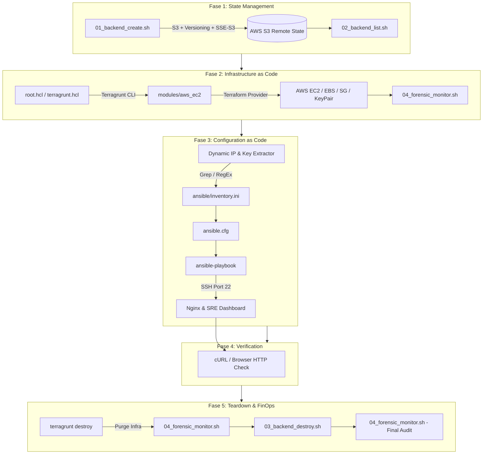

<div align="center">

# Runbook: Despliegue Multi-Capa IaC / CaC en AWS
### Orquestación End-to-End con Terragrunt, Terraform y Ansible


</div>

---

## Tabla de Contenidos

1. [Visión General](#visión-general)
2. [Arquitectura del Flujo](#arquitectura-del-flujo)
3. [Fase 1: State Management (Backend S3)](#fase-1-state-management-backend-s3)
4. [Fase 2: Infrastructure as Code (Terragrunt / Terraform)](#fase-2-infrastructure-as-code-terragrunt--terraform)
5. [Fase 3: Configuration as Code (Ansible)](#fase-3-configuration-as-code-ansible)
6. [Fase 4: Verificación de Servicio](#fase-4-verificación-de-servicio)
7. [Fase 5: Destrucción Controlada y FinOps](#fase-5-destrucción-controlada-y-finops)
8. [Referencia Rápida de Archivos](#referencia-rápida-de-archivos)
9. [Certificación de Cierre](#certificación-de-cierre)

---

## Visión General

Este runbook documenta el ciclo de vida completo de un despliegue de infraestructura en AWS, dividido en cinco fases secuenciales y dependientes entre sí:

| Fase | Dominio | Herramienta Principal | Resultado |
|---|---|---|---|
| 1 | State Management | AWS CLI | Backend remoto S3 seguro |
| 2 | Infrastructure as Code | Terragrunt + Terraform | Cómputo, red y llaves provisionados |
| 3 | Configuration as Code | Ansible | Servicio Nginx configurado |
| 4 | Verificación | cURL / Navegador | Confirmación de disponibilidad HTTP |
| 5 | Teardown | Terragrunt + AWS CLI | Cero residuos y costo cero |

Cada fase depende del éxito de la anterior. No se recomienda omitir pasos ni alterar el orden de ejecución.

---

## Arquitectura del Flujo



---

## Fase 1: State Management (Backend S3)

 

### Objetivos técnicos

- Configurar el almacenamiento distribuido y seguro del archivo de estado `terraform.tfstate`.
- Aplicar controles de seguridad desde la creación del recurso (Security by Default).

### Archivos involucrados

- `scripts/01_backend_create.sh`
- `scripts/02_backend_list.sh`

### Paso 1.1 — Crear el backend

```bash
./scripts/01_backend_create.sh
```

**Mecanismo interno:**

1. Consulta `aws sts get-caller-identity` para derivar el ID de cuenta de AWS de forma unívoca.
2. Ejecuta `aws s3api head-bucket` como chequeo previo de idempotencia (no recrea si ya existe).
3. Crea el bucket con el nombre formateado `sre-tf-state-<ACCOUNT_ID>-<REGION>`.
4. Habilita versionado del bucket para recuperación e historial de estado.
5. Aplica cifrado en reposo SSE-S3 (AES256).
6. Bloquea el acceso público mediante `put-public-access-block`.

### Paso 1.2 — Auditar la existencia del backend

```bash
./scripts/02_backend_list.sh
```

**Mecanismo interno:** consulta `aws s3api list-objects-v2` para verificar la presencia del bucket y enumerar los estados guardados.

---

## Fase 2: Infrastructure as Code (Terragrunt / Terraform)

 

### Objetivos técnicos

- Sintetizar de forma declarativa la infraestructura de red, llaves, almacenamiento y cómputo.
- Centralizar la configuración del estado y proveedores mediante Terragrunt.

### Archivos involucrados

| Archivo | Función |
|---|---|
| `root.hcl` | Backend remoto S3 y bloques globales de proveedores (`default_tags`) |
| `environments/dev/terragrunt.hcl` | Fuente del módulo Terraform y variables del entorno `dev` |
| `modules/aws_ec2/main.tf` | Recursos AWS: `aws_instance`, `aws_security_group`, `aws_key_pair`, `tls_private_key`, `local_sensitive_file` |
| `modules/aws_ec2/variables.tf` | Esquema de entrada del módulo |
| `modules/aws_ec2/outputs.tf` | Exporta IP pública y ruta del archivo `.pem` |

### Paso 2.1 — Exportar la ruta del motor de Terraform

```bash
export TG_TF_PATH=$(which terraform)
```

**Mecanismo interno:** asigna la ruta exacta del binario de Terraform del entorno local a `TG_TF_PATH`, evitando rutas fijas y garantizando compatibilidad entre entornos de ejecución.

### Paso 2.2 — Inicializar y generar el plan

```bash
cd environments/dev
terragrunt init
terragrunt plan
```

**Mecanismo interno:**

- `terragrunt init` procesa `root.hcl`, genera `backend.tf` y `provider.tf`, descarga los proveedores de HashiCorp (`aws`, `local`, `tls`) y valida la conexión con S3.
- `terragrunt plan` lee datos remotos (`aws_ami` de Ubuntu 24.04 LTS, `aws_vpc` por defecto) y genera la especificación de cambios para 5 recursos.

### Paso 2.3 — Aplicar el aprovisionamiento

```bash
terragrunt apply -auto-approve
cd ../..
```

**Mecanismo interno — orden de dependencia:**

1. `tls_private_key.ssh_key` — genera par de llaves RSA de 4096 bits en memoria.
2. `local_sensitive_file.private_key` — escribe la llave privada en `./id_rsa_dev.pem` con permisos `0600`.
3. `aws_key_pair.deployer` — registra la llave pública en AWS EC2 Key Pairs.
4. `aws_security_group.web_sg` — crea reglas de ingreso en puerto 22 (SSH) y puerto 80 (HTTP).
5. `aws_instance.server` — inicia instancia `t3.micro` con disco EBS GP3 de 8 GB encriptado con KMS y etiquetas FinOps.

### Paso 2.4 — Monitoreo forense post-despliegue

```bash
./scripts/04_forensic_monitor.sh dev
```

**Mecanismo interno:** ejecuta en paralelo `aws ec2 describe-instances`, `aws ec2 describe-security-groups`, `aws ec2 describe-volumes` y `aws s3api list-objects` para certificar que la infraestructura creada coincide con la declaración.

---

## Fase 3: Configuration as Code (Ansible)

 

### Objetivos técnicos

- Configurar el sistema operativo y desplegar servicios sobre la instancia de forma idempotente.
- Automatizar la captura de datos de infraestructura sin intervención manual.

### Archivos involucrados

- `ansible/inventory.ini` — inventario dinámico generado por script.
- `ansible.cfg` — configuración global de comportamiento de Ansible.
- `ansible/playbook.yml` — receta de aprovisionamiento y hardening.

### Paso 3.1 — Capturar parámetros dinámicos y generar inventario

```bash
EC2_IP=$(cd environments/dev && terragrunt output -raw public_ip 2>/dev/null | grep -E '^[0-9]+\.[0-9]+\.[0-9]+\.[0-9]+$' | tail -n 1)
KEY_PATH=$(find environments/dev/ -name "id_rsa_dev.pem" | head -n 1)

cat << EOF > ansible/inventory.ini
[webservers]
node01 ansible_host=${EC2_IP} ansible_ssh_private_key_file=${KEY_PATH}
EOF

cat << 'EOF' > ansible.cfg
[defaults]
inventory           = ./ansible/inventory.ini
host_key_checking   = False
retry_files_enabled = False
stdout_callback     = default
result_format       = yaml
remote_user         = ubuntu
interpreter_python  = auto_silent

[ssh_connection]
pipelining          = True
ssh_args            = -o ControlMaster=auto -o ControlPersist=60s -o StrictHostKeyChecking=no
EOF
```

**Mecanismo interno:**

- Obtiene el output `public_ip` de Terragrunt y aplica una expresión regular estricta (`grep -E '^[0-9]+\.[0-9]+\.[0-9]+\.[0-9]+$'`) para descartar Account IDs u otras salidas no deseadas.
- Localiza el archivo de llave privada `.pem` en la estructura de directorios.
- Escribe el inventario mapeando la etiqueta `node01` con los datos recopilados.
- Genera `ansible.cfg` desactivando la verificación estricta de llave de host (`StrictHostKeyChecking=no`) y silenciando advertencias del intérprete de Python (`interpreter_python = auto_silent`).

### Paso 3.2 — Validar conectividad SSH

```bash
ansible webservers -m ansible.builtin.ping
```

**Mecanismo interno:** conecta vía SSH con la llave generada a la IP extraída y ejecuta el módulo `ping` de Ansible, esperando la respuesta `pong`.

### Paso 3.3 — Ejecutar el playbook de aprovisionamiento

```bash
ansible-playbook ansible/playbook.yml
```

**Mecanismo interno — tareas secuenciales:**

1. Gathering Facts: recolecta métricas del sistema objetivo.
2. Actualiza la caché del gestor de paquetes `apt`.
3. Instala los paquetes `nginx`, `curl` y `htop`.
4. Renderiza `/var/www/html/index.html` insertando dinámicamente la IP pública en el Dashboard.
5. Asigna permisos `0644` al usuario `www-data` y garantiza que el servicio `nginx` esté habilitado e iniciado en Systemd.
6. Notifica en consola la dirección de verificación web.

---

## Fase 4: Verificación de Servicio

 

### Objetivos técnicos

- Validar la disponibilidad del servicio HTTP expuesto.
- Confirmar el despliegue del Dashboard interactivo de monitoreo SRE.

### Paso 4.1 — Validación CLI vía cURL

```bash
EC2_IP=$(cd environments/dev && terragrunt output -raw public_ip 2>/dev/null | grep -E '^[0-9]+\.[0-9]+\.[0-9]+\.[0-9]+$' | tail -n 1)
curl -s http://${EC2_IP} | grep "SRE & FinOps Live Node Dashboard"
```

**Mecanismo interno:** realiza una petición GET al puerto 80 del nodo objetivo y valida la presencia de la cadena del título del Dashboard.

### Paso 4.2 — Validación visual en navegador

Acceder mediante navegador a:

```
http://<IP_PÚBLICA_EXTRAÍDA>
```

**Mecanismo interno:** despliega la interfaz web con los detalles de arquitectura, estado operativo de Nginx, parámetros de encriptación del volumen EBS y la dirección de la instancia.

---

## Fase 5: Destrucción Controlada y FinOps

 

### Objetivos técnicos

- Desmantelar los recursos en orden inverso a su aprovisionamiento.
- Asegurar la política de costo cero mediante auditoría forense final.

### Archivos involucrados

- `scripts/03_backend_destroy.sh`
- `scripts/04_forensic_monitor.sh`

### Paso 5.1 — Destruir la infraestructura administrada

```bash
cd environments/dev
terragrunt destroy -auto-approve
cd ../..
```

**Mecanismo interno:**

1. Consulta la tabla de estado en S3 para identificar dependencias entre recursos.
2. Elimina `aws_instance.server` y espera la terminación de la máquina virtual y liberación de la ENI.
3. Elimina `aws_security_group.web_sg`, `aws_key_pair.deployer`, `tls_private_key.ssh_key` y el archivo local `.pem`.
4. Actualiza el estado en S3 dejando registrado un inventario de 0 recursos.

### Paso 5.2 — Auditar estado intermedio de cómputo y red

```bash
./scripts/04_forensic_monitor.sh dev
```

**Mecanismo interno:** verifica que la cantidad de instancias EC2, grupos de seguridad y volúmenes EBS activos sea igual a 0.

### Paso 5.3 — Purgar y eliminar el backend S3

```bash
./scripts/03_backend_destroy.sh
```

**Mecanismo interno:**

1. Invoca `aws s3api list-object-versions` para obtener todas las versiones del archivo de estado y sus marcadores de borrado.
2. Ejecuta `aws s3api delete-objects` para vaciar completamente el bucket.
3. Invoca `aws s3api delete-bucket` eliminando la entidad contenedora del backend.

### Paso 5.4 — Examen forense final de cero residuos

```bash
./scripts/04_forensic_monitor.sh dev
```

**Mecanismo interno:** ejecuta la auditoría integral y confirma la eliminación completa de los recursos.

---

## Referencia Rápida de Archivos

| Ruta | Fase | Propósito |
|---|---|---|
| `scripts/01_backend_create.sh` | 1 | Crear backend S3 |
| `scripts/02_backend_list.sh` | 1 | Auditar backend S3 |
| `root.hcl` | 2 | Backend remoto y proveedores globales |
| `environments/dev/terragrunt.hcl` | 2 | Variables del entorno `dev` |
| `modules/aws_ec2/main.tf` | 2 | Recursos AWS del módulo |
| `modules/aws_ec2/variables.tf` | 2 | Variables de entrada del módulo |
| `modules/aws_ec2/outputs.tf` | 2 | Outputs: IP pública, ruta `.pem` |
| `scripts/04_forensic_monitor.sh` | 2 / 5 | Auditoría forense de recursos |
| `ansible/inventory.ini` | 3 | Inventario dinámico |
| `ansible.cfg` | 3 | Configuración de Ansible |
| `ansible/playbook.yml` | 3 | Receta de aprovisionamiento |
| `scripts/03_backend_destroy.sh` | 5 | Purga y eliminación del backend S3 |

---

## Certificación de Cierre

Salida esperada tras completar la Fase 5:

```
====================================================================
 EXAMEN FORENSE SRE - AWS (ENV: dev | REGION: us-east-1)
====================================================================
 Instancias EC2 Activas/Detenidas : 0
 Grupos de Seguridad (SG)         : 0
 Volúmenes EBS                    : 0
 Bucket Backend S3 (...)          : ELIMINADO
 Objetos/Versiones en S3          : 0
--------------------------------------------------------------------
[AUDIT SUCCESS] LIMPIEZA ABSOLUTA: No se detectan recursos ni zombies en AWS.
```

<div align="center">


</div>

