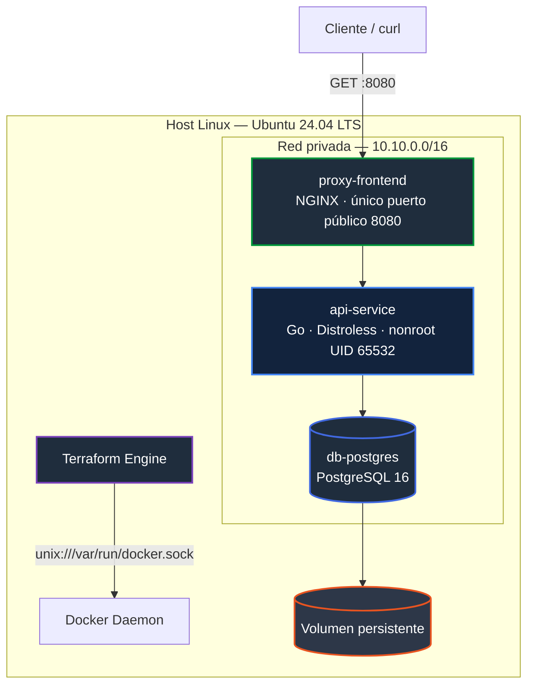

<div align="center">

# SRE Linux Mastery — Laboratorio 3

## Orquestación de Microservicios Multi-Tier con Terraform, Docker Engine y Runtime Distroless

[](https://ubuntu.com)
[](https://www.terraform.io)
[](https://registry.terraform.io/providers/kreuzwerker/docker/latest)
[](https://trivy.dev)
[](https://go.dev)
[](#licencia)

</div>

---

## Descripción del laboratorio

Este repositorio documenta la implementación de una arquitectura de microservicios de tres capas, desplegada íntegramente mediante Infraestructura como Código con **Terraform**, sobre el socket local de **Docker Engine**. No hay proveedor cloud de por medio: todo el laboratorio corre en la máquina local, a coste cero, reproduciendo patrones que en producción se aplicarían igual sobre ECS, Kubernetes o cualquier otro orquestador.

El proyecto integra cuatro disciplinas de forma práctica, no solo teórica:

- **Infraestructura como Código:** la topología completa —red, volumen, imágenes y contenedores— vive en archivos `.tf` versionados, con estado gestionado por Terraform.
- **Arquitectura multi-tier aislada:** un proxy inverso NGINX es el único punto de entrada público; el microservicio en Go y PostgreSQL 16 solo se comunican entre sí a través de una red privada con DNS interno.
- **Hardening DevSecOps:** build multi-stage con flags de reproducibilidad, imagen final sobre base Google Distroless sin shell y sin root, auditada con Trivy hasta alcanzar cero vulnerabilidades HIGH o CRITICAL.
- **Resiliencia SRE:** cuotas de CPU y memoria por contenedor a nivel de *cgroups*, y persistencia de datos validada mediante una prueba de reemplazo destructivo del contenedor de base de datos.

El procedimiento operativo completo, con cada comando explicado flag por flag, está documentado en [`runbook.md`](./runbook.md).

---

## Arquitectura desplegada



**Regla de exposición:** de los tres servicios, solo `proxy-frontend` publica un puerto hacia el host. La API y la base de datos son inalcanzables desde fuera de la red privada, incluso desde el propio host, salvo a través del proxy.

---

## Qué se aprende con este laboratorio

- Aprovisionar redes, volúmenes, imágenes y contenedores de forma declarativa con el proveedor `kreuzwerker/docker`, incluyendo construcción de imágenes personalizadas dentro del propio flujo de Terraform.
- Diseñar un Dockerfile multi-stage que separe compilación de runtime, y entender por qué una imagen Distroless reduce la superficie de ataque frente a una imagen Alpine o Debian tradicional.
- Aplicar cuotas de memoria y CPU a nivel de kernel por contenedor, y verificar su efecto con `docker stats`.
- Auditar una imagen con Trivy filtrando por severidad, e interpretar un reporte de cero vulnerabilidades tanto en el sistema operativo base como en el binario compilado.
- Validar persistencia de datos mediante `terraform apply -replace`, comprobando que un volumen nombrado sobrevive a la destrucción y recreación de su contenedor.
- Ejecutar un ciclo de vida completo de infraestructura: `init → plan → apply → verify → destroy`, con rollback limpio del host al finalizar.

---

## Matriz de recursos declarados

| Recurso Terraform | Objeto en Docker | Propósito técnico |
|---|---|---|
| `docker_network.private_network` | `production-tier-backend-network` | Red bridge aislada, `10.10.0.0/16`, con DNS interno habilitado. |
| `docker_volume.postgres_data` | `production-db-data-persistent` | Almacenamiento persistente, independiente del ciclo de vida del contenedor de base de datos. |
| `docker_image.api_app` | `api-microservice:production` | Imagen construida en el propio flujo de Terraform, multi-stage, sobre base Distroless. |
| `docker_container.db` | `db-postgres` | PostgreSQL 16 aislado en la red privada, límite de 256 MB de RAM. |
| `docker_container.api` | `api-service` | Microservicio Go compilado estáticamente, corriendo como usuario `nonroot` (UID 65532), sin shell. |
| `docker_container.proxy` | `proxy-frontend` | NGINX Alpine, único punto de entrada público, expuesto en el puerto configurable `frontend_port`. |

---

## Estructura del repositorio

```
.
├── app/
│   ├── Dockerfile        Build multi-stage hardened sobre gcr.io/distroless/static-debian12
│   ├── go.mod             Definición del módulo Go
│   ├── go.sum              Checksums de verificación de dependencias
│   └── main.go              API HTTP conectada a PostgreSQL
├── main.tf                    Declaración de recursos de infraestructura en HCL
├── nginx.conf                   Configuración del proxy inverso
├── outputs.tf                     Salidas exportadas por Terraform
├── runbook.md                       Guía operativa paso a paso, con cada comando explicado
├── variables.tf                       Variables parametrizadas del entorno
├── versions.tf                          Versiones del núcleo de Terraform y del proveedor Docker
└── README.md                              Este archivo
```

---

## Prerrequisitos

| Requisito | Versión mínima |
|---|---|
| Sistema operativo | Ubuntu Server 24.04 LTS (nativo o sobre WSL2) |
| Docker Engine | 24.0 o superior, con permisos de ejecución sin `sudo` |
| Terraform CLI | v1.10.0 o superior |
| Trivy Scanner | v0.70.0 o superior |

La instalación completa de estas herramientas, incluyendo la configuración de repositorios oficiales firmados por GPG, está detallada en la Fase I de [`runbook.md`](./runbook.md).

---

## Acceso y reproducción rápida del laboratorio

```bash
# 1. Clonar el repositorio y entrar al directorio
git clone <url-del-repositorio>
cd terraform-docker-stack

# 2. Generar las firmas de dependencias con un contenedor efímero de Go
docker run --rm -v "$PWD/app":/src -w /src golang:alpine go mod tidy

# 3. Inicializar y aplicar la infraestructura
terraform init
terraform plan -out=tfplan
terraform apply "tfplan"

# 4. Acceder al servicio desplegado
curl -i http://localhost:8080
```

Una vez aplicada la infraestructura, el laboratorio queda accesible en `http://localhost:8080`, valor que también se imprime como salida `entrypoint_url` al finalizar `terraform apply`.

### Validaciones recomendadas tras el despliegue

```bash
# Confirmar que el contenedor de la API carece de shell (Zero-Shell)
docker exec -it api-service sh
# Resultado esperado: exec: "sh": executable file not found in $PATH

# Auditar la imagen construida con Trivy
trivy image --severity HIGH,CRITICAL api-microservice:production
# Resultado esperado: 0 vulnerabilidades en OS y en binario
```

### Cierre y limpieza del entorno

```bash
terraform destroy -auto-approve
```

Este comando elimina los ocho recursos gestionados —contenedores, imagen construida, red y volumen— devolviendo el host al estado previo al despliegue. El procedimiento detallado de verificación de limpieza está en la Fase VII del runbook.

---

## Documentación asociada

El presente README ofrece una visión general del laboratorio. Para el procedimiento operativo completo —incluyendo la explicación de cada flag de cada comando, los diagramas de secuencia de arranque, la tabla de resolución de problemas y la matriz de buenas prácticas— consultar [`runbook.md`](./runbook.md).

---

## Licencia

Material técnico desarrollado con fines educativos, orientado a la especialización profesional en Arquitectura Cloud, DevSecOps y Site Reliability Engineering.

<div align="center">

**SRE Linux Mastery** — Especialización Profesional en Arquitectura Cloud y Site Reliability Engineering

</div>

