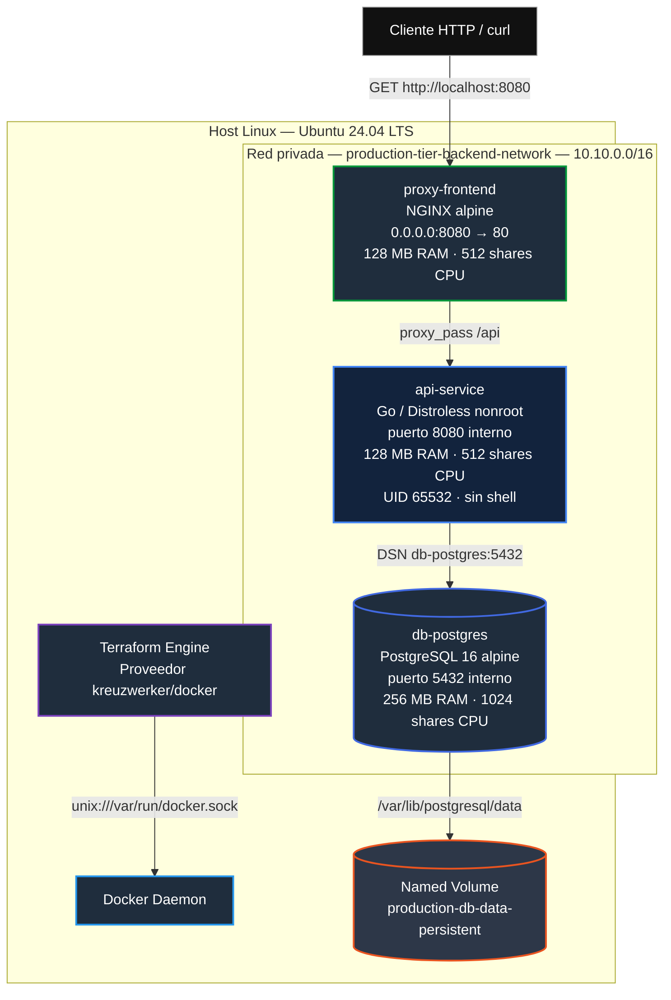
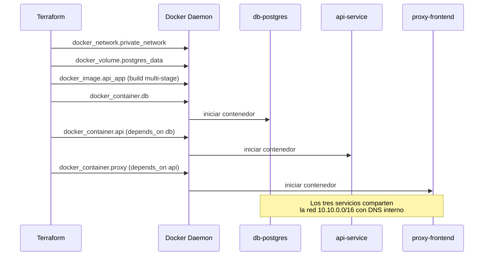

<div align="center">

# Runbook Operativo

## Orquestación Multi-Tier con Terraform, Docker Engine, Distroless Hardened y Auditoría DevSecOps con Trivy

[](https://www.terraform.io)
[](https://registry.terraform.io/providers/kreuzwerker/docker/latest)
[](https://go.dev)
[](https://www.postgresql.org)
[](https://nginx.org)
[](https://trivy.dev)
[](https://github.com/GoogleContainerTools/distroless)
[](https://ubuntu.com)

</div>

---

## Propósito de este documento

Este runbook describe, paso a paso, el procedimiento completo para desplegar y auditar una arquitectura de microservicios de tres capas gobernada íntegramente por Terraform contra el socket local de Docker Engine. No es una guía conceptual: cada bloque de comandos está acompañado de una tabla que descompone flag por flag, argumento por argumento, para que quien lo ejecute entienda no solo *qué* teclea sino *por qué* esa opción específica es la correcta en un contexto de producción simulada.

El criterio de éxito del laboratorio se mide en tres dimensiones: la infraestructura converge sin *drift*, el binario de la API sale del escáner Trivy con cero hallazgos de severidad HIGH o CRITICAL, y el estado de PostgreSQL sobrevive a un reemplazo destructivo del contenedor.

---

## Índice

1. [Arquitectura de referencia y flujo de comunicación](#1-arquitectura-de-referencia-y-flujo-de-comunicación)
2. [Fase I — Preparación del entorno e instalación de herramientas](#2-fase-i--preparación-del-entorno-e-instalación-de-herramientas)
3. [Fase II — Estructura del proyecto y código fuente del microservicio](#3-fase-ii--estructura-del-proyecto-y-código-fuente-del-microservicio)
4. [Fase III — Declaración de infraestructura con Terraform](#4-fase-iii--declaración-de-infraestructura-con-terraform)
5. [Fase IV — Despliegue automatizado con Terraform](#5-fase-iv--despliegue-automatizado-con-terraform)
6. [Fase V — Verificación funcional, monitoreo y auditoría DevSecOps](#6-fase-v--verificación-funcional-monitoreo-y-auditoría-devsecops-0-cves)
7. [Fase VI — Prueba de persistencia y reemplazo inmutable](#7-fase-vi--prueba-de-persistencia-y-reemplazo-inmutable)
8. [Fase VII — Destrucción de la infraestructura e higienización del host](#8-fase-vii--destrucción-de-la-infraestructura-e-higienización-del-host)
9. [Matriz de control operativo y buenas prácticas](#9-matriz-de-control-operativo-y-buenas-prácticas)
10. [Resolución de problemas frecuentes](#10-resolución-de-problemas-frecuentes)

---

## 1. Arquitectura de referencia y flujo de comunicación

La topología separa responsabilidades en tres capas independientes, comunicadas exclusivamente a través de una red *bridge* privada con resolución DNS interna. Ningún contenedor salvo el proxy expone puertos hacia el host: la superficie de ataque externa se reduce a un único punto de entrada.



**Regla de exposición:** solo `proxy-frontend` publica un puerto (`8080 → 80`). `api-service` y `db-postgres` únicamente resuelven entre sí por nombre DNS interno dentro de `production-tier-backend-network`; carecen de mapeo hacia el host. Esta regla se valida de forma explícita en la Fase V.

**Secuencia de arranque:** Terraform crea primero la red y el volumen, construye la imagen de la API, y solo entonces instancia los contenedores en el orden `db → api → proxy`, respetando las dependencias declaradas con `depends_on`.



---

## 2. Fase I — Preparación del entorno e instalación de herramientas

**Objetivo de la fase:** dejar el host con los binarios de Terraform y Trivy instalados desde repositorios oficiales, con sus llaves GPG verificadas, y confirmar que el demonio de Docker responde antes de tocar una sola línea de código de infraestructura.

**Qué se espera al cerrar esta fase:** los tres comandos de validación (`terraform -version`, `trivy --version`, `docker version`) devuelven números de versión concretos, sin errores de conexión al socket ni advertencias de repositorio no firmado.

### 2.1 Instalación de dependencias y repositorios oficiales

```bash
# 1. Dependencias base del sistema
sudo apt-get update && sudo apt-get install -y gnupg software-properties-common curl wget apt-transport-https lsb-release

# 2. Repositorio oficial de HashiCorp (Terraform)
wget -O- https://apt.releases.hashicorp.com/gpg | gpg --dearmor | sudo tee /usr/share/keyrings/hashicorp-archive-keyring.gpg > /dev/null
echo "deb [signed-by=/usr/share/keyrings/hashicorp-archive-keyring.gpg] https://apt.releases.hashicorp.com $(lsb_release -cs) main" | sudo tee /etc/apt/sources.list.d/hashicorp.list

# 3. Repositorio oficial de Aqua Security (Trivy)
wget -qO - https://aquasecurity.github.io/trivy-repo/deb/public.key | gpg --dearmor | sudo tee /usr/share/keyrings/trivy.gpg > /dev/null
echo "deb [signed-by=/usr/share/keyrings/trivy.gpg] https://aquasecurity.github.io/trivy-repo/deb $(lsb_release -sc) main" | sudo tee /etc/apt/sources.list.d/trivy.list

# 4. Actualización de índices e instalación de binarios
sudo apt-get update && sudo apt-get install -y terraform trivy
```

| Comando / argumento | Qué hace exactamente | Por qué es la práctica correcta |
|---|---|---|
| `apt-get install -y gnupg software-properties-common curl wget apt-transport-https lsb-release` | Instala las herramientas mínimas necesarias para descargar, verificar y registrar repositorios externos de terceros. | Sin `gnupg` no es posible verificar firmas; sin `apt-transport-https` APT no puede consumir repositorios servidos por TLS. |
| `wget -O- <url-gpg> \| gpg --dearmor` | Descarga la llave pública del proveedor en formato ASCII-armored (`-O-` envía la salida a stdout) y la convierte al formato binario que APT requiere (`--dearmor`). | Evita ataques de suplantación de paquetes: solo se instalarán paquetes firmados con esa llave concreta. |
| `sudo tee /usr/share/keyrings/<nombre>.gpg > /dev/null` | Escribe el resultado binario de `gpg --dearmor` en el keyring dedicado, redirigiendo la salida visible a `/dev/null` para no volcar bytes binarios en la terminal. | Aísla cada llave en su propio archivo de keyring en lugar de usar el llavero global obsoleto `apt-key`, que Debian y Ubuntu han deprecado. |
| `signed-by=/usr/share/keyrings/<nombre>.gpg` | Vincula la línea `deb` de ese repositorio exclusivamente a la llave descargada en el paso anterior. | Impide que ese repositorio firme paquetes con una llave distinta a la esperada, cerrando la puerta a ataques de *repo confusion*. |
| `$(lsb_release -cs)` | Sustituye dinámicamente el nombre en clave de la distribución instalada (por ejemplo `noble` para Ubuntu 24.04). | Garantiza que se descargue el paquete compilado y probado para la versión exacta del sistema operativo, no una genérica. |
| `apt-get install -y terraform trivy` | Instala ambos binarios desde los repositorios recién registrados, sin solicitar confirmación interactiva (`-y`). | Permite ejecutar el mismo procedimiento en un pipeline de CI/CD sin intervención humana. |

### 2.2 Validación de versiones

```bash
terraform -version
trivy --version
docker version --format 'Client Engine: {{.Client.Version}} | Server Engine: {{.Server.Version}}'
```

| Comando | Qué valida |
|---|---|
| `terraform -version` | Confirma que el binario instalado cumple con el mínimo declarado en `versions.tf` (`>= 1.10.0`). |
| `trivy --version` | Confirma la versión del escáner que se usará en la Fase V; versiones antiguas pueden carecer de la base de datos de vulnerabilidades actualizada. |
| `docker version --format '...'` | Usa la plantilla Go de Docker CLI para imprimir solo la versión del cliente y del daemon, evitando el volcado completo de metadatos que devuelve el comando sin formato. |

**Resultado esperado:** salida con Terraform v1.10 o superior, Trivy v0.70 o superior, y Docker Engine v24 o superior tanto en cliente como en servidor. Si `docker version` no devuelve la sección `Server`, el daemon no está corriendo o el usuario actual no pertenece al grupo `docker`.

---

## 3. Fase II — Estructura del proyecto y código fuente del microservicio

**Objetivo de la fase:** construir el espacio de trabajo, escribir el microservicio en Go con control explícito de timeouts, generar las firmas criptográficas de sus dependencias sin instalar el compilador en el host, y definir un `Dockerfile` multi-etapa que produzca un binario estático corriendo sobre una base sin sistema operativo.

**Qué se espera al cerrar esta fase:** el directorio `app/` contiene `main.go`, `go.mod`, `go.sum` y `Dockerfile`; el archivo `nginx.conf` está listo en la raíz del proyecto para ser inyectado por Terraform en la Fase IV.

### 3.1 Creación del directorio de trabajo

```bash
mkdir -p ~/sre-linux-mastery/Fase4/Docker_3/terraform-docker-stack/app
cd ~/sre-linux-mastery/Fase4/Docker_3/terraform-docker-stack
```

`mkdir -p` crea toda la ruta de directorios intermedios sin fallar si alguno ya existe; al indicar el subdirectorio `app` en la misma invocación se evita un segundo comando.

### 3.2 Código fuente de la aplicación Go (`app/main.go`)

```go
package main

import (
	"database/sql"
	"fmt"
	"log"
	"net/http"
	"os"
	"time"

	_ "github.com/lib/pq"
)

func handler(w http.ResponseWriter, r *http.Request) {
	dbHost := os.Getenv("DB_HOST")
	dbUser := os.Getenv("DB_USER")
	dbPass := os.Getenv("DB_PASSWORD")
	dbName := os.Getenv("DB_NAME")

	dsn := fmt.Sprintf("host=%s port=5432 user=%s password=%s dbname=%s sslmode=disable", dbHost, dbUser, dbPass, dbName)
	db, err := sql.Open("postgres", dsn)
	if err != nil {
		http.Error(w, fmt.Sprintf("Error al conectar a PostgreSQL: %s", err), 500)
		return
	}
	defer db.Close()

	var dbTime string
	err = db.QueryRow("SELECT NOW()::text;").Scan(&dbTime)
	if err != nil {
		http.Error(w, fmt.Sprintf("Error al consultar PostgreSQL: %s", err), 500)
		return
	}

	hostname, _ := os.Hostname()
	fmt.Fprintf(w, "=== SRE MASTERCLASS: RESPUESTA MULTI-TIER ===\n")
	fmt.Fprintf(w, "Host Contenedor API: %s\n", hostname)
	fmt.Fprintf(w, "Fecha/Hora Base de Datos: %s\n", dbTime)
	fmt.Fprintf(w, "Estado: Conexión inter-contenedor validada exitosamente vía DNS interno.\n")
}

func main() {
	http.HandleFunc("/api", handler)
	log.Println("Microservicio API iniciado en puerto 8080...")
	server := &http.Server{
		Addr:         ":8080",
		ReadTimeout:  5 * time.Second,
		WriteTimeout: 10 * time.Second,
	}
	log.Fatal(server.ListenAndServe())
}
```

| Elemento de código | Qué hace | Por qué es la práctica correcta |
|---|---|---|
| `_ "github.com/lib/pq"` | Importa el driver de PostgreSQL únicamente por su efecto de registro (`init()`), sin exponer un identificador utilizable directamente en el código. | El paquete `database/sql` es agnóstico de motor; el driver se registra a sí mismo y se referencia luego por nombre en `sql.Open("postgres", ...)`. |
| `os.Getenv("DB_HOST")`, `DB_USER`, `DB_PASSWORD`, `DB_NAME` | Lee los cuatro parámetros de conexión desde variables de entorno inyectadas por el contenedor. | Cumple el tercer factor de Twelve-Factor App: la configuración vive fuera del código y cambia sin recompilar el binario. |
| `defer db.Close()` | Programa el cierre del *pool* de conexiones para el momento en que la función `handler` retorne, sin importar por qué camino salga. | Evita fugas de descriptores de archivo acumuladas request tras request. |
| `server.ReadTimeout` / `server.WriteTimeout` | Limita a 5 y 10 segundos respectivamente el tiempo que el servidor espera para leer la petición y para escribir la respuesta. | Mitiga ataques de agotamiento de conexiones tipo Slowloris, donde un cliente mantiene sockets abiertos enviando datos a un ritmo mínimo. |
| `log.Fatal(server.ListenAndServe())` | Arranca el servidor HTTP y, si retorna un error (por ejemplo el puerto ya está en uso), termina el proceso con código de salida distinto de cero. | En un contenedor, un proceso que muere con error permite que la política de reinicio de Docker (`restart: unless-stopped`) actúe. |

### 3.3 Inicialización de módulos y generación de `go.sum` con contenedor efímero

```bash
# 1. Crear el archivo go.mod
cat << 'EOF' > app/go.mod
module api-service

go 1.24

require github.com/lib/pq v1.10.9
EOF

# 2. Generar el archivo go.sum mediante un contenedor efímero
docker run --rm -v "$PWD/app":/src -w /src golang:alpine go mod tidy

# 3. Validar los archivos en el subdirectorio app/
ls -la app/
```

| Argumento Docker | Qué hace | Por qué es la práctica correcta |
|---|---|---|
| `--rm` | Elimina el contenedor en cuanto el proceso principal termina. | El contenedor solo existe para calcular hashes de dependencias; no tiene sentido conservarlo en el listado de `docker ps -a`. |
| `-v "$PWD/app":/src` | Monta el directorio local `app/` dentro del contenedor en `/src`, en modo lectura-escritura por defecto. | Permite que `go mod tidy`, ejecutándose dentro del contenedor, escriba `go.sum` directamente en el sistema de archivos del host. |
| `-w /src` | Fija `/src` como directorio de trabajo activo al arrancar el contenedor. | El comando `go mod tidy` necesita ejecutarse en el mismo directorio donde reside `go.mod` para resolver el árbol de dependencias. |
| `golang:alpine go mod tidy` | Usa la imagen oficial de Go sobre Alpine como entorno de ejecución desechable, e invoca `go mod tidy` para descargar las dependencias declaradas y escribir sus checksums. | Evita instalar el toolchain de Go en el host solo para este paso puntual; el host permanece limpio de herramientas de compilación. |

**Resultado esperado:** el listado de `ls -la app/` muestra `main.go`, `go.mod` y `go.sum`, este último generado automáticamente con los hashes SHA-256 de `github.com/lib/pq` y sus transitivas.

### 3.4 Dockerfile multi-etapa hardened con Distroless (`app/Dockerfile`)

```dockerfile
# --- ETAPA 1: Compilación con compilador oficial más reciente ---
FROM golang:alpine AS builder

WORKDIR /src

# Copiar dependencias y hashes de verificación
COPY go.mod go.sum ./
RUN go mod download

# Copiar código fuente
COPY . .

# Compilación estática pura (sin CGO, con stripping de símbolos y sin rutas de host)
RUN CGO_ENABLED=0 GOOS=linux go build -trimpath -ldflags="-w -s" -o /src/api-server main.go

# --- ETAPA 2: Runtime seguro Distroless (Zero-Shell) ---
FROM gcr.io/distroless/static-debian12:nonroot

WORKDIR /

# Copiar exclusivamente el binario compilado, asignando propiedad a nonroot
COPY --from=builder --chown=nonroot:nonroot /src/api-server /api-server

# Ejecutar bajo usuario no privilegiado (UID 65532)
USER nonroot:nonroot

EXPOSE 8080

ENTRYPOINT ["/api-server"]
```

| Directiva / opción | Qué hace | Por qué es la práctica correcta |
|---|---|---|
| `FROM golang:alpine AS builder` | Define la primera etapa del build, nombrada `builder`, usando la imagen oficial de Go sobre Alpine como entorno de compilación. | Incluye siempre las correcciones más recientes de la librería estándar; esta etapa nunca llega a producción, así que su peso no afecta a la imagen final. |
| `COPY go.mod go.sum ./` seguido de `RUN go mod download` | Copia únicamente los manifiestos de dependencias antes que el código fuente, y descarga los módulos en una capa separada. | Aprovecha el cacheo de capas de Docker: si el código cambia pero las dependencias no, esta capa se reutiliza sin volver a descargar nada. |
| `CGO_ENABLED=0` | Deshabilita el enlazado dinámico contra `libc` vía cgo. | Produce un binario 100% estático, requisito indispensable para correr sobre una imagen `distroless/static` que no contiene bibliotecas C. |
| `GOOS=linux` | Fuerza la compilación cruzada explícita al sistema operativo Linux, sin depender del sistema operativo del host que ejecuta el build. | Hace el build reproducible en cualquier máquina, incluidos entornos macOS o Windows con Docker Desktop. |
| `-trimpath` | Elimina del binario resultante las rutas absolutas del sistema de archivos donde se compiló el código. | Mejora la reproducibilidad del build y reduce la superficie de metadatos que un escáner o un atacante podría inspeccionar. |
| `-ldflags="-w -s"` | `-w` omite la tabla de símbolos DWARF de depuración; `-s` omite la tabla de símbolos del linker. | Reduce el tamaño del binario en torno a un 30% y dificulta la ingeniería inversa directa sobre el ejecutable. |
| `FROM gcr.io/distroless/static-debian12:nonroot` | Segunda etapa: imagen base de Google que contiene únicamente certificados de confianza SSL/TLS y el archivo `/etc/passwd` mínimo. | No incluye shell, gestor de paquetes ni utilidades de sistema, eliminando de raíz cualquier vector de post-explotación basado en herramientas del propio sistema operativo. |
| `COPY --from=builder --chown=nonroot:nonroot ...` | Copia solo el binario compilado desde la etapa `builder`, asignándole como propietario al usuario `nonroot` incluido en la imagen base. | El resto del contenido de la etapa de compilación —toolchain, caché de módulos, código fuente— nunca llega a la imagen final. |
| `USER nonroot:nonroot` | Cambia el usuario efectivo del proceso al UID/GID 65532, predefinido en la imagen distroless. | Aplica el principio de menor privilegio: aunque el binario fuera comprometido, no correría como root dentro del contenedor. |
| `ENTRYPOINT ["/api-server"]` | Define el binario como proceso principal e inmutable del contenedor, en su forma *exec* (array JSON), no en forma *shell*. | La forma *exec* evita invocar `/bin/sh -c`, que de todas formas no existe en esta imagen; el proceso recibe señales del sistema directamente. |

### 3.5 Configuración del proxy inverso NGINX (`nginx.conf`)

```nginx
events { worker_connections 1024; }

http {
    upstream backend_api {
        server api-service:8080;
    }

    server {
        listen 80;

        location / {
            proxy_pass http://backend_api/api;
            proxy_set_header Host $host;
            proxy_set_header X-Real-IP $remote_addr;
            proxy_set_header X-Forwarded-For $proxy_add_x_forwarded_for;
        }
    }
}
```

| Directiva | Qué hace | Por qué es la práctica correcta |
|---|---|---|
| `worker_connections 1024;` | Fija el número máximo de conexiones simultáneas que cada *worker* de NGINX puede atender. | Suficiente para el volumen de tráfico del laboratorio sin agotar descriptores de archivo del contenedor. |
| `upstream backend_api { server api-service:8080; }` | Declara un grupo de servidores *upstream* apuntando al nombre DNS interno del contenedor de la API. | Aprovecha la resolución DNS embebida de Docker: `api-service` se resuelve dentro de la red privada sin IPs fijas. |
| `proxy_pass http://backend_api/api;` | Reenvía cada petición recibida en `/` hacia la ruta `/api` del grupo `backend_api`. | Desacopla la ruta pública de la ruta interna real que expone el microservicio. |
| `proxy_set_header Host $host;` | Preserva el encabezado `Host` original del cliente al reenviar la petición. | Evita que la aplicación backend reciba un `Host` distinto al que el cliente realmente solicitó. |
| `proxy_set_header X-Real-IP $remote_addr;` | Añade la IP real del cliente en un encabezado dedicado. | Permite trazabilidad de origen incluso cuando el backend solo ve la IP interna del proxy. |
| `proxy_set_header X-Forwarded-For $proxy_add_x_forwarded_for;` | Encadena la IP del cliente a cualquier cadena `X-Forwarded-For` previa. | Estándar de facto para preservar la cadena completa de saltos en topologías con múltiples proxies. |

---

## 4. Fase III — Declaración de infraestructura con Terraform

**Objetivo de la fase:** traducir la arquitectura descrita en la sección 1 a código HCL declarativo, dividido en archivos por responsabilidad (`versions.tf`, `variables.tf`, `main.tf`, `outputs.tf`), siguiendo la convención estándar de la comunidad Terraform.

**Qué se espera al cerrar esta fase:** cuatro archivos `.tf` en la raíz del proyecto, sintácticamente válidos, listos para `terraform init`.

### 4.1 Definición de proveedores (`versions.tf`)

```hcl
terraform {
  required_version = ">= 1.10.0"

  required_providers {
    docker = {
      source  = "kreuzwerker/docker"
      version = "~> 3.0.2"
    }
  }
}

provider "docker" {
  host = "unix:///var/run/docker.sock"
}
```

| Bloque / atributo | Qué hace | Por qué es la práctica correcta |
|---|---|---|
| `required_version = ">= 1.10.0"` | Bloquea la ejecución del código si el binario de Terraform instalado es anterior a la versión 1.10.0. | Evita comportamientos inconsistentes derivados de ejecutar HCL moderno contra un motor desactualizado. |
| `required_providers { docker = { ... } }` | Fija el proveedor `kreuzwerker/docker` y restringe su versión con el operador *pessimistic* `~> 3.0.2`. | `~> 3.0.2` permite parches (`3.0.3`, `3.0.4`, ...) pero bloquea saltos de versión menor o mayor que podrían romper compatibilidad de esquema. |
| `provider "docker" { host = "unix:///var/run/docker.sock" }` | Instruye al proveedor a comunicarse con el daemon de Docker a través del socket UNIX local, en lugar de un endpoint TCP remoto. | Es la ruta de menor latencia y mayor seguridad quue existe: no expone la API de Docker por red, y no requiere configuración TLS. |

### 4.2 Variables parametrizadas (`variables.tf`)

```hcl
variable "environment" {
  type        = string
  description = "Ambiente de despliegue"
  default     = "production"
}

variable "frontend_port" {
  type        = number
  description = "Puerto expuesto en el Host para el Proxy NGINX"
  default     = 8080
}

variable "db_password" {
  type        = string
  description = "Clave del usuario postgres"
  default     = "SreMasterySecret2026"
  sensitive   = true
}
```

| Variable | Qué hace | Por qué es la práctica correcta |
|---|---|---|
| `environment` | Parametriza el prefijo usado en los nombres de red y volumen (`${var.environment}-tier-backend-network`). | Permite reutilizar el mismo código para levantar entornos `staging`, `qa` o `production` sin colisión de nombres. |
| `frontend_port` | Parametriza el puerto del host mapeado hacia el proxy. | Facilita ejecutar varias instancias del laboratorio en la misma máquina cambiando un único valor. |
| `db_password` con `sensitive = true` | Marca la variable como sensible ante el motor de Terraform. | Terraform enmascara su valor en la salida de `plan` y `apply`, evitando que la clave quede expuesta en logs de consola o de CI/CD. |

> En un entorno real, `db_password` debería inyectarse mediante `TF_VAR_db_password` o un backend de secretos (Vault, AWS Secrets Manager), nunca como valor por defecto en el código versionado. El valor por defecto aquí existe únicamente para simplificar la reproducción del laboratorio.

### 4.3 Recursos principales de infraestructura (`main.tf`)

```hcl
# 1. Red privada aislada (bridge personalizado)
resource "docker_network" "private_network" {
  name   = "${var.environment}-tier-backend-network"
  driver = "bridge"
  ipam_config {
    subnet = "10.10.0.0/16"
  }
}

# 2. Volumen persistente para base de datos
resource "docker_volume" "postgres_data" {
  name = "${var.environment}-db-data-persistent"
}

# 3. Imágenes base requeridas
resource "docker_image" "postgres" {
  name         = "postgres:16-alpine"
  keep_locally = true
}

resource "docker_image" "nginx" {
  name         = "nginx:alpine"
  keep_locally = true
}

# 4. Construcción de imagen del microservicio (Distroless Hardened)
resource "docker_image" "api_app" {
  name = "api-microservice:${var.environment}"
  build {
    context = "./app"
    tag     = ["api-microservice:${var.environment}"]
  }
  triggers = {
    dir_sha1 = sha1(join("", [for f in fileset("./app", "*") : filesha1("./app/${f}")]))
  }
}

# 5. Contenedor de base de datos (aislado)
resource "docker_container" "db" {
  name       = "db-postgres"
  image      = docker_image.postgres.image_id
  restart    = "unless-stopped"
  memory     = 256
  cpu_shares = 1024

  networks_advanced {
    name = docker_network.private_network.name
  }

  volumes {
    volume_name    = docker_volume.postgres_data.name
    container_path = "/var/lib/postgresql/data"
  }

  env = [
    "POSTGRES_USER=postgres",
    "POSTGRES_PASSWORD=${var.db_password}",
    "POSTGRES_DB=sredb"
  ]
}

# 6. Contenedor del microservicio API (aislado)
resource "docker_container" "api" {
  name       = "api-service"
  image      = docker_image.api_app.image_id
  restart    = "unless-stopped"
  memory     = 128
  cpu_shares = 512

  networks_advanced {
    name = docker_network.private_network.name
  }

  env = [
    "DB_HOST=db-postgres",
    "DB_USER=postgres",
    "DB_PASSWORD=${var.db_password}",
    "DB_NAME=sredb"
  ]

  depends_on = [docker_container.db]
}

# 7. Contenedor reverse proxy frontend (único punto de entrada público)
resource "docker_container" "proxy" {
  name       = "proxy-frontend"
  image      = docker_image.nginx.image_id
  restart    = "unless-stopped"
  memory     = 128
  cpu_shares = 512

  networks_advanced {
    name = docker_network.private_network.name
  }

  ports {
    internal = 80
    external = var.frontend_port
    ip       = "0.0.0.0"
  }

  upload {
    content = file("${path.module}/nginx.conf")
    file    = "/etc/nginx/nginx.conf"
  }

  depends_on = [docker_container.api]
}
```

| Recurso / argumento | Qué hace | Por qué es la práctica correcta |
|---|---|---|
| `docker_network.private_network` con `driver = "bridge"` y `ipam_config { subnet = "10.10.0.0/16" }` | Crea una red virtual con DNS embebido y un rango de direcciones explícito, distinto del rango por defecto de Docker. | Evita colisiones con la red `bridge` estándar (`172.17.0.0/16`) y hace el rango predecible para reglas de firewall adicionales. |
| `docker_volume.postgres_data` | Declara un volumen gestionado por Docker, independiente del ciclo de vida de cualquier contenedor. | El volumen sobrevive a la destrucción y recreación del contenedor `db-postgres`, condición necesaria para la prueba de la Fase VI. |
| `docker_image.postgres` / `docker_image.nginx` con `keep_locally = true` | Descarga las imágenes oficiales y evita que Terraform las elimine del daemon al ejecutar `destroy`. | Acelera despliegues posteriores del laboratorio: las imágenes base no vuelven a descargarse en cada ciclo. |
| `docker_image.api_app` con bloque `build { context = "./app" }` | Ordena a Terraform construir la imagen localmente usando el `Dockerfile` de la Fase II como contexto de build. | Integra el ciclo de vida completo de la imagen —construcción incluida— dentro del mismo flujo declarativo, sin scripts externos. |
| `triggers.dir_sha1 = sha1(join(...))` | Calcula un hash SHA-1 agregando el hash individual de cada archivo dentro de `app/`. | Fuerza a Terraform a reconstruir la imagen únicamente cuando el código fuente o las dependencias cambian, no en cada `apply`. |
| `memory = 256` / `128` | Fija el límite duro de memoria RAM en megabytes para el contenedor, aplicado a nivel de *cgroups* del kernel. | Previene que una fuga de memoria en un solo contenedor agote la RAM del host y provoque un evento OOM generalizado. |
| `cpu_shares = 1024` / `512` | Asigna la proporción relativa de ciclos de CPU que el *scheduler* del kernel repartirá bajo contención. | Prioriza a PostgreSQL (1024) sobre la API y el proxy (512 cada uno) cuando el host esté bajo carga simultánea. |
| `networks_advanced { name = ... }` | Conecta el contenedor a la red privada declarada, en lugar de la red `bridge` por defecto de Docker. | Aísla el tráfico dentro de la topología de tres capas y habilita la resolución DNS por nombre de contenedor. |
| `volumes { volume_name = ...; container_path = "/var/lib/postgresql/data" }` | Monta el volumen persistente exactamente en el directorio de datos de PostgreSQL. | Es la ruta estándar donde el motor de base de datos almacena sus archivos; montar en cualquier otra ruta no tendría efecto de persistencia real. |
| `env = [...]` | Define las variables de entorno que cada imagen consume en tiempo de arranque. | Reutiliza el mismo mecanismo de configuración externa que el propio código Go de la Fase II ya espera vía `os.Getenv`. |
| `depends_on = [docker_container.db]` / `[docker_container.api]` | Obliga a Terraform a crear los contenedores en el orden `db → api → proxy`, aunque el grafo de recursos por sí solo no lo exigiera. | Evita condiciones de carrera donde la API intente resolver `db-postgres` antes de que ese contenedor exista en la red. |
| `ports { internal = 80; external = var.frontend_port; ip = "0.0.0.0" }` | Publica el puerto 80 del contenedor `proxy-frontend` en el puerto configurable del host, escuchando en todas las interfaces. | Es el único bloque `ports` de todo el `main.tf`: refuerza a nivel de código la regla de exposición mínima descrita en la arquitectura. |
| `upload { content = file(...); file = "/etc/nginx/nginx.conf" }` | Inyecta el contenido de `nginx.conf` directamente dentro del contenedor al momento de crearlo, sin usar *bind mounts*. | Hace que la infraestructura sea autocontenida y portable: no depende de que el archivo exista en una ruta específica del host en tiempo de ejecución. |

### 4.4 Salidas de infraestructura (`outputs.tf`)

```hcl
output "entrypoint_url" {
  description = "URL pública de acceso al servicio"
  value       = "http://localhost:${var.frontend_port}"
}

output "private_network_name" {
  description = "Nombre de la red aislada creada"
  value       = docker_network.private_network.name
}

output "database_volume_name" {
  description = "Nombre del volumen persistente de la base de datos"
  value       = docker_volume.postgres_data.name
}
```

Cada bloque `output` expone, al finalizar `terraform apply`, un valor derivado del estado real de la infraestructura. Esto evita tener que recordar de memoria nombres generados a partir de variables: Terraform los imprime en pantalla y los deja disponibles para `terraform output <nombre>` en scripts posteriores.

---

## 5. Fase IV — Despliegue automatizado con Terraform

**Objetivo de la fase:** ejecutar el ciclo estándar `init → plan → apply` para materializar en Docker todo lo declarado en la Fase III.

**Qué se espera al cerrar esta fase:** ocho recursos creados (red, volumen, dos imágenes descargadas, una imagen construida, tres contenedores) y las tres salidas de `outputs.tf` impresas en consola.

### 5.1 Inicialización del directorio de trabajo

```bash
terraform init
```

Descarga el proveedor `kreuzwerker/docker` en la versión fijada por `versions.tf`, inicializa el backend de estado local (`terraform.tfstate`) y construye el directorio oculto `.terraform/` con los binarios del proveedor.

**Resultado esperado:** `Terraform has been successfully initialized!`

### 5.2 Planificación y generación del plan binario

```bash
terraform plan -out=tfplan
```

| Flag | Qué hace | Por qué es la práctica correcta |
|---|---|---|
| `-out=tfplan` | Serializa el plan de ejecución calculado en un archivo binario local, en lugar de solo mostrarlo en pantalla. | Garantiza que el `apply` posterior ejecute exactamente lo que fue revisado, eliminando la ventana de tiempo entre revisión y aplicación en la que el estado real podría cambiar. |

**Resultado esperado:** `Plan: 8 to add, 0 to change, 0 to destroy.`

### 5.3 Aplicación de la infraestructura

```bash
terraform apply "tfplan"
```

Al pasarle el archivo de plan generado en el paso anterior en lugar de ejecutar `apply` sin argumentos, Terraform omite la confirmación interactiva de `yes` y aplica exactamente ese plan pre-calculado, sin volver a evaluar el estado deseado contra el estado real en ese instante.

**Resultado esperado:** `Apply complete! Resources: 8 added, 0 changed, 0 destroyed.`, seguido de las tres salidas `entrypoint_url`, `private_network_name` y `database_volume_name` impresas con sus valores concretos.

---

## 6. Fase V — Verificación funcional, monitoreo y auditoría DevSecOps (0 CVEs)

**Objetivo de la fase:** confirmar que la arquitectura funciona de extremo a extremo, que el aislamiento de red se respeta, que los límites de recursos se aplican, y que la imagen construida no contiene vulnerabilidades conocidas de severidad HIGH o CRITICAL.

**Qué se espera al cerrar esta fase:** una respuesta HTTP 200 con datos reales de PostgreSQL, cero puertos expuestos fuera del proxy, consumo de memoria dentro de los límites declarados, un reporte de Trivy con cero hallazgos, y confirmación de que el contenedor de la API no tiene shell.

### 6.1 Prueba integral del flujo multi-tier

```bash
sleep 3
curl -i http://localhost:8080
```

`sleep 3` da margen a PostgreSQL para completar su inicialización interna (creación de catálogos del sistema) antes de que la API intente conectarse. `curl -i` imprime tanto los encabezados de respuesta como el cuerpo, permitiendo confirmar en una sola llamada el código HTTP y el contenido devuelto por el microservicio a través del proxy.

**Resultado esperado:**

```
HTTP/1.1 200 OK
Server: nginx/...

=== SRE MASTERCLASS: RESPUESTA MULTI-TIER ===
Host Contenedor API: <container_id>
Fecha/Hora Base de Datos: 2026-08-19 ...
Estado: Conexión inter-contenedor validada exitosamente vía DNS interno.
```

### 6.2 Comprobación del aislamiento de red

```bash
docker port proxy-frontend
docker port api-service || echo "CONFIRMADO: api-service no expone puertos al host."
docker port db-postgres || echo "CONFIRMADO: db-postgres no expone puertos al host."
```

`docker port <contenedor>` lista el mapeo de puertos publicados de ese contenedor específico. Cuando un contenedor no publica ningún puerto, el comando retorna código de salida distinto de cero y no imprime nada, motivo por el cual se encadena con `||` un mensaje de confirmación explícito en lugar de dejar una salida vacía ambigua.

**Resultado esperado:** únicamente `proxy-frontend` reporta `80/tcp -> 0.0.0.0:8080`; los otros dos comandos imprimen el mensaje de confirmación.

### 6.3 Auditoría de consumo de recursos en tiempo real

```bash
docker stats --no-stream --format "table {{.Name}}\t{{.CPUPerc}}\t{{.MemUsage}}\t{{.MemPerc}}\t{{.NetIO}}"
```

| Flag | Qué hace |
|---|---|
| `--no-stream` | Toma una única muestra de métricas y termina, en lugar de refrescar la terminal continuamente. |
| `--format "table {{...}}"` | Usa la plantilla Go de Docker CLI para mostrar solo las columnas relevantes: nombre, porcentaje de CPU, uso de memoria absoluto, porcentaje de memoria y tráfico de red. |

**Resultado esperado:** el consumo de memoria de `db-postgres` se mantiene por debajo de 256 MiB, y el de `api-service` y `proxy-frontend` por debajo de 128 MiB cada uno, confirmando que los límites de *cgroups* declarados en `main.tf` están activos.

### 6.4 Auditoría DevSecOps con Trivy — validación de 0 CVEs

```bash
trivy image --severity HIGH,CRITICAL api-microservice:production
```

`--severity HIGH,CRITICAL` restringe el reporte a las dos severidades que normalmente bloquean un pipeline de despliegue, filtrando ruido de vulnerabilidades LOW o MEDIUM que rara vez justifican detener un release. Trivy escanea dos superficies de forma independiente: el sistema operativo base de la imagen y los binarios Go embebidos, detectando en este último caso vulnerabilidades a nivel de módulo declarado en `go.sum`.

**Resultado obtenido:**

```
Report Summary

┌────────────────────────────────────────────┬──────────┬─────────────────┬─────────┐
│                   Target                   │   Type   │ Vulnerabilities │ Secrets │
├────────────────────────────────────────────┼──────────┼─────────────────┼─────────┤
│ api-microservice:production (debian 12.15) │  debian  │        0        │    -    │
├────────────────────────────────────────────┼──────────┼─────────────────┼─────────┤
│ api-server                                 │ gobinary │        0        │    -    │
└────────────────────────────────────────────┴──────────┴─────────────────┴─────────┘

Legend:
- '-': Not scanned
- '0': Clean (no security findings detected)
```

**Diagnóstico:** cero vulnerabilidades en el sistema operativo base y cero vulnerabilidades en el binario compilado. La base Distroless, al no incluir gestor de paquetes ni utilidades adicionales, reduce drásticamente la superficie escaneable frente a una imagen `alpine` o `debian` completa.

### 6.5 Validación del blindaje Zero-Shell

```bash
docker exec -it api-service sh
```

**Resultado obtenido:**

```
OCI runtime exec failed: exec failed: unable to start container process: exec: "sh": executable file not found in $PATH
```

**Diagnóstico:** el contenedor carece de intérprete de comandos. Esto neutraliza una categoría completa de técnicas de post-explotación que dependen de obtener una shell interactiva dentro del contenedor comprometido: incluso con acceso al *runtime*, no existe binario `sh` ni `bash` que ejecutar.

---

## 7. Fase VI — Prueba de persistencia y reemplazo inmutable

**Objetivo de la fase:** demostrar que el volumen nombrado sobrevive a la destrucción y recreación forzada del contenedor de base de datos, validando el patrón de infraestructura inmutable.

**Qué se espera al cerrar esta fase:** el registro insertado antes del reemplazo aparece intacto después de que Terraform destruya y vuelva a crear `db-postgres`.

```bash
# 1. Insertar un registro de prueba en PostgreSQL
docker exec -it db-postgres psql -U postgres -d sredb -c "CREATE TABLE audit_logs (id SERIAL, event VARCHAR(50));"
docker exec -it db-postgres psql -U postgres -d sredb -c "INSERT INTO audit_logs (event) VALUES ('APPLY_INMUTABLE_OK');"

# 2. Forzar a Terraform a destruir y recrear el contenedor de base de datos
terraform apply -replace="docker_container.db" -auto-approve

# 3. Esperar 3 segundos para el inicio del nuevo contenedor y comprobar persistencia
sleep 3
docker exec -it db-postgres psql -U postgres -d sredb -c "SELECT * FROM audit_logs;"
```

| Comando / flag | Qué hace | Por qué es la práctica correcta |
|---|---|---|
| `docker exec -it db-postgres psql -U postgres -d sredb -c "..."` | Ejecuta una sentencia SQL puntual dentro del contenedor de PostgreSQL usando el cliente `psql`, con `-i` (interactivo) y `-t` (pseudo-TTY) para una salida legible. | Permite manipular datos de prueba sin exponer el puerto 5432 al host, respetando el aislamiento de red establecido en la Fase V. |
| `terraform apply -replace="docker_container.db" -auto-approve` | Marca explícitamente el recurso `docker_container.db` para destrucción y recreación forzada, y aplica el cambio sin pedir confirmación interactiva. | Simula de forma controlada un evento real de reemplazo de infraestructura —como una actualización de imagen o una migración de nodo— sin tener que borrar manualmente el contenedor por fuera del control de Terraform. |

**Resultado esperado:**

```
 id |       event
----+--------------------
  1 | APPLY_INMUTABLE_OK
(1 row)
```

El nuevo contenedor `db-postgres`, aunque es un objeto completamente distinto a nivel de Docker (nuevo ID, nuevo proceso), monta el mismo volumen nombrado `production-db-data-persistent` y por lo tanto recupera exactamente los mismos archivos de datos que el contenedor anterior había escrito.

---

## 8. Fase VII — Destrucción de la infraestructura e higienización del host

**Objetivo de la fase:** revertir por completo el laboratorio, dejando el host en el mismo estado en que se encontraba antes de la Fase I, sin residuos de redes, volúmenes ni directorios de trabajo.

**Qué se espera al cerrar esta fase:** ninguna consulta de verificación devuelve resultados; el directorio del proyecto ha sido eliminado.

### 8.1 Destrucción controlada con Terraform

```bash
terraform destroy -auto-approve
```

Recorre el grafo de dependencias en orden inverso al de creación —primero los contenedores, luego la imagen construida, y finalmente la red y el volumen— eliminando cada recurso gestionado por el estado actual. `-auto-approve` omite la confirmación interactiva, apropiado en un entorno de laboratorio pero a evitar en producción sin controles adicionales.

**Resultado esperado:** `Destroy complete! Resources: 8 destroyed.`

### 8.2 Verificación de limpieza del daemon Docker

```bash
docker ps -a --filter "name=tier-backend" --filter "name=postgres" --filter "name=api-" --filter "name=proxy-"
docker volume ls --filter "name=production-db-data"
docker network ls --filter "name=tier-backend"
```

Cada `--filter "name=..."` restringe el listado a objetos cuyo nombre contiene el patrón indicado, evitando tener que inspeccionar visualmente el listado completo de contenedores, volúmenes y redes del host.

**Resultado esperado:** las tres consultas retornan únicamente el encabezado de columnas, sin filas de datos.

### 8.3 Eliminación del directorio de trabajo

```bash
cd ~ && rm -rf ~/sre-linux-mastery/Fase4/Docker_3/terraform-docker-stack
```

Se ejecuta `cd ~` primero para garantizar que el shell no quede posicionado dentro del directorio que está a punto de borrarse, evitando comportamientos inconsistentes en algunas terminales al eliminar el directorio de trabajo actual.

---

## 9. Matriz de control operativo y buenas prácticas

| Dominio | Práctica aplicada en el laboratorio | Beneficio operativo |
|---|---|---|
| IaC | Declaración integral en Terraform separada por responsabilidad (`versions.tf`, `variables.tf`, `main.tf`, `outputs.tf`). | Reproducibilidad idéntica entre entornos y trazabilidad completa de cambios (cero *drift*). |
| FinOps | Despliegue local contra el socket UNIX `/var/run/docker.sock`, sin dependencias de proveedor cloud. | Permite practicar patrones de arquitectura multi-tier reales a coste cero de infraestructura. |
| DevSecOps | Build multi-stage combinado con base Distroless (UID 65532) y compilación *hardened* (`-trimpath`, `-ldflags="-w -s"`). | Cero CVEs totales en sistema operativo y binario, eliminando shells y utilidades innecesarias de la imagen final. |
| SRE | Asignación estricta de cuotas de memoria y proporciones de CPU a nivel de *cgroups* por contenedor. | Previene degradación del nodo host por agotamiento de recursos de un único servicio (*noisy neighbor*). |
| Resiliencia | Desacoplamiento del almacenamiento en *Named Volumes* gestionados independientemente del ciclo de vida de los contenedores. | Permite reemplazos inmutables de servicios sin pérdida de estado, validado en la Fase VI. |

---

## 10. Resolución de problemas frecuentes

| Síntoma | Causa probable | Acción correctiva |
|---|---|---|
| `terraform plan` falla con error de conexión al proveedor `docker`. | El usuario actual no pertenece al grupo `docker`, o el daemon no está corriendo. | Verificar con `docker version`; añadir el usuario al grupo con `sudo usermod -aG docker $USER` y reiniciar la sesión. |
| `curl -i http://localhost:8080` devuelve `502 Bad Gateway`. | La API aún no terminó de conectar a PostgreSQL cuando NGINX ya estaba aceptando tráfico. | Repetir tras unos segundos; en la Fase V el `sleep 3` existe precisamente para absorber esta ventana de arranque. |
| Trivy reporta hallazgos inesperados en la etapa `debian`. | La base `gcr.io/distroless/static-debian12` fue *pulled* hace tiempo y existe una versión con parches más recientes. | Ejecutar `docker pull gcr.io/distroless/static-debian12:nonroot` antes de reconstruir la imagen con Terraform. |
| `terraform apply -replace` no reconstruye el contenedor. | Sintaxis del flag incorrecta o nombre de recurso mal escrito. | Confirmar el nombre exacto del recurso con `terraform state list` antes de referenciarlo en `-replace`. |
| El registro de prueba desaparece tras el reemplazo del contenedor de base de datos. | El volumen no está correctamente referenciado en el bloque `volumes` del contenedor, o se está usando un volumen anónimo en lugar del nombrado. | Confirmar con `docker volume ls` que `production-db-data-persistent` existe y revisar que `container_path` coincida exactamente con `/var/lib/postgresql/data`. |

---

<div align="center">

*Documento técnico de referencia operativa — Especialización en Arquitectura Cloud, DevSecOps y Site Reliability Engineering.*

</div>

