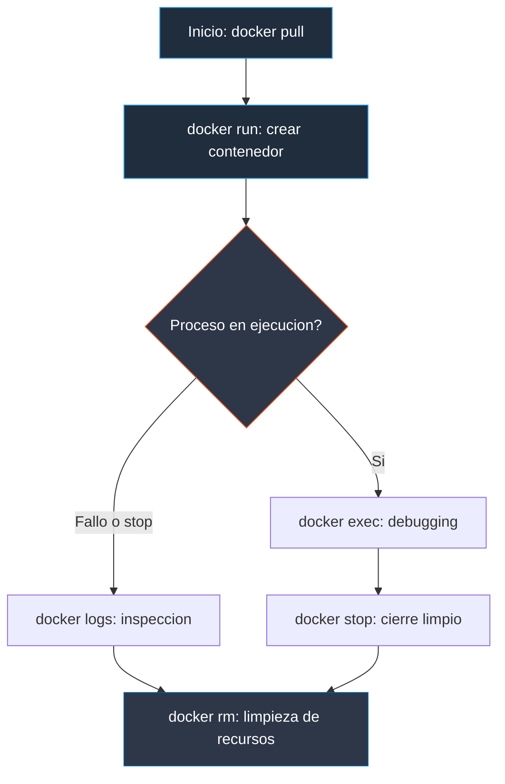
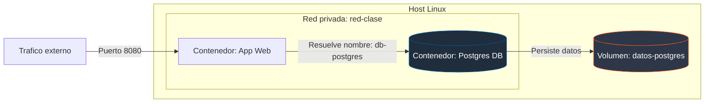

# Runbook: Despliegue y Operación de Docker Engine en Ubuntu 24.04 LTS


Runbook operativo para instalar Docker Engine desde el repositorio oficial, gestionar el ciclo de vida de contenedores, redes y volúmenes, monitorear recursos, y finalmente revertir todos los cambios dejando el host en su estado original. Cada comando incluye su sintaxis, cada argumento su semántica, y cada fase su resultado esperado.

---

## Índice

1. [Arquitectura de referencia](#1-arquitectura-de-referencia)
2. [Fase I — Instalación desde el repositorio oficial](#2-fase-i--instalación-desde-el-repositorio-oficial)
3. [Fase II — Post-instalación y privilegios](#3-fase-ii--post-instalación-y-privilegios)
4. [Fase III — Operaciones clave del CLI](#4-fase-iii--operaciones-clave-del-cli)
5. [Fase IV — Redes aisladas y volúmenes persistentes](#5-fase-iv--redes-aisladas-y-volúmenes-persistentes)
6. [Fase V — Monitoreo y diagnóstico](#6-fase-v--monitoreo-y-diagnóstico)
7. [Fase VI — Purga controlada de recursos](#7-fase-vi--purga-controlada-de-recursos)
8. [Fase VII — Desinstalación total (rollback completo)](#8-fase-vii--desinstalación-total-rollback-completo)
9. [Tabla de referencia rápida](#9-tabla-de-referencia-rápida)

---

## 1. Arquitectura de referencia

```mermaid
architecture-beta
    group host(server)[Host Linux Ubuntu 24 04 LTS]

    service cli(gear)[Docker CLI] in host
    service daemon(server)[dockerd] in host
    service containerd(database)[containerd runc] in host
    service container_a(internet)[Contenedor App] in host
    service container_b(database)[Contenedor DB] in host

    cli:R -- L:daemon
    daemon:B -- T:containerd
    containerd:B -- T:container_a
    containerd:B -- T:container_b
```



**Modelo de capas.** El CLI (`docker`) es un cliente que se comunica con el demonio `dockerd` a través del socket UNIX `/var/run/docker.sock`. `dockerd` delega la gestión de ciclo de vida de bajo nivel (namespaces, cgroups, ejecución de procesos) a `containerd` y su componente `runc`, cumpliendo la especificación OCI (Open Container Initiative).

---

## 2. Fase I — Instalación desde el repositorio oficial

> El repositorio predeterminado de la distribución empaqueta versiones comunitarias que suelen quedar rezagadas respecto a los parches de seguridad. Este runbook exige instalar directamente desde el repositorio upstream de Docker Inc.

### 2.1 Dependencias y actualización de índices

```bash
sudo apt update && sudo apt install -y ca-certificates curl gnupg lsb-release
```

| Elemento | Semántica |
|---|---|
| `sudo` | Eleva privilegios a superusuario para modificar archivos del sistema. |
| `apt update` | Descarga los índices de paquetes actualizados de los repositorios configurados. |
| `&&` | Conector de control: ejecuta el segundo comando solo si el primero termina con código de salida `0`. |
| `apt install -y` | Instala paquetes sin solicitar confirmación interactiva. |
| `ca-certificates` | Permite validar certificados SSL/TLS al descargar paquetes. |
| `curl` | Utilidad de transferencia de datos vía HTTP/HTTPS. |
| `gnupg` | Herramienta de cifrado/firmado usada para verificar la autenticidad de los paquetes. |
| `lsb-release` | Expone el nombre en código de la distribución (por ejemplo `noble`). |

**Resultado esperado:** índices actualizados y dependencias instaladas.

### 2.2 Registro de la llave GPG oficial

```bash
sudo install -m 0755 -d /etc/apt/keyrings
sudo curl -fsSL https://download.docker.com/linux/ubuntu/gpg -o /etc/apt/keyrings/docker.asc
sudo chmod a+r /etc/apt/keyrings/docker.asc
```

| Comando / flag | Semántica |
|---|---|
| `install -m 0755 -d /etc/apt/keyrings` | Crea el directorio destino con permisos `rwxr-xr-x`. |
| `-f` | Falla en silencio ante errores HTTP de servidor. |
| `-s` | Modo silencioso: oculta la barra de progreso. |
| `-S` | Muestra errores aunque el modo silencioso esté activo. |
| `-L` | Sigue redirecciones HTTP. |
| `-o <ruta>` | Escribe la salida en el archivo indicado. |
| `chmod a+r` | Otorga permisos de lectura global a la llave. |

**Resultado esperado:** `/etc/apt/keyrings/docker.asc` contiene la clave de firma digital válida.

### 2.3 Alta del repositorio estable en APT

```bash
echo \
  "deb [arch=$(dpkg --print-architecture) signed-by=/etc/apt/keyrings/docker.asc] https://download.docker.com/linux/ubuntu \
  $(. /etc/os-release && echo "$VERSION_CODENAME") stable" | \
  sudo tee /etc/apt/sources.list.d/docker.list > /dev/null
```

| Elemento | Semántica |
|---|---|
| `$(dpkg --print-architecture)` | Subshell que detecta la arquitectura de CPU (`amd64`, `arm64`). |
| `signed-by=...` | Restringe la validación de este repositorio exclusivamente a la llave indicada. |
| `$(. /etc/os-release && echo "$VERSION_CODENAME")` | Extrae el nombre en código del sistema operativo. |
| `sudo tee <archivo>` | Escribe la entrada de repositorio con privilegios elevados. |
| `> /dev/null` | Descarta la salida estándar de `tee` para mantener limpia la consola. |

**Resultado esperado:** creación de `/etc/apt/sources.list.d/docker.list` apuntando a la rama estable.

### 2.4 Instalación del motor y plugins

```bash
sudo apt update
sudo apt install -y docker-ce docker-ce-cli containerd.io docker-buildx-plugin docker-compose-plugin
```

| Paquete | Semántica |
|---|---|
| `docker-ce` | Docker Community Edition — el demonio `dockerd`. |
| `docker-ce-cli` | Herramienta de línea de comandos para interactuar con el demonio. |
| `containerd.io` | Runtime de contenedores de nivel medio, gestiona el ciclo de vida completo. |
| `docker-buildx-plugin` | Extensión para construcción multi-arquitectura de imágenes. |
| `docker-compose-plugin` | Orquestación multicontenedor declarativa. |

**Resultado esperado:** el servicio `docker.service` queda iniciado y habilitado en `systemd`.

---

## 3. Fase II — Post-instalación y privilegios

Por defecto, el socket `/var/run/docker.sock` solo admite escritura de `root`, por lo que cada invocación requiere `sudo`. Para evitarlo en el uso diario se delega el privilegio al grupo `docker`.

```bash
sudo usermod -aG docker $USER
newgrp docker
```

| Comando / flag | Semántica |
|---|---|
| `usermod` | Modifica la configuración de la cuenta en la base de datos local de usuarios. |
| `-a` | *(append)* agrega un grupo secundario sin eliminar los existentes. |
| `-G docker` | Especifica el grupo objetivo. |
| `$USER` | Variable de entorno con el nombre del usuario autenticado. |
| `newgrp docker` | Recarga la matriz de grupos de la shell activa sin requerir reinicio de sesión. |

### Validación del demonio

```bash
docker version
```

```
Client: Docker Engine - Community
 Version:           29.7.2
 API version:       1.48

Server: Docker Engine - Community
 Engine:
  Version:          29.7.2
  API version:      1.48
```

---

## 4. Fase III — Operaciones clave del CLI



### 4.1 Descarga e inspección de imágenes

```bash
docker pull nginx:alpine
docker image ls --format "table {{.Repository}}\t{{.Tag}}\t{{.Size}}"
```

| Comando / flag | Semántica |
|---|---|
| `docker pull` | Consulta el registro configurado (Docker Hub por defecto) y descarga las capas asociadas a la etiqueta. |
| `docker image ls` | Enumera las imágenes almacenadas localmente. |
| `--format "table ..."` | Aplica una plantilla Go que filtra la salida a las columnas indicadas. |

```
REPOSITORY    TAG         SIZE
nginx         alpine      93.6MB
```

### 4.2 Contenedores efímeros e interactivos

```bash
docker run --rm -it alpine sh
```

| Flag | Semántica |
|---|---|
| `docker run` | Verifica la existencia local de la imagen, la descarga si falta, asigna namespaces y arranca el proceso principal. |
| `--rm` | Elimina el contenedor y su capa de escritura al finalizar el proceso principal. |
| `-i` | *(interactive)* mantiene abierta la entrada estándar. |
| `-t` | *(tty)* asigna una pseudo-terminal para formatear la salida. |
| `alpine` | Imagen base seleccionada. |
| `sh` | Proceso principal ejecutado dentro del contenedor. |

### 4.3 Servicios en segundo plano (detached)

```bash
docker run -d --name mi-web -p 8080:80 --restart unless-stopped nginx:alpine
```

| Flag | Semántica |
|---|---|
| `-d` | *(detached)* ejecuta en segundo plano e imprime el ID (hash SHA-256). |
| `--name mi-web` | Asigna un alias único para referenciar el contenedor sin usar su ID. |
| `-p 8080:80` | Mapea `puerto_host:puerto_contenedor`; el tráfico entrante al 8080 del host llega al 80 interno. |
| `--restart unless-stopped` | Reinicia el contenedor ante caídas o reinicios del host, salvo detención manual explícita. |

### 4.4 Diagnóstico dentro de un contenedor activo

```bash
docker exec -it mi-web sh
```

| Elemento | Semántica |
|---|---|
| `docker exec` | Crea un nuevo proceso dentro del namespace de un contenedor ya en ejecución. |
| `-it` | Mantiene la terminal interactiva abierta. |
| `mi-web` | Contenedor objetivo. |
| `sh` | Binario ejecutado dentro del entorno. |

---

## 5. Fase IV — Redes aisladas y volúmenes persistentes

Reglas de aislamiento aplicadas: la base de datos no expone puertos al host ni a la red pública, y sus datos persisten fuera del ciclo de vida del contenedor mediante un volumen local.



### 5.1 Creación de red y volumen

```bash
docker network create red-clase
docker volume create datos-postgres
```

| Comando | Semántica |
|---|---|
| `docker network create` | Configura un puente virtual (bridge) con subred dedicada, IPs internas y DNS embebido para resolución entre contenedores. |
| `docker volume create` | Inicializa un directorio gestionado bajo `/var/lib/docker/volumes/`, aislado de la capa de escritura efímera del contenedor. |

### 5.2 Base de datos aislada en la red privada

```bash
docker run -d \
  --name db-postgres \
  --network red-clase \
  -v datos-postgres:/var/lib/postgresql/data \
  -e POSTGRES_PASSWORD=ClaveSRE123 \
  postgres:16-alpine
```

| Flag | Semántica |
|---|---|
| `--network red-clase` | Conecta la interfaz del contenedor al puente aislado. |
| `-v datos-postgres:/var/lib/postgresql/data` | Mapea el volumen a la ruta donde PostgreSQL almacena tablas y WAL. |
| `-e POSTGRES_PASSWORD=...` | Inyecta la variable de entorno requerida para inicializar el usuario `postgres`. |

Nótese la ausencia deliberada de `-p`: el puerto 5432 no se expone al host.

### 5.3 Validación de resolución DNS interna

```bash
docker run --rm --network red-clase alpine ping -c 3 db-postgres
```

`ping -c 3 db-postgres` envía tres paquetes ICMP usando el nombre del contenedor; el DNS interno de Docker traduce el nombre a la IP privada correspondiente.

```
PING db-postgres (172.18.0.2): 56 data bytes
64 bytes from 172.18.0.2: seq=0 ttl=64 time=0.211 ms
64 bytes from 172.18.0.2: seq=1 ttl=64 time=0.089 ms
64 bytes from 172.18.0.2: seq=2 ttl=64 time=0.075 ms

--- db-postgres ping statistics ---
3 packets transmitted, 3 packets received, 0% packet loss
```

### 5.4 Prueba de persistencia de datos

**Paso 1 — Inserción de datos:**

```bash
docker exec -it db-postgres psql -U postgres -c "CREATE TABLE alumnos (id SERIAL, nombre VARCHAR(50));"
docker exec -it db-postgres psql -U postgres -c "INSERT INTO alumnos (nombre) VALUES ('Jose Garagorry');"
```

**Paso 2 — Destrucción forzada del contenedor:**

```bash
docker rm -f db-postgres
```

**Paso 3 — Recreación del servicio sobre el mismo volumen:**

```bash
docker run -d \
  --name db-postgres-recuperada \
  --network red-clase \
  -v datos-postgres:/var/lib/postgresql/data \
  -e POSTGRES_PASSWORD=ClaveSRE123 \
  postgres:16-alpine
```

**Paso 4 — Verificación de integridad:**

```bash
docker exec -it db-postgres-recuperada psql -U postgres -c "SELECT * FROM alumnos;"
```

```
 id |     nombre
----+----------------
  1 | Jose Garagorry
(1 row)
```

El dato sobrevive porque residía en el volumen `datos-postgres`, externo al contenedor destruido.

---

## 6. Fase V — Monitoreo y diagnóstico

### 6.1 Métricas de rendimiento en tiempo real

```bash
docker stats --no-stream
```

`--no-stream` imprime un único muestreo de consumo de recursos y finaliza, apto para scripts automatizados.

```
CONTAINER ID   NAME                    CPU %     MEM USAGE / LIMIT     MEM %     NET I/O          BLOCK I/O      PIDS
0d904272d4e4   db-postgres-recuperada  0.02%     18.32MiB / 7.611GiB   0.24%     1.02kB / 126B    0B / 229kB     6
3adf82253a19   mi-web                  0.00%     7.508MiB / 7.611GiB   0.10%     2.9kB / 2.91kB   0B / 32.8kB    9
```

### 6.2 Extracción de metadatos con Go Templates

```bash
docker inspect -f '{{range .NetworkSettings.Networks}}{{.IPAddress}}{{end}}' db-postgres-recuperada
```

`docker inspect` devuelve la configuración y estado completo del objeto en JSON; `-f '{{...}}'` aplica una plantilla Go para extraer únicamente el campo requerido, evitando parseo manual del JSON completo.

### 6.3 Procesos del contenedor a nivel de host

```bash
docker top db-postgres-recuperada
```

```
UID        PID        PPID       C    STIME    TTY      TIME        CMD
70         17069      17043      0    19:24    ?        00:00:00    postgres
70         17159      17069      0    19:24    ?        00:00:00    postgres: checkpointer
70         17160      17069      0    19:24    ?        00:00:00    postgres: background writer
70         17164      17069      0    19:24    ?        00:00:00    postgres: walwriter
```

Estos PIDs son visibles directamente en la tabla de procesos del kernel del host, evidenciando que los contenedores comparten el mismo kernel (a diferencia de una VM).

---

## 7. Fase VI — Purga controlada de recursos

### 7.1 Auditoría de uso de disco

```bash
docker system df
```

```
TYPE            TOTAL     ACTIVE    SIZE      RECLAIMABLE
Images          3         2         500.4MB   88.02kB (0%)
Containers      2         2         147.5kB   0B (0%)
Local Volumes   6         1         52.98MB   12.65MB (23%)
Build Cache     0         0         0B        0B
```

### 7.2 Secuencia segura de purga

```bash
# 1. Detener y eliminar todos los contenedores activos
docker rm -f $(docker ps -aq)

# 2. Eliminar imágenes no vinculadas a ningún contenedor
docker image prune -af

# 3. Eliminar redes sin contenedores asignados
docker network prune -f
```

| Elemento | Semántica |
|---|---|
| `docker ps -aq` | `-a`: incluye contenedores detenidos; `-q`: imprime solo los IDs. |
| `docker image prune -a` | Elimina toda imagen no vinculada a al menos un contenedor activo (no solo las *dangling*). |
| `-f` | Omite la confirmación interactiva. |

---

## 8. Fase VII — Desinstalación total (rollback completo)

Esta fase no forma parte de la operación estándar; se ejecuta únicamente cuando el objetivo es revertir el host a su estado previo a este runbook, eliminando también volúmenes con datos, el motor Docker, sus repositorios y la pertenencia al grupo `docker`.


### 8.1 Purga total de objetos en ejecución

```bash
docker rm -f $(docker ps -aq) 2>/dev/null
docker volume rm $(docker volume ls -q) 2>/dev/null
docker network rm red-clase 2>/dev/null
docker system prune -af --volumes
```

| Elemento | Semántica |
|---|---|
| `docker volume rm $(docker volume ls -q)` | Elimina todos los volúmenes locales, incluidos los que contienen datos persistentes (irreversible). |
| `2>/dev/null` | Descarta mensajes de error si el recurso ya no existe. |
| `docker system prune -af --volumes` | Purga combinada: contenedores detenidos, redes sin uso, imágenes no referenciadas y volúmenes no utilizados, sin confirmación interactiva. |

### 8.2 Detención y deshabilitación del servicio

```bash
sudo systemctl stop docker.service docker.socket
sudo systemctl disable docker.service docker.socket
```

| Comando | Semántica |
|---|---|
| `systemctl stop` | Detiene el proceso del demonio y su socket de escucha. |
| `systemctl disable` | Retira la unidad del arranque automático de `systemd`. |

### 8.3 Desinstalación de paquetes

```bash
sudo apt purge -y docker-ce docker-ce-cli containerd.io docker-buildx-plugin docker-compose-plugin docker-ce-rootless-extras
sudo apt autoremove -y --purge
```

| Flag | Semántica |
|---|---|
| `apt purge` | Desinstala los paquetes junto con sus archivos de configuración (a diferencia de `remove`, que los conserva). |
| `autoremove --purge` | Elimina dependencias que quedaron huérfanas tras la desinstalación. |

### 8.4 Eliminación de directorios de datos residuales

```bash
sudo rm -rf /var/lib/docker
sudo rm -rf /var/lib/containerd
sudo rm -rf /etc/docker
sudo rm -f /var/run/docker.sock
```

| Ruta | Contenido que elimina |
|---|---|
| `/var/lib/docker` | Imágenes, volúmenes, redes y capas de contenedores gestionados por `dockerd`. |
| `/var/lib/containerd` | Estado interno del runtime `containerd`. |
| `/etc/docker` | Configuración del demonio (`daemon.json`, certificados TLS si existieran). |
| `/var/run/docker.sock` | Socket UNIX de comunicación cliente-demonio, normalmente ya retirado al detener el servicio. |

### 8.5 Retiro del repositorio APT y la llave GPG

```bash
sudo rm -f /etc/apt/sources.list.d/docker.list
sudo rm -f /etc/apt/keyrings/docker.asc
sudo apt update
```

Revierte exactamente los archivos creados en las secciones 2.2 y 2.3, devolviendo la configuración de APT a su estado previo a la instalación.

### 8.6 Remoción del usuario del grupo `docker`

```bash
sudo gpasswd -d $USER docker
```

| Comando | Semántica |
|---|---|
| `gpasswd -d $USER docker` | Retira al usuario actual del grupo secundario `docker`, revirtiendo el cambio aplicado en la Fase II. Requiere cerrar sesión para que el cambio de grupos surta efecto en la shell activa. |

### 8.7 Verificación de limpieza

```bash
dpkg -l | grep -i docker
systemctl status docker 2>&1 | head -n 3
```

Ambos comandos deben retornar sin coincidencias de paquetes instalados ni unidades activas, confirmando que el host quedó en un estado equivalente al previo a la Fase I.

---

## 9. Tabla de referencia rápida

| Operación | Comando exacto | Propósito técnico |
|---|---|---|
| Monitoreo | `docker stats --no-stream` | Consumo puntual de recursos sin bloquear la terminal. |
| Limpieza | `docker system prune -f --volumes` | Elimina contenedores, redes y volúmenes huérfanos. |
| Redes | `docker network inspect <red>` | Muestra las IPs de los contenedores conectados. |
| Redirección | `docker port <contenedor>` | Muestra los mapeos activos entre puertos host/contenedor. |
| Registros | `docker logs --tail 100 -f <contenedor>` | Últimas 100 líneas de stdout y seguimiento en vivo. |
| Metadatos | `docker inspect <objeto>` | JSON de configuración completo del objeto. |
| Transferencia | `docker cp ./archivo <contenedor>:/ruta` | Copia un archivo del host hacia el contenedor. |
| Rollback total | Sección 8 completa | Revierte host al estado previo a la instalación. |

---

**Advertencia operativa:** la Fase VII es destructiva e irreversible sobre los datos en volúmenes. Ejecutarla únicamente tras confirmar que no existen respaldos pendientes de recursos en producción.

