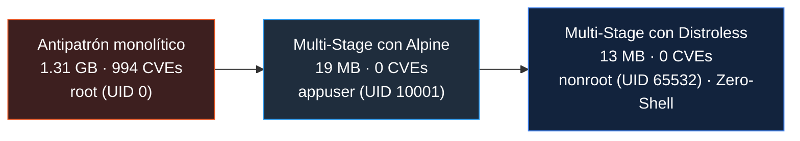

<div align="center">

# SRE Linux Mastery — Laboratorio DevSecOps: Contenedorización Segura

### Deconstrucción de artefactos OCI: Multi-Stage Builds, Distroless y auditoría estática con Trivy

[](https://ubuntu.com)
[](https://www.docker.com)
[](https://trivy.dev)
[](https://go.dev)
[](#licencia)

</div>

---

## Descripción del laboratorio

Este repositorio documenta el proceso de endurecimiento de artefactos OCI bajo los principios de **Site Reliability Engineering (SRE)** y **DevSecOps**.

Se parte de una imagen de contenedor construida de la forma convencional —todo el SDK de compilación empaquetado junto con el binario final, ejecutando como `root`— y se demuestra, con mediciones concretas de tamaño y de vulnerabilidades, cómo revertir esa deuda técnica mediante **Multi-Stage Builds**, imágenes **Alpine Linux** e imágenes **Google Distroless (Zero-Shell)**, ejecutadas siempre bajo usuarios no privilegiados.

El procedimiento completo, con cada comando, cada flag y el resultado esperado de cada fase, está documentado en [`runbook.md`](./runbook.md).

---

## Mapa de evolución técnica



Cada salto en el diagrama elimina una categoría completa de riesgo: primero el SDK y las herramientas de compilación, después el shell y cualquier binario capaz de ejecutar comandos dentro del contenedor.

---

## Objetivos de aprendizaje

**Optimización de capas e inmutabilidad**
Compilación estática desacoplada (`CGO_ENABLED=0`) y reducción del binario mediante *stripping* de símbolos (`-ldflags="-w -s"`). Uso de `COPY --from=builder` para evitar que el SDK y las dependencias transitorias lleguen a producción.

**Principio de menor privilegio**
Configuración de usuarios dedicados sin acceso root: `appuser` (UID 10001) en la variante Alpine y `nonroot` (UID 65532) en la variante Distroless.

**Paradigma Zero-Shell**
Despliegue en entornos sin gestor de paquetes (`apt`, `apk`) y sin shell (`sh`, `bash`), bloqueando de raíz los vectores de explotación interactiva remota.

**Auditoría DevSecOps automatizada**
Integración de Trivy para identificar, reportar y bloquear vulnerabilidades de severidad `HIGH` y `CRITICAL`, con criterios reproducibles en un pipeline de integración continua.

---

## Matriz comparativa

| Criterio | `Dockerfile.monolithic` | `Dockerfile.alpine` | `Dockerfile.distroless` |
|---|---|---|---|
| Base runtime | `golang:1.22` (Debian 12.9) | `alpine:3.20` | `gcr.io/distroless/static-debian12` |
| Tamaño final | 1.31 GB | 19 MB | 13 MB |
| Vulnerabilidades de SO | 994 CVEs | 0 CVEs | 0 CVEs |
| Presencia de shell | `/bin/bash`, `/bin/sh` | `/bin/sh` | Zero-Shell (no existe) |
| Usuario de ejecución | `root` (UID 0) | `appuser` (UID 10001) | `nonroot` (UID 65532) |
| Herramientas internas | `apt`, `gcc`, `git` | Utilitarios BusyBox | Ninguna |

Detalle completo de cómo se obtuvo cada cifra, incluyendo la salida real de Trivy y de `docker exec`, en [`runbook.md`](./runbook.md#8-fase-vii--auditoría-comparativa-y-validación-de-blindaje).

---

## Estructura del repositorio

```text
.
├── main.go                  # API HTTP mínima escrita en Go
├── .dockerignore             # Reglas de exclusión de contexto para el daemon de Docker
├── Dockerfile.monolithic     # Antipatrón: SDK y runtime en la misma imagen
├── Dockerfile.alpine         # Multi-Stage Build con Alpine Linux y usuario appuser
├── Dockerfile.distroless     # Multi-Stage Build con Distroless y usuario nonroot
├── runbook.md                # Guía operativa paso a paso, comando por comando
└── README.md                 # Este archivo
```

---

## Prerrequisitos

| Requisito | Detalle |
|---|---|
| Sistema operativo | Ubuntu Server 24.04 LTS (nativo o sobre WSL2) |
| Motor de contenedores | Docker Engine 24.0 o superior, con permisos de ejecución sin `sudo` |
| Escáner de vulnerabilidades | Trivy 0.70 o superior |
| Conectividad | Acceso saliente a Docker Hub (`docker.io`) y a Google Container Registry (`gcr.io`) |

---

## Cómo reproducir el laboratorio

El procedimiento completo está en [`runbook.md`](./runbook.md); en resumen:

```bash
# 1. Clonar el repositorio y ubicarse en el directorio del laboratorio
git clone <url-del-repositorio>
cd docker-security-lab

# 2. Construir las tres variantes
docker build -t app:monolithic -f Dockerfile.monolithic .
docker build -t app:alpine     -f Dockerfile.alpine .
docker build -t app:distroless -f Dockerfile.distroless .

# 3. Desplegar las tres en paralelo, cada una en su propio puerto
docker run -d --name app-mono   -p 8081:8080 app:monolithic
docker run -d --name app-alp    -p 8082:8080 app:alpine
docker run -d --name app-distro -p 8083:8080 app:distroless

# 4. Auditar cada imagen con Trivy
trivy image --severity HIGH,CRITICAL app:monolithic
trivy image --severity HIGH,CRITICAL app:alpine
trivy image --severity HIGH,CRITICAL app:distroless
```

Al finalizar, la sección de limpieza del runbook detalla cómo remover contenedores, imágenes y el directorio de trabajo para dejar el host en su estado original.

---

## Licencia

Material publicado con fines educativos, dentro del marco de especialización en Arquitectura Cloud y Site Reliability Engineering.

<div align="center">

**SRE Linux Mastery** — Especialización profesional en Arquitectura Cloud y Site Reliability Engineering

</div>

