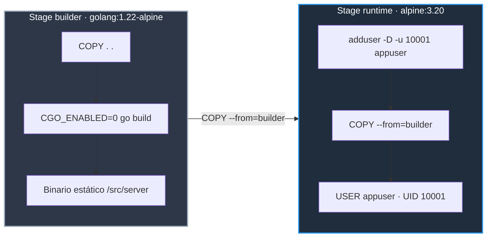
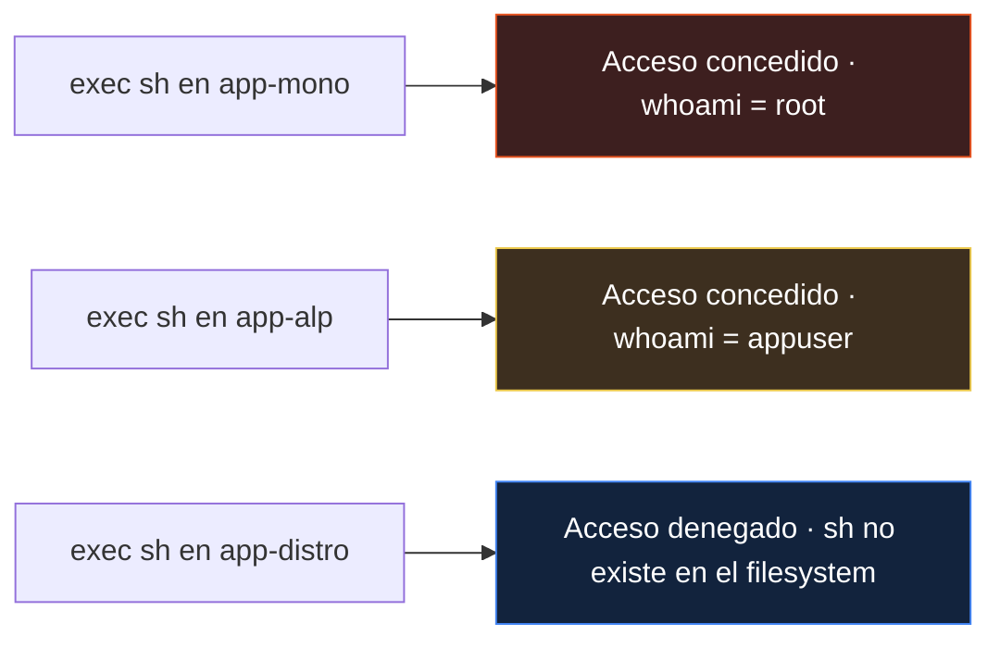

# Runbook: Construcción Segura de Imágenes OCI, Multi-Stage Builds, Distroless y Escaneo de Vulnerabilidades con Trivy

-E95420?style=for-the-badge&logo=ubuntu&logoColor=white)


Documento operativo de referencia para migrar de forma progresiva una imagen de contenedor monolítica (pesada, con privilegios innecesarios y una superficie de ataque amplia) hacia artefactos endurecidos mediante **Multi-Stage Builds**, **Alpine Linux** y **Google Distroless**, validando cada etapa con el escáner de vulnerabilidades **Trivy**.

El laboratorio no es teórico: cada fase produce una imagen real, medible en tamaño, en CVEs y en superficie de ataque, de modo que las decisiones de diseño quedan respaldadas por evidencia y no por convención.

---

## Índice

1. [Arquitectura y comparativa de flujos de construcción](#1-arquitectura-y-comparativa-de-flujos-de-construcción)
2. [Fase I — Preparación del entorno y código fuente](#2-fase-i--preparación-del-entorno-y-código-fuente)
3. [Fase II — Construcción tradicional monolítica (antipatrón)](#3-fase-ii--construcción-tradicional-monolítica-antipatrón)
4. [Fase III — Instalación y configuración del escáner Trivy](#4-fase-iii--instalación-y-configuración-del-escáner-trivy)
5. [Fase IV — Auditoría DevSecOps sobre la imagen monolítica](#5-fase-iv--auditoría-devsecops-sobre-la-imagen-monolítica)
6. [Fase V — Optimización nivel 1: Multi-Stage Build con Alpine](#6-fase-v--optimización-nivel-1-multi-stage-build-con-alpine)
7. [Fase VI — Optimización nivel 2: Multi-Stage Build con Distroless (Zero-Shell)](#7-fase-vi--optimización-nivel-2-multi-stage-build-con-distroless-zero-shell)
8. [Fase VII — Auditoría comparativa y validación de blindaje](#8-fase-vii--auditoría-comparativa-y-validación-de-blindaje)
9. [Fase VIII — Limpieza de recursos e higienización del host](#9-fase-viii--limpieza-de-recursos-e-higienización-del-host)
10. [Matriz comparativa de resultados](#10-matriz-comparativa-de-resultados)
11. [Consideraciones finales y siguientes pasos](#11-consideraciones-finales-y-siguientes-pasos)

---

## 1. Arquitectura y comparativa de flujos de construcción

El laboratorio compara tres estrategias de construcción sobre el mismo código fuente. Cada una parte de la anterior y elimina una capa de riesgo: primero el peso y las herramientas de compilación, después el shell y cualquier binario capaz de ejecutar comandos arbitrarios.

```mermaid
flowchart TD
    subgraph F1["Estrategia 1 · Monolítica"]
        direction TB
        M1["Imagen base: golang:1.22 sobre Debian 12.9"]
        M2["Código fuente + SDK de Go + compilador se copian juntos"]
        M3["go build genera el binario, pero el SDK permanece en la imagen"]
        M4["Resultado: 1.31 GB · UID 0 root · 994 CVEs de SO"]
        M1 --> M2 --> M3 --> M4
    end

    subgraph F2["Estrategia 2 · Multi-Stage con Alpine"]
        direction TB
        A1["Stage builder: golang:1.22-alpine"]
        A2["Compilación estática con CGO_ENABLED=0"]
        A3["Stage runtime: alpine:3.20, imagen nueva y limpia"]
        A4["Se copia únicamente el binario compilado"]
        A5["Resultado: 19 MB · UID 10001 appuser · 0 CVEs de SO"]
        A1 --> A2 --> A3 --> A4 --> A5
    end

    subgraph F3["Estrategia 3 · Multi-Stage con Distroless"]
        direction TB
        D1["Stage builder: golang:1.22-alpine"]
        D2["Compilación estática con CGO_ENABLED=0"]
        D3["Stage runtime: gcr.io/distroless/static-debian12:nonroot"]
        D4["Sin shell, sin gestor de paquetes, sin coreutils"]
        D5["Resultado: 13 MB · UID 65532 nonroot · Zero-Shell · 0 CVEs de SO"]
        D1 --> D2 --> D3 --> D4 --> D5
    end

    F1 -.->|"se elimina el SDK de compilación"| F2
    F2 -.->|"se elimina el shell y BusyBox"| F3

    classDef fase1 fill:#3d1f1f,stroke:#E95420,stroke-width:2px,color:#fff
    classDef fase2 fill:#1f2d3d,stroke:#2496ED,stroke-width:2px,color:#fff
    classDef fase3 fill:#12233d,stroke:#4285F4,stroke-width:2px,color:#fff

    class F1 fase1
    class F2 fase2
    class F3 fase3
```



Cada estrategia se construye, se despliega en un puerto distinto del host y se audita de forma independiente, de modo que los tres contenedores pueden compararse en ejecución simultánea.

---

## 2. Fase I — Preparación del entorno y código fuente

**Propósito de la fase:** aislar el laboratorio en un directorio propio y generar una API HTTP mínima en Go que pueda compilarse como binario estático, sin dependencias dinámicas ni bibliotecas externas.

### 2.1 Creación del directorio de trabajo

```bash
mkdir -p ~/sre-linux-mastery/docker-security-lab && cd ~/sre-linux-mastery/docker-security-lab
```

| Elemento | Semántica |
|---|---|
| `mkdir -p` | Crea la jerarquía completa de directorios indicada; no falla si alguno de los niveles ya existe. |
| `~/sre-linux-mastery/docker-security-lab` | Ruta de trabajo aislada dentro del directorio personal del usuario, evitando interferencia con otros proyectos. |
| `&& cd ...` | Encadena la entrada al directorio solo si la creación fue exitosa (ejecución condicional). |

**Resultado esperado:** el directorio queda creado y la shell activa se posiciona en `/home/<usuario>/sre-linux-mastery/docker-security-lab`.

### 2.2 Creación del archivo de aplicación (`main.go`)

```bash
cat << 'EOF' > main.go
package main

import (
	"fmt"
	"net/http"
	"os"
)

func handler(w http.ResponseWriter, r *http.Request) {
	hostname, _ := os.Hostname()
	fmt.Fprintf(w, "SRE Mastery: API Segura ejecutándose en el Host [%s]\n", hostname)
}

func main() {
	http.HandleFunc("/", handler)
	fmt.Println("Servidor escuchando en el puerto 8080...")
	if err := http.ListenAndServe(":8080", nil); err != nil {
		fmt.Printf("Error al iniciar el servidor: %s\n", err)
	}
}
EOF
```

| Elemento | Semántica |
|---|---|
| `cat << 'EOF' > main.go` | Escribe el bloque de texto directamente en `main.go`. El uso de comillas simples alrededor de `EOF` evita que el shell expanda variables o realice sustituciones dentro del bloque. |
| `os.Hostname()` | Obtiene el nombre del host del contenedor, útil para identificar qué instancia respondió la petición. |
| `http.ListenAndServe(":8080", nil)` | Levanta el servidor HTTP en el puerto 8080 usando el multiplexor por defecto de la librería estándar. |

**Resultado esperado:** archivo `main.go` generado con el código completo de la API HTTP.

### 2.3 Creación del archivo `.dockerignore`

```bash
cat << 'EOF' > .dockerignore
.git
*.md
.dockerignore
Dockerfile*
EOF
```

| Patrón | Semántica |
|---|---|
| `.git` | Excluye el historial y los metadatos de control de versiones del contexto de build. |
| `*.md` | Excluye archivos de documentación Markdown que no forman parte del artefacto en ejecución. |
| `.dockerignore` | Se excluye a sí mismo del contexto transferido. |
| `Dockerfile*` | Evita transferir las definiciones de construcción a las capas de trabajo del daemon. |

**Por qué es una buena práctica:** reduce el tamaño del contexto que se envía al socket de Docker en cada build y previene que archivos sensibles o irrelevantes terminen incluidos por error dentro de una capa de imagen.

---

## 3. Fase II — Construcción tradicional monolítica (antipatrón)

**Propósito de la fase:** materializar, de forma deliberada, el enfoque que la mayoría de los equipos usa por defecto al comenzar con contenedores: una única imagen que contiene simultáneamente el SDK de compilación y el binario final. Esta fase sirve como línea base de comparación.

### 3.1 Creación de `Dockerfile.monolithic`

```bash
cat << 'EOF' > Dockerfile.monolithic
FROM golang:1.22

WORKDIR /app

COPY . .

RUN go build -o /app/server main.go

EXPOSE 8080

CMD ["/app/server"]
EOF
```

| Directiva | Semántica |
|---|---|
| `FROM golang:1.22` | Selecciona la imagen oficial de Go, construida sobre Debian, que incluye el SDK completo, el compilador y las herramientas de desarrollo (aproximadamente 850 MB sin comprimir). |
| `WORKDIR /app` | Establece el directorio de trabajo dentro del contenedor; los comandos posteriores se ejecutan relativos a esta ruta. |
| `COPY . .` | Transfiere el contenido del contexto local (filtrado por `.dockerignore`) al contenedor. |
| `RUN go build -o /app/server main.go` | Compila el binario, pero al ejecutarse en la misma capa que se despliega, deja también el compilador, el código fuente y las dependencias de build en el sistema de archivos final. |
| `EXPOSE 8080` | Declara, a nivel de metadato, el puerto en el que el servicio escucha. |
| `CMD ["/app/server"]` | Define el comando ejecutado por defecto al instanciar el contenedor; como no se especifica `USER`, el proceso corre como `root`. |

### 3.2 Construcción y despliegue de la versión monolítica

```bash
docker build -t app:monolithic -f Dockerfile.monolithic .
docker run -d --name app-mono -p 8081:8080 app:monolithic
curl http://localhost:8081
```

| Flag / Parámetro | Semántica |
|---|---|
| `-t app:monolithic` | Asigna nombre y etiqueta a la imagen resultante. |
| `-f Dockerfile.monolithic` | Especifica explícitamente el archivo de definición a utilizar. |
| `.` | Establece el contexto de construcción como el directorio actual. |
| `-d` | Ejecuta el contenedor en segundo plano (modo *detached*). |
| `--name app-mono` | Asigna un identificador legible al contenedor. |
| `-p 8081:8080` | Mapea el puerto 8081 del host al puerto 8080 del contenedor. |

**Resultado esperado:**

```
SRE Mastery: API Segura ejecutándose en el Host [<container-id>]
```

---

## 4. Fase III — Instalación y configuración del escáner Trivy

**Propósito de la fase:** disponer de una herramienta de análisis estático capaz de inspeccionar las capas de una imagen OCI e identificar vulnerabilidades conocidas (CVEs), tanto en paquetes del sistema operativo base como en dependencias de la aplicación.

```bash
sudo apt-get install -y wget apt-transport-https gnupg lsb-release
wget -qO - https://aquasecurity.github.io/trivy-repo/deb/public.key | gpg --dearmor | sudo tee /usr/share/keyrings/trivy.gpg > /dev/null
echo "deb [signed-by=/usr/share/keyrings/trivy.gpg] https://aquasecurity.github.io/trivy-repo/deb $(lsb_release -sc) main" | sudo tee -a /etc/apt/sources.list.d/trivy.list
sudo apt-get update && sudo apt-get install -y trivy
```

| Comando / Elemento | Semántica |
|---|---|
| `wget -qO - ...` | Descarga la llave pública de Aqua Security y la envía a la salida estándar en lugar de guardarla en disco. |
| `gpg --dearmor` | Convierte la llave del formato ASCII-armored al formato binario que APT requiere. |
| `signed-by=/usr/share/keyrings/trivy.gpg` | Restringe la validación de los paquetes de ese repositorio exclusivamente a la llave configurada, evitando confiar en el llavero global del sistema. |
| `$(lsb_release -sc)` | Inserta dinámicamente el nombre en clave de la distribución (por ejemplo `noble` en Ubuntu 24.04), asegurando que se use el repositorio correcto. |
| `apt-get install -y trivy` | Instala el binario de Trivy en el host. |

### Validación de versión

```bash
trivy --version
```

**Resultado esperado:** salida que confirma `Version: 0.74.0` o una versión posterior.

---

## 5. Fase IV — Auditoría DevSecOps sobre la imagen monolítica

**Propósito de la fase:** cuantificar el riesgo real de la imagen construida en la Fase II, tanto en términos de vulnerabilidades reportadas como de herramientas disponibles para un atacante en caso de compromiso.

### 5.1 Escaneo de vulnerabilidades

```bash
trivy image --severity HIGH,CRITICAL app:monolithic
```

| Flag | Semántica |
|---|---|
| `image` | Indica a Trivy que el objetivo del escaneo es un artefacto de contenedor OCI local o remoto. |
| `--severity HIGH,CRITICAL` | Filtra el reporte para mostrar únicamente hallazgos de severidad alta y crítica, reduciendo ruido informativo. |

**Resultado obtenido:** 994 vulnerabilidades a nivel de sistema operativo base (Debian 12.9), producto de incluir en tiempo de ejecución utilidades y librerías propias de una imagen generalista de desarrollo.

### 5.2 Inspección de superficie de ataque y privilegios

```bash
docker exec -it app-mono which bash apt gcc git
docker exec -it app-mono id
```

| Comando | Semántica |
|---|---|
| `which bash apt gcc git` | Verifica la disponibilidad de intérprete de comandos, gestor de paquetes, compilador y cliente de control de versiones dentro del contenedor en ejecución. |
| `id` | Imprime el identificador de usuario (UID) y de grupo (GID) efectivos del proceso principal. |

**Resultado obtenido:**

```
/usr/bin/bash
/usr/bin/apt
/usr/bin/gcc
/usr/bin/git
uid=0(root) gid=0(root) groups=0(root)
```

**Diagnóstico:** el contenedor monolítico incumple el principio de menor privilegio al ejecutarse como `root`, y conserva herramientas que permitirían a un atacante descargar, compilar y ejecutar código adicional ante una vulnerabilidad de aplicación con ejecución remota de código (RCE).

---

## 6. Fase V — Optimización nivel 1: Multi-Stage Build con Alpine

**Propósito de la fase:** separar explícitamente el entorno de compilación del entorno de ejecución, de forma que el SDK de Go nunca llegue a la imagen que se despliega en producción.



### 6.1 Creación de `Dockerfile.alpine`

```bash
cat << 'EOF' > Dockerfile.alpine
# --- STAGE 1: Build Environment ---
FROM golang:1.22-alpine AS builder

WORKDIR /src

COPY . .

# Compilación estática deshabilitando CGO
RUN CGO_ENABLED=0 GOOS=linux go build -ldflags="-w -s" -o /src/server main.go

# --- STAGE 2: Production Runtime ---
FROM alpine:3.20

# Principio de menor privilegio: crear usuario no-root
RUN adduser -D -u 10001 -s /sbin/nologin appuser

WORKDIR /app

# Copiar exclusivamente el artefacto binario generado en la fase anterior
COPY --from=builder --chown=appuser:appuser /src/server /app/server

USER appuser

EXPOSE 8080

ENTRYPOINT ["/app/server"]
EOF
```

| Directiva / Opción | Semántica |
|---|---|
| `AS builder` | Nombra la primera fase para poder referenciarla explícitamente más adelante. |
| `CGO_ENABLED=0` | Deshabilita el enlazado dinámico contra librerías en C, generando un binario completamente estático que no depende de `libc` del sistema. |
| `-ldflags="-w -s"` | Elimina la tabla de símbolos (`-w`) y la información de depuración DWARF (`-s`), reduciendo el tamaño final del binario. |
| `FROM alpine:3.20` | Inicia una segunda imagen, completamente nueva, descartando todo el contenido acumulado en el stage `builder` (SDK, código fuente, caché de módulos). |
| `adduser -D -u 10001 -s /sbin/nologin appuser` | Crea una cuenta de usuario sin contraseña (`-D`), con UID explícito 10001, y sin shell de acceso interactivo asignado. |
| `COPY --from=builder` | Extrae únicamente el binario compilado desde el stage anterior; ningún otro archivo del builder se transfiere. |
| `--chown=appuser:appuser` | Asigna la propiedad del archivo copiado al usuario no privilegiado en el mismo paso de copia. |
| `USER appuser` | Fija el usuario bajo el cual se ejecutará el proceso principal del contenedor. |

### 6.2 Construcción y despliegue de la versión Alpine

```bash
docker build -t app:alpine -f Dockerfile.alpine .
docker run -d --name app-alp -p 8082:8080 app:alpine
curl http://localhost:8082
```

**Resultado esperado:**

```
SRE Mastery: API Segura ejecutándose en el Host [<container-id>]
```

---

## 7. Fase VI — Optimización nivel 2: Multi-Stage Build con Distroless (Zero-Shell)

**Propósito de la fase:** eliminar por completo cualquier binario capaz de otorgar acceso interactivo o de ejecutar comandos arbitrarios dentro del contenedor, adoptando el paradigma **Distroless** de Google.

### 7.1 Creación de `Dockerfile.distroless`

```bash
cat << 'EOF' > Dockerfile.distroless
# --- STAGE 1: Build Environment ---
FROM golang:1.22-alpine AS builder

WORKDIR /src

COPY . .

RUN CGO_ENABLED=0 GOOS=linux go build -ldflags="-w -s" -o /src/server main.go

# --- STAGE 2: Distroless Runtime ---
FROM gcr.io/distroless/static-debian12:nonroot

WORKDIR /

# Copiar el binario estático al runtime mínimo
COPY --from=builder --chown=nonroot:nonroot /src/server /server

# distroless/static:nonroot incluye por defecto el usuario nonroot (UID 65532)
USER nonroot:nonroot

EXPOSE 8080

ENTRYPOINT ["/server"]
EOF
```

| Directiva | Semántica |
|---|---|
| `FROM gcr.io/distroless/static-debian12:nonroot` | Imagen base que contiene exclusivamente los certificados raíz SSL/TLS y el archivo `/etc/passwd` necesario para resolver el usuario `nonroot`. No incluye gestor de paquetes, shell ni utilidades del sistema. |
| `COPY --from=builder --chown=nonroot:nonroot` | Copia el binario asignando de inmediato la propiedad al usuario predefinido `nonroot`. |
| `USER nonroot:nonroot` | Activa el usuario sin privilegios preconfigurado en la imagen base, con UID 65532. |
| `ENTRYPOINT ["/server"]` | Ejecuta el binario estático directamente como proceso PID 1, sin intermediarios de shell. |

### 7.2 Construcción y despliegue de la versión Distroless

```bash
docker build -t app:distroless -f Dockerfile.distroless .
docker run -d --name app-distro -p 8083:8080 app:distroless
curl http://localhost:8083
```

**Resultado esperado:**

```
SRE Mastery: API Segura ejecutándose en el Host [<container-id>]
```

---

## 8. Fase VII — Auditoría comparativa y validación de blindaje

**Propósito de la fase:** confirmar con evidencia medible que cada iteración del diseño redujo tamaño, vulnerabilidades y superficie de ataque respecto a la anterior.

### 8.1 Comparativa de uso de almacenamiento

```bash
docker image ls --format "table {{.Repository}}\t{{.Tag}}\t{{.Size}}" | grep -E "REPOSITORY|app"
```

**Salida obtenida:**

```
REPOSITORY    TAG          SIZE
app           distroless   13MB
app           alpine       19MB
app           monolithic   1.31GB
```

**Eficiencia de almacenamiento:** reducción de 1.31 GB a 13 MB, equivalente a más del 99% de optimización sobre el artefacto original.

### 8.2 Escaneo integral con Trivy

```bash
echo "=== ESCANEO MONOLITHIC ===" && trivy image --severity HIGH,CRITICAL app:monolithic
echo "=== ESCANEO ALPINE ===" && trivy image --severity HIGH,CRITICAL app:alpine
echo "=== ESCANEO DISTROLESS ===" && trivy image --severity HIGH,CRITICAL app:distroless
```

**Resumen de hallazgos:**

- `app:monolithic`: 994 vulnerabilidades de sistema operativo (Debian).
- `app:alpine`: 0 vulnerabilidades de sistema operativo (Alpine).
- `app:distroless`: 0 vulnerabilidades de sistema operativo (Distroless).

Las alertas remanentes sobre el binario Go corresponden a la versión del compilador utilizada en el stage `builder` (Go 1.22) y se mitigan actualizando a la última versión menor del SDK.

### 8.3 Comprobación del blindaje Zero-Shell

```bash
# 1. Monolítico: acceso interactivo como root permitido
docker exec -it app-mono sh -c "whoami"

# 2. Alpine: acceso permitido bajo usuario no privilegiado
docker exec -it app-alp whoami

# 3. Distroless: bloqueo total por ausencia de intérprete de comandos
docker exec -it app-distro sh
```

**Salida en consola:**

```
root
appuser
OCI runtime exec failed: exec failed: unable to start container process: exec: "sh": executable file not found in $PATH
```

**Interpretación técnica:** el error `executable file not found in $PATH` confirma que la imagen Distroless no posee ningún binario de shell. Esto neutraliza cualquier intento de ejecución interactiva de comandos y limita severamente las posibilidades de movimiento lateral en caso de intrusión.



---

## 9. Fase VIII — Limpieza de recursos e higienización del host

**Propósito de la fase:** dejar el host en su estado original, sin contenedores, imágenes ni directorios residuales del laboratorio.

```bash
# 1. Detener y remover contenedores en ejecución
docker rm -f app-mono app-alp app-distro

# 2. Eliminar imágenes construidas
docker rmi app:monolithic app:alpine app:distroless

# 3. Remover el directorio de laboratorio
cd ~ && rm -rf ~/sre-linux-mastery/docker-security-lab
```

| Comando | Semántica |
|---|---|
| `docker rm -f ...` | Detiene mediante señal `SIGKILL` y elimina de forma inmediata los contenedores indicados. |
| `docker rmi ...` | Elimina los tags y, cuando no quedan referencias, las capas de las imágenes locales. |
| `rm -rf ...` | Elimina recursivamente el directorio de trabajo completo del laboratorio. |

---

## 10. Matriz comparativa de resultados

| Dimensión técnica | Enfoque monolítico (Fase II) | Multi-Stage con Alpine (Fase V) | Multi-Stage Distroless (Fase VI) |
|---|---|---|---|
| Imagen base de runtime | `golang:1.22` (Debian 12.9) | `alpine:3.20` | `gcr.io/distroless/static-debian12` |
| Tamaño del artefacto | 1.31 GB | 19 MB | 13 MB |
| Vulnerabilidades de SO (CVEs) | 994 (HIGH / CRITICAL) | 0 | 0 |
| Herramientas de sistema | `apt`, `gcc`, `git`, `bash`, `coreutils` | `apk`, BusyBox (`sh`, `ls`, etc.) | Ninguna |
| Intérprete de comandos | `/bin/bash`, `/bin/sh` | `/bin/sh` | Zero-Shell (no existe) |
| Usuario efectivo | `root` (UID 0) | `appuser` (UID 10001) | `nonroot` (UID 65532) |
| Nivel de superficie de ataque | Crítico | Reducido | Mínimo teórico OCI |

---

## 11. Consideraciones finales y siguientes pasos

Los resultados de este laboratorio sostienen tres decisiones de diseño que conviene fijar como estándar en cualquier pipeline de construcción de imágenes:

- **Multi-Stage Build como práctica por defecto.** Ningún artefacto de producción debería contener el SDK de compilación; separar `builder` de `runtime` es prácticamente gratuito en tiempo de build y elimina la mayoría de las vulnerabilidades de sistema operativo heredadas.
- **Ejecución bajo usuario no privilegiado.** Fijar un `USER` distinto de `root` reduce el impacto de una vulnerabilidad de aplicación, incluso cuando el shell sigue presente.
- **Distroless para cargas que lo permiten.** Cuando la aplicación es un binario estático sin dependencias de shell (scripts de arranque, herramientas de diagnóstico interactivo), Distroless representa el límite práctico de reducción de superficie de ataque alcanzable a nivel de imagen OCI.

Como extensión natural de este laboratorio se recomienda:

- Integrar el escaneo de Trivy como *gate* obligatorio en el pipeline de CI, bloqueando el build ante hallazgos `CRITICAL`.
- Firmar las imágenes generadas (por ejemplo con `cosign`) para garantizar procedencia antes del despliegue.
- Actualizar periódicamente la versión del SDK de Go en el stage `builder`, dado que las alertas remanentes detectadas en la Fase VII dependen directamente de esa versión.

