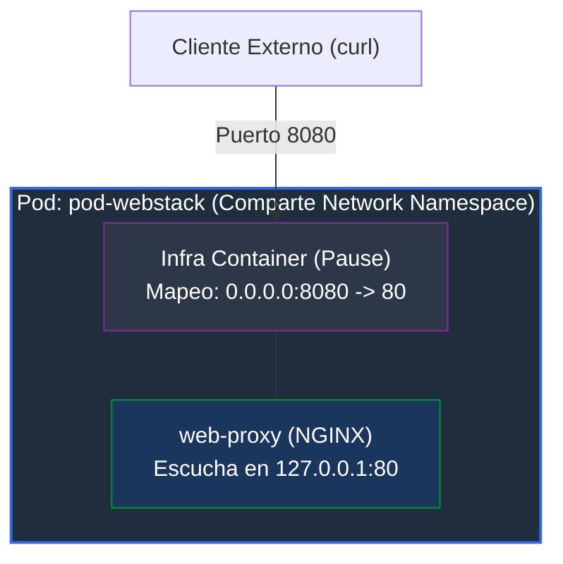

# Workshop y Runbook Operativo: Fundamentos de Podman, Modo Rootless y Gestión de Pods OCI

Documento técnico de operaciones para aprovisionar, operar y auditar cargas de trabajo OCI utilizando Podman (Pod Manager). Enseña a operar contenedores sin demonios (daemonless), sin privilegios de superusuario (rootless), a gestionar grupos de contenedores mediante Pods y a exportar/reproducir manifiestos declarativos de Kubernetes.

## Índice

1. [Arquitectura de Referencia: Docker vs. Podman](#1-arquitectura-de-referencia-docker-vs-podman)
2. [Fase I — Verificación y Configuración del Modo Rootless](#2-fase-i--verificación-y-configuración-del-modo-rootless)
3. [Fase II — Demostración Práctica del Mapeo de UIDs (User Namespaces)](#3-fase-ii--demostración-práctica-del-mapeo-de-uids-user-namespaces)
4. [Fase III — Redes Aisladas y Almacenamiento Persistente](#4-fase-iii--redes-aisladas-y-almacenamiento-persistente)
5. [Fase IV — Creación y Operación de Pods OCI](#5-fase-iv--creación-y-operación-de-pods-oci)
6. [Fase V — Exportación e Integración Declarativa con Kubernetes YAML](#6-fase-v--exportación-e-integración-declarativa-con-kubernetes-yaml)
7. [Fase VI — Limpieza de Recursos e Higienización del Host](#7-fase-vi--limpieza-de-recursos-e-higienización-del-host)
8. [Matriz de Equivalencias y Control Técnico](#8-matriz-de-equivalencias-y-control-técnico)

---

## 1. Arquitectura de Referencia: Docker vs. Podman

### ARQUITECTURA TRADICIONAL (DOCKER)

```
[CLI] ──(Socket UNIX)──> [dockerd (Daemon Root)] ──> [containerd] ──> [runc] ──> [Contenedor]
                               │
                (Punto único de falla y riesgo root)
```

### ARQUITECTURA MODERNA DAEMONLESS (PODMAN)

```
[CLI (podman)] ──(Fork/Exec)──> [conmon] ──> [crun / runc] ──> [Contenedor (UID 1000)]
```

**Sin Demonio (Daemonless):** Cada contenedor es un proceso hijo directo administrado por `conmon` (Container Monitor). No existe un proceso en segundo plano que consuma memoria de forma persistente ni que actúe como punto único de fallo.

**Espacios de nombres de usuario (User Namespaces):** El usuario root (UID 0) dentro del contenedor está mapeado a una cuenta no privilegiada en el host (HUSER 1000), bloqueando escalamientos de privilegios hacia el kernel del servidor.

---

## 2. Fase I — Verificación y Configuración del Modo Rootless

**Propósito de la fase:** Asegurar que el sistema operativo cuente con los rangos de sub-identificadores necesarios y la configuración de registros de imágenes para operar de forma desatendida.

### 2.1 Verificación de SubUIDs y SubGIDs

```bash
grep "$USER" /etc/subuid
grep "$USER" /etc/subgid
```

| Archivo | Semántica | Por qué es una buena práctica |
|---|---|---|
| `/etc/subuid` | Define el rango de identificadores de usuario secundarios delegados. | Asigna 65,536 UIDs virtuales para que el usuario pueda mapear identidades internas sin ser root. |
| `/etc/subgid` | Define el rango de identificadores de grupo secundarios delegados. | Permite aislar permisos de grupos dentro del contenedor en espacio de usuario. |

Resultado esperado:

```
gmt:100000:65536
```

### 2.2 Configuración de Registries Incondicionales

```bash
mkdir -p ~/.config/containers
cat << 'EOF' > ~/.config/containers/registries.conf
unqualified-search-registries = ["docker.io", "quay.io", "gcr.io"]
EOF
```

| Opción de Configuración | Semántica | Por qué es una buena práctica |
|---|---|---|
| `unqualified-search-registries` | Lista de registros consultados en orden al solicitar nombres cortos de imágenes (ej. `alpine`). | Evita errores de resolución interactiva y garantiza reproducibilidad en scripts automatizados. |

### 2.3 Auditoría de Seguridad del Entorno

```bash
podman info --format 'Rootless: {{.Host.Security.Rootless}} | Runtime: {{.Host.OCIRuntime.Name}}'
```

Resultado esperado:

```
Rootless: true | Runtime: runc
```

---

## 3. Fase II — Demostración Práctica del Mapeo de UIDs (User Namespaces)

**Propósito de la fase:** Evidenciar empíricamente la diferencia entre la identidad interna percibida por el proceso en el contenedor y su identidad real en la tabla de procesos del Kernel de Linux.

### 3.1 Inspección de Identidad Interna vs. Host

```bash
# 1. Inspeccionar UID dentro del contenedor
podman run --rm alpine id

# 2. Desplegar proceso en segundo plano
podman run -d --name test-sleep alpine sleep 100

# 3. Comparar el UID virtual del contenedor frente al UID real del host
podman top test-sleep user huser

# 4. Eliminar contenedor de prueba
podman rm -f test-sleep
```

| Comando / Opción | Semántica | Por qué es una buena práctica |
|---|---|---|
| `podman run --rm` | Descarga, ejecuta y destruye el contenedor al terminar el proceso. | Mantiene limpio el almacenamiento de pruebas efímeras. |
| `podman top <id> user huser` | Extrae el usuario interno (`user`) y el usuario real del host (`huser`). | SRE / Auditoría: Confirma que el proceso no corre como superusuario en el sistema físico. |

Resultado en consola:

```
USER        HUSER
root        1000
```

---

## 4. Fase III — Redes Aisladas y Almacenamiento Persistente

**Propósito de la fase:** Desplegar una base de datos relacional PostgreSQL 16 con almacenamiento inmutable y conectividad aislada a nivel de usuario.

### 4.1 Creación de Red y Volumen Administrado

```bash
podman network create net-workshop
podman volume create vol-db-data
```

| Comando | Semántica | Por qué es una buena práctica |
|---|---|---|
| `podman network create` | Crea un puente de red en espacio de usuario gestionado por Netavark/CNI. | Permite resolución DNS nativa entre contenedores sin exponer puertos al host. |
| `podman volume create` | Reserva un directorio administrado en `~/.local/share/containers/storage/volumes/`. | Desacopla la persistencia de los datos del ciclo de vida del contenedor. |

### 4.2 Despliegue de Base de Datos PostgreSQL

```bash
podman run -d \
  --name db-postgres \
  --network net-workshop \
  -v vol-db-data:/var/lib/postgresql/data \
  -e POSTGRES_PASSWORD=PodmanSecret2026 \
  docker.io/library/postgres:16-alpine
```

| Flag | Semántica | Por qué es una buena práctica |
|---|---|---|
| `-d` | Modo detached (segundo plano). | Libera la terminal para continuar con las operaciones. |
| `--network net-workshop` | Conecta el contenedor a la red privada. | Aísla la base de datos de accesos no autorizados. |
| `-v vol-db-data:...` | Monta el volumen persistente en el directorio de PostgreSQL. | Garantiza la inmutabilidad de los datos ante recreación del contenedor. |
| `-e POSTGRES_PASSWORD=...` | Inyecta la variable de entorno de inicialización. | Configura credenciales requeridas por el motor. |

### 4.3 Validación de Estado y Logs

```bash
podman ps
podman logs --tail 20 db-postgres
```

**Resultado esperado:** El contenedor se muestra en estado `Up` y los logs confirman `database system is ready to accept connections`.

---

## 5. Fase IV — Creación y Operación de Pods OCI

**Propósito de la fase:** Implementar el concepto de Pod (equivalente nativo de Kubernetes): múltiples contenedores que comparten la misma interfaz de red (localhost), dirección IP y tabla de puertos.



### 5.1 Creación del Pod y Asignación de Puertos

```bash
podman pod create --name pod-webstack -p 8080:80
```

| Flag | Semántica | Por qué es una buena práctica |
|---|---|---|
| `pod create` | Inicializa la estructura del Pod y levanta el contenedor infra (pause). | Centraliza la asignación de puertos en el Pod, permitiendo agregar o quitar contenedores dinámicamente. |
| `-p 8080:80` | Mapea el puerto del host directamente al espacio de red compartido del Pod. | Los contenedores dentro del Pod no requieren publicar puertos individuales. |

### 5.2 Incorporación de Servicios al Pod

```bash
podman run -d \
  --name web-proxy \
  --pod pod-webstack \
  docker.io/library/nginx:alpine
```

| Flag | Semántica | Por qué es una buena práctica |
|---|---|---|
| `--pod pod-webstack` | Une el contenedor al espacio de nombres de red y procesos del Pod. | Habilita la comunicación inter-servicio mediante `127.0.0.1` (localhost). |

### 5.3 Auditoría de Estructura del Pod

```bash
# Validar respuesta externa mapeada al Pod
curl -I http://localhost:8080

# Listar Pods y contenedores asociados
podman pod ps
podman ps --pod
```

**Resultado esperado:**

- `curl` retorna `HTTP/1.1 200 OK`.
- `podman ps --pod` lista dos contenedores asociados al Pod: el contenedor de infraestructura `pod-webstack-infra` y el servicio `web-proxy`.

---

## 6. Fase V — Exportación e Integración Declarativa con Kubernetes YAML

**Propósito de la fase:** Transformar la infraestructura imperativa creada en Podman a especificaciones declarativas estándar de Kubernetes (Kind: Pod), permitiendo su portabilidad directa a entornos de producción (k3s, EKS, GKE).

### 6.1 Generación del Manifiesto de Kubernetes

```bash
podman generate kube pod-webstack > webstack-k8s.yaml
cat webstack-k8s.yaml
```

| Comando | Semántica | Por qué es una buena práctica |
|---|---|---|
| `podman generate kube <pod>` | Analiza el Pod en ejecución y produce un manifiesto YAML estándar de Kubernetes. | Facilita la transición entre desarrollo local y clústeres de Kubernetes empresariales sin reescribir definiciones. |

### 6.2 Destrucción Imperativa y Recreación Declarativa (GitOps Ready)

```bash
# 1. Destruir el Pod creado manualmente
podman pod rm -f pod-webstack

# 2. Recrear toda la infraestructura leyendo directamente el archivo YAML
podman play kube webstack-k8s.yaml

# 3. Validar funcionamiento inmediato
curl -I http://localhost:8080
```

| Comando | Semántica | Por qué es una buena práctica |
|---|---|---|
| `podman play kube <archivo.yaml>` | Lee la definición de Kubernetes y levanta los Pods, contenedores y mapeos de red declarados. | Permite aplicar el paradigma de Infraestructura como Código (IaC) de forma nativa sin herramientas externas. |

---

## 7. Fase VI — Limpieza de Recursos e Higienización del Host

**Propósito de la fase:** Remover todos los contenedores, pods, volúmenes e imágenes creadas, dejando el sistema en su estado limpio original.

```bash
# 1. Destruir la infraestructura declarada en el archivo YAML
podman play kube --down webstack-k8s.yaml

# 2. Remover base de datos, volumen y red de la Fase III
podman rm -f db-postgres
podman volume rm vol-db-data
podman network rm net-workshop

# 3. Eliminar imágenes locales descargadas
podman rmi -a -f

# 4. Eliminar archivos locales temporales
rm -f webstack-k8s.yaml

# 5. Validación de auditoría de limpieza
podman pod ps
podman ps -a
podman volume ls
```

| Comando | Semántica | Por qué es una buena práctica |
|---|---|---|
| `podman play kube --down` | Lee el manifiesto YAML y destruye todos los recursos creados en orden inverso. | Garantiza la reversibilidad total de las definiciones declarativas. |
| `podman rmi -a -f` | Purga todas las imágenes del almacenamiento local rootless. | Recupera espacio en disco en el sistema de archivos del usuario. |

---

## 8. Matriz de Equivalencias y Control Técnico

| Capacidad Operativa | Docker Engine | Podman (Pod Manager) |
|---|---|---|
| Modelo de Procesos | Cliente-Servidor centralizado (dockerd en root). | Daemonless (Procesos hijos directos vía conmon). |
| Manejo de Privilegios | Requiere elevación de permisos (sudo / grupo docker). | Rootless nativo por User Namespaces (UID 1000). |
| Punto Único de Falla | La caída del demonio detiene la gestión de contenedores. | Aislado: Los contenedores siguen corriendo independientemente. |
| Agrupación de Cargas | Requiere Docker Compose (docker-compose.yml). | Pods nativos (podman pod create). |
| Integración Kubernetes | Herramientas externas (Kompose / Helm). | Nativa bidireccional (generate kube / play kube). |
| Almacenamiento Local | `/var/lib/docker/` (Propiedad de root). | `~/.local/share/containers/storage/` (Propiedad del usuario). |

