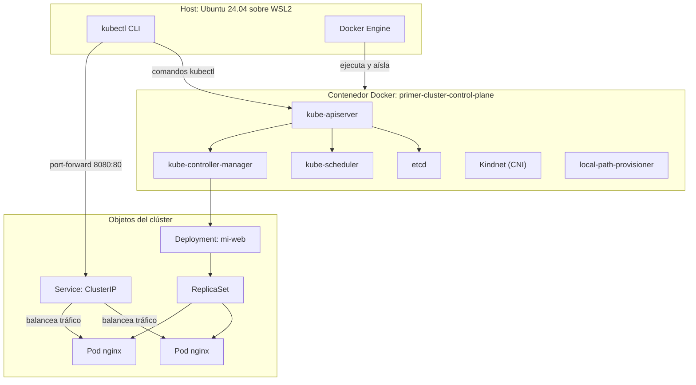
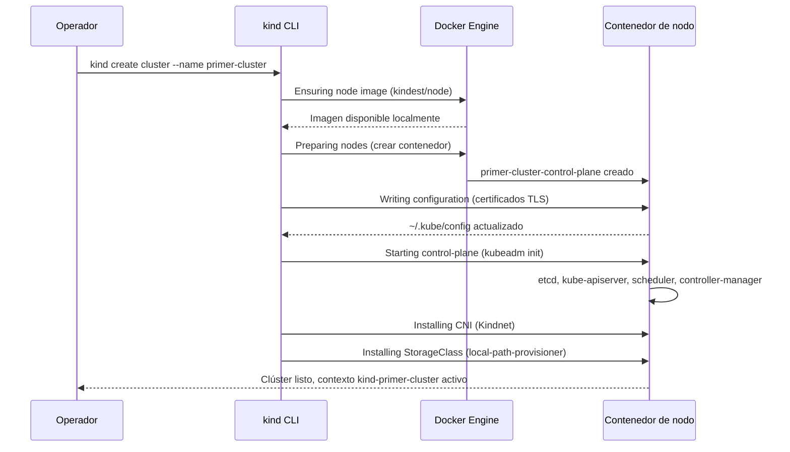
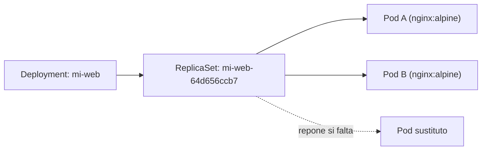
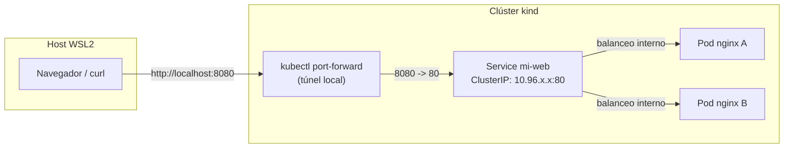
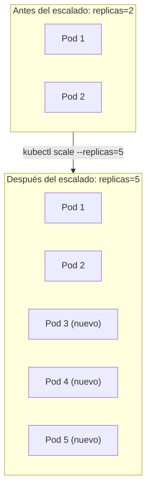
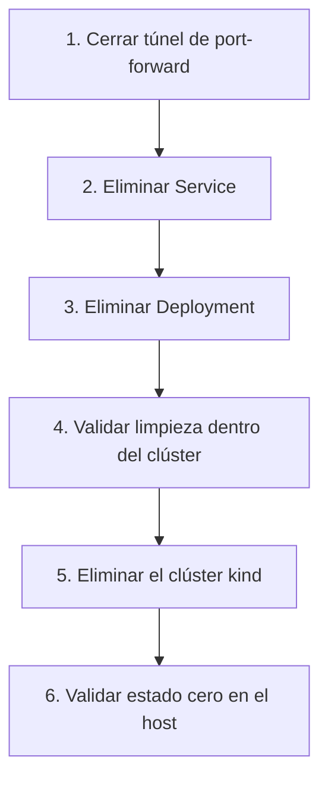

# Runbook Técnico: Ciclo de Vida Completo en Kubernetes con Kind (WSL2)


---

## Índice

1. [Objetivo del documento](#objetivo-del-documento)
2. [Arquitectura general del laboratorio](#arquitectura-general-del-laboratorio)
3. [Requisitos previos](#requisitos-previos)
4. [Fase 1 — Instalación del cliente y el orquestador local](#fase-1--instalación-del-cliente-y-el-orquestador-local)
5. [Fase 2 — Provisionamiento del clúster](#fase-2--provisionamiento-del-clúster)
6. [Fase 3 — Despliegue de cargas y autorreparación](#fase-3--despliegue-de-cargas-y-autorreparación)
7. [Fase 4 — Red interna y exposición de tráfico](#fase-4--red-interna-y-exposición-de-tráfico)
8. [Fase 5 — Escalabilidad horizontal](#fase-5--escalabilidad-horizontal)
9. [Fase 6 — Reverso y teardown completo](#fase-6--reverso-y-teardown-completo)
10. [Tabla resumen del ciclo de vida](#tabla-resumen-del-ciclo-de-vida)
11. [Resolución de problemas comunes](#resolución-de-problemas-comunes)
12. [Glosario técnico](#glosario-técnico)

---

## Objetivo del documento

Este runbook describe, paso a paso, el ciclo de vida completo de un clúster de Kubernetes construido con **kind** (Kubernetes in Docker) sobre **Ubuntu 24.04 en WSL2**. Cubre cuatro etapas obligatorias de cualquier operación de infraestructura: instalación de herramientas, aprovisionamiento, operación (despliegue, exposición de red, escalado y autorreparación) y desmantelamiento controlado.

Cada comando incluido en este documento fue verificado en el entorno descrito. El documento está pensado para que una persona sin experiencia previa en Kubernetes pueda ejecutar el laboratorio de principio a fin sin perder el control de lo que sucede en cada paso, y para que una persona con experiencia lo use como referencia rápida de operación.

---

## Arquitectura general del laboratorio

El siguiente diagrama muestra cómo se relacionan los componentes que se construyen a lo largo de este runbook: el host WSL2, el motor de contenedores Docker, el nodo de Kind actuando como plano de control, y los objetos de Kubernetes que se crean dentro de él.



---

## Requisitos previos

| Componente | Versión mínima recomendada | Verificación |
|---|---|---|
| Ubuntu | 24.04 LTS sobre WSL2 | `lsb_release -a` |
| Docker Engine | 24.x o superior, corriendo y accesible sin `sudo` | `docker ps` |
| Acceso a internet | Necesario para descargar binarios e imágenes | `curl -I https://dl.k8s.io` |
| Espacio en disco | 4 GB libres como mínimo | `df -h` |

Si Docker no está en ejecución dentro de WSL2, el comando `kind create cluster` fallará de inmediato con un error de conexión al socket de Docker. Confirmar que `docker ps` responde sin error antes de continuar con la Fase 1.

---

## Fase 1 — Instalación del cliente y el orquestador local


### Qué se instala en esta fase

Dos binarios independientes, sin relación de dependencia entre sí:

- **kubectl**: el cliente de línea de comandos oficial que traduce cada instrucción del operador en peticiones HTTP contra la API de Kubernetes.
- **kind**: la herramienta que empaqueta un nodo completo de Kubernetes (plano de control y, opcionalmente, nodos de trabajo) dentro de un único contenedor Docker.

### Qué se espera al finalizar la fase

Ambos comandos, `kubectl version --client` y `kind version`, deben responder con un número de versión sin errores de "command not found". Esta fase no crea todavía ningún clúster; solo deja disponibles las herramientas necesarias para hacerlo.

### 1.1. Descarga e instalación de kubectl

```bash
curl -LO "https://dl.k8s.io/release/$(curl -L -s https://dl.k8s.io/release/stable.txt)/bin/linux/amd64/kubectl"
sudo install -o root -g root -m 0755 kubectl /usr/local/bin/kubectl
rm kubectl
```

**Explicación línea por línea:**

| Instrucción | Función |
|---|---|
| `curl -LO` | Descarga el archivo remoto. `-L` sigue redirecciones HTTP (necesario porque `dl.k8s.io` redirige a un bucket de almacenamiento); `-O` guarda el archivo con el mismo nombre que tiene en el servidor de origen. |
| `$(curl -L -s https://dl.k8s.io/release/stable.txt)` | Subcomando que consulta el archivo de texto plano donde Kubernetes publica la última versión estable (ejemplo: `v1.31.0`). El flag `-s` (silent) suprime la barra de progreso para que la salida quede limpia y pueda incrustarse en la URL principal. |
| `sudo install -o root -g root -m 0755` | Copia el binario al destino final asignando en un solo paso atómico: propietario `root` (`-o`), grupo `root` (`-g`) y permisos `0755` (`-m`), equivalentes a lectura/escritura/ejecución para el dueño y lectura/ejecución para el resto. |
| `/usr/local/bin/kubectl` | Ruta de destino. Al estar incluida en la variable `$PATH` por defecto en Ubuntu, el binario queda disponible desde cualquier directorio sin necesidad de indicar la ruta completa. |
| `rm kubectl` | Elimina la copia temporal descargada en el directorio de trabajo actual, dejando el entorno sin archivos residuales. |

**Verificación:**

```bash
kubectl version --client
```

Salida esperada: un bloque con `Client Version: vX.Y.Z`. No debe aparecer ningún mensaje de conexión rechazada, porque todavía no existe un servidor de Kubernetes al cual conectarse.

### 1.2. Descarga e instalación de kind

```bash
curl -Lo ./kind https://kind.sigs.k8s.io/dl/v0.24.0/kind-linux-amd64
chmod +x ./kind
sudo mv ./kind /usr/local/bin/kind
```

**Explicación línea por línea:**

| Instrucción | Función |
|---|---|
| `curl -Lo ./kind` | Descarga el binario siguiendo redirecciones (`-L`) y fuerza el nombre de archivo de destino a `kind` (`-o ./kind`), independientemente del nombre original (`kind-linux-amd64`). |
| `chmod +x ./kind` | Agrega el permiso de ejecución al archivo descargado, que por defecto no lo trae. |
| `sudo mv ./kind /usr/local/bin/kind` | Mueve el binario ya ejecutable hacia el directorio global del sistema, dejándolo disponible en el `$PATH`. |

**Verificación:**

```bash
kind version
```

Salida esperada: `kind v0.24.0 go1.22.x linux/amd64` o similar.

---

## Fase 2 — Provisionamiento del clúster


### Qué ocurre en esta fase

`kind` levanta un contenedor Docker que actúa como nodo único de Kubernetes, con todos los componentes del plano de control ejecutándose dentro de él. Al terminar, `kubectl` queda configurado automáticamente para hablar con ese clúster.

### Qué se espera al finalizar la fase

Un nodo en estado `Ready` visible mediante `kubectl get nodes`, y un contexto llamado `kind-primer-cluster` activo en `~/.kube/config`.

### 2.1. Creación del clúster

```bash
kind create cluster --name primer-cluster
```

**Explicación de la sintaxis:**

| Fragmento | Función |
|---|---|
| `create cluster` | Subcomando que dispara la secuencia completa de aprovisionamiento: creación del contenedor, generación de certificados, inicialización del plano de control y configuración del cliente. |
| `--name primer-cluster` | Asigna una etiqueta identificadora al clúster. Si se omite, `kind` usa el nombre por defecto `kind`. Este valor se reutiliza después para el contexto (`kind-primer-cluster`) y para las operaciones de borrado. |

**Secuencia interna de eventos** (tal como se reporta en la salida del comando):



### 2.2. Verificación del estado del clúster

```bash
kubectl cluster-info
kubectl get nodes
```

| Comando | Qué muestra |
|---|---|
| `kubectl cluster-info` | Las URLs internas donde escuchan `kube-apiserver` y `CoreDNS`, confirmando que el plano de control responde. |
| `kubectl get nodes` | El listado de nodos del clúster junto a su estado (`STATUS`). |

Es normal que, en los primeros segundos posteriores a la creación, el nodo aparezca como `NotReady` mientras el complemento de red (CNI) termina de configurar las tablas de enrutamiento internas. Repetir el comando una vez transcurridos entre 10 y 20 segundos debe mostrar el estado `Ready`.

---

## Fase 3 — Despliegue de cargas y autorreparación


### Qué se construye en esta fase

Un `Deployment`, que a su vez crea y administra un `ReplicaSet`, cuyo único propósito es garantizar que exista siempre el número de Pods declarado. Esta relación jerárquica es la base del comportamiento de autorreparación que se valida al final de la fase.



### Qué se espera al finalizar la fase

Dos Pods en estado `Running`. Al eliminar manualmente uno de ellos, el sistema debe reponerlo sin intervención humana, manteniendo siempre el número declarado de réplicas.

### 3.1. Creación del Deployment

```bash
kubectl create deployment mi-web --image=nginx:alpine --replicas=2
```

| Fragmento | Función |
|---|---|
| `create deployment mi-web` | Registra un nuevo objeto `Deployment` con el identificador `mi-web` en el clúster. |
| `--image=nginx:alpine` | Define la imagen de contenedor que ejecutarán los Pods: Nginx sobre la base ligera Alpine Linux. |
| `--replicas=2` | Fija el estado deseado en dos instancias idénticas del Pod, ejecutándose de forma simultánea. |

### 3.2. Inspección del estado de los Pods

```bash
kubectl get pods -o wide
```

El flag `-o wide` amplía la salida estándar agregando la dirección IP interna asignada a cada Pod por el complemento de red y el nodo donde se está ejecutando. Durante los primeros segundos, la columna `STATUS` puede mostrar `ContainerCreating`, mientras el runtime de contenedores descarga las capas de la imagen `nginx:alpine`. El estado final esperado es `Running` para ambos Pods.

### 3.3. Prueba de autorreparación

```bash
kubectl delete pod <NOMBRE_DE_UN_POD>
```

`delete pod` elimina de forma inmediata y destructiva la instancia indicada. El nombre exacto del Pod se obtiene de la columna `NAME` en la salida del paso anterior.

Verificación inmediata:

```bash
kubectl get pods
```

Lo que debe observarse:

1. El Pod eliminado desaparece de inmediato del listado.
2. El controlador del `ReplicaSet` detecta que el número de Pods en ejecución (uno) no coincide con el estado deseado (dos), declarado originalmente en el `Deployment`.
3. En un plazo de pocos segundos, aparece un Pod nuevo con un sufijo de nombre distinto, reponiendo automáticamente la capacidad declarada.

Este comportamiento es el mecanismo de reconciliación continua de Kubernetes: el controlador compara de forma constante el estado observado contra el estado deseado y actúa para eliminar cualquier diferencia entre ambos.

---

## Fase 4 — Red interna y exposición de tráfico


### Por qué es necesaria esta fase

Los Pods son recursos efímeros: cada vez que se recrean, obtienen una dirección IP nueva. Un objeto `Service` resuelve este problema asignando una dirección virtual estable y un balanceador interno que distribuye el tráfico entre todos los Pods que coincidan con su selector de etiquetas, sin que el cliente necesite conocer las IPs individuales.



### Qué se espera al finalizar la fase

Una respuesta HTTP exitosa de Nginx (página de bienvenida) al consultar `http://localhost:8080` desde el navegador o desde `curl`, confirmando que el túnel de `port-forward` y el `Service` funcionan de extremo a extremo.

### 4.1. Creación del Service

```bash
kubectl expose deployment mi-web --type=ClusterIP --port=80 --target-port=80
```

| Fragmento | Función |
|---|---|
| `expose deployment mi-web` | Crea un `Service` cuyo selector apunta automáticamente a las mismas etiquetas que usan los Pods del `Deployment mi-web`. |
| `--type=ClusterIP` | Define el tipo de Service. `ClusterIP` asigna una dirección virtual accesible únicamente desde dentro del clúster; es el tipo por defecto y el adecuado para comunicación interna. |
| `--port=80` | Puerto en el que el Service escucha las conexiones entrantes. |
| `--target-port=80` | Puerto real dentro del contenedor al que se reenvía el tráfico recibido; en este caso coincide con el puerto en el que Nginx escucha por defecto. |

### 4.2. Inspección del Service

```bash
kubectl get svc mi-web
```

La columna `CLUSTER-IP` mostrará una dirección fija dentro del rango interno del clúster (por ejemplo, `10.96.175.31`). Esa dirección permanece constante durante toda la vida del Service, sin importar cuántas veces se recreen los Pods detrás de ella.

### 4.3. Exposición hacia el host mediante port-forward

```bash
kubectl port-forward svc/mi-web 8080:80
```

| Fragmento | Función |
|---|---|
| `port-forward` | Abre un túnel de socket bidireccional entre el host y un recurso dentro del clúster. El proceso permanece en primer plano hasta que se interrumpe manualmente. |
| `svc/mi-web` | Identifica el objeto destino del túnel: el Service `mi-web`. |
| `8080:80` | Mapeo de puertos con el formato `puerto_local:puerto_remoto`. El puerto 8080 del host queda conectado al puerto 80 del Service dentro del clúster. |

**Validación:** con el comando anterior en ejecución, abrir `http://localhost:8080` en un navegador (o ejecutar `curl http://localhost:8080` en otra terminal) debe devolver la página de bienvenida por defecto de Nginx.

---

## Fase 5 — Escalabilidad horizontal


### Qué demuestra esta fase

Que la capacidad de cómputo de una aplicación puede ajustarse en caliente, sin interrumpir el servicio ya activo y sin necesidad de recrear el `Deployment` ni el `Service`.



### Qué se espera al finalizar la fase

Cinco Pods en estado `Running`, todos alcanzables a través del mismo Service `mi-web`, sin que el túnel de `port-forward` abierto en la fase anterior se haya visto interrumpido.

### 5.1. Escalar réplicas

```bash
kubectl scale deployment mi-web --replicas=5
```

| Fragmento | Función |
|---|---|
| `scale deployment mi-web` | Modifica el campo `spec.replicas` del `Deployment` indicado, almacenado en `etcd`. |
| `--replicas=5` | Nuevo valor objetivo de instancias en ejecución simultánea. |

### 5.2. Validación

```bash
kubectl get pods
```

Los Pods que ya estaban corriendo continúan sin interrupciones. El `ReplicaSet` crea tres instancias adicionales para alcanzar el nuevo total de cinco, todas gestionadas bajo el mismo Service, sin cambios de configuración adicionales.

---

## Fase 6 — Reverso y teardown completo


### Por qué el orden importa

El desmontaje se ejecuta en sentido inverso a la creación de recursos, para evitar referencias rotas entre objetos que dependen unos de otros (por ejemplo, un túnel que apunta a un Service ya eliminado). Esta fase deja el sistema anfitrión en el mismo estado en que se encontraba antes de iniciar el laboratorio.



### 6.1. Cierre del túnel de red

En la terminal donde se ejecuta el túnel, presionar `Ctrl + C`. De forma alternativa, desde otra terminal:

```bash
pkill -f "kubectl port-forward" 2>/dev/null || true
```

| Fragmento | Función |
|---|---|
| `pkill -f` | Busca procesos cuyos argumentos de ejecución contengan la cadena indicada y les envía una señal de terminación. |
| `"kubectl port-forward"` | Patrón de búsqueda que identifica de forma inequívoca el proceso del túnel activo. |
| `2>/dev/null \|\| true` | Redirige cualquier mensaje de error hacia el descarte (`/dev/null`) y fuerza que el comando siempre termine con código de salida exitoso, incluso si no había ningún proceso activo que eliminar. |

### 6.2. Eliminación del Service

```bash
kubectl delete service mi-web
```

Retira la dirección virtual `ClusterIP`, limpia los registros asociados en el DNS interno del clúster (`CoreDNS`) y elimina las reglas de traducción de red gestionadas por `kube-proxy`.

### 6.3. Eliminación del Deployment

```bash
kubectl delete deployment mi-web
```

Destruye el objeto `Deployment` junto con el `ReplicaSet` que administra. Como consecuencia, se envía la señal `SIGTERM` a cada uno de los cinco Pods activos, dándoles oportunidad de finalizar de forma ordenada antes de recibir `SIGKILL` si no responden dentro del período de gracia.

### 6.4. Validación de limpieza dentro del clúster

```bash
kubectl get all
```

La única entrada que debe permanecer visible es `service/kubernetes`, el Service nativo que expone la API interna del clúster en el puerto 443. No debe existir ningún Pod, ReplicaSet ni Deployment perteneciente al laboratorio.

### 6.5. Destrucción total del clúster kind

```bash
kind delete cluster --name primer-cluster
```

Esta operación, en un único paso:

- Detiene y elimina el contenedor Docker `primer-cluster-control-plane`.
- Elimina las interfaces de red tipo *bridge* creadas específicamente para el clúster.
- Purga los volúmenes efímeros asociados a `containerd` y `etcd`.
- Borra el contexto `kind-primer-cluster` del archivo `~/.kube/config`.

### 6.6. Validación de estado cero en el sistema anfitrión

```bash
kind get clusters
docker ps
```

| Comando | Resultado esperado |
|---|---|
| `kind get clusters` | `No kind clusters found.` |
| `docker ps` | Ninguna fila correspondiente a contenedores de Kubernetes o de kind. |

Con ambas verificaciones en el estado descrito, el entorno queda completamente limpio y disponible para iniciar un nuevo ciclo del laboratorio desde la Fase 2.

---

## Tabla resumen del ciclo de vida

| Fase | Recurso | Comando de ejecución | Comando de reverso |
|---|---|---|---|
| 2 | Infraestructura | `kind create cluster --name <NOMBRE>` | `kind delete cluster --name <NOMBRE>` |
| 3 | Cómputo (Pods) | `kubectl create deployment <NOMBRE> --image=` | `kubectl delete deployment <NOMBRE>` |
| 4 | Red (Service) | `kubectl expose deployment <NOMBRE> --port=X` | `kubectl delete service <NOMBRE>` |
| 4 | Acceso local | `kubectl port-forward svc/<NOMBRE> <LOCAL>:<K8S>` | `Ctrl + C` o `pkill -f "kubectl port-forward"` |
| 5 | Capacidad | `kubectl scale deployment <NOMBRE> --replicas=N` | `kubectl scale deployment <NOMBRE> --replicas=1` |

---

## Resolución de problemas comunes

| Síntoma | Causa probable | Acción correctiva |
|---|---|---|
| `kind create cluster` falla con error de conexión al socket | Docker Engine no está en ejecución en WSL2 | Iniciar Docker (`sudo service docker start` o abrir Docker Desktop) y confirmar con `docker ps` |
| Nodo permanece en `NotReady` más de un minuto | El complemento de red (CNI) aún no terminó de inicializarse | Esperar y repetir `kubectl get nodes`; si persiste, revisar `kubectl describe node <NODO>` |
| `kubectl port-forward` se corta al escalar el Deployment | Comportamiento esperado si el Pod específico al que apuntaba el túnel fue reemplazado | Volver a ejecutar el comando de `port-forward`, dado que apunta al Service y no a un Pod individual, esto normalmente no ocurre; si sucede, verificar que se usó `svc/mi-web` y no `pod/<nombre>` |
| `kubectl get pods` muestra `ImagePullBackOff` | Sin conectividad a internet desde el nodo de kind, o nombre de imagen incorrecto | Verificar conectividad del contenedor `primer-cluster-control-plane` y revisar el valor de `--image` |
| `kind delete cluster` no elimina el contenedor | Proceso interrumpido a mitad de ejecución | Ejecutar `docker rm -f primer-cluster-control-plane` manualmente y luego `kind get clusters` para confirmar |

---

## Glosario técnico

| Término | Definición |
|---|---|
| **Plano de control** | Conjunto de componentes (`kube-apiserver`, `etcd`, `kube-scheduler`, `kube-controller-manager`) responsables de mantener el estado deseado del clúster. |
| **CNI** | Container Network Interface: especificación e implementación que asigna direcciones IP a los Pods y gestiona el enrutamiento entre ellos. |
| **ReplicaSet** | Controlador que garantiza que un número específico de réplicas de un Pod se mantenga en ejecución en todo momento. |
| **ClusterIP** | Tipo de Service que expone una dirección IP virtual accesible únicamente dentro del clúster. |
| **Reconciliación** | Proceso continuo mediante el cual los controladores de Kubernetes comparan el estado observado contra el estado deseado y aplican los cambios necesarios para igualarlos. |
| **etcd** | Base de datos clave-valor distribuida donde Kubernetes almacena todo el estado del clúster. |

