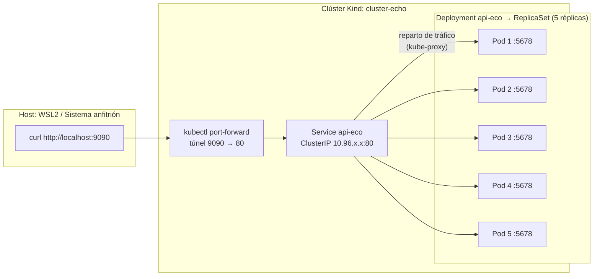
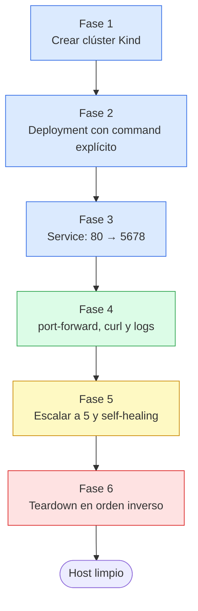
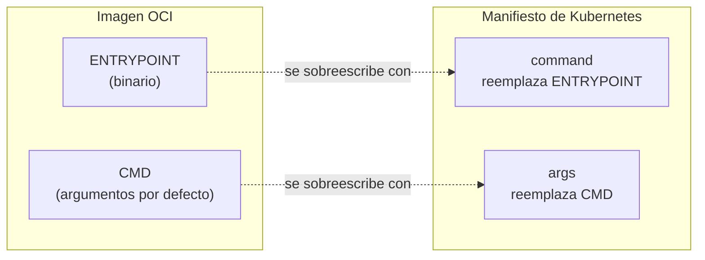

# Workshop 2: Microservicios en Kubernetes — Inyección de Comandos, Balanceo y Resiliencia en Kind


> Taller práctico de **SRE / DevOps** para desplegar, exponer, observar, escalar y destruir un microservicio HTTP dentro de un clúster local de Kubernetes creado con **Kind**, sobre **Ubuntu 24.04 en WSL2**.

---

## Tabla de Contenidos

1. [Descripción General](#descripción-general)
2. [Objetivos de Aprendizaje](#objetivos-de-aprendizaje)
3. [Arquitectura del Laboratorio](#arquitectura-del-laboratorio)
4. [Resumen de Fases](#resumen-de-fases)
5. [Requisitos del Entorno](#requisitos-del-entorno)
6. [Inicio Rápido](#inicio-rápido)
7. [Estructura del Repositorio](#estructura-del-repositorio)
8. [Conceptos Clave](#conceptos-clave)
9. [Errores Comunes](#errores-comunes)
10. [Siguientes Pasos](#siguientes-pasos)

---

## Descripción General

Este taller aborda el despliegue, configuración y operación de un microservicio real dentro de un clúster local. Se trabajan problemas frecuentes en entornos productivos:

- Manejo de **imágenes OCI reducidas** (sin shell, sin `$PATH` útil).
- Diferencia entre **`command`** (el binario) y **`args`** (sus parámetros).
- **Traducción de puertos** entre el Service y el contenedor.
- **Observabilidad** de logs de varias réplicas con selectores de etiquetas.
- **Escalado horizontal** en caliente y **autorreparación** (*self-healing*).
- **Teardown** ordenado para dejar el host limpio.

La aplicación es [`hashicorp/http-echo`](https://hub.docker.com/r/hashicorp/http-echo): un servidor HTTP minimalista que responde con un texto fijo. Es ideal porque su imagen contiene únicamente un binario (`/http-echo`), lo que obliga a entender cómo Kubernetes ejecuta contenedores.

---

## Objetivos de Aprendizaje

| # | Objetivo | Qué demuestra |
|---|----------|---------------|
| 1 | **Gestión de comandos y argumentos OCI** | Diferencia entre sobreescribir el ejecutable (`command` / `entrypoint`) y pasar parámetros (`args`) para evitar `CrashLoopBackOff`. |
| 2 | **Traducción y abstracción de puertos** | Un `Service` `ClusterIP` expone el puerto estándar `80` y redirige al puerto real `5678` del proceso. |
| 3 | **Operación de túneles locales** | Gestionar `port-forward` en segundo plano y controlar la pausa de sincronización del socket TCP. |
| 4 | **Observabilidad basada en etiquetas** | Consolidar logs de múltiples Pods con `-l app=api-eco`. |
| 5 | **Escalado y resiliencia** | Pasar de 2 a 5 réplicas sin caída de servicio y verificar la reconciliación tras borrar un Pod. |
| 6 | **Desmantelamiento metodológico** | Teardown en orden inverso de dependencias para limpiar host y red. |

---

## Arquitectura del Laboratorio

### Diagrama 1 — Vista de componentes



**Cómo leerlo (de izquierda a derecha):**

1. **`curl`** vive en tu máquina (WSL2) y apunta a `localhost:9090`.
2. **`kubectl port-forward`** abre un túnel TCP desde tu host hacia el clúster: todo lo que llegue al `9090` local se reenvía al puerto `80` del Service.
3. El **Service `api-eco`** tiene una IP virtual estable (`ClusterIP`). Recibe en el puerto `80` y traduce hacia el `targetPort` `5678`.
4. Los **Pods** (gestionados por un ReplicaSet) escuchan en `5678`. Cada uno es una réplica idéntica del microservicio.

> **Nota de precisión:** el reparto de carga real entre Pods lo hace `kube-proxy` (iptables/IPVS) para el tráfico que entra **por el Service dentro del clúster**. Un `port-forward` a `svc/...` selecciona **un** Pod y mantiene el túnel contra él. En el [RUNBOOK](RUNBOOK.md#apéndice-a--demostración-del-balanceo-real-desde-dentro-del-clúster) hay un ejercicio opcional para observar el balanceo real.

### Diagrama 2 — Ciclo de vida del taller



**Cómo leerlo:** las fases son estrictamente secuenciales; cada una depende del resultado de la anterior. Los colores agrupan la intención: azul = construir, verde = probar y observar, amarillo = operar bajo estrés, rojo = destruir.

---

## Resumen de Fases

| Fase | Título | Descripción técnica |
|:----:|--------|---------------------|
| **1** | Aprovisionamiento aislado | Inicialización de un clúster local independiente (`cluster-echo`) y verificación del estado `Ready` en el nodo de control. |
| **2** | Despliegue con comando explícito | Creación de un Deployment con 2 réplicas pasando el binario `/http-echo` y sus argumentos, evitando fallos de resolución en el `$PATH`. |
| **3** | Abstracción de red (Service) | Exposición del microservicio desacoplando el puerto de entrada (`80`) del puerto interno del contenedor (`5678`). |
| **4** | Exposición local y logs | Túnel TCP hacia el host en el puerto `9090`, tráfico de prueba e inspección de logs consolidados. |
| **5** | Escalabilidad y autorreparación | Escalado en caliente a 5 réplicas y eliminación de un Pod usando `jsonpath` para auditar la reposición. |
| **6** | Desmantelamiento controlado | Cierre de túneles, purga secuencial de recursos y destrucción del clúster Kind. |

---

## Requisitos del Entorno

| Requisito | Detalle | Verificación |
|-----------|---------|--------------|
| Sistema | WSL2 con Ubuntu 24.04 LTS | `lsb_release -a` |
| Docker | Engine activo, usable **sin `sudo`** | `docker ps` |
| `kubectl` | Instalado y en el `$PATH` | `kubectl version --client` |
| `kind` | v0.24.0 o superior, en el `$PATH` | `kind version` |
| Puerto libre | `9090` disponible en el host | `ss -ltn \| grep 9090` (sin salida = libre) |

---

## Inicio Rápido

Si ya tienes todo instalado, esta es la secuencia mínima completa (el detalle, salidas esperadas y solución de problemas están en el **[RUNBOOK.md](RUNBOOK.md)**):

```bash
kind create cluster --name cluster-echo
kubectl create deployment api-eco --image=hashicorp/http-echo:0.2.3 --replicas=2 \
  -- /http-echo -text="Respuesta generada por el backend"
kubectl expose deployment api-eco --type=ClusterIP --port=80 --target-port=5678
kubectl port-forward svc/api-eco 9090:80 &
sleep 2 && curl http://localhost:9090
```

Para limpiar todo:

```bash
pkill -f "kubectl port-forward" 2>/dev/null || true
kind delete cluster --name cluster-echo
```

---

## Estructura del Repositorio

```text
WS_2/
├── README.md     ← Visión general, objetivos y arquitectura (este archivo)
└── RUNBOOK.md    ← Guía operativa paso a paso con verificaciones
```

---

## Conceptos Clave

### `command` vs `args`



**Explicación:** Kubernetes no usa los nombres de Docker. `command` equivale a `ENTRYPOINT` y `args` a `CMD`. Si en `command` solo pones `-text="hola"` (un argumento), el runtime intentará **ejecutar `-text=hola` como binario**, fallará y el Pod entrará en `CrashLoopBackOff`. Por eso, con `kubectl create deployment ... -- <cmd>`, todo lo que va tras `--` pasa a `command` y **debe empezar por la ruta del binario** (`/http-echo`).

### Puertos: `port` vs `targetPort`

| Campo | Significado | En este taller |
|-------|-------------|----------------|
| `port` | Puerto en el que el **Service** escucha | `80` |
| `targetPort` | Puerto del **contenedor** al que se reenvía | `5678` |
| `9090:80` (port-forward) | `puertoLocal:puertoDelService` | `9090` → `80` |

### Self-healing

El **Deployment** declara un *estado deseado* (`replicas: 5`). El **ReplicaSet** compara continuamente el estado real con el deseado y crea Pods si faltan. Es un **bucle de reconciliación**: no hay que intervenir manualmente.

---

## Errores Comunes

| Síntoma | Causa probable | Solución rápida |
|---------|----------------|-----------------|
| Pod en `CrashLoopBackOff` | `command` sin ruta al binario | Recrear con `-- /http-echo -text=...` |
| `curl: (7) Failed to connect` | El túnel aún no está enlazado | Esperar (`sleep 2`) o revisar que `port-forward` siga vivo |
| `bind: address already in use` | Puerto `9090` ocupado | `pkill -f "kubectl port-forward"` o usar otro puerto |
| `curl` falla tras borrar un Pod | El túnel apuntaba justo a ese Pod | Reiniciar el `port-forward` (ver RUNBOOK) |
| `docker ps` muestra contenedores tras el teardown | Hay otros contenedores ajenos al taller | Verificar que no exista ninguno llamado `cluster-echo-*` |

---

## Siguientes Pasos

- Reemplazar comandos imperativos por **manifiestos YAML** versionados.
- Añadir **readiness / liveness probes** para un self-healing más fino.
- Exponer con **Ingress** o `NodePort` mediante `extraPortMappings` de Kind.
- Introducir **HPA** (Horizontal Pod Autoscaler) para escalado automático.

---

<p align="center"><sub>Taller 2 · SRE Linux Mastery · Kubernetes con Kind</sub></p>

