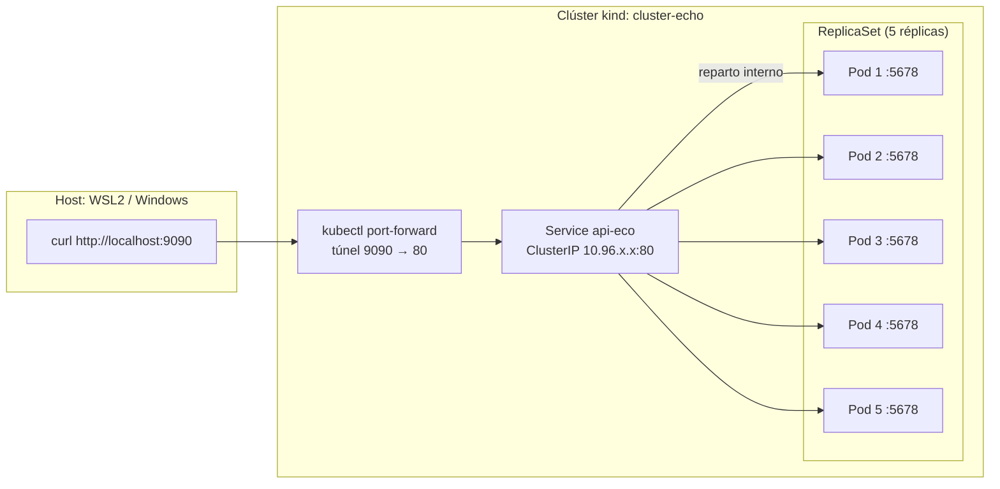
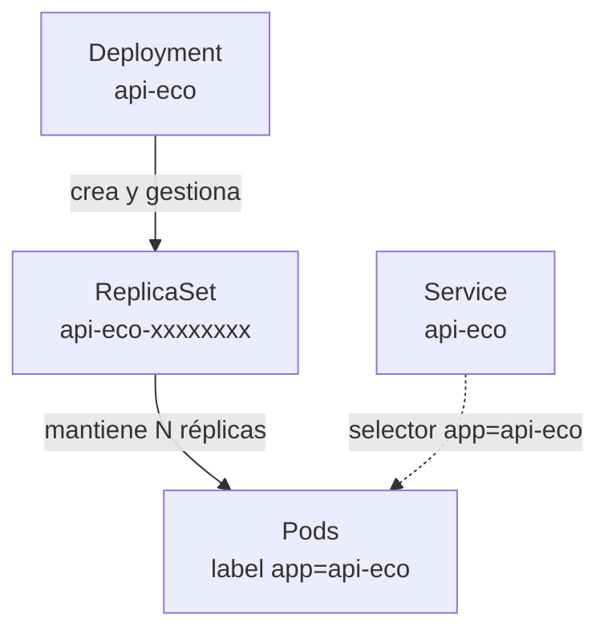
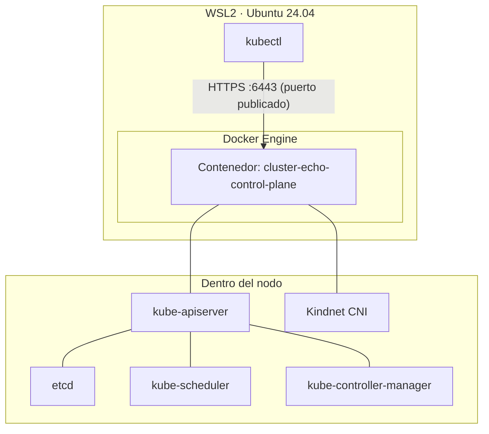
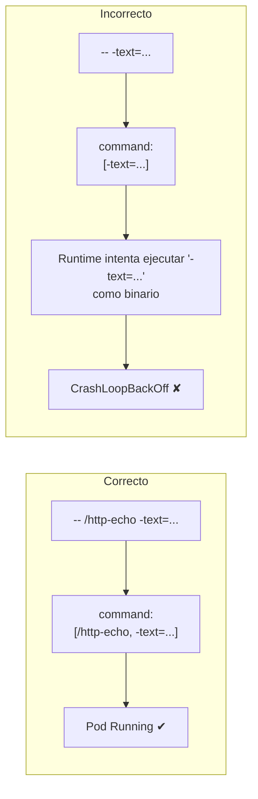
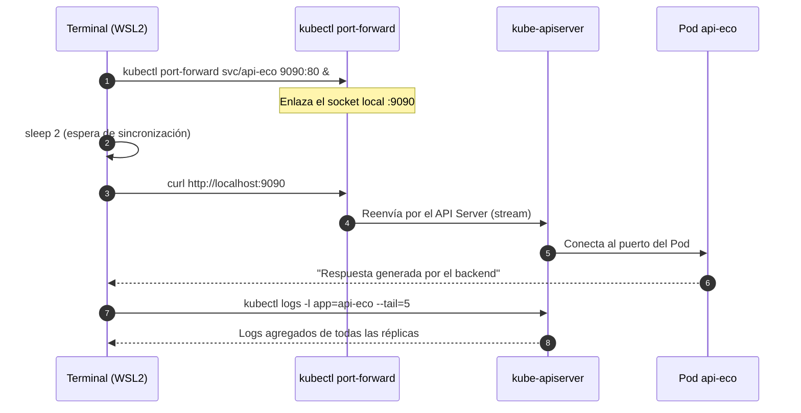
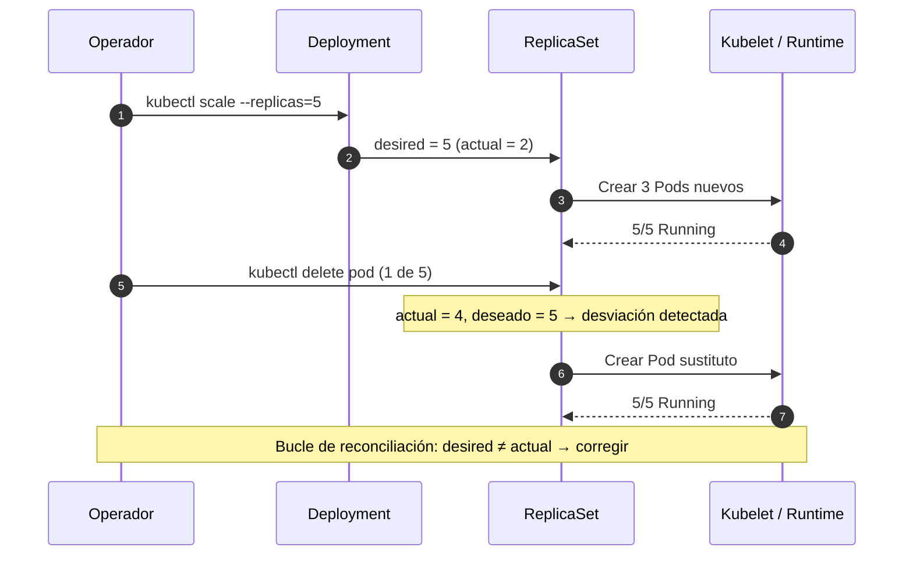
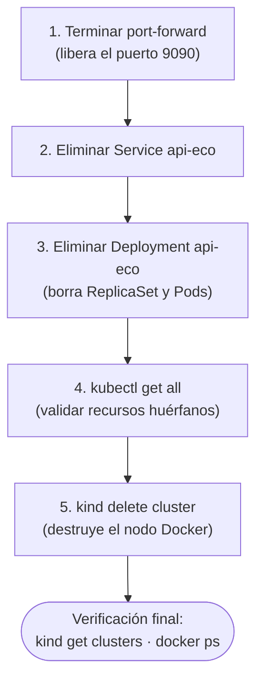
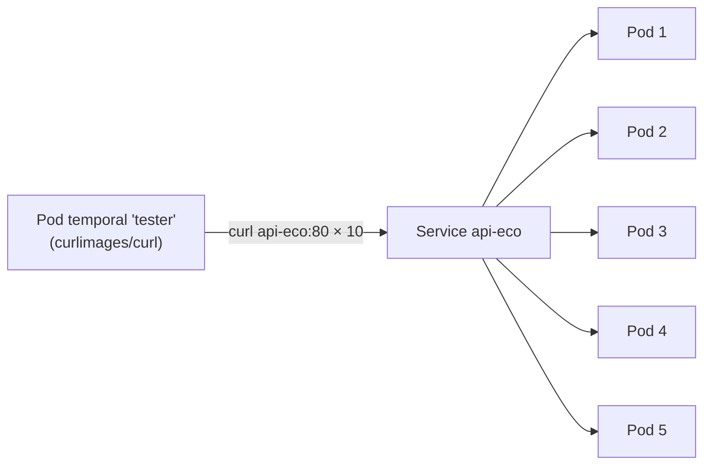

# Runbook Técnico: Microservicio HTTP, Balanceo y Resiliencia en Kubernetes con Kind


---

## Tabla de Contenidos

- [Objetivo del Documento](#objetivo-del-documento)
- [Cómo usar este runbook](#cómo-usar-este-runbook)
- [Arquitectura del Taller](#arquitectura-del-taller)
- [Fase 0 — Verificación previa](#fase-0--verificación-previa)
- [Fase 1 — Provisionamiento del clúster aislado](#fase-1--provisionamiento-del-clúster-aislado)
- [Fase 2 — Despliegue con comando explícito](#fase-2--despliegue-de-la-api-con-comando-explícito)
- [Fase 3 — Abstracción de red y traducción de puertos](#fase-3--abstracción-de-red-y-traducción-de-puertos)
- [Fase 4 — Exposición local, pruebas HTTP y logs](#fase-4--exposición-local-pruebas-http-y-logs)
- [Fase 5 — Escalabilidad y resiliencia](#fase-5--escalabilidad-horizontal-y-resiliencia-self-healing)
- [Fase 6 — Desmantelamiento controlado](#fase-6--desmantelamiento-controlado-teardown)
- [Apéndice A — Demostración del balanceo real](#apéndice-a--demostración-del-balanceo-real-desde-dentro-del-clúster)
- [Apéndice B — Troubleshooting](#apéndice-b--troubleshooting)
- [Apéndice C — Glosario](#apéndice-c--glosario)
- [Apéndice D — Hoja de referencia rápida](#apéndice-d--hoja-de-referencia-rápida)

---

## Objetivo del Documento

Este runbook documenta el ciclo de vida completo de un microservicio empaquetado en una imagen minimalista (`hashicorp/http-echo`). Cubre:

1. El **pasaje explícito de comandos** al runtime OCI.
2. La **traducción de puertos** arbitrarios a estándares HTTP mediante Services `ClusterIP`.
3. La **inspección agregada de registros** con selectores de etiquetas.
4. La **escalabilidad horizontal en caliente**.
5. La **autorreparación** (*self-healing*) ante la pérdida de Pods.
6. Un **teardown** limpio y verificable.

---

## Cómo usar este runbook

Cada fase sigue la misma estructura para facilitar el estudio y la operación:

| Bloque | Propósito |
|--------|-----------|
| **Qué ocurre** | Contexto conceptual: qué se construye y por qué. |
| **Comandos** | Lo que se ejecuta, con comentarios línea a línea. |
| **Salida esperada** | Ejemplo aproximado (los nombres/IPs/edades variarán). |
| **Verificación** | Criterio objetivo de éxito antes de continuar. |
| **Si algo falla** | Diagnóstico rápido de los errores más probables. |

> **Regla de oro:** no avances a la siguiente fase sin cumplir la verificación de la actual.

---

## Arquitectura del Taller

### Diagrama 1 — Componentes finales (estado tras la Fase 5)



**Explicación del diagrama:**

| Elemento | Rol |
|----------|-----|
| `CLIENT` | Cliente HTTP en tu host; solo conoce `localhost:9090`. |
| `PF` | Proceso `kubectl port-forward`. Es un túnel **temporal y local**; no forma parte del clúster, vive en tu terminal. |
| `SVC` | Punto de entrada estable con IP virtual. Traduce `80` → `5678`. Su IP no cambia aunque los Pods mueran y renazcan. |
| `P1…P5` | Réplicas idénticas creadas por el ReplicaSet. Sus IPs sí son efímeras. |

### Diagrama 2 — Jerarquía de objetos de Kubernetes



**Explicación:** el `Deployment` no crea Pods directamente: crea un `ReplicaSet`, que es quien garantiza el número de réplicas. El `Service` **no está "dentro" del Deployment**; se acopla a los Pods únicamente a través de la **etiqueta** `app=api-eco`. Este acoplamiento por etiquetas es la razón por la que `kubectl logs -l app=api-eco` y el Service ven exactamente los mismos Pods.

---

## Fase 0 — Verificación previa

**Qué ocurre:** se comprueba que el entorno cumple los requisitos antes de tocar nada.

```bash
# Docker accesible sin sudo
docker ps

# Versiones de las herramientas
kind version
kubectl version --client

# Puerto 9090 libre (sin salida = libre)
ss -ltn | grep 9090

# No debe existir ya un clúster con el mismo nombre
kind get clusters
```

**Verificación:** `docker ps` responde sin errores de permisos, `kind` y `kubectl` muestran versión, y `cluster-echo` **no** aparece en `kind get clusters`.

**Si algo falla:**

| Error | Solución |
|-------|----------|
| `permission denied ... docker.sock` | `sudo usermod -aG docker $USER` y reiniciar la sesión de WSL (`wsl --shutdown` desde Windows). |
| `Cannot connect to the Docker daemon` | Iniciar Docker Engine (`sudo service docker start`) o Docker Desktop con integración WSL. |
| `cluster-echo` ya existe | `kind delete cluster --name cluster-echo` y repetir. |

---

## Fase 1 — Provisionamiento del Clúster Aislado

### Qué ocurre en esta fase

Kind crea **un contenedor Docker** que actúa como nodo de Kubernetes. Dentro corre todo el plano de control: `kube-apiserver`, `etcd`, `kube-scheduler`, `kube-controller-manager` y la red CNI (Kindnet). Al ser un clúster con nombre propio, queda **aislado** de cualquier otro contexto que tengas.



**Explicación:** `kubectl` habla con el `kube-apiserver` a través de un puerto que Kind publica en `localhost`. El API Server es la única puerta de entrada: guarda el estado en `etcd`, el `scheduler` decide en qué nodo va cada Pod y el `controller-manager` ejecuta los bucles de reconciliación (los que darán el self-healing en la Fase 5). Al ser un clúster de **un solo nodo**, este mismo nodo también ejecuta las cargas de trabajo.

### Comandos de ejecución

```bash
# 1. Crear el clúster con nombre explícito
kind create cluster --name cluster-echo

# 2. Verificar que el plano de control alcance el estado operativo
kubectl get nodes
```

### Salida esperada

```text
Creating cluster "cluster-echo" ...
 ✓ Ensuring node image (kindest/node:v1.31.0) 🖼
 ✓ Preparing nodes 📦
 ✓ Writing configuration 📜
 ✓ Starting control-plane 🕹️
 ✓ Installing CNI 🔌
 ✓ Installing StorageClass 💾
Set kubectl context to "kind-cluster-echo"

NAME                         STATUS   ROLES           AGE   VERSION
cluster-echo-control-plane   Ready    control-plane   40s   v1.31.0
```

### Verificación

- El nodo reporta **`Ready`** en la columna `STATUS`.
- El contexto activo es `kind-cluster-echo`: `kubectl config current-context`.

### Si algo falla

| Síntoma | Causa / Solución |
|---------|------------------|
| Nodo en `NotReady` | Esperar 30–60 s (el CNI aún se inicializa) y repetir `kubectl get nodes`. |
| Timeout creando el clúster | Poca RAM en WSL2; ajustar `.wslconfig` (p. ej. `memory=4GB`) y reiniciar WSL. |
| `kubectl` apunta a otro clúster | `kubectl config use-context kind-cluster-echo`. |

---

## Fase 2 — Despliegue de la API con Comando Explícito

### Qué ocurre en esta fase

Se crea un **Deployment** con 2 réplicas. La imagen `hashicorp/http-echo` es minimalista: contiene **solo el binario `/http-echo`**, sin shell ni utilidades. Por eso hay que indicar la **ruta absoluta del binario** tras el delimitador `--`.

**¿Qué hace exactamente `--`?** Separa las opciones de `kubectl` de lo que se enviará al contenedor. Todo lo que va después se guarda en el campo **`command`** del Pod (equivalente a `ENTRYPOINT`). Como `command` **reemplaza** el ejecutable, su primer elemento debe ser el binario.



**Explicación del diagrama:** a la izquierda, el primer elemento es un ejecutable real, así que el contenedor arranca. A la derecha, el runtime interpreta `-text=...` como programa a ejecutar; no existe, el contenedor sale con error y Kubernetes lo reinicia en bucle con esperas crecientes (`CrashLoopBackOff`).

### Comandos de ejecución

```bash
# 1. Crear el Deployment declarando comando y argumentos
#    --image      → imagen fijada a una versión (nunca usar :latest en producción)
#    --replicas=2 → estado deseado inicial
#    --           → todo lo que sigue va al campo 'command' del contenedor
kubectl create deployment api-eco \
  --image=hashicorp/http-echo:0.2.3 \
  --replicas=2 \
  -- /http-echo -text="Respuesta generada por el backend"

# 2. Inspeccionar la creación de Pods (filtrando por etiqueta)
kubectl get pods -l app=api-eco
```

### Salida esperada

```text
deployment.apps/api-eco created

NAME                       READY   STATUS    RESTARTS   AGE
api-eco-6c8b7d9f5d-4kx2p   1/1     Running   0          15s
api-eco-6c8b7d9f5d-m9wqz   1/1     Running   0          15s
```

> En el primer despliegue puede verse `ContainerCreating` unos segundos mientras se descarga la imagen.

### Verificación

- Ambos Pods en **`Running`** con **`0` reinicios** (`RESTARTS`).
- Comprobar el comando efectivo:

  ```bash
  kubectl get deployment api-eco -o jsonpath='{.spec.template.spec.containers[0].command}'
  ```
  Debe mostrar `["/http-echo","-text=Respuesta generada por el backend"]`.

### Si algo falla

| Síntoma | Diagnóstico |
|---------|-------------|
| `CrashLoopBackOff` | `kubectl logs <pod>` y `kubectl describe pod <pod>`; revisar que el primer elemento tras `--` sea `/http-echo`. |
| `ImagePullBackOff` | Sin acceso a Docker Hub o tag inexistente; revisar red y nombre de imagen. |
| `Pending` | `kubectl describe pod <pod>` → sección *Events* (recursos insuficientes). |

---

## Fase 3 — Abstracción de Red y Traducción de Puertos

### Qué ocurre en esta fase

Los Pods tienen IPs efímeras y escuchan en un puerto poco común (`5678`). Un **Service `ClusterIP`** ofrece:

- Una **IP virtual estable** dentro del clúster.
- Un **nombre DNS** (`api-eco.default.svc.cluster.local`).
- **Traducción de puertos**: entrada `80` → salida `5678`.


**Explicación:** al cliente le basta con conocer `api-eco:80`, un puerto HTTP estándar. Si mañana el desarrollador cambia el puerto de la aplicación, solo se modifica el `targetPort` del Service; los clientes no se enteran. Eso es **desacoplamiento**.

### Comandos de ejecución

```bash
# 1. Crear el Service con desacoplamiento de puertos
#    --port=80         → puerto del Service
#    --target-port=5678 → puerto real del contenedor
kubectl expose deployment api-eco --type=ClusterIP --port=80 --target-port=5678

# 2. Inspeccionar la IP virtual asignada
kubectl get svc api-eco

# 3. (Recomendado) Confirmar que el Service encontró los Pods
kubectl get endpoints api-eco
```

### Salida esperada

```text
service/api-eco exposed

NAME      TYPE        CLUSTER-IP     EXTERNAL-IP   PORT(S)   AGE
api-eco   ClusterIP   10.96.142.87   <none>        80/TCP    5s

NAME      ENDPOINTS                         AGE
api-eco   10.244.0.5:5678,10.244.0.6:5678   5s
```

### Verificación

- `PORT(S)` muestra **`80/TCP`** y hay una IP fija en `CLUSTER-IP`.
- `ENDPOINTS` lista **tantas IPs como réplicas** (2 ahora) y todas con `:5678`. Si aparece `<none>`, el selector no encuentra Pods.

### Si algo falla

| Síntoma | Causa |
|---------|-------|
| `ENDPOINTS` vacío | Pods no `Ready` o etiqueta distinta. Comparar `kubectl get svc api-eco -o wide` (selector) con `kubectl get pods --show-labels`. |
| Conexión rechazada más adelante | `targetPort` incorrecto (no coincide con el puerto real del proceso). |

---

## Fase 4 — Exposición Local, Pruebas HTTP y Logs

### Qué ocurre en esta fase

El Service `ClusterIP` **solo es accesible desde dentro del clúster**. Para probarlo desde WSL2 se abre un **túnel** con `kubectl port-forward`: el puerto `9090` local se reenvía al puerto `80` del Service.

Como el comando se lanza **en segundo plano** (`&`), el socket tarda una fracción de segundo en quedar enlazado. Si se lanza `curl` de inmediato puede fallar con *connection refused*; de ahí el `sleep 2`.



**Explicación del flujo:**

1. Se abre el túnel en segundo plano.
2. `sleep 2` da tiempo a que el socket quede escuchando.
3. `curl` entra por `localhost:9090`; el tráfico viaja **a través del API Server** hasta un Pod.
4. Los logs se consultan por separado con un **selector de etiquetas**, que reúne en una sola salida las trazas de **todas** las réplicas.

> **Precisión importante:** `port-forward svc/...` resuelve el Service a **un único Pod** y mantiene el túnel contra él. No reparte peticiones entre réplicas. Es una herramienta de **depuración**, no de balanceo. Para ver el balanceo real, consulta el [Apéndice A](#apéndice-a--demostración-del-balanceo-real-desde-dentro-del-clúster).

### Comandos de ejecución

```bash
# 1. Iniciar port-forward en background y esperar a que el socket quede enlazado
kubectl port-forward svc/api-eco 9090:80 &
sleep 2

# 2. Enviar petición HTTP de prueba
curl http://localhost:9090

# 3. Consultar logs agregados de todas las réplicas
#    -l app=api-eco → selector de etiquetas
#    --tail=5       → últimas 5 líneas por Pod
kubectl logs -l app=api-eco --tail=5
```

### Salida esperada

```text
[1] 4321
Forwarding from 127.0.0.1:9090 -> 5678
Forwarding from [::1]:9090 -> 5678
Handling connection for 9090

Respuesta generada por el backend

2026/09/24 15:04:11 [INFO] server is listening on :5678
2026/09/24 15:05:02 127.0.0.1:50122 200 "GET / HTTP/1.1" 34 "curl/8.5.0" 84.1µs
```

> Nótese que `port-forward` informa `9090 -> 5678`: resuelve el puerto `80` del Service al `targetPort` del Pod.

### Verificación

- `curl` devuelve **`Respuesta generada por el backend`**.
- Los logs muestran peticiones con código **`200`**.
- El túnel sigue vivo: `jobs` debe mostrar `Running`.

### Si algo falla

| Síntoma | Solución |
|---------|----------|
| `curl: (7) Failed to connect` | Aumentar el `sleep` a 3–5 s o verificar con `jobs` que el túnel siga activo. |
| `unable to listen on port 9090 ... address already in use` | `pkill -f "kubectl port-forward"` o usar otro puerto local (`8080:80`). |
| `logs` sin líneas de petición | La petición llegó a otra réplica; los logs son por Pod. Revisar la salida completa sin `--tail`. |

---

## Fase 5 — Escalabilidad Horizontal y Resiliencia (Self-Healing)

### Qué ocurre en esta fase

Se cambia el estado deseado de **2 a 5 réplicas** en caliente y luego se **elimina un Pod a propósito**. El ReplicaSet detecta que hay 4 en lugar de 5 y crea un reemplazo de inmediato.



**Explicación:** Kubernetes es **declarativo**. Tú declaras *qué* quieres (5 réplicas) y los controladores se encargan del *cómo*. El borrado del Pod no es un "error" para el clúster, es una desviación que se corrige automáticamente. El nuevo Pod tiene **un nombre distinto** y una edad (`AGE`) de pocos segundos.

### Comandos de ejecución

```bash
# 1. Escalar el despliegue a 5 réplicas
kubectl scale deployment api-eco --replicas=5

# 2. Validar que las 5 réplicas estén disponibles
kubectl get pods -l app=api-eco

# 3. Capturar el nombre del primer Pod con jsonpath y eliminarlo
POD_A_BORRAR=$(kubectl get pods -l app=api-eco -o jsonpath="{.items[0].metadata.name}")
echo "Eliminando: $POD_A_BORRAR"
kubectl delete pod "$POD_A_BORRAR"

# 4. Validar la reposición del Pod sustituto
kubectl get pods -l app=api-eco

# 5. Confirmar disponibilidad del servicio
curl http://localhost:9090
```

**Desglose de `jsonpath="{.items[0].metadata.name}"`:**

| Fragmento | Significado |
|-----------|-------------|
| `.items` | Lista de Pods devueltos por el selector. |
| `[0]` | Primer elemento de la lista. |
| `.metadata.name` | Campo con el nombre del Pod. |

### Salida esperada

```text
deployment.apps/api-eco scaled

NAME                       READY   STATUS    RESTARTS   AGE
api-eco-6c8b7d9f5d-4kx2p   1/1     Running   0          6m
api-eco-6c8b7d9f5d-m9wqz   1/1     Running   0          6m
api-eco-6c8b7d9f5d-b7t4n   1/1     Running   0          8s
api-eco-6c8b7d9f5d-h2s9c   1/1     Running   0          8s
api-eco-6c8b7d9f5d-r5vzl   1/1     Running   0          8s

Eliminando: api-eco-6c8b7d9f5d-4kx2p
pod "api-eco-6c8b7d9f5d-4kx2p" deleted

NAME                       READY   STATUS    RESTARTS   AGE
api-eco-6c8b7d9f5d-m9wqz   1/1     Running   0          6m
api-eco-6c8b7d9f5d-b7t4n   1/1     Running   0          40s
api-eco-6c8b7d9f5d-h2s9c   1/1     Running   0          40s
api-eco-6c8b7d9f5d-r5vzl   1/1     Running   0          40s
api-eco-6c8b7d9f5d-w6d8j   1/1     Running   0          3s     ← sustituto
```

### Verificación

- Siguen existiendo **5 Pods `Running`**, uno de ellos con `AGE` de pocos segundos y nombre nuevo.
- El Pod eliminado ya no aparece en la lista.
- `curl` responde **sin errores de conexión**.

> **Caso límite (importante):** como `port-forward` está atado a **un** Pod concreto, si el Pod eliminado era justamente el que usaba el túnel, verás en la terminal `lost connection to pod` y `curl` fallará. **No es un fallo del Service ni del self-healing**: es una limitación del túnel. Solución: reiniciarlo.
>
> ```bash
> pkill -f "kubectl port-forward" 2>/dev/null || true
> kubectl port-forward svc/api-eco 9090:80 &
> sleep 2
> curl http://localhost:9090
> ```

### Si algo falla

| Síntoma | Causa / Solución |
|---------|------------------|
| Pods en `Pending` tras escalar | Recursos insuficientes en WSL2; revisar `kubectl describe pod`. |
| El Pod borrado tarda en desaparecer (`Terminating`) | Es el *grace period* (30 s por defecto); el reemplazo ya está creado. |
| `curl` falla justo tras el borrado | Ver el caso límite anterior y reiniciar el túnel. |

---

## Fase 6 — Desmantelamiento Controlado (Teardown)

### Qué ocurre en esta fase

Se liberan primero los **recursos locales** (túnel) y después los objetos de Kubernetes **en orden inverso a su dependencia**: el Service depende de los Pods (por etiqueta), y los Pods dependen del Deployment. Finalmente se destruye el nodo Kind.



**Explicación:** se limpia de "afuera hacia adentro". Cerrar el túnel primero evita errores de conexión al borrar los Pods; borrar el Service antes que el Deployment evita tener un punto de entrada sin destino. El paso 4 es una **auditoría**: confirma que no queda nada del taller antes de destruir el clúster.

### Comandos de ejecución

```bash
# 1. Terminar el proceso de túnel en el host
pkill -f "kubectl port-forward" 2>/dev/null || true

# 2. Eliminar el Service de red
kubectl delete service api-eco

# 3. Eliminar el Deployment y sus réplicas
kubectl delete deployment api-eco

# 4. Validar que no existan recursos huérfanos
kubectl get all

# 5. Destruir la infraestructura del clúster
kind delete cluster --name cluster-echo
```

**Nota sobre `pkill ... || true`:** `pkill` devuelve código de salida `1` si no encuentra procesos. El `|| true` evita que un script con `set -e` se detenga; `2>/dev/null` oculta mensajes de error irrelevantes.

### Salida esperada

```text
service "api-eco" deleted
deployment.apps "api-eco" deleted

NAME                 TYPE        CLUSTER-IP   EXTERNAL-IP   PORT(S)   AGE
service/kubernetes   ClusterIP   10.96.0.1    <none>        443/TCP   25m

Deleting cluster "cluster-echo" ...
Deleted nodes: ["cluster-echo-control-plane"]
```

> Es **normal** que `kubectl get all` muestre `service/kubernetes`: lo crea Kubernetes por defecto y no pertenece al taller.

### Verificación final

```bash
kind get clusters
docker ps
```

- `kind get clusters` → `No kind clusters found.`
- `docker ps` → **ningún contenedor del taller** (no debe existir `cluster-echo-control-plane`). Si tienes otros contenedores ajenos corriendo, aparecerán y es correcto.
- Opcional: `kubectl config get-contexts` no debería listar `kind-cluster-echo`.

---

## Apéndice A — Demostración del balanceo real (desde dentro del clúster)

Como `port-forward` no reparte carga, para **ver** el balanceo se lanza un Pod cliente temporal *dentro* del clúster (requiere que los recursos de las Fases 2–3 estén activos, idealmente con 5 réplicas).



**Explicación:** aquí el tráfico entra por el **Service** y `kube-proxy` selecciona un Pod destino para cada conexión nueva (de forma aproximadamente uniforme, no estrictamente *round-robin*).

```bash
# 1. Generar 10 peticiones desde dentro del clúster
kubectl run tester --rm -it --restart=Never --image=curlimages/curl -- \
  sh -c 'for i in $(seq 1 10); do curl -s http://api-eco; done'

# 2. Ver cuántas peticiones recibió cada Pod
for p in $(kubectl get pods -l app=api-eco -o name); do
  echo "$p → $(kubectl logs $p | grep -c 'GET /') peticiones"
done
```

**Resultado esperado:** las 10 peticiones aparecen **repartidas entre varios Pods** (no todas en uno). Como todas las réplicas responden el mismo texto, el balanceo solo es visible en los logs.

---

## Apéndice B — Troubleshooting

| # | Síntoma | Causa probable | Comando de diagnóstico | Solución |
|---|---------|----------------|------------------------|----------|
| 1 | `CrashLoopBackOff` | `command` sin ruta al binario | `kubectl logs <pod>` · `kubectl describe pod <pod>` | Recrear con `-- /http-echo -text=...` |
| 2 | `ImagePullBackOff` | Tag/imagen inválida o sin red | `kubectl describe pod <pod>` | Corregir imagen; revisar conectividad |
| 3 | `ENDPOINTS <none>` | Selector no coincide o Pods no Ready | `kubectl get pods --show-labels` | Alinear etiquetas / esperar `Ready` |
| 4 | `curl: (7)` | Túnel no enlazado o caído | `jobs` · `ss -ltn \| grep 9090` | `sleep` mayor o reiniciar túnel |
| 5 | `address already in use` | Otro proceso usa 9090 | `ss -ltnp \| grep 9090` | `pkill -f "kubectl port-forward"` |
| 6 | `lost connection to pod` | Se borró el Pod del túnel | Mensaje en la terminal del túnel | Reiniciar `port-forward` |
| 7 | Nodo `NotReady` | CNI inicializando / falta RAM | `kubectl describe node` | Esperar o ampliar memoria de WSL2 |
| 8 | `kubectl` apunta a otro clúster | Contexto incorrecto | `kubectl config current-context` | `kubectl config use-context kind-cluster-echo` |
| 9 | `kind delete` no libera contenedor | Docker inestable | `docker ps -a` | `docker rm -f cluster-echo-control-plane` |

---

## Apéndice C — Glosario

| Término | Definición |
|---------|------------|
| **OCI** | *Open Container Initiative*: estándar de formato y ejecución de imágenes/contenedores. |
| **Entrypoint / `command`** | Binario que se ejecuta al iniciar el contenedor. |
| **`args`** | Parámetros que se pasan a ese binario (equivale a `CMD`). |
| **Deployment** | Objeto declarativo que gestiona ReplicaSets y actualizaciones. |
| **ReplicaSet** | Garantiza que existan N Pods idénticos en todo momento. |
| **Pod** | Unidad mínima de ejecución; agrupa uno o más contenedores. |
| **Service `ClusterIP`** | IP virtual estable, accesible solo dentro del clúster. |
| **`targetPort`** | Puerto del contenedor al que el Service reenvía. |
| **Endpoints** | Lista de IP:puerto de los Pods que respaldan un Service. |
| **`kube-proxy`** | Componente que implementa el reparto de tráfico de los Services. |
| **Port-forward** | Túnel temporal desde el host hacia un Pod/Service, vía API Server. |
| **Self-healing** | Recuperación automática mediante bucles de reconciliación. |
| **Zero-downtime** | Cambio de capacidad sin interrumpir la atención de peticiones. |
| **JSONPath** | Lenguaje de consulta para extraer campos de la salida JSON de `kubectl`. |

---

## Apéndice D — Hoja de referencia rápida

```bash
# ── Ciclo completo (copiar y pegar) ─────────────────────────────
kind create cluster --name cluster-echo
kubectl get nodes

kubectl create deployment api-eco --image=hashicorp/http-echo:0.2.3 --replicas=2 \
  -- /http-echo -text="Respuesta generada por el backend"
kubectl get pods -l app=api-eco

kubectl expose deployment api-eco --type=ClusterIP --port=80 --target-port=5678
kubectl get svc api-eco

kubectl port-forward svc/api-eco 9090:80 &
sleep 2
curl http://localhost:9090
kubectl logs -l app=api-eco --tail=5

kubectl scale deployment api-eco --replicas=5
kubectl get pods -l app=api-eco
POD_A_BORRAR=$(kubectl get pods -l app=api-eco -o jsonpath="{.items[0].metadata.name}")
kubectl delete pod "$POD_A_BORRAR"
kubectl get pods -l app=api-eco
curl http://localhost:9090

pkill -f "kubectl port-forward" 2>/dev/null || true
kubectl delete service api-eco
kubectl delete deployment api-eco
kubectl get all
kind delete cluster --name cluster-echo
kind get clusters
docker ps
```

### Checklist final de aprendizaje

- [ ] Explico la diferencia entre `command` y `args`, y por qué `--` exige el binario.
- [ ] Sé qué hacen `port`, `targetPort` y `9090:80`.
- [ ] Entiendo por qué `port-forward` es una herramienta de depuración y no de balanceo.
- [ ] Puedo agregar logs de varias réplicas con `-l`.
- [ ] Explico el bucle de reconciliación que restituye un Pod eliminado.
- [ ] Ejecuto un teardown ordenado y lo verifico.

---

<p align="center"><sub>Runbook · Taller 2 · SRE Linux Mastery · Kubernetes con Kind</sub></p>

