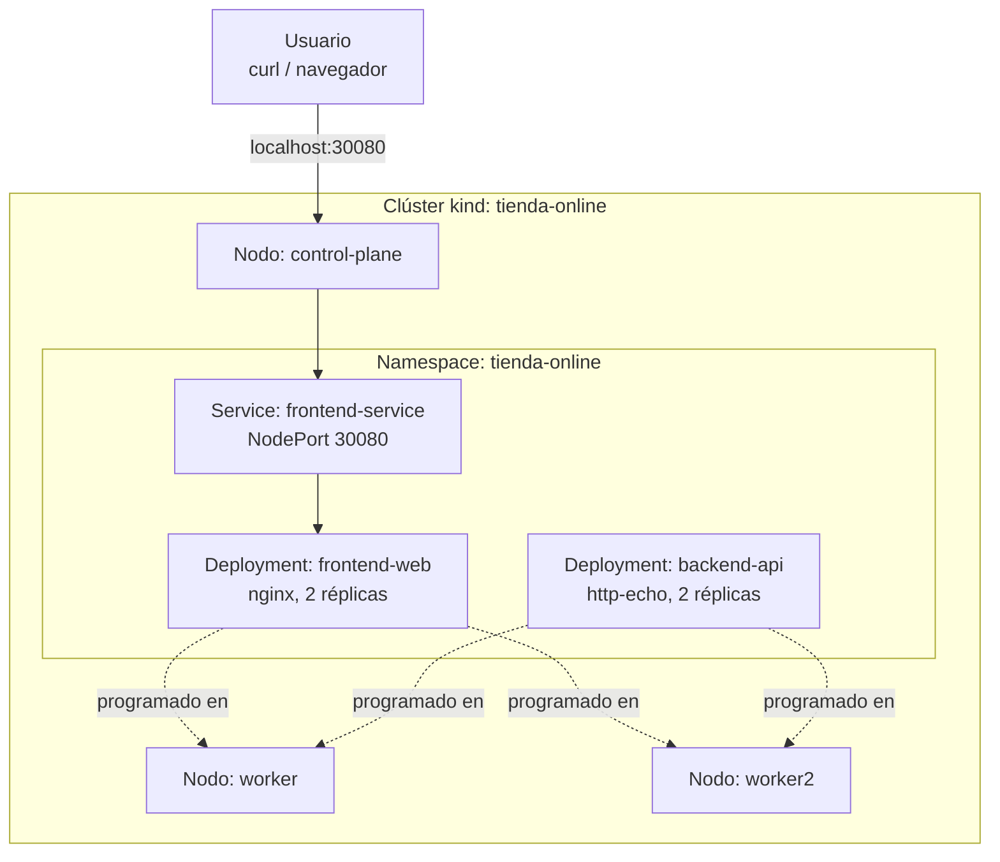
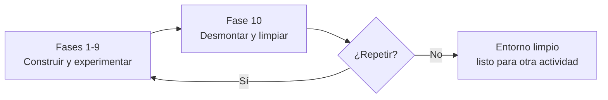

# Taller: Tienda Online con Kubernetes en WSL2 + kind

Taller práctico para construir un clúster de Kubernetes local de 3 nodos con `kind`
sobre WSL2, desplegar una aplicación de tienda online (frontend + backend),
observar cómo Kubernetes distribuye y actualiza recursos, y desmontar todo
dejando el entorno listo para repetir el ejercicio.

---

## Índice

- [Objetivo](#objetivo)
- [Qué vas a aprender](#qué-vas-a-aprender)
- [Prerrequisitos](#prerrequisitos)
- [Arquitectura](#arquitectura)
- [Estructura del taller](#estructura-del-taller)
- [Archivos incluidos](#archivos-incluidos)
- [Criterios de éxito](#criterios-de-éxito)
- [Ciclo de repetibilidad](#ciclo-de-repetibilidad)
- [Recursos recomendados](#recursos-recomendados)

---

## Objetivo

Construir un clúster de Kubernetes local con **3 nodos** (1 control-plane y 2
workers) usando **kind** dentro de **WSL2 (Ubuntu 24.04 LTS)**. Sobre ese
clúster se despliega una tienda online simulada para practicar operaciones
básicas de administración y observación de un clúster real.

## Qué vas a aprender

| Tema | Descripción |
|---|---|
| Componentes de Kubernetes | Qué es un clúster, un nodo y sus piezas principales |
| Clústeres multinodo con kind | Cómo crear un entorno local realista con Docker |
| Namespaces | Aislamiento lógico de recursos dentro de un clúster |
| Deployments / ReplicaSets / Pods | Jerarquía de gestión de aplicaciones |
| Services y Endpoints | Cómo se expone y balancea el tráfico hacia los pods |
| Scheduler | Cómo se distribuyen los pods entre nodos |
| Escalado | Cómo aumentar y reducir réplicas de forma declarativa |
| Diagnóstico | Uso de `logs`, `describe` y `events` |
| Teardown | Cómo limpiar el entorno de forma completa y segura |

## Prerrequisitos

| Herramienta | Versión mínima | Verificación |
|---|---|---|
| Windows 10/11 con WSL2 | habilitado | `wsl --version` |
| Ubuntu en WSL | 24.04 LTS | `lsb_release -a` |
| Docker | 24.x o superior | `docker --version` |
| kind | 0.20 o superior | `kind --version` |
| kubectl | 1.28 o superior | `kubectl version --client` |

> Si falta alguna herramienta, el `RUNBOOK.md` incluye los comandos de
> instalación en la Fase 1.

## Arquitectura

## Estructura del taller

| Fase | Tema | Duración estimada |
|---|---|---|
| 1 | Preparación del entorno WSL2 | 15 min |
| 2 | Creación del clúster multinodo | 10 min |
| 3 | Namespace y contexto | 5 min |
| 4 | Despliegue del frontend | 10 min |
| 5 | Despliegue del backend | 10 min |
| 6 | Exposición con Service NodePort | 10 min |
| 7 | Verificación y pruebas | 10 min |
| 8 | Escalado y observación de Endpoints | 15 min |
| 9 | Diagnóstico con logs y eventos | 10 min |
| 10 | Desacople y limpieza total | 10 min |

**Duración total estimada:** 1 hora 45 minutos.

## Archivos incluidos

| Archivo | Contenido |
|---|---|
| `README.md` | Visión general del taller (este documento) |
| `RUNBOOK.md` | Guía paso a paso con todos los comandos explicados |
| `kind-config.yaml` | Configuración del clúster kind (3 nodos) |
| `frontend.yaml` | Manifiesto del Deployment de frontend |
| `backend.yaml` | Manifiesto del Deployment de backend |
| `service.yaml` | Manifiesto del Service NodePort |
| `teardown.sh` | Script de limpieza automatizada (Fase 10) |

## Criterios de éxito

Al finalizar, deberías poder marcar todo lo siguiente:

- [ ] Ver 3 nodos en estado `Ready` con `kubectl get nodes`
- [ ] Ver 4 pods corriendo en el namespace `tienda-online`
- [ ] Acceder al frontend vía `curl http://localhost:30080`
- [ ] Ver los pods distribuidos entre `worker` y `worker2`
- [ ] Escalar el frontend a 4 réplicas y ver los nuevos pods aparecer
- [ ] Ver los Endpoints actualizarse en tiempo real
- [ ] Leer los logs de un pod con `kubectl logs`
- [ ] Diagnosticar con `kubectl describe pod`
- [ ] Eliminar el clúster dejando el equipo como estaba
- [ ] Repetir el taller desde cero en menos de 15 minutos

## Ciclo de repetibilidad

Este taller está diseñado para ejecutarse tantas veces como sea necesario,
sin dejar residuos en el sistema.

## Recursos recomendados

- [Documentación oficial de kind](https://kind.sigs.k8s.io/)
- [Documentación oficial de Kubernetes](https://kubernetes.io/docs/home/)
- [Kubectl Cheat Sheet](https://kubernetes.io/docs/reference/kubectl/cheatsheet/)
- [Conceptos de Kubernetes](https://kubernetes.io/docs/concepts/)

---

Continúa con **[RUNBOOK.md](./RUNBOOK.md)** para ejecutar el taller paso a paso.

