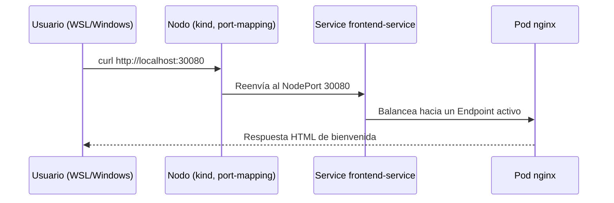
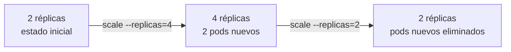
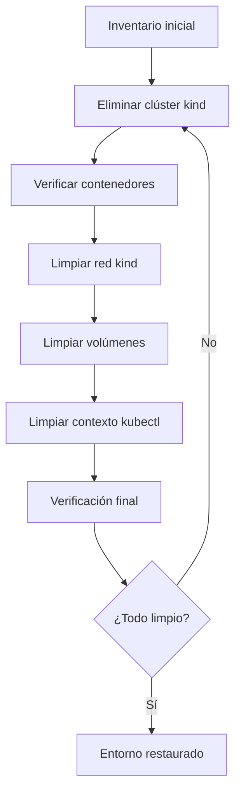

# RUNBOOK: Tienda Online con Kubernetes en WSL2 + kind


Guía paso a paso para construir, operar y desmontar el clúster del taller.
Cada fase contiene comandos listos para copiar y pegar, la salida esperada,
y notas de verificación o solución de problemas.

**Convenciones usadas en este documento:**

| Marca | Significado |
|---|---|
| `bash` | Comando a ejecutar en la terminal |
| `text` | Salida esperada del comando |
| **Nota** | Explicación conceptual |
| **Verificar** | Qué revisar antes de continuar |
| **Solución de problemas** | Error común y cómo resolverlo |

---

## Índice de fases

1. [Preparación del entorno WSL2](#fase-1--preparación-del-entorno-wsl2)
2. [Creación del clúster multinodo](#fase-2--creación-del-clúster-multinodo)
3. [Namespace y contexto](#fase-3--namespace-y-contexto)
4. [Despliegue del frontend](#fase-4--despliegue-del-frontend)
5. [Despliegue del backend](#fase-5--despliegue-del-backend)
6. [Exposición con Service NodePort](#fase-6--exposición-con-service-nodeport)
7. [Verificación y pruebas](#fase-7--verificación-y-pruebas)
8. [Escalado y observación de Endpoints](#fase-8--escalado-y-observación-de-endpoints)
9. [Diagnóstico con logs y eventos](#fase-9--diagnóstico-con-logs-y-eventos)
10. [Desacople y limpieza total](#fase-10--desacople-y-limpieza-total)

---

## Fase 1 — Preparación del entorno WSL2

### 1.1 Verificar que estás dentro de WSL2

```bash
uname -a
```

```text
Linux MSI 6.6.114.1-microsoft-standard-WSL2 #1 SMP ... x86_64 GNU/Linux
```

**Verificar:** debe aparecer `microsoft-standard-WSL2`. Si no aparece, no estás
en un entorno WSL2 válido.

### 1.2 Verificar que Docker está activo

```bash
docker --version
docker ps
```

**Solución de problemas:** si `docker ps` muestra `Cannot connect to the Docker
daemon`, inicia Docker Desktop o ejecuta `sudo service docker start`.

### 1.3 Verificar (o instalar) kind y kubectl

```bash
kind --version
kubectl version --client
```

Si no están instalados:

```bash
# kind
curl -Lo ./kind https://kind.sigs.k8s.io/dl/v0.20.0/kind-linux-amd64
chmod +x ./kind
sudo mv ./kind /usr/local/bin/kind

# kubectl
curl -LO "https://dl.k8s.io/release/$(curl -L -s https://dl.k8s.io/release/stable.txt)/bin/linux/amd64/kubectl"
chmod +x kubectl
sudo mv kubectl /usr/local/bin/kubectl
```

### 1.4 Habilitar systemd en WSL2

kind necesita `systemd` activo para iniciar los nodos correctamente.

```bash
sudo vi /etc/wsl.conf
```

Añade:

```ini
[boot]
systemd=true
```

Guarda y sal del editor. Luego, **desde PowerShell en Windows** (no desde WSL):

```powershell
wsl --shutdown
```

Vuelve a entrar a WSL y confirma:

```bash
wsl
systemctl status
```

```text
● MSI
    State: running
```

**Nota:** si tu entorno no permite modificar systemd, kind puede funcionar
igualmente en muchos casos. Si la creación del clúster falla más adelante,
revisa el paso 1.5.

### 1.5 Ajustar límites del kernel (inotify)

Evita el error de `cgroup` ajustando los límites de vigilancia de archivos:

```bash
sudo sysctl fs.inotify.max_user_watches=524288
sudo sysctl fs.inotify.max_user_instances=512
```

Para hacerlo permanente:

```bash
echo "fs.inotify.max_user_watches=524288" | sudo tee /etc/sysctl.d/99-kind.conf
echo "fs.inotify.max_user_instances=512" | sudo tee -a /etc/sysctl.d/99-kind.conf
sudo sysctl --system
```

**Nota:** sin este ajuste, al crear el clúster puede aparecer el error:

```text
ERROR: failed to create cluster: could not find a log line that matches
"Reached target .*Multi-User System.*|detected cgroup v1"
```

### 1.6 Crear la carpeta de trabajo

```bash
mkdir -p ~/sre-linux-mastery/Fase5/WS_3
cd ~/sre-linux-mastery/Fase5/WS_3
pwd
```

---

## Fase 2 — Creación del clúster multinodo

### 2.1 Verificar clústeres previos

```bash
kind get clusters
```

Si aparecen clústeres de intentos anteriores:

```bash
kind delete clusters --all
kind get clusters
```

**Nota:** dejar clústeres antiguos puede causar conflictos de nombres, puertos
o red.

### 2.2 Crear el archivo de configuración de kind

```bash
vi kind-config.yaml
```

```yaml
kind: Cluster
apiVersion: kind.x-k8s.io/v1alpha4
nodes:
- role: control-plane
  extraPortMappings:
  - containerPort: 30080
    hostPort: 30080
    protocol: TCP
- role: worker
- role: worker
```

| Campo | Función |
|---|---|
| `kind: Cluster` | Tipo de recurso que kind va a crear |
| `nodes` | Lista de nodos del clúster |
| `role: control-plane` | Nodo que gestiona el clúster |
| `extraPortMappings` | Mapea un puerto del host (WSL) hacia el nodo |
| `role: worker` (x2) | Nodos donde correrán las cargas de trabajo |

**Nota:** sin este archivo, `kind create cluster` crea solo un nodo
control-plane, y no sería posible observar la distribución entre workers.

### 2.3 Crear el clúster

```bash
kind create cluster --name tienda-online --config kind-config.yaml
```

```text
Creating cluster "tienda-online" ...
 - Ensuring node image (kindest/node:v1.31.0)
 - Preparing nodes
 - Writing configuration
 - Starting control-plane
 - Installing CNI
 - Installing StorageClass
 - Joining worker nodes
Set kubectl context to "kind-tienda-online"
```

**Solución de problemas:**

| Error | Causa y solución |
|---|---|
| `could not find a log line that matches...` | Revisar el paso 1.5 (límites de inotify) |
| `node(s) already exist` | `kind delete cluster --name tienda-online && docker network rm kind` y reintentar |
| `port 30080 already in use` | Otro proceso usa el puerto: `sudo lsof -i :30080` y liberarlo, o cambiar el `hostPort` |

### 2.4 Verificar los nodos

```bash
kubectl get nodes -o wide
```

```text
NAME                          STATUS   ROLES           AGE   VERSION
tienda-online-control-plane   Ready    control-plane   74s   v1.31.0
tienda-online-worker          Ready    <none>          60s   v1.31.0
tienda-online-worker2         Ready    <none>          60s   v1.31.0
```

**Verificar:** los 3 nodos deben estar en estado `Ready`.

---

## Fase 3 — Namespace y contexto

### 3.1 Crear el namespace

```bash
kubectl create namespace tienda-online
```

**Nota:** un namespace es una capa lógica que organiza recursos dentro del
clúster; no está atado a un nodo específico.

### 3.2 Fijar el namespace por defecto

```bash
kubectl config set-context --current --namespace=tienda-online
kubectl config view --minify | grep namespace
```

**Nota:** esto evita tener que añadir `-n tienda-online` en cada comando.

---

## Fase 4 — Despliegue del frontend

```bash
vi frontend.yaml
```

```yaml
apiVersion: apps/v1
kind: Deployment
metadata:
  name: frontend-web
  namespace: tienda-online
spec:
  replicas: 2
  selector:
    matchLabels:
      app: frontend
  template:
    metadata:
      labels:
        app: frontend
    spec:
      containers:
      - name: web
        image: nginx:alpine
        ports:
        - containerPort: 80
```

Aplicar y verificar:

```bash
kubectl apply -f frontend.yaml
kubectl get pods -o wide
```

```text
NAME                           READY   STATUS    NODE
frontend-web-8cdd58859-jmpmt   1/1     Running   tienda-online-worker
frontend-web-8cdd58859-ttkzw   1/1     Running   tienda-online-worker2
```

**Verificar:** 2 pods en estado `Running`, distribuidos entre `worker` y
`worker2` por decisión del *scheduler*.

---

## Fase 5 — Despliegue del backend

```bash
vi backend.yaml
```

```yaml
apiVersion: apps/v1
kind: Deployment
metadata:
  name: backend-api
  namespace: tienda-online
spec:
  replicas: 2
  selector:
    matchLabels:
      app: backend
  template:
    metadata:
      labels:
        app: backend
    spec:
      containers:
      - name: api
        image: hashicorp/http-echo
        args:
        - "-text=Hola desde el Backend de la Tienda"
        ports:
        - containerPort: 5678
```

```bash
kubectl apply -f backend.yaml
kubectl get pods -o wide
```

```text
NAME                           READY   STATUS    NODE
backend-api-5b856c844c-6d5gz   1/1     Running   tienda-online-worker
backend-api-5b856c844c-dn5j5   1/1     Running   tienda-online-worker2
frontend-web-8cdd58859-jmpmt   1/1     Running   tienda-online-worker
frontend-web-8cdd58859-ttkzw   1/1     Running   tienda-online-worker2
```

**Verificar:** 4 pods totales, con un frontend y un backend por worker.

---

## Fase 6 — Exposición con Service NodePort

```bash
vi service.yaml
```

```yaml
apiVersion: v1
kind: Service
metadata:
  name: frontend-service
  namespace: tienda-online
spec:
  type: NodePort
  selector:
    app: frontend
  ports:
    - port: 80
      targetPort: 80
      nodePort: 30080
```

**Nota:** el valor de `nodePort` debe coincidir con el `hostPort` definido en
`kind-config.yaml`.

```bash
kubectl apply -f service.yaml
kubectl get svc
kubectl get endpoints frontend-service
```

```text
NAME               TYPE       CLUSTER-IP      PORT(S)        AGE
frontend-service   NodePort   10.96.104.136   80:30080/TCP   8s

NAME               ENDPOINTS
frontend-service   10.244.1.2:80,10.244.2.2:80
```

**Nota:** los *Endpoints* son la lista viva de IPs de los pods que cumplen el
selector del Service. Se actualizan automáticamente.

### Flujo de tráfico



---

## Fase 7 — Verificación y pruebas

```bash
curl http://localhost:30080
```

Debe devolver el HTML de bienvenida de Nginx. Esto confirma el flujo completo:
`WSL → localhost:30080 → kind (port mapping) → Nodo → Service → Pod`.

También puedes abrir `http://localhost:30080` en el navegador de Windows.

Para ver todos los recursos del namespace:

```bash
kubectl get all
```

**Verificar:** deben aparecer 4 pods, 1 service, 2 deployments y 2 replicasets,
todos en estado saludable.

---

## Fase 8 — Escalado y observación de Endpoints

Abre **tres terminales**:

**Terminal 1** — eventos en tiempo real:

```bash
kubectl get events --watch
```

**Terminal 2** — endpoints en tiempo real:

```bash
kubectl get endpoints frontend-service --watch
```

**Terminal 3** — escalar el frontend:

```bash
kubectl scale deployment frontend-web --replicas=4
kubectl get pods -o wide
```



**Verificar:**

- En la Terminal 1: eventos `Scheduled`, `Pulling`, `Pulled`, `Created`, `Started`
- En la Terminal 2: los Endpoints crecen de 2 a 4 IPs
- En la Terminal 3: `kubectl get pods -o wide` muestra los nuevos pods

Vuelve a 2 réplicas:

```bash
kubectl scale deployment frontend-web --replicas=2
```

**Nota clave:** Kubernetes es declarativo. El usuario declara el estado
deseado (`replicas: N`) y el sistema se encarga de alcanzarlo y mantenerlo.

---

## Fase 9 — Diagnóstico con logs y eventos

### 9.1 Describir un pod

```bash
kubectl get pods
kubectl describe pod <nombre-del-pod>
```

**Verificar:** en la sección `Events` se observa el ciclo de vida completo del
pod: `Scheduled → Pulling → Pulled → Created → Started`.

### 9.2 Ver logs de un pod

```bash
kubectl logs <nombre-del-pod>
```

**Solución de problemas:** si ves `syntax error near unexpected token
'newline'`, significa que copiaste el marcador `<nombre-del-pod>` sin
reemplazarlo por un nombre real.

### 9.3 Vista general del namespace

```bash
kubectl get all
kubectl get pods -o wide
kubectl get endpoints
kubectl get events --sort-by=.metadata.creationTimestamp | tail -20
```

---

## Fase 10 — Desacople y limpieza total

**Objetivo:** dejar el equipo exactamente como estaba antes del taller, para
poder repetirlo tantas veces como sea necesario.



### 10.1 Inventario antes de eliminar

```bash
kind get clusters
docker ps -a --filter "name=tienda-online"
docker network ls | grep kind
docker volume ls | grep kind
```

### 10.2 Eliminar el clúster

```bash
kind delete cluster --name tienda-online
```

**Nota:** esto elimina los 3 contenedores Docker que actuaban como nodos y
limpia automáticamente el contexto, clúster y usuario del `kubeconfig`.

### 10.3 Verificar que los nodos desaparecieron

```bash
docker ps -a | grep tienda-online
kind get clusters
```

Ambos comandos deben devolver vacío o `No kind clusters found.`

### 10.4 Limpiar la red kind huérfana (si aplica)

```bash
docker network ls | grep kind
docker network rm kind
```

### 10.5 Limpiar volúmenes huérfanos (si aplica)

```bash
docker volume ls -q | grep kind | xargs -r docker volume rm
```

**Nota:** la opción `-r` de `xargs` evita ejecutar el comando si no hay
argumentos que procesar.

### 10.6 Limpiar imágenes de kind (opcional)

```bash
docker images | grep kindest
```

**Nota:** conserva la imagen si vas a repetir el taller pronto; elimínala solo
si necesitas liberar espacio (aproximadamente 1 GB).

### 10.7 Limpiar el contexto de kubectl

```bash
kubectl config get-contexts
```

**Nota:** si `kind delete cluster` se ejecutó correctamente, el contexto
`kind-tienda-online` ya no debería aparecer. Si aparece, elimínalo manualmente:

```bash
kubectl config delete-context kind-tienda-online
kubectl config delete-cluster kind-tienda-online
kubectl config delete-user kind-tienda-online
```

### 10.8 Manifiestos YAML

**Opción A — conservarlos (recomendado para repetir el taller):**

```bash
ls -la ~/sre-linux-mastery/Fase5/WS_3/
```

**Opción B — eliminarlos por completo:**

```bash
cd ~/sre-linux-mastery/Fase5/WS_3/
rm -f kind-config.yaml frontend.yaml backend.yaml service.yaml
```

### 10.9 Verificación final

```bash
echo "Clústeres kind:"      && kind get clusters
echo "Contenedores:"        && docker ps -a | grep tienda-online
echo "Red kind:"            && docker network ls | grep kind
echo "Volúmenes kind:"      && docker volume ls | grep kind
echo "Contexto kubectl:"    && kubectl config get-contexts | grep kind-tienda-online
echo "Espacio en Docker:"   && docker system df
```

Todas las líneas de resultado (excepto `docker system df`) deben devolver
vacío o `No kind clusters found.`.

### 10.10 Limpieza profunda de Docker (opcional, avanzado)

```bash
docker system df
```

**Advertencia:** `docker system prune -a --volumes` es global y destructivo:
elimina imágenes, redes y volúmenes no usados de **todos** tus proyectos, no
solo del taller. Ejecútalo solo si estás seguro:

```bash
docker system prune -a --volumes
```

### 10.11 Qué conservar

No es necesario eliminar lo siguiente si planeas repetir el taller:

- `~/sre-linux-mastery/Fase5/WS_3/*.yaml`
- `/etc/sysctl.d/99-kind.conf`
- La línea `systemd=true` en `/etc/wsl.conf`

Estos ajustes son inofensivos y aceleran la próxima ejecución.

---

## Repetir el taller desde cero

```bash
cd ~/sre-linux-mastery/Fase5/WS_3

kind get clusters
kind create cluster --name tienda-online --config kind-config.yaml

kubectl create namespace tienda-online
kubectl config set-context --current --namespace=tienda-online
kubectl apply -f frontend.yaml
kubectl apply -f backend.yaml
kubectl apply -f service.yaml

curl http://localhost:30080
```

**Tiempo estimado de repetición:** 3 a 5 minutos (la imagen base ya está
descargada).

---

## Script de limpieza automatizada: teardown.sh

```bash
#!/usr/bin/env bash
# teardown.sh - Limpieza completa del taller tienda-online
set -e

CLUSTER_NAME="tienda-online"

echo "Iniciando teardown del taller: $CLUSTER_NAME"

echo "-> Eliminando clúster kind..."
kind delete cluster --name "$CLUSTER_NAME" 2>/dev/null || echo "  (ya no existía)"

read -p "¿Eliminar TODOS los clústeres kind? [y/N] " -n 1 -r
echo
if [[ $REPLY =~ ^[Yy]$ ]]; then
  kind delete clusters --all 2>/dev/null || true
fi

echo "-> Limpiando red kind..."
docker network rm kind 2>/dev/null || echo "  (no existía)"

echo "-> Limpiando volúmenes kind..."
docker volume ls -q | grep kind | xargs -r docker volume rm 2>/dev/null || true

echo "-> Limpiando contexto kubectl..."
kubectl config delete-context "kind-$CLUSTER_NAME" 2>/dev/null || true
kubectl config delete-cluster "kind-$CLUSTER_NAME" 2>/dev/null || true
kubectl config delete-user "kind-$CLUSTER_NAME" 2>/dev/null || true

echo ""
echo "Teardown completo. Estado final:"
echo "Clústeres kind:"   && kind get clusters
echo "Red kind:"         && (docker network ls | grep kind || echo "  (limpio)")
echo "Volúmenes kind:"   && (docker volume ls | grep kind || echo "  (limpio)")
echo "Contextos kubectl:" && kubectl config get-contexts
echo "Espacio en Docker:" && docker system df

echo ""
echo "Los YAML en ~/sre-linux-mastery/Fase5/WS_3/ se conservaron."
echo "Los ajustes de sysctl y systemd se conservaron."
echo "Para repetir: kind create cluster --name $CLUSTER_NAME --config kind-config.yaml"
```

Hazlo ejecutable y úsalo:

```bash
chmod +x teardown.sh
./teardown.sh
```

---

## Glosario

| Término | Definición |
|---|---|
| Cluster | Conjunto de nodos gestionados por Kubernetes |
| Nodo | Máquina (física o virtual) donde corren los pods |
| Pod | Unidad mínima desplegable; contiene uno o más contenedores |
| Deployment | Gestiona réplicas de pods y sus actualizaciones |
| ReplicaSet | Garantiza que el número de pods activos sea el deseado |
| Service | Expone un conjunto de pods con una dirección estable |
| Endpoints | Lista viva de IPs de pods detrás de un Service |
| Namespace | Capa lógica para organizar recursos dentro del clúster |
| Scheduler | Componente que decide en qué nodo se ejecuta cada pod |
| Kubelet | Agente que ejecuta y supervisa pods en cada nodo |
| kind | Herramienta para crear clústeres de Kubernetes usando contenedores Docker |
| Teardown | Proceso de desmontar y limpiar un entorno |

## Checklist final

**Construcción**
- [ ] Los 3 nodos están `Ready`
- [ ] El namespace `tienda-online` existe
- [ ] Los 4 pods están corriendo (2 frontend + 2 backend)
- [ ] El Service `frontend-service` es de tipo `NodePort`
- [ ] Los Endpoints muestran 2 IPs
- [ ] `curl http://localhost:30080` devuelve el HTML de Nginx

**Experimentación**
- [ ] Escalado a 4 réplicas y observación de nuevos pods
- [ ] Observación de Endpoints creciendo en tiempo real
- [ ] Escalado de vuelta a 2 réplicas
- [ ] Revisión de eventos con `--watch`
- [ ] Lectura de logs y descripción de un pod

**Limpieza**
- [ ] Clúster eliminado con `kind delete cluster`
- [ ] Sin contenedores, red ni volúmenes residuales
- [ ] Sin contextos de kubectl residuales
- [ ] Entorno restaurado al estado inicial

---

Siguiendo este ciclo — **construir, experimentar, diagnosticar, desmontar,
repetir** — practicarás el flujo de trabajo real de un equipo de SRE/DevOps.

