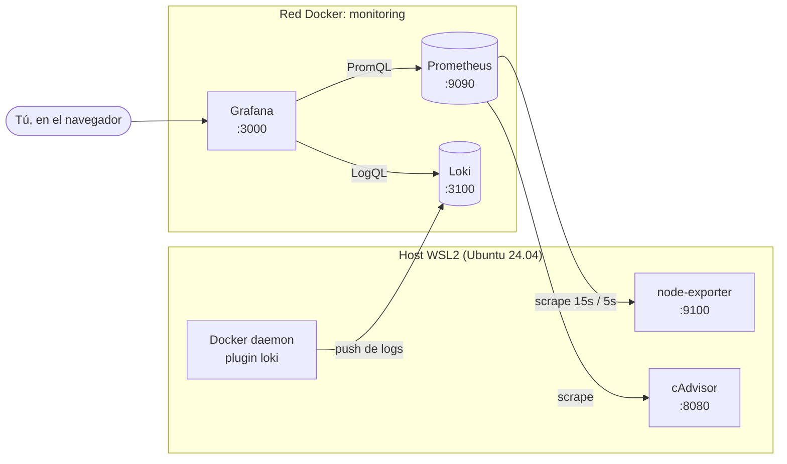

<div align="center">

# WS_4 · Stack de Observabilidad

**Métricas, logs y visualización unificada sobre Docker Compose, listo en minutos y reproducible siempre.**


</div>

---

## De qué se trata

Este laboratorio levanta un stack de observabilidad completo con un solo comando. Prometheus recoge métricas del host y de los contenedores, Loki centraliza los logs y Grafana los muestra juntos en un dashboard que ya viene configurado. No hay que hacer clic en ninguna interfaz para tenerlo funcionando: todo vive en archivos que se versionan en git.

Está pensado para practicar SRE en WSL2, pero funciona en cualquier host Linux con Docker.

## Qué incluye

| Componente | Para qué sirve | Puerto |
|---|---|---|
| Prometheus | Recolecta y almacena métricas como series de tiempo | 9090 |
| node-exporter | Expone métricas del host (CPU, RAM, disco, red) | 9100 |
| cAdvisor | Expone métricas de cada contenedor Docker | 8080 |
| Loki | Almacena los logs de todos los contenedores | 3100 |
| Grafana | Muestra métricas y logs en un mismo lugar | 3000 |

## Qué vas a aprender

- **Infraestructura como código.** Seis archivos de configuración describen todo el stack.
- **Autoprovisioning.** Datasources y dashboard se cargan solos al arrancar.
- **Los tres pilares.** Métricas, logs y visualización trabajando juntos.
- **Datos reales.** Scrape cada 15 s (5 s en cAdvisor) y dashboard con refresh de 30 s.
- **Salud verificable.** Los cinco servicios tienen healthcheck.
- **Reproducibilidad.** Destruir y reconstruir todo toma menos de cinco minutos.

## Arquitectura



**Cómo leerlo.** Las flechas indican quién inicia la conversación. Prometheus es quien sale a buscar las métricas (modelo *pull*) a node-exporter y cAdvisor. Con los logs ocurre lo contrario: el daemon de Docker empuja (*push*) cada línea a Loki mediante un plugin. Grafana no almacena nada; solo consulta a Prometheus con PromQL y a Loki con LogQL, y tú miras todo desde un único panel.

## Estructura del proyecto

```text
WS_4/
├── docker-compose.yml                  # Orquesta los 5 servicios
├── prometheus/
│   └── prometheus.yml                  # Qué scrapear y con qué frecuencia
├── loki/
│   └── loki-config.yml                 # Schema, almacenamiento y retención
└── grafana/
    ├── provisioning/
    │   ├── datasources/datasources.yml # Conecta Prometheus y Loki
    │   └── dashboards/dashboards.yml   # Le dice a Grafana dónde están los JSON
    └── dashboards/
        └── system-overview.json        # Dashboard: 6 paneles de métricas + 1 de logs
```

## Inicio rápido

```bash
# 1. Entrar al laboratorio
cd ~/sre-linux-mastery/Fase5/WS_4

# 2. Instalar el plugin de logging de Loki (solo una vez por máquina)
docker plugin install grafana/loki-docker-driver:latest \
  --alias loki --grant-all-permissions

# 3. Levantar todo
docker compose up -d

# 4. Dar tiempo a que los healthchecks pasen y revisar
sleep 45 && docker compose ps
```

Cuando los cinco servicios aparezcan como `healthy`, abre:

| Servicio | URL | Credenciales |
|---|---|---|
| Grafana | http://localhost:3000 | `admin` / `admin` |
| Prometheus | http://localhost:9090 | no aplica |
| cAdvisor | http://localhost:8080 | no aplica |
| Loki | http://localhost:3100/ready | no aplica |

## Requisitos

| Componente | Versión mínima | Cómo comprobarlo |
|---|---|---|
| Docker Engine | 20.10 | `docker --version` |
| Docker Compose | v2 | `docker compose version` |
| WSL2 con Ubuntu | 22.04 | `lsb_release -a` |
| Python 3 | 3.8 | `python3 --version` |

Antes de arrancar, confirma que los puertos 3000, 3100, 8080, 9090 y 9100 estén libres:

```bash
for p in 3000 3100 8080 9090 9100; do
  ss -tlnp 2>/dev/null | grep -q ":$p " && echo "Puerto $p OCUPADO" || echo "Puerto $p libre"
done
```

## Reiniciar desde cero

```bash
docker compose down -v --remove-orphans   # borra contenedores, volúmenes y red
docker compose up -d                      # reconstruye
```

Tus archivos de configuración no se tocan. Solo desaparecen los datos acumulados.

## Problemas frecuentes

| Qué ves | Qué hacer |
|---|---|
| `error looking up logging plugin loki` | Falta el plugin. Repite el paso 2 del inicio rápido. |
| Paneles con "No data" | Espera un minuto. Prometheus necesita al menos un scrape completo. |
| Panel de logs vacío | Cambia el rango a "Last 5 minutes". Al inicio Loki solo tiene datos recientes. |
| cAdvisor se reinicia en bucle | Revisa que el compose tenga `privileged: true` y el dispositivo `/dev/kmsg`. |
| Puerto ocupado | `docker ps` o `sudo lsof -i :PUERTO` para ver quién lo usa. |

## Documentación completa

El **[RUNBOOK](./RUNBOOK.md)** recorre el laboratorio paso a paso: cada archivo, cada decisión de diseño, la validación, la verificación end-to-end y el ciclo completo de destrucción y reconstrucción.

## Licencia

Material educativo. Úsalo, modifícalo y compártelo con libertad.

