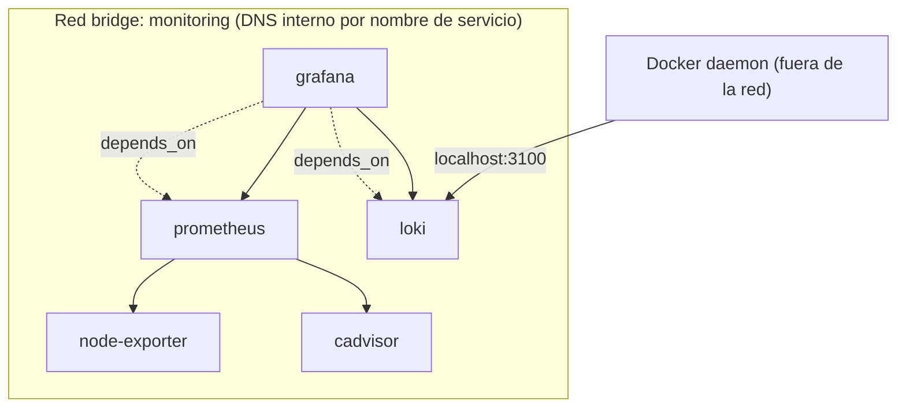
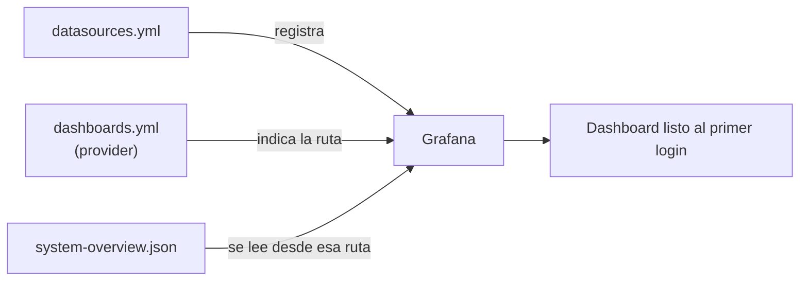
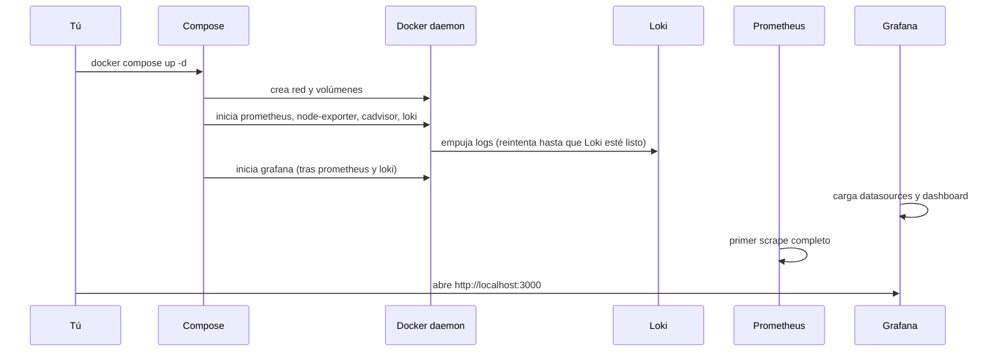
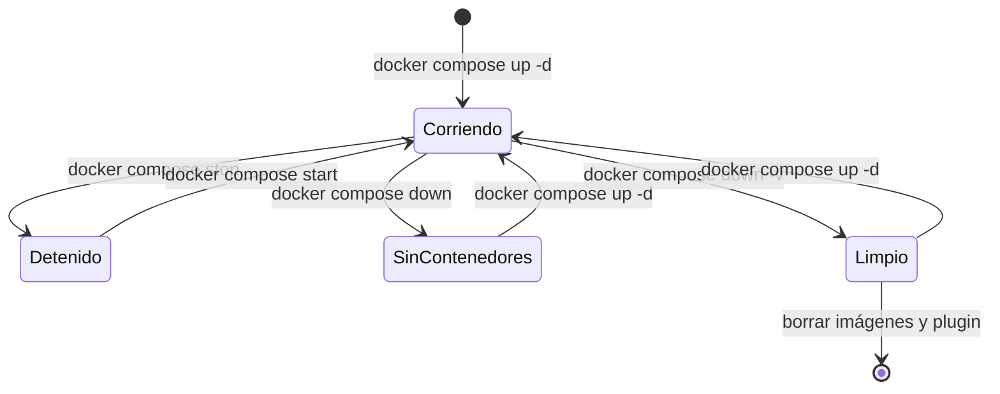
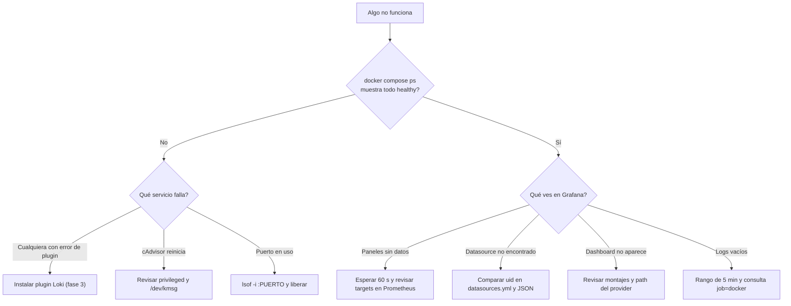

<div align="center">

# RUNBOOK · WS_4 Stack de Observabilidad


</div>

Esta guía te lleva de una carpeta vacía a un stack de observabilidad funcionando, explicando por qué cada pieza está donde está. Al terminar podrás reconstruir el laboratorio en cualquier máquina, entender cada decisión de diseño y destruirlo limpiamente para repetirlo cuando quieras.

## Índice

- [Mapa general](#mapa-general)
- [Fase 0. Validar el entorno](#fase-0)
- [Fase 1. Estructura de directorios](#fase-1)
- [Fase 2. docker-compose.yml](#fase-2)
- [Fase 3. Plugin Loki para Docker](#fase-3)
- [Fase 4. prometheus.yml](#fase-4)
- [Fase 5. loki-config.yml](#fase-5)
- [Fase 6. datasources.yml](#fase-6)
- [Fase 7. dashboards.yml](#fase-7)
- [Fase 8. system-overview.json](#fase-8)
- [Fase 9. Validar la sintaxis](#fase-9)
- [Fase 10. Arrancar el stack](#fase-10)
- [Fase 11. Verificación end-to-end](#fase-11)
- [Fase 12. Prueba con datos reales](#fase-12)
- [Fase 13. Destrucción y reconstrucción](#fase-13)
- [Apéndice A. Operación diaria](#apendice-a)
- [Apéndice B. Troubleshooting](#apendice-b)
- [Apéndice C. Puertos y endpoints](#apendice-c)

---

## Mapa general

Antes de escribir una línea, conviene tener claro el recorrido.

```mermaid
flowchart LR
    F0["0. Entorno"] --> F1["1. Carpetas"] --> F2["2. Compose"] --> F3["3. Plugin Loki"]
    F3 --> F4["4. Prometheus"] --> F5["5. Loki"] --> F6["6. Datasources"]
    F6 --> F7["7. Provider"] --> F8["8. Dashboard"] --> F9["9. Validar"]
    F9 --> F10["10. Arrancar"] --> F11["11. Verificar"] --> F12["12. Datos reales"] --> F13["13. Reset"]
```



**Cómo leerlo.** Las fases 1 a 8 construyen los seis archivos. La 9 los valida antes de gastar tiempo levantando contenedores. De la 10 en adelante el stack corre, se verifica y se destruye. Si algo falla, casi siempre se detecta en la fase 9, que es la más barata de repetir.

---

<a name="fase-0"></a>
## Fase 0. Validar el entorno

### 0.1 Versiones

```bash
docker --version
docker compose version
lsb_release -a
python3 --version
```

Referencia de salida (tus números pueden variar):

```text
Docker version 29.x, build ...
Docker Compose version v5.x
Ubuntu 24.04 LTS
Python 3.12.x
```

| Herramienta | Mínimo | Motivo |
|---|---|---|
| Docker Engine | 20.10 | Soporte de plugins de logging |
| Docker Compose | v2 | Usa `name:` en lugar del antiguo `version:` |
| Python | 3.8 | Validar JSON en la fase 9 |

### 0.2 Puertos libres

```bash
for p in 3000 3100 8080 9090 9100; do
  ss -tlnp 2>/dev/null | grep -q ":$p " && echo "Puerto $p OCUPADO" || echo "Puerto $p libre"
done
```

`ss -tlnp` lista los sockets TCP en escucha con su proceso. Si alguno aparece ocupado, identifica al responsable con `sudo lsof -i :3000` y decide si lo detienes o cambias el puerto publicado en el compose.

### 0.3 Interfaz de red

```bash
ip -br link
```

```text
lo        UNKNOWN   00:00:00:00:00:00 <LOOPBACK,UP,LOWER_UP>
eth0      UP        00:15:5d:67:44:85 <BROADCAST,MULTICAST,UP,LOWER_UP>
docker0   DOWN      c6:58:56:50:d3:92 <NO-CARRIER,BROADCAST,MULTICAST,UP>
```

El dashboard consulta `node_network_receive_bytes_total{device="eth0"}`. Si tu interfaz principal se llama distinto (`ens3`, `enp0s3`), cambia ese valor en el JSON de la [fase 8](#fase-8).

---

<a name="fase-1"></a>
## Fase 1. Estructura de directorios

```bash
cd ~/sre-linux-mastery/Fase5
mkdir -p WS_4/{prometheus,loki,grafana/provisioning/datasources,grafana/provisioning/dashboards,grafana/dashboards}
cd WS_4 && pwd
```

La expansión de llaves de bash (`{a,b,c}`) crea todas las rutas en un solo comando, y `-p` evita errores si ya existen. Verifica con `tree -a .`:

```text
.
├── grafana
│   ├── dashboards
│   └── provisioning
│       ├── dashboards
│       └── datasources
├── loki
└── prometheus
```

### Por qué esta estructura

| Directorio | Contiene | Razón |
|---|---|---|
| `prometheus/` | `prometheus.yml` | Editar scrapes sin tocar el orquestador |
| `loki/` | `loki-config.yml` | Schema, almacenamiento y retención |
| `grafana/provisioning/datasources/` | `datasources.yml` | Grafana lo lee al arrancar y conecta las fuentes |
| `grafana/provisioning/dashboards/` | `dashboards.yml` | El *provider*: indica dónde buscar dashboards |
| `grafana/dashboards/` | `system-overview.json` | Los dashboards en sí |

**Idea clave.** Grafana separa el *provider* (dónde buscar) del *contenido* (los JSON). Por eso viven en carpetas distintas y, como verás en la fase 2, se montan en rutas distintas dentro del contenedor.

---

<a name="fase-2"></a>
## Fase 2. docker-compose.yml

```bash
vi docker-compose.yml
```

En `vi`: `i` para insertar, `Esc` para salir del modo edición, `:wq` para guardar y cerrar.

### 2.1 Contenido

Los bloques `logging` son idénticos en los cinco servicios; se usa un ancla YAML (`x-logging`) para escribirlo una sola vez.

```yaml
name: ws4-observability

x-logging: &loki-logging
  driver: loki
  options:
    loki-url: "http://localhost:3100/loki/api/v1/push"
    loki-batch-size: "400"
    loki-external-labels: "container_name={{.Name}},job=docker"

networks:
  monitoring:
    driver: bridge

volumes:
  prometheus_data:
  grafana_data:
  loki_data:

services:

  prometheus:
    image: prom/prometheus:latest
    container_name: ws4-prometheus
    restart: unless-stopped
    ports:
      - "9090:9090"
    volumes:
      - ./prometheus/prometheus.yml:/etc/prometheus/prometheus.yml:ro
      - prometheus_data:/prometheus
    command:
      - '--config.file=/etc/prometheus/prometheus.yml'
      - '--storage.tsdb.path=/prometheus'
      - '--storage.tsdb.retention.time=7d'
    healthcheck:
      test: ["CMD", "wget", "--spider", "-q", "http://localhost:9090/-/healthy"]
      interval: 30s
      timeout: 5s
      retries: 3
      start_period: 20s
    logging: *loki-logging
    networks: [monitoring]

  node-exporter:
    image: prom/node-exporter:latest
    container_name: ws4-node-exporter
    restart: unless-stopped
    ports:
      - "9100:9100"
    volumes:
      - /proc:/host/proc:ro
      - /sys:/host/sys:ro
      - /:/rootfs:ro
    command:
      - '--path.procfs=/host/proc'
      - '--path.sysfs=/host/sys'
      - '--path.rootfs=/rootfs'
      - '--collector.filesystem.mount-points-exclude=^/(sys|proc|dev|host|etc)($$|/)'
    healthcheck:
      test: ["CMD", "wget", "--spider", "-q", "http://localhost:9100/metrics"]
      interval: 30s
      timeout: 5s
      retries: 3
      start_period: 10s
    logging: *loki-logging
    networks: [monitoring]

  cadvisor:
    image: gcr.io/cadvisor/cadvisor:latest
    container_name: ws4-cadvisor
    restart: unless-stopped
    ports:
      - "8080:8080"
    volumes:
      - /:/rootfs:ro
      - /var/run:/var/run:ro
      - /sys:/sys:ro
      - /var/lib/docker/:/var/lib/docker:ro
      - /dev/disk/:/dev/disk:ro
    privileged: true
    devices:
      - /dev/kmsg:/dev/kmsg
    healthcheck:
      test: ["CMD", "wget", "--spider", "-q", "http://localhost:8080/healthz"]
      interval: 30s
      timeout: 5s
      retries: 3
      start_period: 30s
    logging: *loki-logging
    networks: [monitoring]

  loki:
    image: grafana/loki:latest
    container_name: ws4-loki
    restart: unless-stopped
    ports:
      - "3100:3100"
    volumes:
      - ./loki/loki-config.yml:/etc/loki/local-config.yaml:ro
      - loki_data:/loki
    command: -config.file=/etc/loki/local-config.yaml
    healthcheck:
      test: ["CMD", "wget", "--spider", "-q", "http://localhost:3100/ready"]
      interval: 30s
      timeout: 5s
      retries: 3
      start_period: 30s
    logging: *loki-logging
    networks: [monitoring]

  grafana:
    image: grafana/grafana:latest
    container_name: ws4-grafana
    restart: unless-stopped
    ports:
      - "3000:3000"
    environment:
      GF_SECURITY_ADMIN_USER: admin
      GF_SECURITY_ADMIN_PASSWORD: admin
      GF_USERS_ALLOW_SIGN_UP: "false"
      GF_DASHBOARDS_DEFAULT_HOME_DASHBOARD_PATH: /var/lib/grafana/dashboards/system-overview.json
    volumes:
      - grafana_data:/var/lib/grafana
      - ./grafana/provisioning/datasources:/etc/grafana/provisioning/datasources:ro
      - ./grafana/provisioning/dashboards:/etc/grafana/provisioning/dashboards:ro
      - ./grafana/dashboards:/var/lib/grafana/dashboards:ro
    healthcheck:
      test: ["CMD", "wget", "--spider", "-q", "http://localhost:3000/api/health"]
      interval: 30s
      timeout: 5s
      retries: 3
      start_period: 30s
    depends_on:
      - prometheus
      - loki
    logging: *loki-logging
    networks: [monitoring]
```

### 2.2 Cómo se conectan las piezas



**Cómo leerlo.** Dentro de la red `monitoring`, los contenedores se encuentran por nombre: Grafana llega a `http://prometheus:9090` sin conocer ninguna IP. Las líneas punteadas son `depends_on`: Grafana espera a que Prometheus y Loki hayan arrancado. El Docker daemon queda fuera de la red porque vive en el host, y por eso llega a Loki a través del puerto publicado en `localhost:3100`.

### 2.3 Decisiones de diseño

**`name:`** reemplaza al obsoleto `version:` y prefija los recursos creados (`ws4-observability_monitoring`, `ws4-observability_prometheus_data`).

**Volúmenes nombrados.** Los gestiona Docker en `/var/lib/docker/volumes/`. Sobreviven a `down` y `up`; solo desaparecen con `down -v` o `docker volume rm`.

**Bloque de logging.**

| Línea | Por qué |
|---|---|
| `driver: loki` | Usa el plugin instalado en la fase 3 |
| `loki-url` con `localhost` | El envío lo hace el daemon de Docker en el host, no el contenedor. Ve `localhost:3100` porque el puerto está publicado |
| `loki-batch-size: "400"` | Agrupa líneas antes de enviar y reduce la carga de red |
| `loki-external-labels` | `{{.Name}}` se expande al nombre del contenedor. `job=docker` es el filtro que usará Grafana |

**Healthchecks.**

| Campo | Significado |
|---|---|
| `test` | Se ejecuta dentro del contenedor; salida 0 significa sano |
| `wget --spider -q` | Hace la petición sin descargar contenido ni imprimir nada |
| `interval` / `timeout` | Cada 30 s, con 5 s de plazo por intento |
| `retries: 3` | Tres fallos seguidos marcan `unhealthy` |
| `start_period` | Margen inicial para que el servicio termine de arrancar |

| Servicio | Endpoint de salud |
|---|---|
| Prometheus | `/-/healthy` |
| node-exporter | `/metrics` |
| cAdvisor | `/healthz` |
| Loki | `/ready` |
| Grafana | `/api/health` |

**node-exporter.** Sin montar `/proc`, `/sys` y `/` solo vería su propio contenedor. Los flags `--path.*` le indican dónde encontrarlos. El `$$` del filtro de mountpoints es la forma de escribir un `$` literal en un compose.

**cAdvisor.** Necesita `privileged: true` y `/dev/kmsg` para leer cgroups y métricas del kernel. Sin ellos se reinicia en bucle.

**Grafana y los montajes.** Aquí hay una trampa fácil de pisar. Si montas `provisioning/dashboards` y `dashboards` en la misma ruta del contenedor, el segundo montaje oculta al primero y Grafana nunca ve `dashboards.yml`. Por eso los JSON van a `/var/lib/grafana/dashboards` y el provider (fase 7) apunta ahí.

---

<a name="fase-3"></a>
## Fase 3. Plugin Loki para Docker

```bash
docker plugin install grafana/loki-docker-driver:latest \
  --alias loki --grant-all-permissions
docker plugin ls
```

```text
ID             NAME          DESCRIPTION           ENABLED
69037162cb29   loki:latest   Loki Logging Driver   true
```

`--alias loki` permite escribir `driver: loki` en el compose. `--grant-all-permissions` evita la pregunta interactiva de permisos. Lo importante es `ENABLED = true`; si dice `false`, ejecuta `docker plugin enable loki`.

Sin el plugin, `docker compose up` falla con `error looking up logging plugin loki`.

**Versión idempotente**, para scripts que pueden ejecutarse más de una vez:

```bash
docker plugin ls | grep -q "loki.*true" || \
  docker plugin install grafana/loki-docker-driver:latest --alias loki --grant-all-permissions
```

---

<a name="fase-4"></a>
## Fase 4. prometheus/prometheus.yml

```bash
vi prometheus/prometheus.yml
```

```yaml
global:
  scrape_interval: 15s
  evaluation_interval: 15s
  external_labels:
    lab: ws4
    host: wsl-ubuntu-24.04

scrape_configs:

  - job_name: 'prometheus'
    static_configs:
      - targets: ['localhost:9090']

  - job_name: 'node-exporter'
    static_configs:
      - targets: ['node-exporter:9100']

  - job_name: 'cadvisor'
    scrape_interval: 5s
    static_configs:
      - targets: ['cadvisor:8080']
```

| Clave | Qué hace |
|---|---|
| `scrape_interval` | Cada cuánto consulta a cada target. Es el latido del sistema |
| `evaluation_interval` | Cada cuánto evalúa reglas de alerta (aún no hay ninguna) |
| `external_labels` | Etiquetas añadidas a todas las series; útiles si algún día federas varios Prometheus |
| `job_name` | Aparece como label `job=` en cada métrica |
| `targets` | Nombre del servicio Docker. Prometheus se consulta a sí mismo con `localhost` |
| `scrape_interval: 5s` en cAdvisor | Más resolución para métricas de contenedores, que cambian rápido |

---

<a name="fase-5"></a>
## Fase 5. loki/loki-config.yml

```bash
vi loki/loki-config.yml
```

```yaml
auth_enabled: false

server:
  http_listen_port: 3100
  grpc_listen_port: 9096

common:
  instance_addr: 127.0.0.1
  path_prefix: /loki
  storage:
    filesystem:
      chunks_directory: /loki/chunks
      rules_directory: /loki/rules
  replication_factor: 1
  ring:
    kvstore:
      store: inmemory

schema_config:
  configs:
    - from: 2024-01-01
      store: tsdb
      object_store: filesystem
      schema: v13
      index:
        prefix: index_
        period: 24h

ruler:
  alertmanager_url: http://localhost:9093

limits_config:
  allow_structured_metadata: true
  retention_period: 168h

compactor:
  working_directory: /loki/compactor
  retention_enabled: true
  delete_request_store: filesystem
```

| Bloque | Significado |
|---|---|
| `auth_enabled: false` | Un solo tenant. Suficiente para laboratorio; en producción se activa |
| `path_prefix: /loki` | Raíz dentro del contenedor, respaldada por el volumen `loki_data` |
| `tsdb` + `v13` | Esquema moderno que reemplaza a `boltdb-shipper` + `v11` |
| `retention_period: 168h` | Siete días de logs |
| `allow_structured_metadata` | Requerido por el esquema v13 |
| `compactor` | Es quien realmente borra lo vencido. Sin él, la retención no se aplica |

---

<a name="fase-6"></a>
## Fase 6. datasources.yml

```bash
vi grafana/provisioning/datasources/datasources.yml
```

```yaml
apiVersion: 1

deleteDatasources:
  - name: Prometheus
    orgId: 1
  - name: Loki
    orgId: 1

datasources:

  - name: Prometheus
    uid: prometheus-ds
    type: prometheus
    access: proxy
    url: http://prometheus:9090
    isDefault: true
    editable: false
    jsonData:
      timeInterval: "15s"
      httpMethod: POST

  - name: Loki
    uid: loki-ds
    type: loki
    access: proxy
    url: http://loki:3100
    editable: false
    jsonData:
      maxLines: 1000
```

| Clave | Significado |
|---|---|
| `deleteDatasources` | Borra versiones previas al arrancar y evita duplicados |
| `uid` | Crítico. El dashboard referencia los datasources por UID; si no coinciden, los paneles quedan vacíos |
| `access: proxy` | Grafana consulta desde su backend, sin problemas de CORS |
| `url` | Nombre del servicio Docker, dentro de la misma red |
| `isDefault` | Prometheus es la fuente por defecto en paneles nuevos |
| `timeInterval` | Debe coincidir con el `scrape_interval` |
| `editable: false` | Nadie puede alterar la fuente desde la interfaz; la verdad vive en el archivo |

---

<a name="fase-7"></a>
## Fase 7. dashboards.yml

```bash
vi grafana/provisioning/dashboards/dashboards.yml
```

```yaml
apiVersion: 1

providers:
  - name: ws4
    folder: Observabilidad
    type: file
    disableDeletion: false
    updateIntervalSeconds: 30
    allowUiUpdates: false
    options:
      path: /var/lib/grafana/dashboards
```

| Clave | Significado |
|---|---|
| `type: file` | Los dashboards se leen desde archivos |
| `folder` | Carpeta de Grafana donde aparecerán |
| `updateIntervalSeconds: 30` | Grafana vuelve a escanear la ruta cada 30 s, así que editar el JSON se refleja solo |
| `allowUiUpdates: false` | Los cambios hechos en pantalla no se guardan; el archivo manda |
| `path` | Debe coincidir con el destino del montaje en el compose |



**Cómo leerlo.** Grafana arranca y lee tres cosas sin intervención humana: las fuentes de datos, la ubicación de los dashboards y los dashboards mismos. El resultado es un panel funcional desde el primer inicio de sesión.

---

<a name="fase-8"></a>
## Fase 8. system-overview.json

```bash
vi grafana/dashboards/system-overview.json
```

El dashboard tiene siete paneles: tres indicadores del host, tres series de tiempo y un panel de logs.

```json
{
  "uid": "ws4-system-overview",
  "title": "WS4 - System Overview",
  "tags": ["ws4"],
  "timezone": "browser",
  "refresh": "30s",
  "schemaVersion": 39,
  "time": { "from": "now-1h", "to": "now" },
  "panels": [
    {
      "id": 1, "type": "gauge", "title": "CPU del host (%)",
      "datasource": { "type": "prometheus", "uid": "prometheus-ds" },
      "gridPos": { "x": 0, "y": 0, "w": 8, "h": 6 },
      "fieldConfig": { "defaults": { "unit": "percent", "min": 0, "max": 100 }, "overrides": [] },
      "targets": [{ "refId": "A", "expr": "100 - (avg(rate(node_cpu_seconds_total{mode=\"idle\"}[2m])) * 100)" }]
    },
    {
      "id": 2, "type": "gauge", "title": "Memoria del host (%)",
      "datasource": { "type": "prometheus", "uid": "prometheus-ds" },
      "gridPos": { "x": 8, "y": 0, "w": 8, "h": 6 },
      "fieldConfig": { "defaults": { "unit": "percent", "min": 0, "max": 100 }, "overrides": [] },
      "targets": [{ "refId": "A", "expr": "100 * (1 - node_memory_MemAvailable_bytes / node_memory_MemTotal_bytes)" }]
    },
    {
      "id": 3, "type": "gauge", "title": "Disco raíz usado (%)",
      "datasource": { "type": "prometheus", "uid": "prometheus-ds" },
      "gridPos": { "x": 16, "y": 0, "w": 8, "h": 6 },
      "fieldConfig": { "defaults": { "unit": "percent", "min": 0, "max": 100 }, "overrides": [] },
      "targets": [{ "refId": "A", "expr": "100 - (node_filesystem_avail_bytes{mountpoint=\"/\",fstype!=\"rootfs\"} / node_filesystem_size_bytes{mountpoint=\"/\",fstype!=\"rootfs\"} * 100)" }]
    },
    {
      "id": 4, "type": "timeseries", "title": "Tráfico de red eth0",
      "datasource": { "type": "prometheus", "uid": "prometheus-ds" },
      "gridPos": { "x": 0, "y": 6, "w": 8, "h": 8 },
      "fieldConfig": { "defaults": { "unit": "Bps" }, "overrides": [] },
      "targets": [
        { "refId": "A", "legendFormat": "recibido", "expr": "rate(node_network_receive_bytes_total{device=\"eth0\"}[2m])" },
        { "refId": "B", "legendFormat": "enviado", "expr": "rate(node_network_transmit_bytes_total{device=\"eth0\"}[2m])" }
      ]
    },
    {
      "id": 5, "type": "timeseries", "title": "CPU por contenedor (%)",
      "datasource": { "type": "prometheus", "uid": "prometheus-ds" },
      "gridPos": { "x": 8, "y": 6, "w": 8, "h": 8 },
      "fieldConfig": { "defaults": { "unit": "percent" }, "overrides": [] },
      "targets": [{ "refId": "A", "legendFormat": "{{name}}", "expr": "sum by (name) (rate(container_cpu_usage_seconds_total{name=~\"ws4-.+\"}[1m])) * 100" }]
    },
    {
      "id": 6, "type": "timeseries", "title": "Memoria por contenedor",
      "datasource": { "type": "prometheus", "uid": "prometheus-ds" },
      "gridPos": { "x": 16, "y": 6, "w": 8, "h": 8 },
      "fieldConfig": { "defaults": { "unit": "bytes" }, "overrides": [] },
      "targets": [{ "refId": "A", "legendFormat": "{{name}}", "expr": "container_memory_working_set_bytes{name=~\"ws4-.+\"}" }]
    },
    {
      "id": 7, "type": "logs", "title": "Logs de contenedores",
      "datasource": { "type": "loki", "uid": "loki-ds" },
      "gridPos": { "x": 0, "y": 14, "w": 24, "h": 10 },
      "options": { "showTime": true, "wrapLogMessage": true, "sortOrder": "Descending" },
      "targets": [{ "refId": "A", "expr": "{job=\"docker\"}" }]
    }
  ]
}
```

| Panel | Fuente | Qué mide |
|---|---|---|
| 1 a 3 | node-exporter | CPU, memoria y disco del host WSL |
| 4 | node-exporter | Bytes por segundo recibidos y enviados por `eth0` |
| 5 y 6 | cAdvisor | CPU y memoria de cada contenedor `ws4-*` |
| 7 | Loki | Líneas de log de todos los contenedores con `job=docker` |

Dos detalles que conviene recordar. Los `uid` de datasource deben coincidir con los de la fase 6. Y si tu interfaz no es `eth0`, edita el panel 4.

---

<a name="fase-9"></a>
## Fase 9. Validar la sintaxis

Validar antes de arrancar ahorra minutos de depuración con contenedores caídos.

```bash
# Compose: errores de sintaxis, anclas e interpolación
docker compose config -q && echo "compose OK"

# Dashboard: JSON bien formado
python3 -m json.tool grafana/dashboards/system-overview.json > /dev/null && echo "json OK"

# Prometheus: validación oficial con promtool
docker run --rm -v "$PWD/prometheus:/cfg:ro" --entrypoint promtool \
  prom/prometheus:latest check config /cfg/prometheus.yml

# Loki: verifica la configuración sin arrancar el servicio
docker run --rm -v "$PWD/loki/loki-config.yml:/cfg.yml:ro" \
  grafana/loki:latest -config.file=/cfg.yml -verify-config
```

Cada comando debería terminar sin errores. `docker compose config -q` imprime solo si algo está mal; la palabra `OK` la agrega el `echo` cuando el comando anterior sale con código 0.

---

<a name="fase-10"></a>
## Fase 10. Arrancar el stack

```bash
docker compose up -d
sleep 45
docker compose ps
```

`-d` deja los contenedores en segundo plano. La espera de 45 s cubre el `start_period` más largo de los healthchecks.



**Cómo leerlo.** Compose crea primero la red y los volúmenes, y después los servicios. Mientras Loki aún no responde, el daemon reintenta enviar los logs, así que no se pierde el arranque. Grafana espera a Prometheus y Loki, carga sus archivos de provisioning y, cuando Prometheus completa su primer scrape, los paneles ya muestran datos.

Salida esperada de `docker compose ps`: los cinco servicios con estado `Up ... (healthy)`.

---

<a name="fase-11"></a>
## Fase 11. Verificación end-to-end

### 11.1 Cada servicio responde

```bash
curl -s localhost:9090/-/healthy; echo
curl -s localhost:3100/ready; echo
curl -s localhost:3000/api/health; echo
curl -s -o /dev/null -w "cAdvisor: %{http_code}\n" localhost:8080/healthz
curl -s -o /dev/null -w "node-exporter: %{http_code}\n" localhost:9100/metrics
```

### 11.2 Prometheus ve a sus tres targets

```bash
curl -s localhost:9090/api/v1/targets | python3 -c "
import sys, json
for t in json.load(sys.stdin)['data']['activeTargets']:
    print(t['labels']['job'], t['health'])"
```

Esperado: `prometheus up`, `node-exporter up` y `cadvisor up`.

### 11.3 Loki recibe logs

```bash
curl -s localhost:3100/loki/api/v1/label/job/values
```

Debe devolver `docker` entre los valores. Si la lista está vacía, espera un minuto y repite.

### 11.4 Grafana tiene sus fuentes y su dashboard

```bash
curl -s -u admin:admin localhost:3000/api/datasources | python3 -c "
import sys, json
for d in json.load(sys.stdin): print(d['name'], d['uid'])"

curl -s -u admin:admin "localhost:3000/api/search?query=WS4" | python3 -m json.tool | grep title
```

Esperado: `Prometheus prometheus-ds`, `Loki loki-ds` y el dashboard `WS4 - System Overview`.

### 11.5 Revisión visual

Abre http://localhost:3000, inicia sesión con `admin` / `admin` y confirma que el dashboard cargue como página de inicio con sus siete paneles.

---

<a name="fase-12"></a>
## Fase 12. Prueba con datos reales

Un dashboard con valores bajos y planos no demuestra nada. Esta fase genera actividad para ver cómo reaccionan los paneles.

**Carga de CPU durante 60 segundos**

```bash
timeout 60 sh -c 'yes > /dev/null' &
timeout 60 sh -c 'yes > /dev/null' &
```

Mira los paneles 1 y 5 con refresh de 5 s. El indicador de CPU del host debería subir de forma visible.

**Tráfico de red**

```bash
for i in 1 2 3; do curl -s -o /dev/null https://example.com/; done
```

**Logs con una etiqueta propia**

```bash
docker run --rm --name logtest \
  --log-driver loki \
  --log-opt loki-url="http://localhost:3100/loki/api/v1/push" \
  --log-opt loki-external-labels="job=docker,container_name=logtest" \
  alpine sh -c 'for i in 1 2 3 4 5; do echo "evento de prueba $i"; sleep 1; done'
```

En Grafana, en el panel de logs, busca `evento de prueba`. También puedes consultarlo por API:

```bash
curl -sG localhost:3100/loki/api/v1/query_range \
  --data-urlencode 'query={container_name="logtest"}' | python3 -m json.tool | head -30
```

**Qué demuestra.** Las métricas reaccionan en segundos (pilar 1), los logs aparecen etiquetados y consultables (pilar 2) y todo se ve en un solo lugar (pilar 3).

---

<a name="fase-13"></a>
## Fase 13. Destrucción y reconstrucción

La reproducibilidad es el objetivo del laboratorio, así que conviene practicar el reset completo.



**Cómo leerlo.** Cada transición borra algo distinto. `stop` solo detiene. `down` elimina contenedores y red, pero conserva los volúmenes, es decir, tus datos. `down -v` elimina también los volúmenes y deja el sistema como al inicio. Desde el estado limpio, un `up -d` reconstruye todo a partir de los seis archivos.

### 13.1 Destruir

```bash
docker compose down -v --remove-orphans
```

### 13.2 Confirmar que no quedó nada

```bash
docker ps -a --filter "name=ws4"
docker volume ls --filter "name=ws4"
docker network ls --filter "name=ws4"
```

Las tres listas deben salir vacías.

### 13.3 Limpieza opcional (vuelve a cero absoluto)

```bash
docker compose down -v --rmi all --remove-orphans   # incluye imágenes
docker plugin disable loki && docker plugin rm loki # quita el plugin
```

Si quitas el plugin, deberás repetir la [fase 3](#fase-3) antes del siguiente arranque.

### 13.4 Reconstruir

```bash
docker compose up -d
sleep 45 && docker compose ps
```

Los seis archivos del proyecto permanecen intactos. Con las imágenes en caché, la reconstrucción toma menos de cinco minutos.

---

<a name="apendice-a"></a>
## Apéndice A. Operación diaria

| Necesito | Comando |
|---|---|
| Ver estado y salud | `docker compose ps` |
| Logs de un servicio | `docker compose logs -f grafana` |
| Reiniciar un servicio | `docker compose restart prometheus` |
| Recargar config de Prometheus sin reiniciar | `curl -X POST localhost:9090/-/reload` (requiere `--web.enable-lifecycle`) |
| Aplicar cambios del compose | `docker compose up -d` |
| Detener sin perder datos | `docker compose stop` |
| Uso de recursos en vivo | `docker stats` |
| Espacio de los volúmenes | `docker system df -v` |

Nota: `docker compose logs` lee del driver de logging. Con el driver `loki`, algunas versiones de Docker no permiten leer los logs localmente. Si ocurre, usa Grafana, que es el propósito de este stack.

---

<a name="apendice-b"></a>
## Apéndice B. Troubleshooting

Empieza por el síntoma y sigue el árbol.



**Cómo leerlo.** La primera pregunta separa problemas de infraestructura (algún contenedor no está sano) de problemas de configuración (todo corre, pero algo no se ve). Eso evita buscar en Grafana un error que en realidad está en Docker.

### Detalle por síntoma

| Síntoma | Causa probable | Solución |
|---|---|---|
| `error looking up logging plugin loki` | Plugin no instalado o deshabilitado | `docker plugin ls`; instalar o `docker plugin enable loki` |
| cAdvisor reinicia en bucle | Falta `privileged: true` o `/dev/kmsg` | Revisar el servicio en el compose |
| Panel "No data" | Prometheus aún sin primer scrape | Esperar 60 s; confirmar targets en http://localhost:9090/targets |
| Paneles de red vacíos | La interfaz no se llama `eth0` | Ajustar `device=` en el panel 4 |
| Paneles de contenedores vacíos | Falta el label `name` o el filtro `ws4-.+` no coincide | Probar `container_memory_working_set_bytes` sin filtro en Prometheus |
| Datasource no encontrado | `uid` distinto entre YAML y JSON | Igualar `prometheus-ds` y `loki-ds` |
| Dashboard no aparece | Montaje solapado o `path` incorrecto | Verificar `/var/lib/grafana/dashboards` en compose y provider |
| Panel de logs vacío | Rango muy amplio o aún sin logs | "Last 5 minutes"; consulta `{job="docker"}` |
| Loki `not ready` | Aún inicializando o config inválida | Esperar 30 s; ejecutar `-verify-config` (fase 9) |
| Puerto ocupado | Otro proceso lo usa | `docker ps` o `sudo lsof -i :PUERTO` |

### Diagnóstico rápido

```bash
docker compose ps
docker inspect --format '{{.Name}} {{.State.Health.Status}}' $(docker compose ps -q)
docker compose logs --tail 50 loki
```

---

<a name="apendice-c"></a>
## Apéndice C. Puertos y endpoints

| Servicio | Puerto | Endpoints útiles |
|---|---|---|
| Grafana | 3000 | `/`, `/api/health`, `/api/datasources` |
| Loki | 3100 | `/ready`, `/loki/api/v1/labels`, `/loki/api/v1/query_range` |
| cAdvisor | 8080 | `/`, `/healthz`, `/metrics` |
| Prometheus | 9090 | `/`, `/targets`, `/-/healthy`, `/api/v1/query` |
| node-exporter | 9100 | `/metrics` |

**Credenciales de laboratorio:** `admin` / `admin`. Cámbialas de inmediato si el stack se expone fuera de tu máquina.

### Antes de llevar esto a producción

- Fijar versiones de imágenes en lugar de `latest`.
- Guardar credenciales en secretos o un archivo `.env` fuera de git.
- Activar autenticación y multi-tenant en Loki.
- Añadir Alertmanager y reglas de alerta.
- Evitar `privileged: true` si el entorno lo permite y limitar los puertos publicados a `127.0.0.1`.

