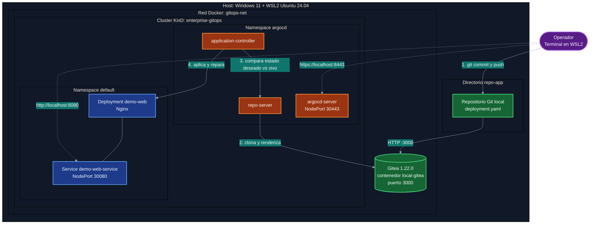
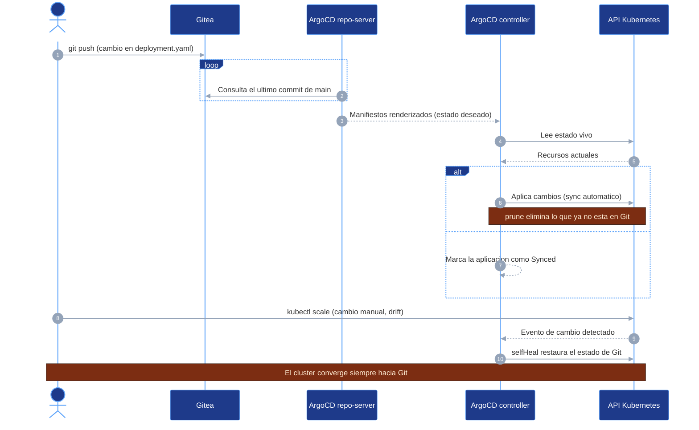
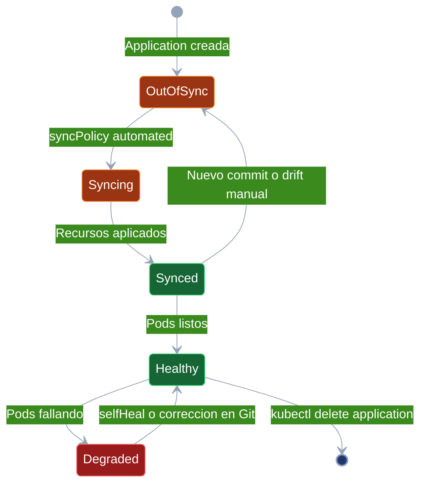

# Workshop 5 (WS_5): GitOps empresarial con KinD, Gitea y ArgoCD


Este taller monta un ecosistema GitOps completo y autocontenido en una sola maquina. No requiere cuentas en GitHub, tokens externos ni conexion a internet una vez descargadas las imagenes. El objetivo es entender, con practica real, como un controlador dentro del cluster mantiene la infraestructura alineada con lo que dice Git.

Documentos relacionados:

- [RUNBOOK.md](./RUNBOOK.md): procedimiento operativo paso a paso, con cada comando y archivo explicado.

---

## Tabla de contenido

1. [Objetivos de aprendizaje](#1-objetivos-de-aprendizaje)
2. [Stack tecnologico](#2-stack-tecnologico)
3. [Arquitectura](#3-arquitectura)
4. [Flujo GitOps](#4-flujo-gitops)
5. [Principios GitOps aplicados](#5-principios-gitops-aplicados)
6. [Estructura del directorio](#6-estructura-del-directorio)
7. [Archivos de configuracion](#7-archivos-de-configuracion)
8. [Mapa de puertos y servicios](#8-mapa-de-puertos-y-servicios)
9. [Requisitos previos](#9-requisitos-previos)
10. [Inicio rapido](#10-inicio-rapido)
11. [Consideraciones de seguridad](#11-consideraciones-de-seguridad)

---

## 1. Objetivos de aprendizaje

Al terminar el taller sabras:

- Levantar un servidor Git privado (Gitea) con Docker Compose.
- Crear un cluster Kubernetes local con KinD y conectarlo a una red Docker externa.
- Instalar ArgoCD y exponerlo mediante NodePort.
- Declarar una aplicacion con el recurso `Application` y habilitar sincronizacion automatica.
- Comprobar en vivo el escalado declarativo, la deteccion de deriva (drift) y la autorreparacion (self-heal).

---

## 2. Stack tecnologico

| Tecnologia | Version | Rol | Justificacion |
| :--- | :--- | :--- | :--- |
| WSL2 con Ubuntu | 24.04 LTS | Entorno de ejecucion | Kernel Linux real con soporte completo de cgroups y redes sobre Windows 11. |
| Docker Engine y Compose | Estable | Capa de contenedores | Aloja Gitea y los nodos de KinD de forma aislada y reproducible. |
| KinD | Estable | Cluster Kubernetes | Nodos conformes con CNCF dentro de contenedores; permite mapear puertos al host. |
| Gitea | 1.22.0 | Servidor Git local | Ligero, con API REST, ideal para laboratorios sin conexion externa. |
| ArgoCD | v2.10.4 | Motor GitOps | Reconciliador declarativo que compara Git contra el cluster de forma continua. |
| Nginx | 1.25-alpine | Aplicacion de prueba | Carga simple para observar sincronizacion y reparacion. |

---

## 3. Arquitectura

El diagrama muestra los componentes, sus fronteras de red y los puertos publicados hacia el host.



Lectura del diagrama:

- **Operador:** unico punto de entrada humano. Solo interactua con Git; nunca modifica el cluster directamente.
- **Gitea:** fuente de verdad. Vive en la red `gitops-net`, a la que tambien se conecta el nodo de KinD para resolver `local-gitea` por nombre.
- **ArgoCD:** corre dentro del cluster. El `repo-server` clona el repositorio y el `application-controller` decide si hay diferencias que corregir.
- **Namespace default:** destino del despliegue. El Service se publica en el puerto 30080 del nodo, que KinD mapea al 8080 del host.

---

## 4. Flujo GitOps

Secuencia completa desde un cambio en el codigo hasta su reflejo en el cluster, incluyendo la reparacion ante cambios manuales.



---

## 5. Principios GitOps aplicados

| Principio | Como se aplica en este taller |
| :--- | :--- |
| Declarativo | Todo el estado deseado se expresa en YAML (`deployment.yaml`, `argocd-app.yaml`). |
| Versionado e inmutable | Git es la unica fuente de verdad; cada cambio queda auditado en un commit. |
| Pull automatico | El cluster consulta a Git desde adentro; no se entregan credenciales de administrador a un pipeline externo. |
| Reconciliacion continua | `selfHeal` corrige deriva y `prune` elimina recursos huerfanos. |

Ciclo de vida de una aplicacion segun su estado de sincronizacion:



---

## 6. Estructura del directorio

```text
/home/gmt/sre-linux-mastery/Fase5/WS_5/
├── README.md                # Vision general, arquitectura y principios
├── RUNBOOK.md               # Procedimiento operativo detallado
├── infra/                   # Infraestructura del laboratorio
│   ├── docker-compose.yml   # Gitea y red externa gitops-net
│   ├── kind-config.yaml     # Cluster KinD y mapeo de puertos al host
│   └── argocd-app.yaml      # Recurso Application que enlaza ArgoCD con Gitea
└── repo-app/                # Repositorio Git de la aplicacion
    ├── .git/                # Historial local (se crea con git init)
    └── deployment.yaml      # Deployment y Service de Nginx
```

| Ruta | Tipo | Responsabilidad |
| :--- | :--- | :--- |
| `infra/` | Directorio | Todo lo que construye la plataforma. No se versiona en Gitea. |
| `repo-app/` | Directorio | Lo que ArgoCD observa. Es lo unico que se publica en Gitea. |

La separacion es deliberada: en entornos reales el repositorio de aplicacion y el de plataforma tienen ciclos de cambio y permisos distintos.

---

## 7. Archivos de configuracion

| Archivo | Formato | Funcion | Parametros clave |
| :--- | :--- | :--- | :--- |
| `infra/docker-compose.yml` | Compose | Levanta Gitea con persistencia y red propia | `image`, `ports`, `volumes`, `networks`, variables `GITEA__*` |
| `infra/kind-config.yaml` | KinD v1alpha4 | Define el nodo control-plane y los puertos publicados | `extraPortMappings` (30080 a 8080, 30443 a 8443) |
| `infra/argocd-app.yaml` | CRD Application | Declara origen, destino y politica de sincronizacion | `repoURL`, `path`, `syncPolicy.automated` |
| `repo-app/deployment.yaml` | Kubernetes | Describe la aplicacion Nginx y su Service | `replicas`, `image`, `nodePort` |

El detalle linea por linea de cada archivo esta en el [RUNBOOK.md](./RUNBOOK.md).

---

## 8. Mapa de puertos y servicios

| Servicio | Acceso desde el host | Puerto interno | Origen del mapeo |
| :--- | :--- | :--- | :--- |
| Gitea (web y API) | `http://localhost:3000` | 3000 | `ports` en Compose |
| Aplicacion Nginx | `http://localhost:8080` | NodePort 30080 | `extraPortMappings` en KinD |
| ArgoCD UI | `https://localhost:8443` | NodePort 30443 | `extraPortMappings` en KinD |
| Gitea desde el cluster | `http://local-gitea:3000` | 3000 | DNS de la red `gitops-net` |

---

## 9. Requisitos previos

| Requisito | Verificacion |
| :--- | :--- |
| Windows 11 con WSL2 y Ubuntu 24.04 | `lsb_release -a` |
| Docker Engine y plugin Compose | `docker compose version` |
| KinD | `kind version` |
| kubectl | `kubectl version --client` |
| git y curl | `git --version && curl --version` |
| Puertos libres 3000, 8080 y 8443 | `ss -tlnp` |
| Memoria disponible recomendada | 4 GB libres para WSL2 |

---

## 10. Inicio rapido

```bash
cd /home/gmt/sre-linux-mastery/Fase5/WS_5
less RUNBOOK.md     # Seguir las fases 0 a 8 en orden
```

Orden de ejecucion resumido:

```mermaid
%%{init: {'theme':'base','themeVariables':{'primaryColor':'#0f766e','primaryTextColor':'#fff','lineColor':'#94a3b8','fontFamily':'Inter, Segoe UI, sans-serif'}}}%%
flowchart LR
    F0["Fase 0<br/>Verificacion"] --> F1["Fase 1<br/>Directorios"]
    F1 --> F2["Fase 2<br/>Gitea"]
    F2 --> F3["Fase 3<br/>KinD y red"]
    F3 --> F4["Fase 4<br/>ArgoCD"]
    F4 --> F5["Fase 5<br/>Repo y app"]
    F5 --> F6["Fase 6<br/>Application"]
    F6 --> F7["Fase 7<br/>Pruebas"]
    F7 --> F8["Fase 8<br/>Limpieza"]

    classDef prep fill:#581c87,stroke:#c084fc,color:#fff
    classDef infra fill:#1e3a8a,stroke:#60a5fa,color:#fff
    classDef gitops fill:#9a3412,stroke:#fb923c,color:#fff
    classDef test fill:#166534,stroke:#4ade80,color:#fff
    classDef clean fill:#991b1b,stroke:#f87171,color:#fff
    class F0,F1 prep
    class F2,F3 infra
    class F4,F5,F6 gitops
    class F7 test
    class F8 clean
```



---

## 11. Consideraciones de seguridad

Este es un laboratorio. Algunas decisiones son aceptables solo aqui:

| Practica del taller | Riesgo | Alternativa en produccion |
| :--- | :--- | :--- |
| Contrasena en texto plano en comandos | Queda en el historial del shell | Gestor de secretos, variables de entorno o credential helper |
| Repositorio publico y registro abierto en Gitea | Cualquiera en la red puede leer o crear cuentas | Repositorios privados, `DISABLE_REGISTRATION=true`, SSO |
| Gitea sin TLS | Trafico sin cifrar | Ingress con certificados validos |
| Usuario administrador para el repositorio | Privilegios excesivos | Cuenta de servicio con acceso de solo lectura para ArgoCD |
| ArgoCD con certificado autofirmado | Advertencia en el navegador | Certificado emitido por una CA interna |

