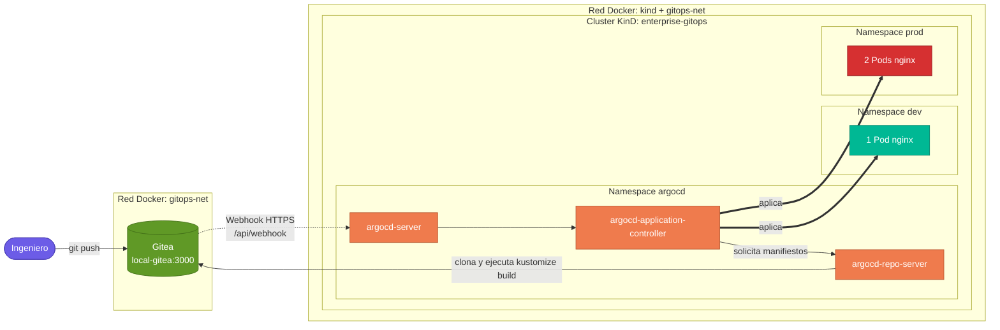
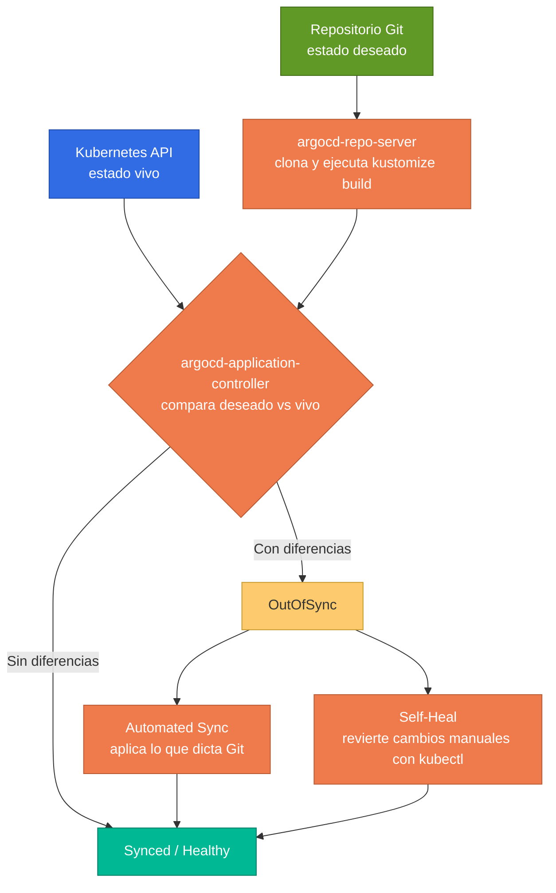
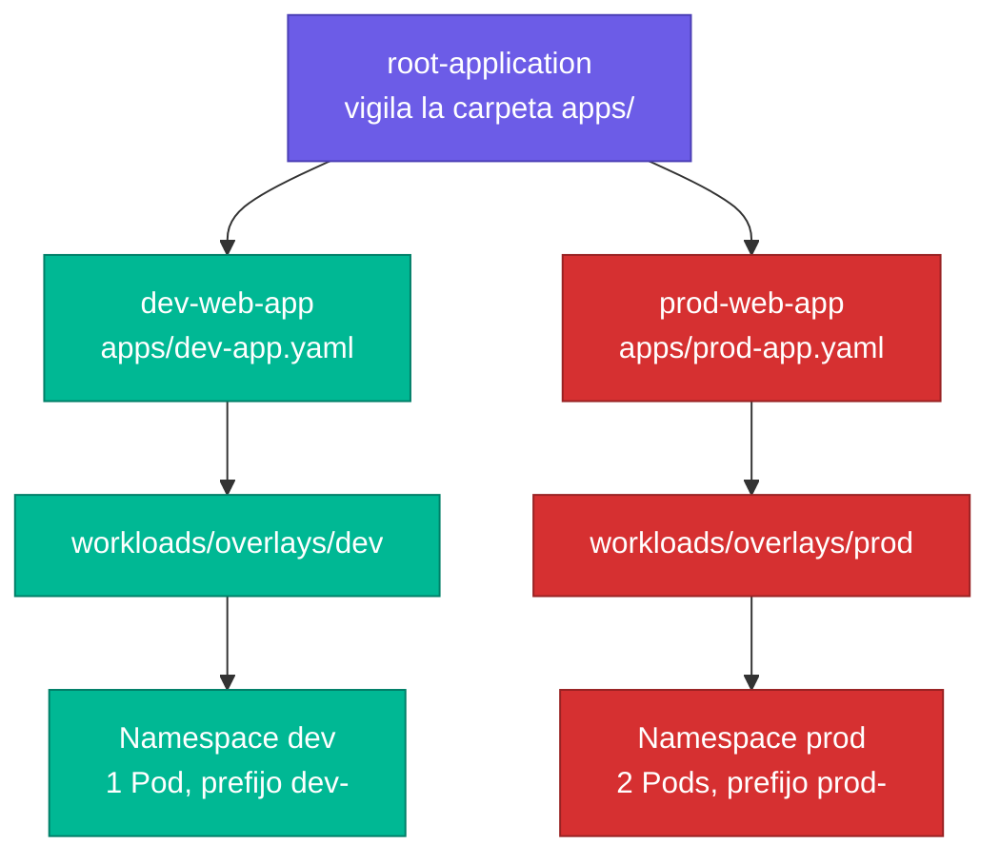
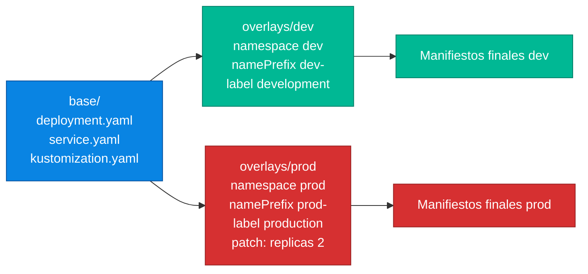
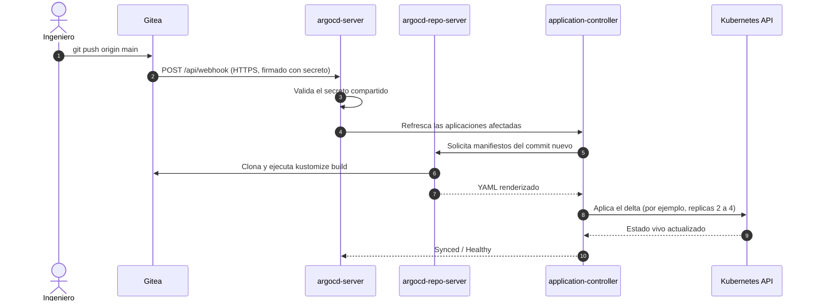
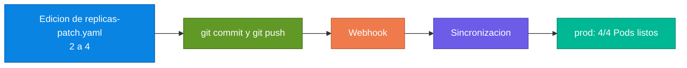

# Workshop 6 (WS_6): GitOps Multi-Entorno con ArgoCD, Kustomize y Webhooks


Este taller construye una plataforma GitOps completa en una sola maquina: dos entornos (**dev** y **prod**) que comparten una misma base de manifiestos, un punto de entrada unico (patron **App of Apps**) y sincronizacion casi inmediata gracias a un **webhook** que Gitea dispara en cada `git push`.

El objetivo practico es sencillo de enunciar y dificil de lograr sin disciplina: que cualquier cambio en un entorno nazca de un commit, sea revisable y se aplique solo.

---

## Tabla de contenidos

1. [Que se construye](#1-que-se-construye)
2. [Stack y justificacion](#2-stack-y-justificacion)
3. [Arquitectura general](#3-arquitectura-general)
4. [Bucle de reconciliacion de ArgoCD](#4-bucle-de-reconciliacion-de-argocd)
5. [Patron App of Apps](#5-patron-app-of-apps)
6. [Composicion con Kustomize](#6-composicion-con-kustomize)
7. [Flujo del webhook](#7-flujo-del-webhook)
8. [Estructura de directorios](#8-estructura-de-directorios)
9. [Archivos de configuracion](#9-archivos-de-configuracion)
10. [Guia de la interfaz web](#10-guia-de-la-interfaz-web)
11. [Resultado esperado](#11-resultado-esperado)
12. [Documentacion relacionada](#12-documentacion-relacionada)

---

## 1. Que se construye

| Entorno | Namespace | Replicas | Prefijo de recursos | Etiqueta `environment` |
| :--- | :--- | :---: | :--- | :--- |
| Development | `dev` | 1 | `dev-` | `development` |
| Production | `prod` | 2 (escalable via Git) | `prod-` | `production` |

Tres aplicaciones de ArgoCD gobiernan todo: `root-application`, `dev-web-app` y `prod-web-app`.

## 2. Stack y justificacion

| Componente | Rol | Por que se eligio |
| :--- | :--- | :--- |
| WSL2 con Ubuntu 24.04 LTS | Entorno base | Kernel Linux real, cgroups v2 y Docker nativo sobre Windows 11. |
| KinD | Cluster Kubernetes | Nodos certificados por la CNCF dentro de contenedores; permite exponer NodePorts al host con `extraPortMappings`. |
| Gitea | Fuente de verdad | Servidor Git liviano con API REST, sin depender de servicios externos. |
| Kustomize | Composicion declarativa | Integrado en `kubectl`; base comun mas parches por ambiente, sin plantillas. |
| ArgoCD | Reconciliador GitOps | Compara Git contra el estado vivo y corrige el drift de forma continua. |
| Webhook Gitea a ArgoCD | Disparador de eventos | Evita esperar el sondeo periodico (aprox. 3 minutos) y sincroniza en segundos. |

## 3. Arquitectura general



**Como leerlo.** El ingeniero solo interactua con Git. Gitea notifica a `argocd-server` por HTTPS; el controlador pide a `argocd-repo-server` que compile los manifiestos y luego aplica el resultado en los namespaces destino. La conexion del nodo KinD a `gitops-net` es lo que permite que el cluster resuelva el nombre `local-gitea` y que Gitea alcance a ArgoCD.

## 4. Bucle de reconciliacion de ArgoCD



Los tres servicios cumplen funciones distintas:

- **argocd-repo-server:** clona el repositorio y genera el YAML final ejecutando `kustomize build workloads/overlays/<entorno>`.
- **argocd-application-controller:** compara ese YAML con los objetos vivos en el cluster y decide si hace falta actuar.
- **argocd-server:** expone la interfaz web (puerto 8443 en el host) y recibe el webhook en `/api/webhook`.

Las politicas `prune` y `selfHeal` activadas en cada aplicacion hacen que ArgoCD elimine lo que ya no esta en Git y deshaga cualquier cambio manual.

## 5. Patron App of Apps



Solo la `root-application` se aplica a mano, una unica vez. Todo lo demas se descubre desde Git: agregar un entorno nuevo es agregar un archivo en `apps/`.

## 6. Composicion con Kustomize



La base se escribe una sola vez (principio DRY). Cada overlay agrega solo lo que cambia: el namespace, el prefijo de nombres, las etiquetas y, en produccion, un parche que fija las replicas.

## 7. Flujo del webhook



## 8. Estructura de directorios

```text
/home/gmt/sre-linux-mastery/Fase5/WS_6/
├── README.md                        Arquitectura y guia conceptual
├── RUNBOOK.md                       Procedimiento operativo paso a paso
├── infra/
│   └── root-app.yaml                Aplicacion raiz (bootstrap del App of Apps)
└── repo-gitops/                     Repositorio Git local publicado en Gitea
    ├── apps/                        Definiciones de Application (CRD de ArgoCD)
    │   ├── dev-app.yaml
    │   └── prod-app.yaml
    └── workloads/
        ├── base/                    Manifiestos comunes, sin conocimiento de entorno
        │   ├── deployment.yaml
        │   ├── service.yaml
        │   └── kustomization.yaml
        └── overlays/                Personalizacion por entorno
            ├── dev/
            │   └── kustomization.yaml
            └── prod/
                ├── kustomization.yaml
                └── replicas-patch.yaml
```

## 9. Archivos de configuracion

| Archivo | Tipo de recurso | Funcion |
| :--- | :--- | :--- |
| `infra/root-app.yaml` | `Application` | Apunta a `apps/` y crea las aplicaciones hijas. Es lo unico que se aplica con `kubectl`. |
| `apps/dev-app.yaml` | `Application` | Despliega `workloads/overlays/dev` en el namespace `dev`. |
| `apps/prod-app.yaml` | `Application` | Despliega `workloads/overlays/prod` en el namespace `prod`. |
| `workloads/base/deployment.yaml` | `Deployment` | Define `web-app` con `nginx:1.25-alpine`, 1 replica, puerto 80. |
| `workloads/base/service.yaml` | `Service` | `web-service` tipo ClusterIP hacia el puerto 80. |
| `workloads/base/kustomization.yaml` | `Kustomization` | Lista los recursos que forman la base. |
| `overlays/dev/kustomization.yaml` | `Kustomization` | Namespace `dev`, prefijo `dev-`, etiqueta `development`. |
| `overlays/prod/kustomization.yaml` | `Kustomization` | Namespace `prod`, prefijo `prod-`, etiqueta `production`, referencia al parche. |
| `overlays/prod/replicas-patch.yaml` | Parche estrategico | Sobrescribe unicamente `spec.replicas`. |

Directivas clave de las `Application`:

| Directiva | Efecto |
| :--- | :--- |
| `syncPolicy.automated.prune` | Elimina del cluster lo que desaparece de Git. |
| `syncPolicy.automated.selfHeal` | Revierte modificaciones manuales sobre recursos gestionados. |
| `syncOptions: CreateNamespace=true` | Crea el namespace destino si no existe. |
| `finalizers: resources-finalizer.argocd.argoproj.io` | Borrado en cascada: al eliminar la aplicacion se eliminan sus recursos. |

## 10. Guia de la interfaz web

Acceso: `https://localhost:8443` (el certificado es autofirmado, hay que aceptar la advertencia). Usuario `admin`; la contrasena inicial esta en el Secret `argocd-initial-admin-secret`.

| Vista | Que muestra | Cuando consultarla |
| :--- | :--- | :--- |
| Dashboard de aplicaciones | Estado de sincronizacion (Synced, OutOfSync) y de salud (Healthy, Progressing, Degraded) por aplicacion. | Primera revision tras cada cambio. |
| Resource Tree | Jerarquia Application, Deployment, ReplicaSet, Pod. Cada Pod ofrece resumen, logs y eventos. | Diagnosticar por que un Pod no arranca. |
| App Diff | Diferencia entre lo que declara Git y lo que existe en el cluster. | Confirmar que un cambio manual fue detectado. |
| Sync Status / History | Commit desplegado y historial de revisiones. | Auditoria y rollback. |

## 11. Resultado esperado



Al terminar el taller, un cambio de replicas en Git se refleja en el cluster en pocos segundos y sin ejecutar ningun comando contra Kubernetes.

## 12. Documentacion relacionada

- [`RUNBOOK.md`](./RUNBOOK.md): procedimiento operativo completo, con la explicacion de cada comando, verificaciones y resolucion de problemas.

