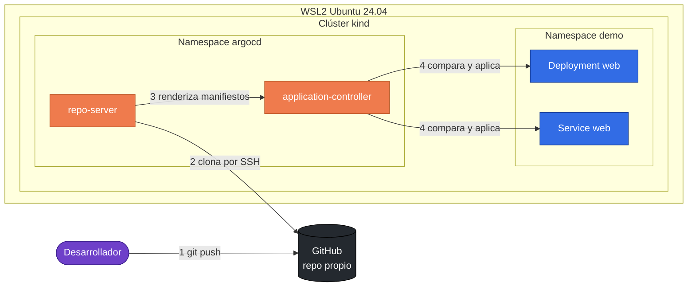

<div align="center">

# Laboratorio 2: Argo CD con Repositorio Propio

**GitOps de extremo a extremo sobre Kubernetes local**


</div>

---

## 1. Resumen ejecutivo

Este laboratorio demuestra el modelo **GitOps** tal como opera en produccion: Git es la unica fuente de verdad y Argo CD reconcilia continuamente el clúster contra ese estado deseado. A diferencia del Laboratorio 1 (repositorio ajeno, alteraciones manuales sobre el clúster), aquí el repositorio es propio, la conexión es por SSH y todo cambio nace en un commit.

| Aspecto | Detalle |
|---|---|
| Objetivo | Desplegar y operar una aplicación mediante Git y Argo CD |
| Modelo | Pull-based GitOps con sincronización automática |
| Entorno | Clúster local `kind` sobre Docker en WSL2 |
| Entregable | Aplicación `Synced` y `Healthy`, con rollback verificado |

## 2. Objetivos de aprendizaje

| N.° | Competencia | Evidencia esperada |
|---|---|---|
| 1 | Conectar Argo CD a GitHub por SSH | Repositorio en estado `Successful` |
| 2 | Entender la reconciliación Git a clúster | Cambio en Git reflejado sin `kubectl apply` |
| 3 | Interpretar `Synced` y `Healthy` | Lectura correcta del dashboard |
| 4 | Aplicar `prune: true` | Recurso huérfano eliminado |
| 5 | Aplicar `selfHeal: true` | Deriva manual revertida |
| 6 | Hacer rollback con `git revert` | Estado anterior restaurado |
| 7 | Medir latencia de detección | Tiempo registrado con y sin refresh |

## 3. Arquitectura



**Leyenda del diagrama**

| Elemento | Color | Significado |
|---|---|---|
| Desarrollador | Violeta | Actor que modifica el estado deseado en Git |
| GitHub | Negro | Fuente de verdad; almacena los manifiestos YAML |
| repo-server / application-controller | Naranja | Componentes de Argo CD: el primero clona y renderiza, el segundo compara y sincroniza |
| Deployment / Service | Azul | Recursos de Kubernetes gestionados por Argo CD |
| Flechas numeradas | n/a | Orden cronológico: push, clonado, renderizado, aplicación |

## 4. Tecnologías

| Herramienta | Rol |
|---|---|
| Docker | Runtime de contenedores |
| kind | Kubernetes dentro de contenedores Docker |
| kubectl | Cliente de Kubernetes |
| Argo CD | Motor GitOps |
| Git y GitHub | Control de versiones y repositorio remoto |

## 5. Requisitos previos

- [ ] WSL2 con Ubuntu 24.04
- [ ] Docker en ejecución (`docker ps` responde)
- [ ] `kind`, `kubectl` y `git` instalados
- [ ] Cuenta de GitHub con clave SSH configurada
- [ ] 4 GB de RAM libres para el clúster

## 6. Flujo general

```mermaid
flowchart TD
    A[Fase 1<br/>Clúster kind]:::infra --> B[Fase 2<br/>Instalar Argo CD]:::infra
    B --> C[Fase 3<br/>Acceso a la UI]:::infra
    C --> D[Fase 4<br/>Repositorio propio]:::git
    D --> E[Fase 5<br/>Credencial SSH]:::sec
    E --> F[Fase 6<br/>Registrar repositorio]:::sec
    F --> G[Fase 7<br/>Crear Application]:::argo
    G --> H[Fase 8<br/>Verificar Synced y Healthy]:::ok
    H --> I[Fase 9<br/>Cambio y medición]:::test
    I --> J[Fase 10<br/>Prune y selfHeal]:::test
    J --> K[Fase 11<br/>Rollback]:::test
    K --> L[Fase 12<br/>Limpieza]:::end

    classDef infra fill:#326CE5,stroke:#1B3F94,color:#fff
    classDef git fill:#24292F,stroke:#000,color:#fff
    classDef sec fill:#B08800,stroke:#6B5400,color:#fff
    classDef argo fill:#EF7B4D,stroke:#B3501F,color:#fff
    classDef ok fill:#2EA44F,stroke:#1A6B31,color:#fff
    classDef test fill:#8250DF,stroke:#4C2889,color:#fff
    classDef end fill:#57606A,stroke:#24292F,color:#fff
```

**Leyenda del diagrama**

| Color | Categoría | Fases | Qué representa |
|---|---|---|---|
| Azul | Infraestructura | 1 a 3 | Clúster, instalación y acceso |
| Negro | Fuente de verdad | 4 | Repositorio Git con manifiestos |
| Dorado | Seguridad | 5 y 6 | Autenticación SSH entre Argo CD y GitHub |
| Naranja | Configuración GitOps | 7 | Objeto `Application` |
| Verde | Validación | 8 | Estado correcto del despliegue |
| Violeta | Pruebas operativas | 9 a 11 | Cambio, reconciliación y rollback |
| Gris | Cierre | 12 | Retiro del entorno |

## 7. Estructura del repositorio de la aplicación

```text
argocd-lab2-app/
└── k8s/
    ├── namespace.yaml
    ├── deployment.yaml
    └── service.yaml
```

## 8. Glosario mínimo

| Término | Definición |
|---|---|
| Synced | El clúster coincide con lo declarado en Git |
| OutOfSync | Existe diferencia entre Git y el clúster |
| Healthy | Los recursos funcionan correctamente |
| Prune | Eliminación de recursos que ya no están en Git |
| Self-heal | Reversión automática de cambios manuales en el clúster |
| Drift | Desviación del clúster respecto a Git |

## 9. Documentación operativa

Procedimiento completo, comandos, validaciones y resolución de problemas en **[RUNBOOK.md](./RUNBOOK.md)**.

