<div align="center">

# Runbook: Laboratorio 2, Argo CD con Repositorio Propio


-2EA44F?style=for-the-badge)

</div>

---

## Convenciones

| Marcador | Significado |
|---|---|
| `<USUARIO>` | Tu usuario de GitHub; reemplázalo en cada comando |
| Bloque **Comando** | Se ejecuta tal cual en la terminal de WSL2 |
| Bloque **Validación** | Resultado esperado antes de avanzar |
| Bloque **Si falla** | Diagnóstico rápido |

## Mapa de fases

| Fase | Nombre | Categoría | Duración |
|---|---|---|---|
| 0 | Verificación de requisitos | Preparación | 2 min |
| 1 | Crear clúster kind | Infraestructura | 3 min |
| 2 | Instalar Argo CD | Infraestructura | 4 min |
| 3 | Acceder a la UI | Infraestructura | 2 min |
| 4 | Crear repositorio propio | Fuente de verdad | 5 min |
| 5 | Generar credencial SSH | Seguridad | 3 min |
| 6 | Registrar repositorio en Argo CD | Seguridad | 3 min |
| 7 | Crear la Application | GitOps | 3 min |
| 8 | Verificar Synced y Healthy | Validación | 2 min |
| 9 | Cambio en Git y medición | Prueba | 6 min |
| 10 | Prune y selfHeal | Prueba | 6 min |
| 11 | Rollback con git revert | Prueba | 4 min |
| 12 | Limpieza | Cierre | 1 min |

---

## Fase 0. Verificación de requisitos

**Objetivo:** confirmar que las herramientas están disponibles antes de crear nada.

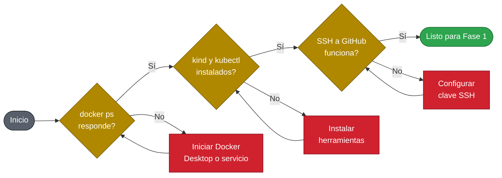

| Elemento | Leyenda |
|---|---|
| Rombos dorados | Puntos de decisión; cada uno verifica una dependencia |
| Rectángulos rojos | Acción correctiva; tras ejecutarla se vuelve a la decisión |
| Óvalo verde | Condición de salida: todas las dependencias están cubiertas |
| Óvalo gris | Punto de entrada |

**Comando**

```bash
docker ps
kind version
kubectl version --client
git --version
ssh -T git@github.com
```

**Validación:** `docker ps` lista cabeceras sin error y `ssh -T` responde `Hi <USUARIO>! You've successfully authenticated`.

---

## Fase 1. Crear clúster kind

**Objetivo:** disponer de un Kubernetes local desechable.

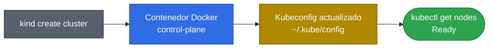

| Elemento | Leyenda |
|---|---|
| Comando (gris) | Instrucción ejecutada por el operador |
| Contenedor control-plane (azul) | Nodo único que aloja API server, etcd y kubelet |
| Kubeconfig (dorado) | kind registra el contexto `kind-argo-lab2` para `kubectl` |
| Resultado (verde) | Nodo en estado `Ready` |

**Comando**

```bash
kind create cluster --name argo-lab2
kubectl cluster-info --context kind-argo-lab2
kubectl get nodes
```

**Validación:** nodo `argo-lab2-control-plane` en `Ready`.

**Si falla:** `docker ps` para confirmar Docker activo; `kind delete cluster --name argo-lab2` y reintentar.

---

## Fase 2. Instalar Argo CD

**Objetivo:** desplegar el motor GitOps en el namespace `argocd`.

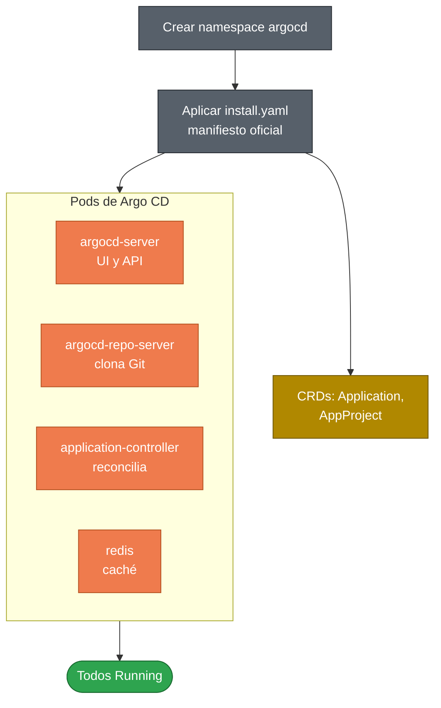

| Componente | Función |
|---|---|
| CRDs (dorado) | Extienden la API de Kubernetes con el tipo `Application` |
| argocd-server | Expone la interfaz web y la API |
| argocd-repo-server | Clona repositorios Git y genera los manifiestos finales |
| application-controller | Compara estado deseado vs. real y sincroniza |
| redis | Caché interna de estado |

**Comando**

```bash
kubectl create namespace argocd
kubectl apply -n argocd -f https://raw.githubusercontent.com/argoproj/argo-cd/stable/manifests/install.yaml
kubectl wait --for=condition=available deployment/argocd-server -n argocd --timeout=300s
kubectl get pods -n argocd
```

**Validación:** todos los pods en `Running` y `1/1` o `2/2` en READY.

**Si falla:** `kubectl describe pod <pod> -n argocd`. Causas comunes: falta de memoria o descarga de imágenes lenta; esperar y repetir `kubectl wait`.

---

## Fase 3. Acceder a la UI

**Objetivo:** iniciar sesión como `admin`.

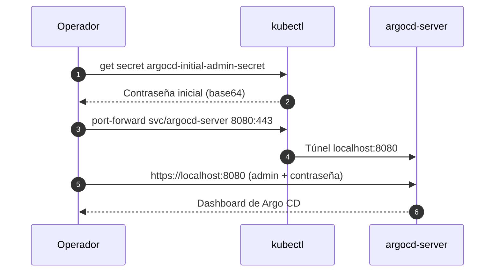

| Paso | Leyenda |
|---|---|
| 1 y 2 | Se lee el secret donde Argo CD guarda la contraseña generada en la instalación |
| 3 y 4 | `port-forward` crea un túnel entre tu máquina y el servicio interno |
| 5 y 6 | Acceso por HTTPS; el navegador advertirá certificado autofirmado, es esperado |

**Comando** (terminal 1, mantener abierta)

```bash
kubectl -n argocd get secret argocd-initial-admin-secret -o jsonpath="{.data.password}" | base64 -d; echo
kubectl port-forward svc/argocd-server -n argocd 8080:443
```

**Validación:** abrir `https://localhost:8080` e ingresar con usuario `admin`.

> Usa una segunda terminal para las fases siguientes.

---

## Fase 4. Crear repositorio propio

**Objetivo:** construir la fuente de verdad con los manifiestos de la aplicación.

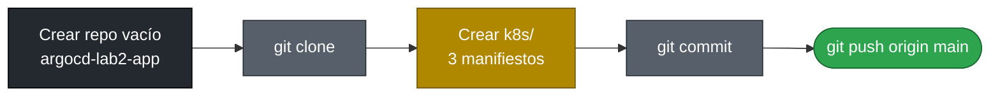

| Archivo | Contenido |
|---|---|
| `namespace.yaml` | Namespace `demo` donde vivirá la aplicación |
| `deployment.yaml` | Deployment `web` con nginx y 2 réplicas |
| `service.yaml` | Service `web` tipo ClusterIP en el puerto 80 |

**Comando** (crear primero un repositorio vacío en GitHub llamado `argocd-lab2-app`)

```bash
cd ~ && git clone git@github.com:<USUARIO>/argocd-lab2-app.git && cd argocd-lab2-app
mkdir k8s

cat > k8s/namespace.yaml <<'EOF'
apiVersion: v1
kind: Namespace
metadata:
  name: demo
EOF

cat > k8s/deployment.yaml <<'EOF'
apiVersion: apps/v1
kind: Deployment
metadata:
  name: web
  namespace: demo
spec:
  replicas: 2
  selector:
    matchLabels: { app: web }
  template:
    metadata:
      labels: { app: web }
    spec:
      containers:
        - name: nginx
          image: nginx:1.27
          ports: [{ containerPort: 80 }]
EOF

cat > k8s/service.yaml <<'EOF'
apiVersion: v1
kind: Service
metadata:
  name: web
  namespace: demo
spec:
  selector: { app: web }
  ports: [{ port: 80, targetPort: 80 }]
EOF

git add . && git commit -m "feat: manifiestos iniciales" && git branch -M main && git push -u origin main
```

**Validación:** los tres archivos visibles en GitHub bajo `k8s/`.

---

## Fase 5. Generar credencial SSH

**Objetivo:** crear un par de claves dedicado y de solo lectura para Argo CD.

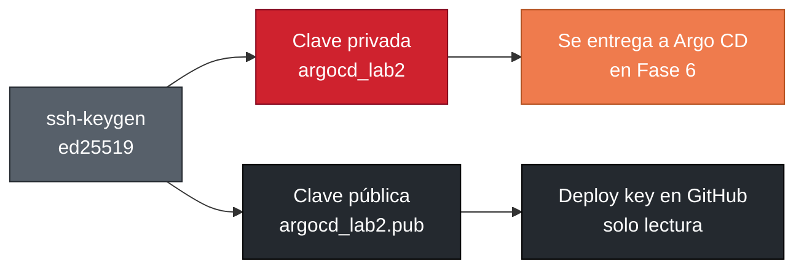

| Elemento | Leyenda |
|---|---|
| Clave privada (rojo) | Secreto; nunca se sube a Git ni se comparte |
| Clave pública (negro) | Se registra en GitHub como Deploy key |
| Deploy key | Credencial limitada a un único repositorio; principio de mínimo privilegio |

**Comando**

```bash
ssh-keygen -t ed25519 -f ~/.ssh/argocd_lab2 -C "argocd-lab2" -N ""
cat ~/.ssh/argocd_lab2.pub
```

En GitHub: repositorio, **Settings**, **Deploy keys**, **Add deploy key**; pegar la clave pública, dejar **Allow write access** desactivado y guardar.

**Validación:** la deploy key aparece listada en el repositorio.

---

## Fase 6. Registrar el repositorio en Argo CD

**Objetivo:** entregar a Argo CD la URL y la clave privada mediante un Secret declarativo.

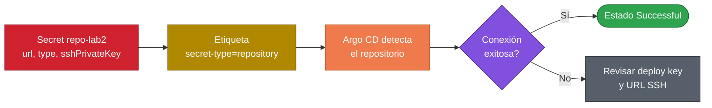

| Elemento | Leyenda |
|---|---|
| Secret | Contiene la URL SSH, el tipo `git` y la clave privada |
| Etiqueta `argocd.argoproj.io/secret-type=repository` | Indica a Argo CD que este Secret es una credencial de repositorio |
| Decisión | Argo CD intenta conectar; el resultado se ve en la UI |

**Comando**

```bash
kubectl create secret generic repo-lab2 -n argocd \
  --from-literal=type=git \
  --from-literal=url=git@github.com:<USUARIO>/argocd-lab2-app.git \
  --from-file=sshPrivateKey=$HOME/.ssh/argocd_lab2
kubectl label secret repo-lab2 -n argocd argocd.argoproj.io/secret-type=repository
```

**Validación:** UI, **Settings**, **Repositories**: estado **Successful**.

**Si falla:** confirmar que la URL usa formato `git@github.com:` y que la deploy key corresponde a la clave pública.

---

## Fase 7. Crear la Application

**Objetivo:** vincular repositorio, ruta y destino con sincronización automática.

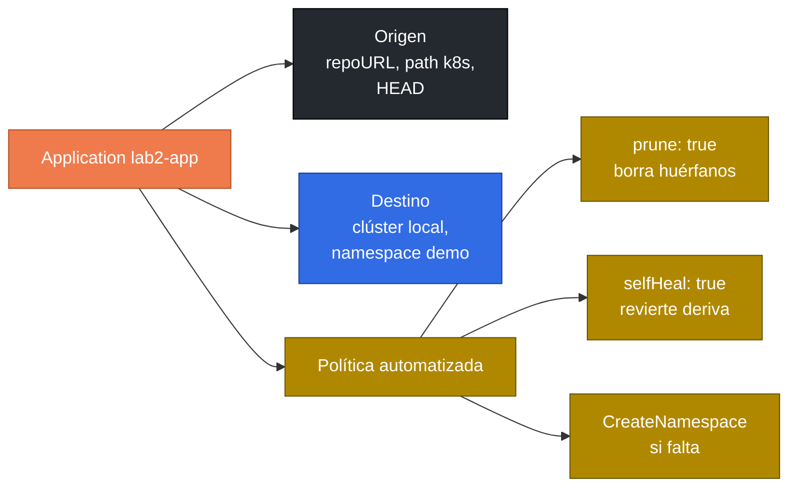

| Campo | Leyenda |
|---|---|
| `source.path` | Carpeta del repositorio que se sincroniza |
| `destination.server` | `https://kubernetes.default.svc` representa el clúster donde corre Argo CD |
| `prune` | Elimina del clúster lo que se borra de Git |
| `selfHeal` | Deshace cambios manuales hechos con `kubectl` |

**Comando**

```bash
cat <<'EOF' | kubectl apply -f -
apiVersion: argoproj.io/v1alpha1
kind: Application
metadata:
  name: lab2-app
  namespace: argocd
spec:
  project: default
  source:
    repoURL: git@github.com:<USUARIO>/argocd-lab2-app.git
    targetRevision: HEAD
    path: k8s
  destination:
    server: https://kubernetes.default.svc
    namespace: demo
  syncPolicy:
    automated:
      prune: true
      selfHeal: true
    syncOptions:
      - CreateNamespace=true
EOF
```

**Validación:** la aplicación `lab2-app` aparece en el dashboard.

---

## Fase 8. Verificar Synced y Healthy

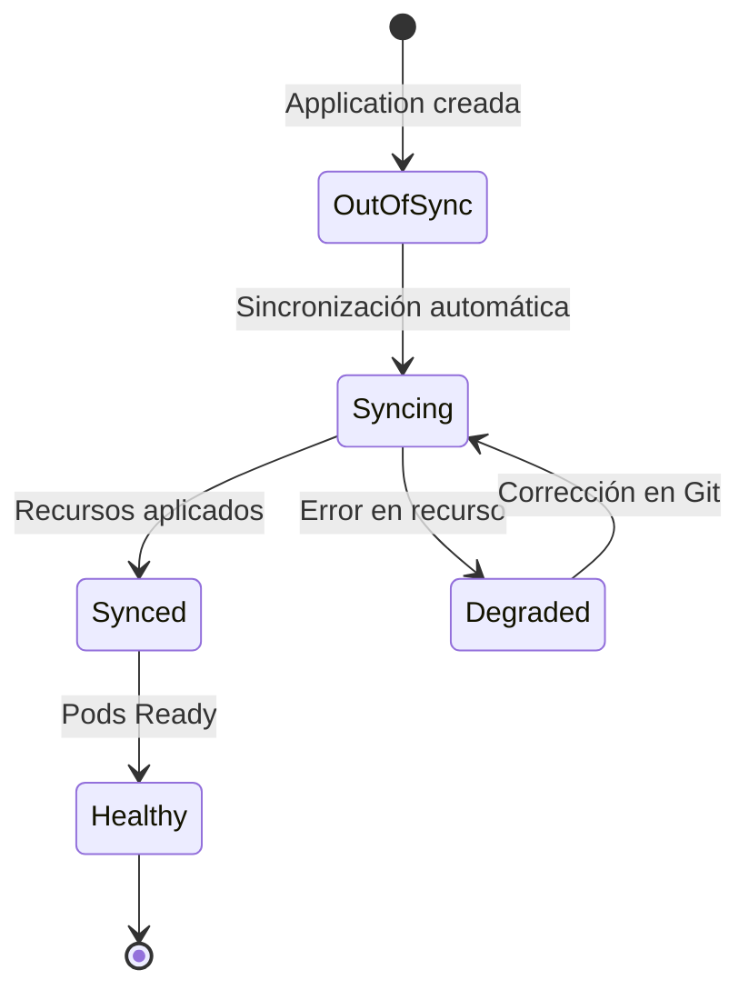

| Estado | Leyenda |
|---|---|
| OutOfSync | Git y clúster difieren; estado inicial |
| Syncing | Argo CD está aplicando los manifiestos |
| Synced | El clúster coincide con Git |
| Healthy | Los pods están listos; objetivo de esta fase |
| Degraded | Algún recurso falla; se corrige en Git, no en el clúster |

**Comando**

```bash
kubectl get application lab2-app -n argocd
kubectl get all -n demo
```

**Validación:** columnas `SYNC STATUS = Synced` y `HEALTH STATUS = Healthy`; 2 pods `web` en `Running`.

---

## Fase 9. Cambio en Git y medición de latencia

**Objetivo:** observar la propagación Git a clúster y medir el tiempo de reacción.

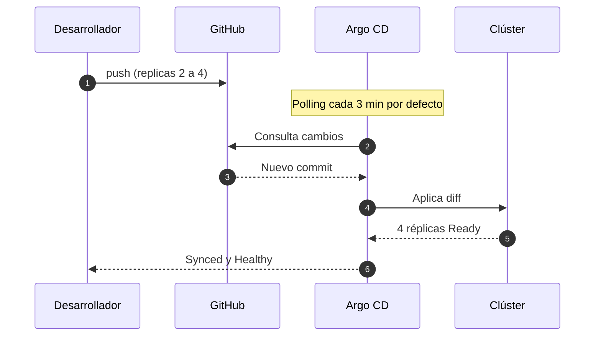

| Paso | Leyenda |
|---|---|
| 1 | El cambio se hace solo en Git |
| Nota | Sin webhook, Argo CD detecta por sondeo; la latencia máxima ronda 3 minutos |
| 3 a 5 | Argo CD compara, aplica la diferencia y confirma salud |

**Comando**

```bash
cd ~/argocd-lab2-app
sed -i 's/replicas: 2/replicas: 4/' k8s/deployment.yaml
git commit -am "feat: escalar a 4 replicas" && git push
date +%T
kubectl get deploy web -n demo -w
```

Para acelerar la detección (medición con refresh forzado):

```bash
kubectl annotate application lab2-app -n argocd argocd.argoproj.io/refresh=hard --overwrite
```

**Registro de mediciones**

| Escenario | Hora del push | Hora de 4 réplicas | Latencia |
|---|---|---|---|
| Polling natural | | | |
| Refresh forzado | | | |

**Validación:** `kubectl get deploy web -n demo` muestra `4/4`.

---

## Fase 10. Prune y selfHeal

**Objetivo:** comprobar que Git manda sobre el clúster en ambos sentidos.

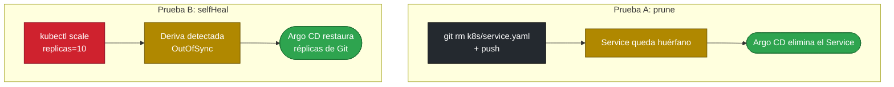

| Elemento | Leyenda |
|---|---|
| Prueba A (negro) | El cambio legítimo viaja por Git y Argo CD limpia lo que ya no existe |
| Prueba B (rojo) | El cambio ilegítimo se hace directo en el clúster y es revertido |
| Verde | Resultado esperado de cada prueba |

**Comando: prueba A**

```bash
cd ~/argocd-lab2-app
git rm k8s/service.yaml && git commit -m "chore: eliminar service" && git push
kubectl annotate application lab2-app -n argocd argocd.argoproj.io/refresh=hard --overwrite
kubectl get svc -n demo
```

**Comando: prueba B**

```bash
kubectl scale deploy web -n demo --replicas=10
kubectl get deploy web -n demo -w
```

**Validación:** A, el Service `web` desaparece. B, las réplicas regresan al valor de Git (4).

---

## Fase 11. Rollback con git revert

**Objetivo:** restaurar el Service sin tocar el clúster.


| Elemento | Leyenda |
|---|---|
| Commit rojo | Cambio que se desea deshacer |
| `git revert` | Crea un commit inverso; conserva el historial y es seguro en ramas compartidas |
| Commit verde | Nuevo estado deseado: el Service vuelve a existir |

**Comando**

```bash
cd ~/argocd-lab2-app
git revert HEAD --no-edit && git push
kubectl annotate application lab2-app -n argocd argocd.argoproj.io/refresh=hard --overwrite
kubectl get svc -n demo
```

**Validación:** el Service `web` reaparece y la aplicación vuelve a `Synced` y `Healthy`.

---

## Fase 12. Limpieza

```bash
kind delete cluster --name argo-lab2
rm ~/.ssh/argocd_lab2 ~/.ssh/argocd_lab2.pub
```

Eliminar además la deploy key en GitHub si el repositorio se conserva.

---

## Resolución de problemas

| Síntoma | Causa probable | Acción |
|---|---|---|
| Repositorio con estado `Failed` | Deploy key ausente o URL en formato HTTPS | Verificar clave y usar `git@github.com:` |
| `ComparisonError` | Ruta `path` incorrecta o YAML inválido | Revisar `k8s/` y la sintaxis |
| Aplicación `OutOfSync` persistente | Sincronización automática desactivada | Confirmar bloque `automated` |
| UI inaccesible | `port-forward` cerrado | Reiniciar el comando de la Fase 3 |
| Pods en `Pending` | Recursos insuficientes en WSL2 | Aumentar memoria en `.wslconfig` |
| `ImagePullBackOff` | Sin red o límite de pulls | Reintentar o revisar conectividad |

## Criterios de aceptación

- [ ] Repositorio registrado como `Successful`
- [ ] Aplicación `Synced` y `Healthy`
- [ ] Cambio de réplicas propagado desde Git
- [ ] Latencias registradas en la tabla de la Fase 9
- [ ] Prune y selfHeal verificados
- [ ] Rollback con `git revert` verificado

## Referencias

- Documentación oficial de Argo CD: https://argo-cd.readthedocs.io
- kind: https://kind.sigs.k8s.io

