<div align="center">

# Runbook: Laboratorio 2, Argo CD con Repositorio Propio


-2EA44F?style=for-the-badge)


</div>

---

## Convenciones

* `${USUARIO}`: tu usuario de GitHub. Se define una sola vez al inicio (Fase 1) como variable de entorno.
* Los bloques **Comando** se ejecutan en WSL2.
* Los bloques **Validación** indican qué debes ver antes de avanzar a la siguiente fase.
* Los bloques **Anatomía del diagrama** explican, componente por componente, qué representa cada elemento del diagrama de la fase.
* Si cierras la terminal y la reabres, vuelve a ejecutar `export USUARIO=...` antes de continuar.

---

## Guía de lectura de los diagramas

Todos los diagramas de este runbook usan la misma paleta de colores y las mismas formas, para que una vez que aprendas a leer uno, puedas leer todos.

### Paleta de colores

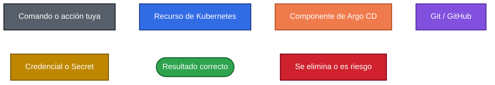

| Color | Significa | Ejemplos en este lab |
| :--- | :--- | :--- |
| Gris | Comando o acción que ejecutas tú | `kubectl apply`, `git push` |
| Azul | Recurso o componente nativo de Kubernetes | Deployment, Service, API server |
| Naranja | Componente propio de Argo CD | repo-server, application-controller |
| Morado | Git y GitHub | Repositorio, commits |
| Amarillo | Credenciales y secretos | Llave SSH, Secret |
| Verde | Resultado esperado o validación exitosa | Nodo `Ready`, app `Synced` |
| Rojo | Algo que se elimina o que implica riesgo | Service borrado por `prune` |

### Formas y flechas

| Elemento | Notación Mermaid | Significado |
| :--- | :--- | :--- |
| Rectángulo | `A["texto"]` | Componente, comando o recurso |
| Cilindro | `A[("texto")]` | Almacenamiento: repositorio, Secret, caché |
| Píldora (stadium) | `A(["texto"])` | Resultado o punto de validación |
| Flecha sólida `-->` | | Flujo normal de ejecución |
| Flecha gruesa `==>` | | Flujo principal del ciclo GitOps |
| Flecha punteada `-.->` | | Lectura, consulta o relación indirecta (no modifica nada) |
| Caja con título (subgraph) | `subgraph ... end` | Frontera: un namespace, un clúster, un servicio externo |

---

## Vista general de la arquitectura

Antes de entrar a las fases, este es el mapa completo de lo que vas a construir. Vuelve a este diagrama cuando te pierdas en alguna fase.

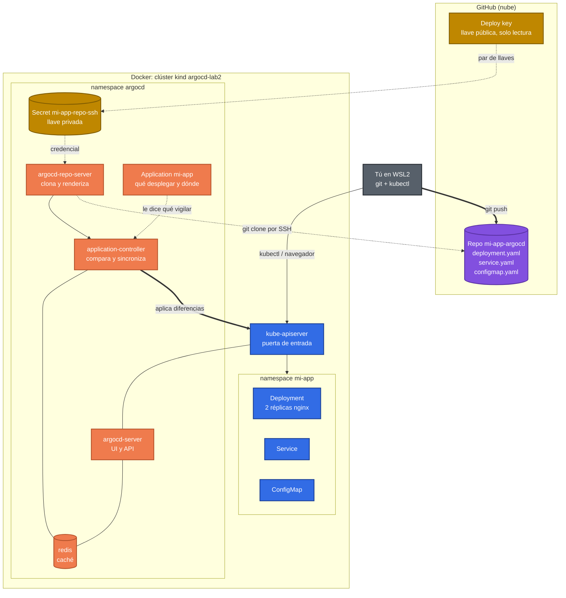

**Anatomía del diagrama**

| Componente | Qué es | Qué hace en este laboratorio |
| :--- | :--- | :--- |
| **Tú en WSL2** | Tu terminal con `git` y `kubectl` | Haces `git push` hacia GitHub y comandos `kubectl` hacia el clúster. Nunca despliegas la app directamente. |
| **Repo mi-app-argocd** | Repositorio Git remoto | Es la **fuente de verdad**: describe el estado deseado del clúster. |
| **Deploy key** | Llave SSH pública registrada en GitHub | Autoriza a Argo CD a **leer** (no escribir) el repo. |
| **kind argocd-lab2** | Kubernetes dentro de un contenedor Docker | Clúster desechable, ideal para aprender sin riesgo. |
| **kube-apiserver** | API central de Kubernetes | Todo pasa por aquí: `kubectl`, Argo CD y la UI. |
| **argocd-server** | Servidor de Argo CD | Sirve la UI web y la API que usas con el navegador. |
| **argocd-repo-server** | Servicio que accede a Git | Clona el repo, lee los YAML y genera los manifiestos finales. |
| **application-controller** | El "cerebro" de Argo CD | Compara el estado deseado (Git) contra el real (clúster) y corrige las diferencias. |
| **redis** | Base de datos en memoria | Caché para acelerar consultas. No guarda datos críticos. |
| **Secret mi-app-repo-ssh** | Secret de Kubernetes | Guarda la llave privada que Argo CD usa para entrar a GitHub. |
| **Application mi-app** | Recurso personalizado (CRD) de Argo CD | Une un repositorio (origen) con un namespace del clúster (destino). |
| **namespace mi-app** | Espacio de nombres destino | Aquí viven los recursos que Argo CD despliega a partir de Git. |

---

## Fase 1. Crear el clúster kind

**Objetivo:** Disponer de un Kubernetes local desechable con el nombre exacto que usará el resto del laboratorio.

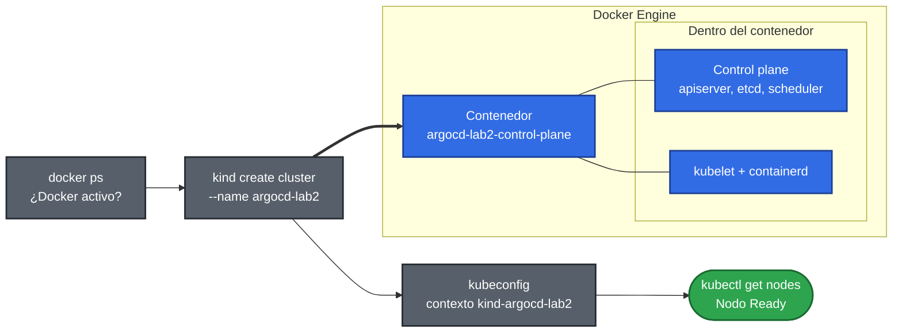

**Anatomía del diagrama**

| Componente | Qué es | Por qué importa |
| :--- | :--- | :--- |
| **docker ps** | Comprobación de que el motor Docker responde | kind necesita Docker; si falla, nada más funcionará. |
| **kind create cluster** | Herramienta que crea un clúster Kubernetes | "kind" significa *Kubernetes IN Docker*. |
| **Contenedor control-plane** | Un único contenedor que actúa como nodo | Es el "servidor" completo de tu clúster. |
| **Control plane** | Componentes que gobiernan el clúster | El apiserver recibe órdenes, etcd guarda el estado, el scheduler decide dónde corre cada pod. |
| **kubelet + containerd** | Agente del nodo y runtime de contenedores | Ejecutan realmente los pods dentro del nodo. |
| **kubeconfig / contexto** | Archivo que le dice a `kubectl` a qué clúster hablar | `kubectl config use-context` evita aplicar comandos al clúster equivocado. |
| **Nodo Ready** | Estado de salud del nodo | Es tu señal de "puedes continuar". |

**Comando:**

```bash
# 0. Definir tu usuario de GitHub (cámbialo por el tuyo)
export USUARIO=jgaragorry

# 1. Verificar que Docker esté corriendo (si falla, inicia Docker Desktop)
docker ps

# 2. Crear la estructura de directorios base
mkdir -p ~/argocd-lab-2/{manifests,repo-git}
cd ~/argocd-lab-2

# 3. Crear el clúster
kind create cluster --name argocd-lab2
kubectl config use-context kind-argocd-lab2
```

**Validación:** `kubectl get nodes` muestra un nodo llamado `argocd-lab2-control-plane` en estado `Ready`.

---

## Fase 2. Instalar Argo CD

**Objetivo:** Desplegar los componentes de Argo CD en el namespace `argocd`.

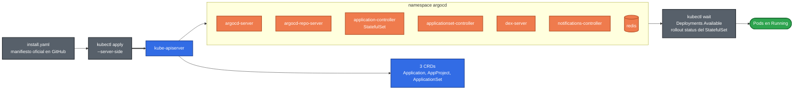

**Anatomía del diagrama**

| Componente | Qué es | Por qué importa |
| :--- | :--- | :--- |
| **install.yaml** | Manifiesto oficial que define todo Argo CD | Una sola URL instala todos los componentes. |
| **`--server-side`** | Modo de aplicación donde el servidor calcula los cambios | Los CRDs de Argo CD son tan grandes que el modo normal falla por exceder el límite de anotaciones. |
| **3 CRDs** | Extensiones que "enseñan" nuevos tipos de recurso a Kubernetes | Sin ellas, Kubernetes no entendería qué es una `Application`. |
| **argocd-server** | Deployment con la UI y la API | Lo que abres en el navegador. |
| **argocd-repo-server** | Deployment que clona repositorios | Es el único componente que habla con Git. |
| **application-controller** | StatefulSet (por eso se espera con `rollout status`) | Ejecuta el bucle de reconciliación. |
| **applicationset-controller** | Genera múltiples Applications desde plantillas | No lo usamos en este lab, pero se instala por defecto. |
| **dex-server** | Proveedor de identidad (SSO) | Opcional; no se usa en este lab. |
| **notifications-controller** | Envía alertas (Slack, email) | No se usa en este lab. |
| **redis** | Caché en memoria | Acelera la UI y la comparación de estados. |
| **kubectl wait** | Espera activa hasta que los Deployments estén `Available` | Evita que sigas antes de tiempo. No se usa `pods --all` porque pods auxiliares pueden terminar en `Completed` y nunca ser `Ready`. |

**Comando:**

```bash
kubectl create namespace argocd
kubectl apply -n argocd --server-side --force-conflicts -f https://raw.githubusercontent.com/argoproj/argo-cd/stable/manifests/install.yaml
```

> **Nota:** el flag `--server-side` es obligatorio porque los CRDs de Argo CD son muy grandes.

Esperar a que los componentes estén listos:

```bash
kubectl wait --for=condition=Available deployment --all -n argocd --timeout=300s
kubectl rollout status statefulset/argocd-application-controller -n argocd --timeout=300s
```

> Se espera por `Deployment` y `StatefulSet` en lugar de `pods --all`, porque algunos pods auxiliares pueden terminar en `Completed` y nunca llegan a `Ready`, lo que haría fallar el `wait` por timeout.

**Validación:** `kubectl get pods -n argocd` muestra los pods principales (server, repo-server, application-controller, applicationset-controller, redis, dex, notifications) en estado `Running`.

---

## Fase 3. Acceder a la UI

**Objetivo:** Obtener la contraseña de administrador y exponer la interfaz web.

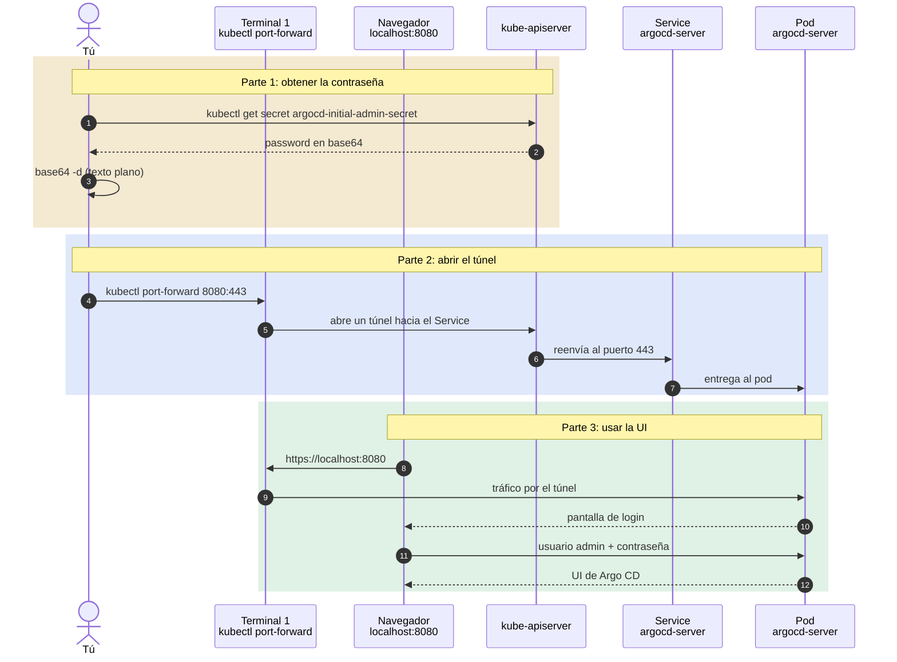

**Anatomía del diagrama**

| Elemento | Qué representa | Detalle importante |
| :--- | :--- | :--- |
| **Participante "Tú"** (actor) | La persona que opera | Inicia todos los pasos. |
| **Terminal 1** | Proceso `kubectl port-forward` | Debe quedar **abierto**; si lo cierras (Ctrl+C), pierdes el acceso a la UI. |
| **Navegador** | Tu cliente web | Habla con `localhost`, no directamente con el clúster. |
| **kube-apiserver** | Intermediario del túnel | El port-forward viaja a través de la API de Kubernetes. |
| **Service argocd-server** | Dirección interna estable | Los pods cambian de IP; el Service no. |
| **Pod argocd-server** | El proceso que sirve la UI | Destino final del tráfico. |
| **Bloque amarillo** | Obtención de la contraseña | El Secret guarda la clave en base64 (codificación, no cifrado). |
| **Bloque azul** | Creación del túnel | Une `localhost:8080` con el puerto 443 del Service. |
| **Bloque verde** | Uso normal de la UI | Aquí aceptas la advertencia del certificado autofirmado. |
| **Números (autonumber)** | Orden cronológico | Léelos de 1 hacia abajo. |

**Comando (Terminal 1, mantener abierta):**

```bash
kubectl -n argocd get secret argocd-initial-admin-secret -o jsonpath="{.data.password}" | base64 -d; echo
kubectl port-forward svc/argocd-server -n argocd 8080:443
```

> **Nota:** si `port-forward` falla con `Unable to listen on port 8080`, otro servicio en WSL (como cAdvisor o Grafana) está usando ese puerto. Cambia el puerto local:
> `kubectl port-forward svc/argocd-server -n argocd 9090:443`
> y accede a `https://localhost:9090`.

**Validación:** Abrir `https://localhost:8080` (aceptar la advertencia de certificado) e ingresar con usuario `admin` y la contraseña obtenida.

> Desde aquí, usa una **segunda terminal** (Terminal 2) para el resto de las fases. Recuerda ejecutar `export USUARIO=...` en ella.

---

## Fase 4. Crear repositorio propio y publicar en GitHub

**Objetivo:** Construir el estado deseado (manifiestos) y subirlo a tu repositorio remoto.

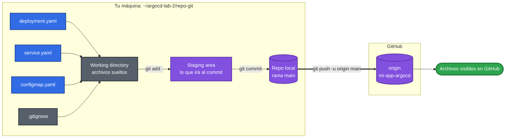

**Anatomía del diagrama**

| Componente | Qué es | Rol en GitOps |
| :--- | :--- | :--- |
| **deployment.yaml** | Describe los pods de la app | Define imagen (`nginx:1.25-alpine`) y réplicas (2). |
| **service.yaml** | Describe cómo se accede a los pods | Es el recurso que eliminaremos y restauraremos en las fases 9 y 10. |
| **configmap.yaml** | Datos de configuración clave-valor | Muestra que Argo CD también gestiona configuración. |
| **.gitignore** | Lista de archivos que Git debe ignorar | Evita subir temporales (`*.swp`, `.env`). |
| **Working directory** | Carpeta de trabajo con archivos editables | Git aún no los sigue. |
| **Staging area** | Zona intermedia de `git add` | Te deja elegir qué entra en el próximo commit. |
| **Repo local (main)** | Historial de commits en tu disco | Aún no existe en GitHub. |
| **origin** | Nombre del repositorio remoto | Alias para `git@github.com:USUARIO/mi-app-argocd.git`. |
| **git push -u** | Sube commits y enlaza `main` local con `origin/main` | El `-u` evita repetir el destino en futuros `git push`. |

**Comando:**

```bash
cd ~/argocd-lab-2/repo-git

# 1. Crear los manifiestos
cat > deployment.yaml <<'EOF'
apiVersion: apps/v1
kind: Deployment
metadata:
  name: mi-app
spec:
  replicas: 2
  selector:
    matchLabels:
      app: mi-app
  template:
    metadata:
      labels:
        app: mi-app
    spec:
      containers:
        - name: mi-app
          image: nginx:1.25-alpine
          ports:
            - containerPort: 80
EOF

cat > service.yaml <<'EOF'
apiVersion: v1
kind: Service
metadata:
  name: mi-app
spec:
  selector:
    app: mi-app
  ports:
    - port: 80
      targetPort: 80
EOF

cat > configmap.yaml <<'EOF'
apiVersion: v1
kind: ConfigMap
metadata:
  name: mi-app-config
data:
  ambiente: "laboratorio"
  version: "v1"
EOF

# 2. Crear archivo .gitignore para evitar subir archivos temporales
cat > .gitignore <<'EOF'
*.swp
.DS_Store
.env
EOF

# 3. Inicializar Git y hacer commit
git init
git add .
git commit -m "feat: manifiestos iniciales"
git branch -M main
```

**Publicar en GitHub:**

> **Requisito previo:** antes de ejecutar estos comandos, ve a GitHub y crea un repositorio vacío llamado `mi-app-argocd` (sin README, sin `.gitignore`, sin licencia).

```bash
git remote add origin git@github.com:${USUARIO}/mi-app-argocd.git
git push -u origin main
```

**Validación:** Los 3 archivos YAML y el `.gitignore` son visibles en `https://github.com/${USUARIO}/mi-app-argocd`.

---

## Fase 5. Registrar credencial SSH en Argo CD

**Objetivo:** Dar acceso de **solo lectura** a Argo CD para que pueda clonar tu repositorio. Argo CD no usa tu llave SSH local; necesita la suya propia, guardada en un Secret.

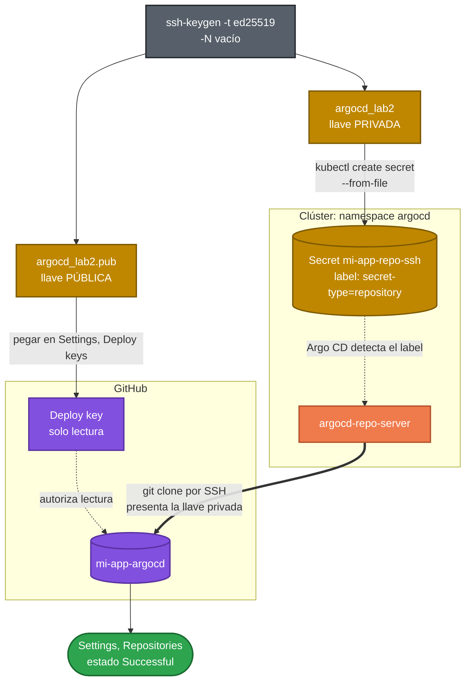

**Anatomía del diagrama**

| Componente | Qué es | Detalle importante |
| :--- | :--- | :--- |
| **ssh-keygen -N ""** | Genera un par de llaves sin passphrase | Argo CD no puede escribir una contraseña, por eso la llave debe ir sin ella. |
| **Llave privada** | Tu "contraseña" secreta | **Nunca** se sube a GitHub ni a Git. Solo vive en el Secret. |
| **Llave pública** | Candado que acompaña a la privada | Se registra en GitHub; no es secreta. |
| **Deploy key** | Llave pública atada a **un solo repositorio** | Más segura que tu llave personal: solo lectura y un solo repo. |
| **Secret mi-app-repo-ssh** | Contenedor Kubernetes de la credencial | Incluye `type=git`, `url` y `sshPrivateKey`. |
| **Label `argocd.argoproj.io/secret-type=repository`** | Etiqueta que activa el Secret | Sin ella, Argo CD **ignora** el Secret. |
| **argocd-repo-server** | Quien usa la credencial | Presenta la llave privada a GitHub; GitHub la valida contra la pública. |
| **Flechas punteadas** | Relaciones de autorización | No transportan datos; indican "quién autoriza a quién". |
| **Successful** | Estado de conexión en la UI | Confirma que la autenticación SSH funciona. |

**Paso 1. Crear una llave dedicada, sin passphrase** (Argo CD no puede pedir una contraseña):

```bash
ssh-keygen -t ed25519 -f ~/.ssh/argocd_lab2 -N "" -C "argocd-lab2"
cat ~/.ssh/argocd_lab2.pub
```

**Paso 2. Registrar la llave pública como Deploy key en GitHub:**

1. Abre `https://github.com/${USUARIO}/mi-app-argocd/settings/keys`.
2. Pulsa **Add deploy key**.
3. Pega la salida del `cat` anterior. Título: `argocd-lab2`.
4. **No marques** "Allow write access" (debe quedar de solo lectura).

**Paso 3. Crear el Secret en el clúster:**

```bash
kubectl create secret generic mi-app-repo-ssh \
  --namespace argocd \
  --from-literal=type=git \
  --from-literal=url=git@github.com:${USUARIO}/mi-app-argocd.git \
  --from-file=sshPrivateKey=$HOME/.ssh/argocd_lab2

kubectl label secret mi-app-repo-ssh -n argocd argocd.argoproj.io/secret-type=repository
```

**Validación:** En la UI de Argo CD, ve a **Settings > Repositories**. Debes ver tu repo con estado `Successful`.

---

## Fase 6. Crear la Application

**Objetivo:** Unir el repositorio (Fase 4) con el clúster (Fase 1).

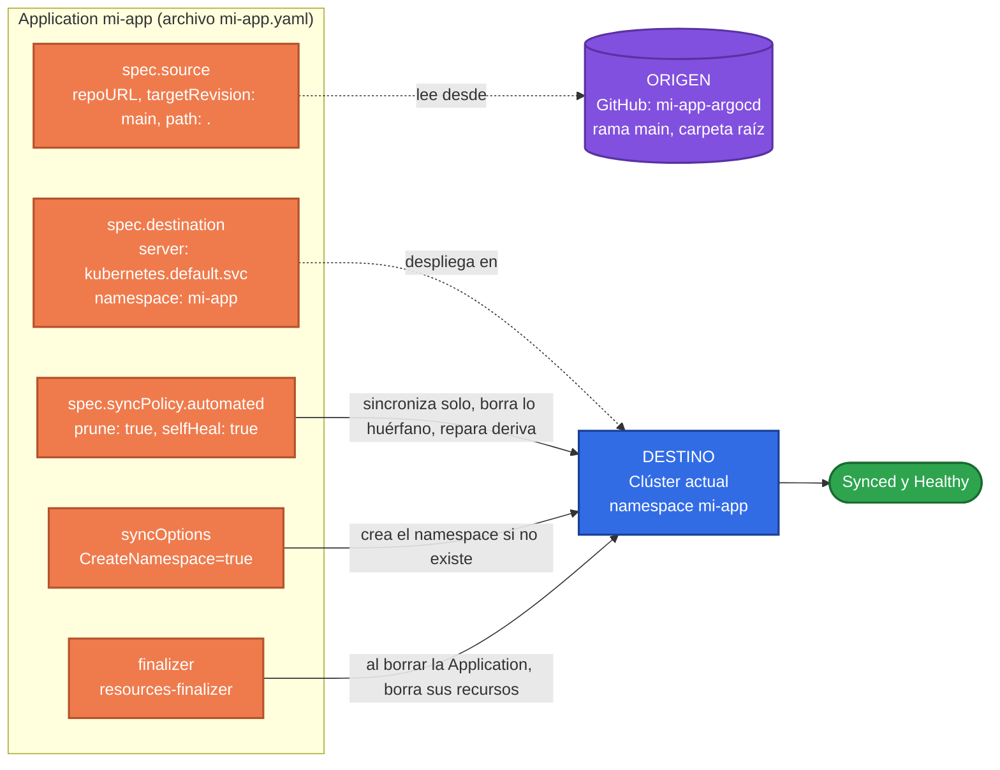

**Anatomía del diagrama**

| Campo de la Application | Qué hace | Qué pasa si lo cambias |
| :--- | :--- | :--- |
| **`spec.source.repoURL`** | URL SSH del repo | Si no coincide con la del Secret (Fase 5), falla la autenticación. |
| **`targetRevision: main`** | Rama o tag a vigilar | Podrías apuntar a otra rama para probar cambios sin afectar `main`. |
| **`path: .`** | Carpeta del repo con los YAML | Si tus manifiestos estuvieran en `k8s/`, aquí iría `k8s`. |
| **`destination.server`** | API del clúster destino | `https://kubernetes.default.svc` significa "este mismo clúster". |
| **`destination.namespace`** | Namespace donde se crean los recursos | Aquí `mi-app`. |
| **`automated`** | Sincroniza sin intervención humana | Sin él, tendrías que pulsar "Sync" a mano. |
| **`prune: true`** | Borra del clúster lo que ya no está en Git | Es lo que prueba la Fase 9, prueba A. |
| **`selfHeal: true`** | Revierte cambios manuales en el clúster | Es lo que prueba la Fase 9, prueba B. |
| **`CreateNamespace=true`** | Crea el namespace destino si no existe | Evita crearlo a mano. |
| **`finalizers`** | Ejecuta limpieza al borrar la Application | Borra también los recursos desplegados (útil en el lab; en producción hay que usarlo con cuidado). |

**Estados que verás en la UI** (son dos ejes independientes: *sincronización* y *salud*):

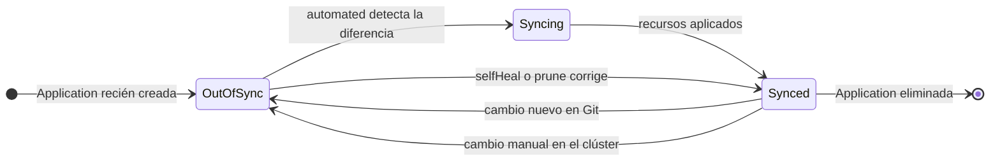

| Estado | Significa |
| :--- | :--- |
| **OutOfSync** | El clúster no coincide con Git. |
| **Syncing** | Argo CD está aplicando los cambios. |
| **Synced** | El clúster coincide con Git. |
| **Healthy** (eje aparte) | Los recursos funcionan: pods `Running`, Deployment disponible. Una app puede estar `Synced` pero `Degraded` si el pod falla. |

**Comando** (el `EOF` va **sin comillas** para que `${USUARIO}` se expanda):

```bash
cat > ~/argocd-lab-2/manifests/mi-app.yaml <<EOF
apiVersion: argoproj.io/v1alpha1
kind: Application
metadata:
  name: mi-app
  namespace: argocd
  finalizers:
    - resources-finalizer.argocd.argoproj.io
spec:
  project: default
  source:
    repoURL: git@github.com:${USUARIO}/mi-app-argocd.git
    targetRevision: main
    path: .
  destination:
    server: https://kubernetes.default.svc
    namespace: mi-app
  syncPolicy:
    automated:
      prune: true
      selfHeal: true
    syncOptions:
      - CreateNamespace=true
EOF

kubectl apply -f ~/argocd-lab-2/manifests/mi-app.yaml
```

**Validación:** `kubectl get application mi-app -n argocd` muestra `Synced` y `Healthy`.

---

## Fase 7. Verificar despliegue

**Objetivo:** Confirmar que lo que está en Git ya existe en el clúster.

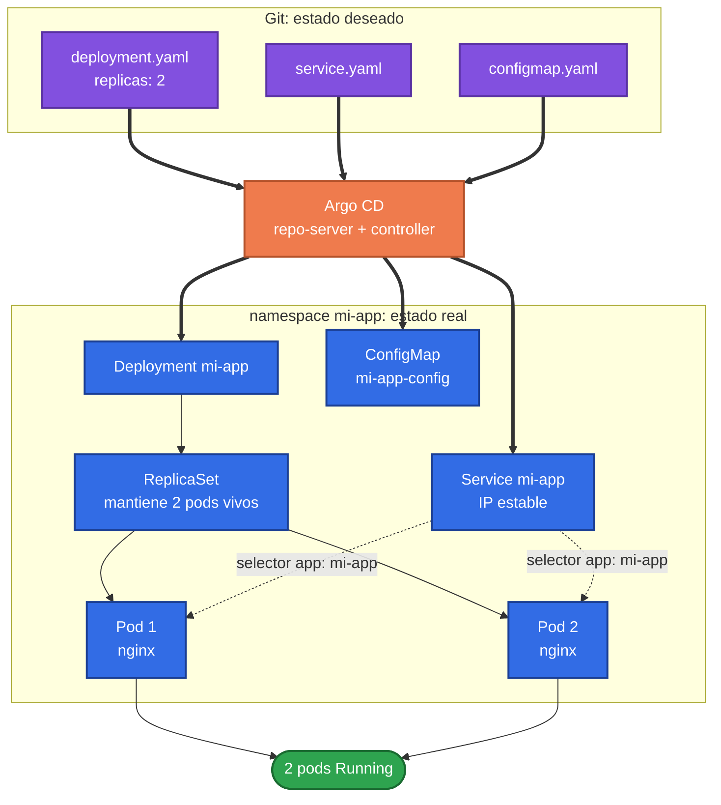

**Anatomía del diagrama**

| Componente | Qué es | Relación con los demás |
| :--- | :--- | :--- |
| **Estado deseado (Git)** | Los 3 YAML del repositorio | Lo que **debería** existir. |
| **Estado real (namespace)** | Recursos vivos en el clúster | Lo que **existe** de verdad. |
| **Deployment** | Declara "quiero 2 réplicas de nginx" | Crea y gestiona al ReplicaSet. |
| **ReplicaSet** | Vigila que haya exactamente N pods | Si un pod muere, crea otro. |
| **Pods** | Contenedores nginx en ejecución | Quienes realmente sirven la aplicación. |
| **Service** | Dirección estable hacia los pods | Los encuentra por la etiqueta `app: mi-app`, no por IP. |
| **ConfigMap** | Datos de configuración | Existe en el clúster, aunque la app de ejemplo no lo consuma. |
| **Flechas gruesas** | Despliegue gestionado por Argo CD | Tú no ejecutaste `kubectl apply` de estos recursos. |

**Comando:**

```bash
kubectl get pods -n mi-app
```

**Validación:** Deben verse 2 pods de nginx en estado `Running`.

---

## Fase 8. Cambio en Git y medición de latencia

**Objetivo:** Demostrar que el clúster reacciona a un cambio hecho puramente en Git.

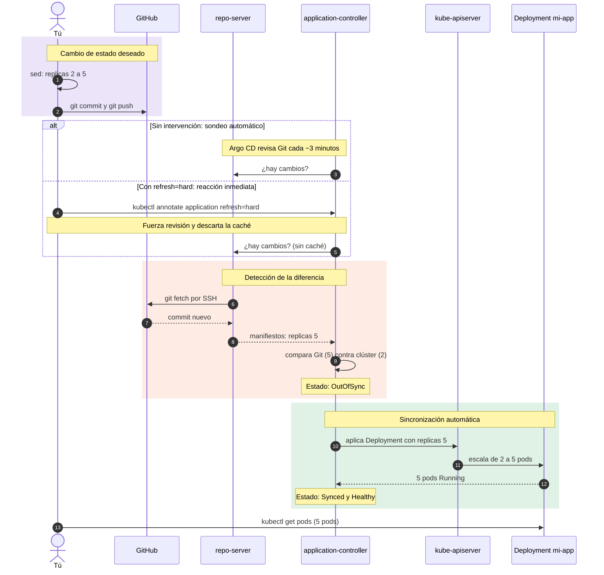

**Anatomía del diagrama**

| Elemento | Qué representa | Aprendizaje clave |
| :--- | :--- | :--- |
| **Bloque morado** | Tu cambio en Git | Es la **única** acción humana. No tocas el clúster. |
| **Bloque `alt` / `else`** | Dos caminos posibles | Muestra que hay un camino lento (sondeo) y uno rápido (`refresh=hard`). |
| **Sondeo cada ~3 min** | Comportamiento por defecto | Por eso sin forzar tendrías que esperar. |
| **`refresh=hard`** | Anotación que fuerza la revisión inmediata | Solo acelera la **detección**; la sincronización la hace la política `automated`. |
| **Bloque naranja** | Detección del desvío | El repo-server renderiza; el controller compara. |
| **Bloque verde** | Corrección | El controller aplica el estado deseado al clúster. |
| **Flechas `->>` y `-->>`** | Petición (sólida) y respuesta (punteada) | Léelas como "pregunta" y "respuesta". |
| **Nota "OutOfSync"** | Estado transitorio | Dura unos segundos entre detectar y aplicar. |

**Comando** (para forzar la reacción rápida):

```bash
cd ~/argocd-lab-2/repo-git
sed -i 's/replicas: 2/replicas: 5/' deployment.yaml
git commit -am "feat: escalar a 5 replicas" && git push

# Forzar a Argo CD a revisar AHORA (si no, esperar ~3 min)
kubectl annotate application mi-app -n argocd argocd.argoproj.io/refresh=hard --overwrite

# Esperar y verificar
sleep 15
kubectl get pods -n mi-app
```

**Validación:** Deben aparecer 5 pods.

---

## Fase 9. Pruebas Prune y selfHeal

**Objetivo:** Comprobar que Argo CD limpia recursos huérfanos y revierte cambios manuales.

### Prueba A: prune (Git manda sobre lo que sobra)

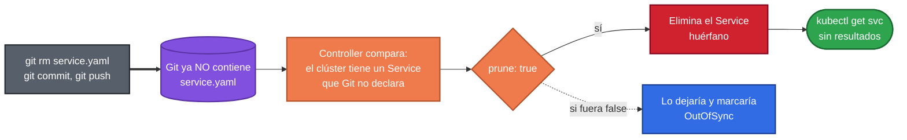

| Componente | Qué es | Aprendizaje |
| :--- | :--- | :--- |
| **git rm** | Borra el archivo y lo prepara para commit | La eliminación ocurre en **Git**, no en el clúster. |
| **Recurso huérfano** | Existe en el clúster pero ya no en Git | Sin `prune`, se acumularía "basura" para siempre. |
| **Rombo `prune: true`** | Punto de decisión de la política | Es la configuración que habilita la limpieza automática. |
| **Rama punteada** | Lo que pasaría con `prune: false` | Argo CD solo avisaría con `OutOfSync`. |
| **Caja roja** | Acción destructiva | Recuerda: `prune` borra de verdad. |

```bash
cd ~/argocd-lab-2/repo-git
git rm service.yaml && git commit -m "chore: eliminar service" && git push
kubectl annotate application mi-app -n argocd argocd.argoproj.io/refresh=hard --overwrite
sleep 15
kubectl get svc -n mi-app
```

**Validación A:** El Service desaparece del clúster.

### Prueba B: selfHeal (Git manda sobre cambios manuales)

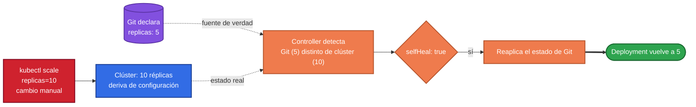

| Componente | Qué es | Aprendizaje |
| :--- | :--- | :--- |
| **Cambio manual (rojo)** | Alguien modifica el clúster a mano | Es lo que en la práctica causa "deriva" y errores difíciles de rastrear. |
| **Deriva (drift)** | Diferencia entre lo declarado y lo real | `selfHeal` existe para eliminarla. |
| **Flechas punteadas hacia el controller** | Las dos entradas que compara | Estado deseado (Git) y estado real (clúster). |
| **Rombo `selfHeal: true`** | Decisión de la política | Sin él, el cambio manual **persistiría**. |
| **Resultado** | El valor de Git gana siempre | Para cambiar réplicas de verdad, cambias Git. |

```bash
kubectl scale deploy mi-app -n mi-app --replicas=10
sleep 15
kubectl get deploy mi-app -n mi-app
```

**Validación B:** Argo CD revierte las réplicas al valor de Git (5).

---

## Fase 10. Rollback con git revert

**Objetivo:** Restaurar el Service eliminado en la Fase 9 sin tocar el clúster.

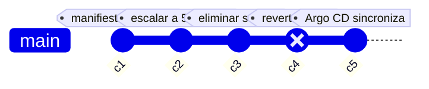

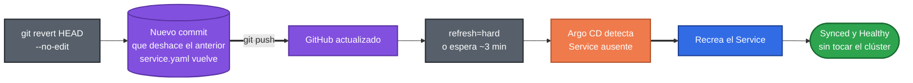

**Anatomía de los diagramas**

| Elemento | Qué representa | Aprendizaje |
| :--- | :--- | :--- |
| **gitGraph: línea de commits** | Historial lineal de la rama `main` | Cada círculo es un commit. |
| **Commit `REVERSE` (tachado)** | El commit generado por `git revert` | No borra el historial: **añade** un commit que deshace otro. |
| **Commit `HIGHLIGHT`** | Momento en que Argo CD sincroniza | No es un commit real; marca cuándo el clúster alcanza el nuevo estado. |
| **`git revert` vs `git reset`** | Dos formas de "volver atrás" | `revert` es seguro en ramas compartidas porque conserva el historial y la auditoría. |
| **Sin tocar el clúster** | Principio GitOps | El rollback es un cambio en Git; Argo CD hace el resto. |

> **Importante:** `git revert HEAD` revierte el último commit. Funciona aquí porque el último commit es el de "eliminar service". Si hiciste otros commits después, usa `git log --oneline` y revierte el hash correcto.

**Comando:**

```bash
cd ~/argocd-lab-2/repo-git
git revert HEAD --no-edit && git push
kubectl annotate application mi-app -n argocd argocd.argoproj.io/refresh=hard --overwrite
sleep 15
kubectl get svc -n mi-app
```

**Validación:** El Service vuelve a existir. La aplicación está `Synced` y `Healthy`.

---

## Fase 11. Limpieza

**Objetivo:** Dejar el entorno sin rastros, desde lo local hasta lo remoto.

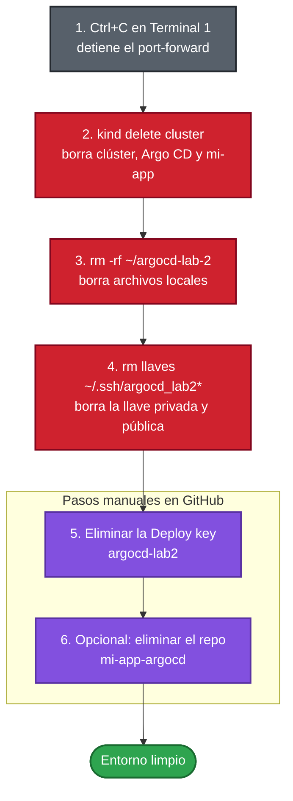

**Anatomía del diagrama**

| Paso | Qué elimina | Por qué en este orden |
| :--- | :--- | :--- |
| **1. Port-forward** | El túnel hacia la UI | Evita errores al destruir el clúster con el túnel abierto. |
| **2. Clúster kind** | Todo Kubernetes: Argo CD, mi-app, Secrets | Un solo comando borra todo lo que vive dentro. |
| **3. Carpeta local** | Manifiestos y copia local del repo | Tu repo sigue existiendo en GitHub hasta el paso 6. |
| **4. Llaves SSH** | El par de llaves del lab | No dejes llaves huérfanas en tu máquina. |
| **5. Deploy key** | Acceso de lectura al repo | Una llave pública olvidada en GitHub sigue siendo una autorización activa. |
| **6. Repo (opcional)** | El repositorio remoto | Solo si ya no lo necesitas. |

**Comando:**

```bash
# 1. Detener el port-forward (Ctrl+C en la Terminal 1)

# 2. Eliminar el clúster
kind delete cluster --name argocd-lab2

# 3. Eliminar archivos locales del laboratorio
rm -rf ~/argocd-lab-2
rm -f ~/.ssh/argocd_lab2 ~/.ssh/argocd_lab2.pub
```

**Pasos manuales en GitHub:**

1. Elimina la Deploy key `argocd-lab2` en `Settings > Deploy keys` del repositorio.
2. Opcional: elimina el repositorio `mi-app-argocd` si ya no lo necesitas.

---

## Resolución de problemas

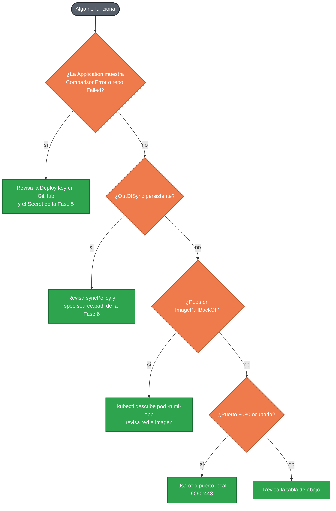

| Síntoma | Causa probable | Acción |
| :--- | :--- | :--- |
| `ComparisonError` o repo en estado `Failed` | Error de autenticación SSH. | Verifica que la Deploy key esté registrada en GitHub (Fase 5, paso 2) y que el Secret tenga la clave privada correcta. |
| `OutOfSync` persistente | Cambio manual en el clúster con `selfHeal` desactivado, o `path` incorrecto en la Application. | Revisa `syncPolicy` y `spec.source.path` en el YAML de la Application (Fase 6). |
| `ImagePullBackOff` | Problema de red o nombre de imagen incorrecto. | `kubectl describe pod -n mi-app` para ver el error. |
| Puerto 8080 ocupado | Otro servicio en WSL. | Usa otro puerto: `kubectl port-forward svc/argocd-server -n argocd 9090:443`. |
| `repoURL` con `<USUARIO>` o vacío | La variable `USUARIO` no estaba definida en esa terminal. | Ejecuta `export USUARIO=tu_usuario` y repite el comando. |
| `kubectl wait` agota el timeout | Se esperó por pods que no llegan a `Ready`. | Usa los comandos de la Fase 2 (`Deployment` y `StatefulSet`). |

