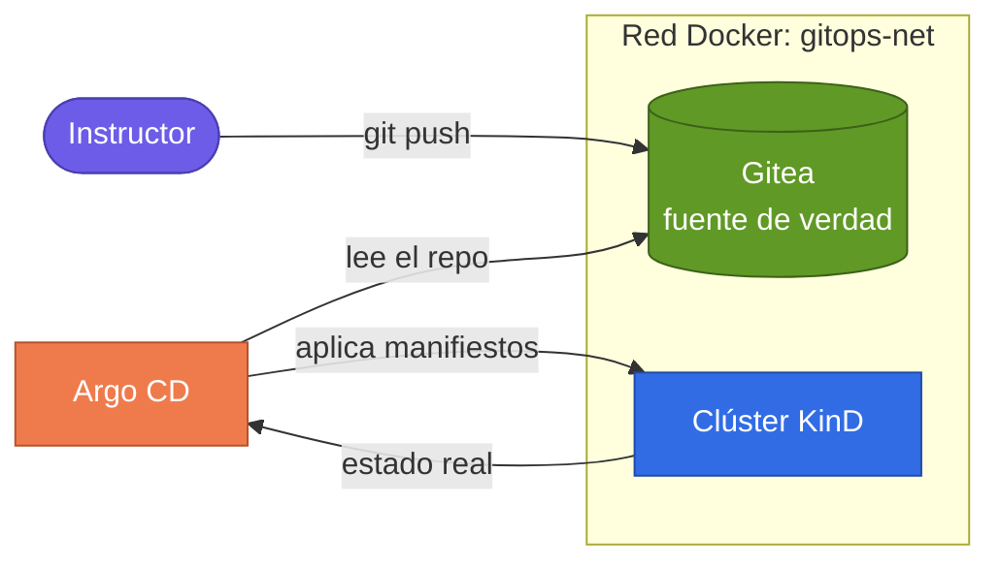

# Laboratorio GitOps: Gitea + KinD + Argo CD


Este laboratorio monta, en una sola máquina, un flujo GitOps completo: un servidor Git propio (Gitea), un clúster Kubernetes local (KinD) y Argo CD vigilando el repositorio. No usa cuentas en la nube ni tokens de GitHub. Una vez descargadas las imágenes, tampoco necesita internet.

Lo armé para enseñar una sola idea: **el clúster se parece a lo que dice Git, y si alguien lo toca a mano, Argo CD lo corrige**. Todo lo demás es andamiaje para poder verlo con los propios ojos.

---

## Qué se aprende

- Levantar un servidor Git privado con Docker Compose.
- Crear un clúster Kubernetes con KinD y conectarlo a la red de Gitea.
- Instalar Argo CD, exponerlo y entrar por el navegador.
- Declarar una `Application` que enlaza un repositorio con el clúster.
- Ver el ciclo completo: estado inicial, cambio de réplicas desde Git, deriva manual y autorreparación.
- Destruir todo y volver a empezar sin residuos.

---

## Prerequisites


| Requisito | Para qué lo uso |
| :--- | :--- |
| Windows 11 con WSL2 y Ubuntu 24.04 | Kernel Linux real con redes y cgroups completos |
| Docker Engine y plugin Compose | Corre Gitea y los nodos de KinD |
| `kind` | Crea el clúster dentro de un contenedor |
| `kubectl` | Habla con el clúster |
| `git` y `curl` | Subir el código y comprobar respuestas HTTP |
| Puertos libres: 3000, 222, 8443, 8080 | Gitea (web y SSH), Argo CD y la aplicación |
| Primera ejecución con internet | Descargar imágenes y los manifiestos de Argo CD |

---

## Estructura de directorios

Ruta base: `/home/gmt/sre-linux-mastery/Fase5/WS_Easy`

```text
WS_Easy/
├── README.md
├── runbook.md
├── infra/                    # Todo lo que es plataforma
│   ├── docker-compose.yml    # Gitea y su red Docker
│   ├── kind-config.yaml      # Clúster KinD y mapeo de puertos al host
│   └── argocd-app.yaml       # Application de Argo CD
└── repo-app/                 # El código de la aplicación; este es el repo que se sube a Gitea
    └── deployment.yaml       # Deployment y Service de Nginx
```

Separo `infra/` de `repo-app/` a propósito: `repo-app/` es lo único que vive en Git y lo único que Argo CD lee. `infra/` es lo que yo uso para montar el escenario.

---

## Vista general del flujo

Quien cambia cosas siempre hace `git push`. Argo CD hace el resto.



Orden de las fases del laboratorio:


---

## Cómo se usa el runbook

`runbook.md` es el guion de la clase. Cada fase trae, en este orden:

1. Qué vamos a lograr y por qué.
2. El comando o el archivo exacto, con su directorio.
3. La explicación de cada opción, archivo y carpeta.
4. Una comprobación que tiene que pasar antes de seguir.

Lo sigo de arriba abajo y no salto fases. Si una comprobación falla, no avanzo hasta resolverla, porque cada fase depende de la anterior.

Las fases 6 y 7 son la demostración. Las anteriores son preparación, así que conviene tenerlas listas antes de que lleguen los alumnos.

---

## Destruir y reproducir

Para borrar todo, sigo la Fase 8 del runbook. En corto:

```bash
cd /home/gmt/sre-linux-mastery/Fase5
kind delete cluster --name enterprise-gitops
docker compose -f WS_Easy/infra/docker-compose.yml down -v
rm -rf WS_Easy
```

El orden importa. Primero borro el clúster porque su nodo está conectado a la red de Gitea; si intento quitar la red antes, Docker se queja. `down -v` también borra el volumen con los datos de Gitea, así que el siguiente arranque es un Gitea limpio.

Para volver a reproducir, repito el runbook desde la Fase 0. No queda nada de la corrida anterior: ni repositorio, ni usuario, ni clúster, ni red.

