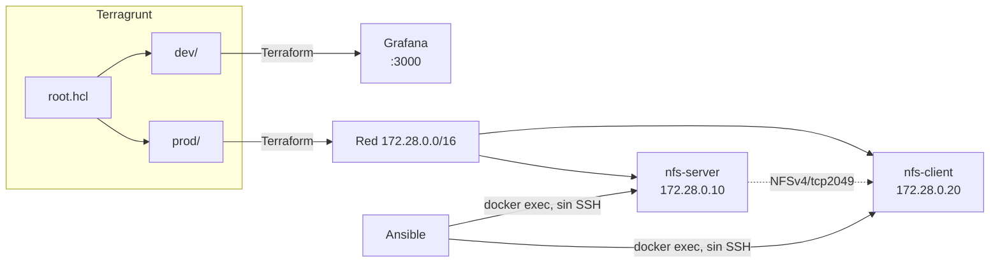

# iac-workshop

-E95420?style=flat-square&logo=ubuntu&logoColor=white)


-005571?style=flat-square)

Laboratorio de infraestructura multi-entorno para practicar el ciclo completo de Infraestructura como Código (IaC) y Configuración como Código (CaC) sobre contenedores Docker, usando **Terraform**, **Terragrunt** y **Ansible** de forma articulada.

El laboratorio despliega dos entornos independientes en el mismo host:

- **`dev`** — un stack de observabilidad con **Grafana**, auto-provisionado con un datasource sintético y un dashboard en tiempo real, sin pasos de configuración manual.
- **`prod`** — un clúster de almacenamiento compartido **NFSv4** (servidor + cliente) sobre una red Docker con direccionamiento IP fijo, configurado internamente con Ansible.

## Arquitectura



Terragrunt centraliza la definición del proveedor Docker y evita duplicarla entre entornos. Terraform crea las redes, imágenes y contenedores de cada entorno. Ansible entra directamente por el socket de Docker —sin necesidad de SSH ni agentes— para configurar el sistema operativo dentro de los contenedores de `prod`.

## Estructura del repositorio

```
iac-workshop/
├── ansible/
│   ├── inventory.ini
│   └── configure_nfs.yml
├── terraform/
│   └── modules/
│       ├── dev_observability/
│       └── prod_nfs_cluster/
├── terragrunt/
│   ├── root.hcl
│   ├── dev/terragrunt.hcl
│   └── prod/terragrunt.hcl
├── deploy_all.sh
├── destroy_all.sh
├── RUNBOOK.md
└── README.md
```

## Requisitos

- Ubuntu 24.04 LTS (nativo o vía WSL2 en Windows)
- Usuario con privilegios `sudo`
- Conectividad de salida a internet
- Puerto `3000` libre en el host

## Instalación de herramientas

El runbook detalla la instalación completa desde cero (Docker CE, Terraform, Terragrunt, Ansible). En resumen:

```bash
sudo apt-get update
sudo apt-get install -y ca-certificates curl gnupg lsb-release jq tree nfs-common
# Ver RUNBOOK.md — Fase 0 para los pasos completos de cada herramienta
```

## Puesta en marcha rápida

Con las herramientas ya instaladas, todo el ciclo de vida puede ejecutarse con un solo script:

```bash
./deploy_all.sh
```

Esto crea el entorno `dev` (Grafana), el entorno `prod` (clúster NFS) y ejecuta el playbook de Ansible y las pruebas de integración, en ese orden.

Al finalizar, Grafana queda disponible en:

```
http://localhost:3000
```

con acceso anónimo habilitado en modo lectura y el dashboard **"Métricas Rápidas Dev (Auto-Provisioned)"** graficando datos en tiempo real.

## Ejecución manual paso a paso

Para un despliegue controlado, fase por fase, con verificación intermedia en cada paso — recomendado para fines de aprendizaje — seguir la secuencia completa documentada en **[`RUNBOOK.md`](./RUNBOOK.md)**:

1. Preparación del sistema operativo host
2. Estructura de directorios del proyecto
3. Módulos Terraform reutilizables
4. Orquestación DRY con Terragrunt
5. Gestión de configuración con Ansible
6. Ejecución del despliegue
7. Pruebas de humo y validación
8. Limpieza y desmontaje

Cada fase incluye el propósito, el detalle línea por línea de cada comando y opción, la salida esperada y el criterio de éxito antes de avanzar a la siguiente.

## Validación funcional

```bash
# Lectura desde el cliente de un archivo que reside físicamente en el servidor
docker exec -it prod-nfs-client cat /mnt/shared_users/seed_user.json

# Verificación del punto de montaje a nivel de kernel
docker exec -it prod-nfs-client df -h /mnt/shared_users
```

## Limpieza del entorno

```bash
./destroy_all.sh
```

Destruye ambos entornos, purga las redes Docker y elimina los directorios de caché (`.terraform`, `.terragrunt-cache`), dejando el host en estado neutro.

## Documentación completa

Toda la explicación técnica detallada — arquitectura, matriz de componentes, sintaxis de cada comando, diagramas de secuencia y resolución de problemas comunes — está en **[`RUNBOOK.md`](./RUNBOOK.md)**.

