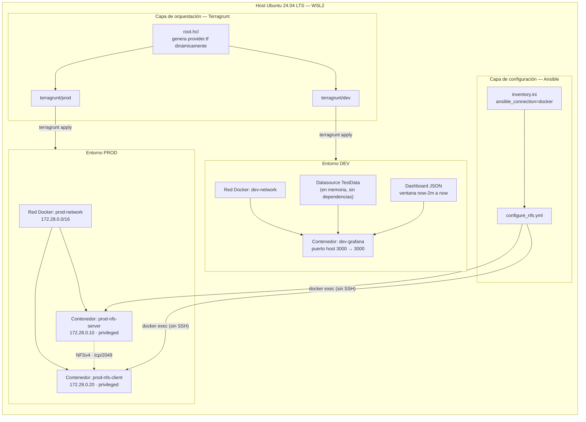
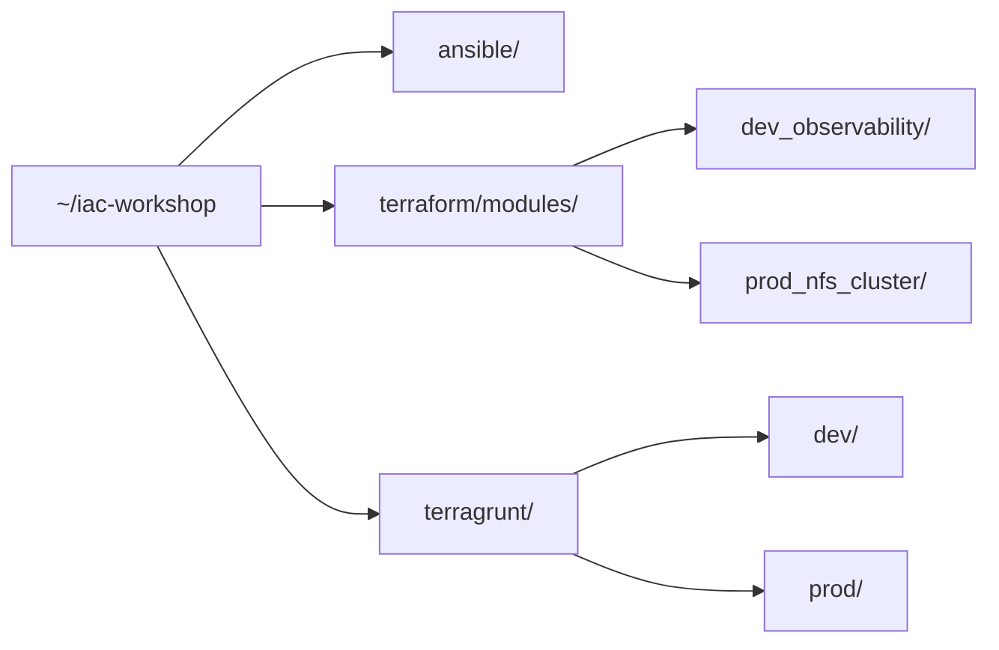
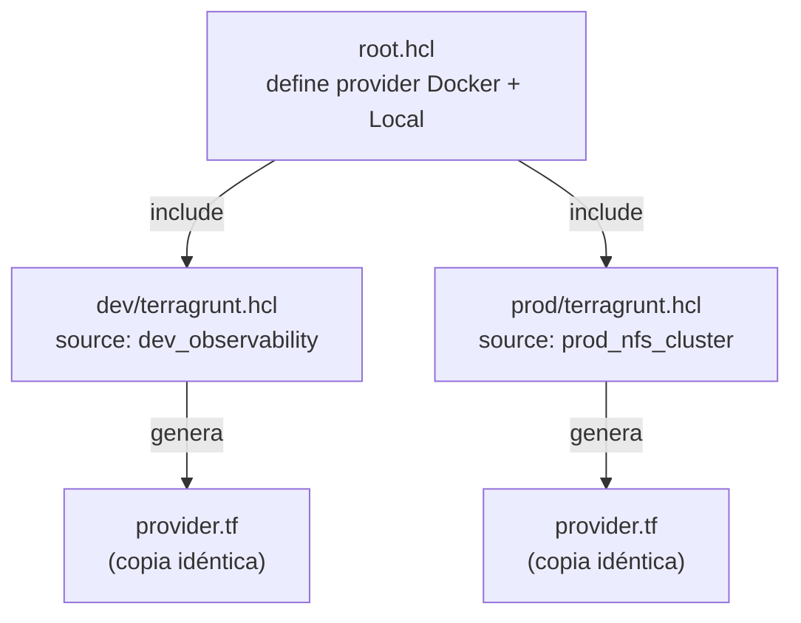
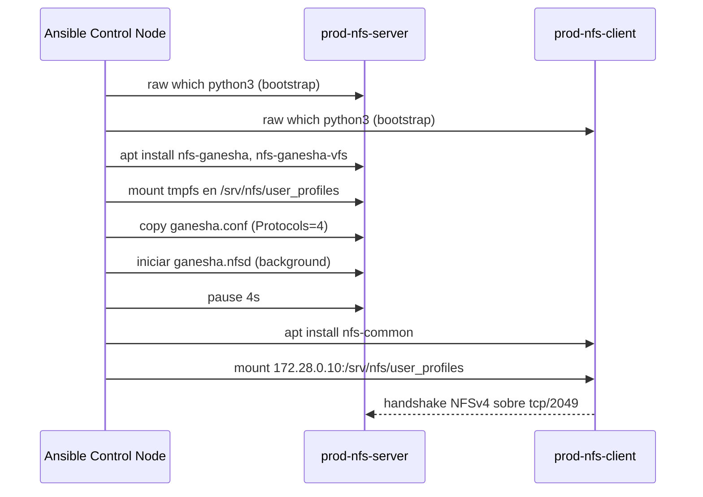
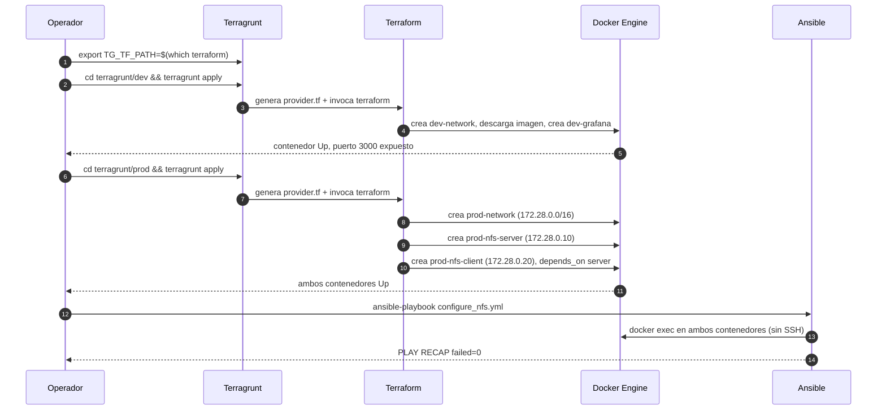
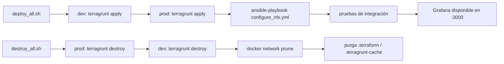

# Runbook Técnico — Laboratorio de Infraestructura Multi-Entorno (IaC + CaC)

-E95420?style=for-the-badge&logo=ubuntu&logoColor=white)


---

## Tabla de contenidos

1. [Propósito y alcance](#propósito-y-alcance)
2. [Arquitectura general](#arquitectura-general)
3. [Matriz de componentes](#matriz-de-componentes)
4. [Requisitos previos](#requisitos-previos)
5. [Fase 0 — Preparación del sistema operativo host](#fase-0--preparación-del-sistema-operativo-host)
6. [Fase 1 — Estructura de directorios del proyecto](#fase-1--estructura-de-directorios-del-proyecto)
7. [Fase 2 — Módulos Terraform reutilizables](#fase-2--módulos-terraform-reutilizables)
8. [Fase 3 — Orquestación DRY con Terragrunt](#fase-3--orquestación-dry-con-terragrunt)
9. [Fase 4 — Gestión de configuración con Ansible](#fase-4--gestión-de-configuración-con-ansible)
10. [Fase 5 — Ejecución del despliegue](#fase-5--ejecución-del-despliegue)
11. [Fase 6 — Pruebas de humo y validación](#fase-6--pruebas-de-humo-y-validación)
12. [Fase 7 — Limpieza y desmontaje](#fase-7--limpieza-y-desmontaje)
13. [Automatización de ciclo de vida completo](#automatización-de-ciclo-de-vida-completo)
14. [Resolución de problemas comunes](#resolución-de-problemas-comunes)
15. [Glosario](#glosario)

---

## Propósito y alcance

Este runbook documenta, paso a paso, el aprovisionamiento reproducible de un laboratorio con dos entornos independientes sobre un mismo host Ubuntu 24.04 LTS ejecutado en WSL2:

- **`dev`**: un stack de observabilidad con Grafana auto-provisionado (datasource sintético y dashboard en tiempo real).
- **`prod`**: un clúster de almacenamiento compartido NFSv4 compuesto por un servidor y un cliente, comunicados sobre una red Docker con direccionamiento IP fijo.

La construcción combina tres disciplinas:

| Disciplina | Herramienta | Qué resuelve |
|---|---|---|
| Infraestructura como código (IaC) | Terraform | Declara redes, contenedores e imágenes de forma idempotente. |
| Orquestación DRY | Terragrunt | Evita duplicar bloques `provider` y fuerza el binario correcto de Terraform en cada entorno. |
| Configuración como código (CaC) | Ansible | Configura el sistema operativo *dentro* de los contenedores ya creados (paquetes, montajes, demonios). |

El documento está pensado para ejecutarse de manera manual y auditable, fase por fase, permitiendo detener, inspeccionar y retomar el proceso en cualquier punto.

---

## Arquitectura general



**Lectura del diagrama:** Terragrunt es el punto de entrada único; genera el proveedor Docker y delega en los módulos Terraform de cada entorno. Una vez que los contenedores `prod` existen, Ansible se conecta directamente al socket de Docker —sin SSH ni agentes— para instalar paquetes y levantar el servicio NFS dentro de ellos.

---

## Matriz de componentes

| Capa | Herramienta | Entorno | Responsabilidad |
|---|---|---|---|
| Orquestación IaC | Terragrunt | Global (`root.hcl`) | Centralización DRY de proveedores y control estricto del binario de Terraform. |
| Observabilidad | Terraform + Docker | `dev` | Contenedor Grafana con provisión declarativa de dashboards y datasource `TestData`. |
| Cómputo y red | Terraform + Docker | `prod` | Red en puente `172.28.0.0/16` y dos contenedores en modo privilegiado. |
| Gestión de configuración | Ansible | `prod` | Conexión sin agentes vía socket Docker para levantar NFSv4 puro sobre `tmpfs`. |

---

## Requisitos previos

- Windows con WSL2 habilitado, distribución Ubuntu 24.04 LTS instalada.
- Usuario con privilegios `sudo`.
- Conectividad de salida a internet (repositorios APT, GitHub Releases, Docker Hub).
- Al menos 4 GB de RAM asignados a WSL2 y 10 GB de espacio libre en disco.
- Puerto `3000` del host disponible (usado por Grafana).

---

## Fase 0 — Preparación del sistema operativo host

**Objetivo de la fase:** dejar el host con todas las cadenas de herramientas necesarias — motor de contenedores, motor de IaC, orquestador DRY y motor de configuración — antes de declarar cualquier recurso.

**Resultado esperado al final de la fase:** los cuatro binarios (`docker`, `terraform`, `terragrunt`, `ansible`) responden a su comando de versión sin error.

### Paso 0.1 — Actualización de repositorios e instalación de dependencias base

```bash
sudo apt-get update
sudo apt-get install -y ca-certificates curl gnupg lsb-release jq tree nfs-common
```

| Comando / paquete | Qué hace |
|---|---|
| `apt-get update` | Sincroniza el índice local de paquetes con los repositorios configurados. Es obligatorio antes de cualquier instalación para evitar instalar versiones obsoletas o inexistentes. |
| `ca-certificates` | Provee el almacén de autoridades certificadoras raíz, necesario para validar conexiones HTTPS salientes hacia los repositorios de Docker y HashiCorp. |
| `gnupg` | Permite importar y verificar las llaves GPG con las que los repositorios externos firman sus paquetes, evitando ataques de sustitución de binarios. |
| `curl` | Cliente HTTP usado en todo el runbook para descargar llaves, binarios y consultar la API de GitHub. |
| `lsb-release` | Expone `lsb_release -cs`, que devuelve el nombre en clave de la distribución (por ejemplo `noble`), usado para construir las líneas de repositorio correctas. |
| `jq` | Procesador de JSON en línea de comandos, usado más adelante para extraer el campo `tag_name` de la respuesta de la API de GitHub. |
| `tree` | Utilidad de inspección visual de árboles de directorios; facilita auditar la estructura creada en la Fase 1. |
| `nfs-common` | Instala las utilidades cliente del protocolo NFS (`mount.nfs`, `showmount`) requeridas por el contenedor cliente en la Fase 4. |

### Paso 0.2 — Instalación de Docker Community Edition (CE)

```bash
# 1. Crear directorio seguro para llaves de repositorios
sudo install -m 0755 -d /etc/apt/keyrings

# 2. Descargar la llave GPG oficial de Docker
sudo curl -fsSL https://download.docker.com/linux/ubuntu/gpg -o /etc/apt/keyrings/docker.asc
sudo chmod a+r /etc/apt/keyrings/docker.asc

# 3. Registrar el repositorio oficial estable en APT
echo \
  "deb [arch=$(dpkg --print-architecture) signed-by=/etc/apt/keyrings/docker.asc] https://download.docker.com/linux/ubuntu \
  $(. /etc/os-release && echo "$VERSION_CODENAME") stable" | \
  sudo tee /etc/apt/sources.list.d/docker.list > /dev/null

# 4. Instalar motor Docker y complementos
sudo apt-get update
sudo apt-get install -y docker-ce docker-ce-cli containerd.io docker-buildx-plugin docker-compose-plugin

# 5. Iniciar servicio y otorgar permisos no root al usuario actual
sudo service docker start
sudo usermod -aG docker $USER
```

Desglose línea por línea:

- `install -m 0755 -d /etc/apt/keyrings`: crea el directorio destino con permisos `rwxr-xr-x`; es la ubicación estándar recomendada por Docker desde que se deprecó `apt-key`.
- `curl -fsSL ... -o docker.asc`: descarga la llave GPG pública. Los modificadores significan: `-f` (fallar silenciosamente ante error HTTP en vez de guardar la página de error), `-s` (modo silencioso, sin barra de progreso), `-S` (mostrar el error si `-s` está activo y ocurre uno), `-L` (seguir redirecciones).
- `chmod a+r docker.asc`: garantiza que APT, ejecutándose con su propio usuario interno, pueda leer la llave.
- La línea `echo ... | sudo tee ...`: construye dinámicamente la entrada del repositorio.
  - `$(dpkg --print-architecture)` detecta si el procesador es `amd64` o `arm64` y evita hardcodear la arquitectura.
  - `signed-by=/etc/apt/keyrings/docker.asc` vincula ese repositorio específico a esa llave específica, en vez de confiar en el llavero global del sistema.
  - `$(. /etc/os-release && echo "$VERSION_CODENAME")` carga las variables de la distribución y extrae el nombre en clave (`noble` para 24.04).
  - `tee ... > /dev/null` escribe el contenido en el archivo de lista de APT sin duplicar la salida en la terminal.
- `docker-ce`: el motor (daemon) de Docker. `docker-ce-cli`: el cliente de línea de comandos. `containerd.io`: el runtime de bajo nivel que gestiona el ciclo de vida real de los contenedores. `docker-buildx-plugin`: extiende `docker build` con soporte multi-plataforma. `docker-compose-plugin`: habilita `docker compose` como subcomando nativo.
- `service docker start`: en WSL2, donde `systemd` puede no estar activo por defecto, este es el método compatible para arrancar el demonio.
- `usermod -aG docker $USER`: agrega el usuario actual al grupo `docker`, que tiene permisos de lectura/escritura sobre el socket UNIX `/var/run/docker.sock`. Sin esto, cada comando `docker` requeriría `sudo`.

> **Acción requerida:** el cambio de grupo no se refleja en la sesión de shell actual. Para activarlo sin cerrar sesión:
> ```bash
> newgrp docker
> ```

### Paso 0.3 — Instalación de Terraform

```bash
wget -O- https://apt.releases.hashicorp.com/gpg | sudo gpg --dearmor --yes -o /usr/share/keyrings/hashicorp-archive-keyring.gpg

echo "deb [signed-by=/usr/share/keyrings/hashicorp-archive-keyring.gpg] https://apt.releases.hashicorp.com $(lsb_release -cs) main" | sudo tee /etc/apt/sources.list.d/hashicorp.list

sudo apt-get update && sudo apt-get install -y terraform
```

- `wget -O- ... | gpg --dearmor`: descarga la llave pública de HashiCorp en formato ASCII-armored y la convierte (`--dearmor`) al formato binario que APT requiere. El flag `--yes` evita el prompt interactivo de sobrescritura si el archivo ya existiera.
- La segunda línea registra el repositorio de HashiCorp de la misma forma que se hizo con Docker, vinculado a su propia llave.
- `apt-get install -y terraform`: instala el binario oficial desde el repositorio recién agregado, en lugar de una copia de terceros.

### Paso 0.4 — Instalación de Terragrunt

```bash
TERRAGRUNT_VERSION=$(curl -s https://api.github.com/repos/gruntwork-io/terragrunt/releases/latest | jq -r .tag_name)
curl -L -o /tmp/terragrunt "https://github.com/gruntwork-io/terragrunt/releases/download/${TERRAGRUNT_VERSION}/terragrunt_linux_amd64"

chmod +x /tmp/terragrunt
sudo mv /tmp/terragrunt /usr/local/bin/terragrunt
```

- Terragrunt no se distribuye vía APT; se instala como binario suelto desde GitHub Releases.
- `curl -s https://api.github.com/.../releases/latest`: consulta la API de GitHub y devuelve un JSON con metadatos de la última versión publicada.
- `jq -r .tag_name`: extrae el campo `tag_name` (por ejemplo `v0.66.0`) en formato raw (`-r`, sin comillas), evitando fijar la versión a mano en el script.
- `curl -L -o /tmp/terragrunt ...`: descarga el binario correspondiente a Linux/amd64 hacia un directorio temporal.
- `chmod +x`: otorga permiso de ejecución.
- `mv ... /usr/local/bin/terragrunt`: lo coloca en una ruta que ya forma parte del `PATH` estándar, disponible globalmente para cualquier usuario del sistema.

### Paso 0.5 — Instalación de Ansible

```bash
sudo apt-get install -y software-properties-common
sudo add-apt-repository --yes --update ppa:ansible/ansible
sudo apt-get install -y ansible
```

- `software-properties-common`: provee el comando `add-apt-repository`.
- `add-apt-repository --yes --update ppa:ansible/ansible`: agrega el repositorio oficial mantenido por el equipo de Ansible (más actualizado que el paquete por defecto de Ubuntu) y refresca el índice APT en la misma operación (`--update`), sin pedir confirmación (`--yes`).
- `apt-get install -y ansible`: instala el paquete, que incluye `ansible`, `ansible-playbook`, `ansible-galaxy`, entre otros binarios.

### Paso 0.6 — Verificación de herramientas instaladas

```bash
docker --version && terraform version && terragrunt --version && ansible --version
```

El operador `&&` encadena los cuatro comandos de forma que, si alguno falla (código de salida distinto de cero), los siguientes no se ejecutan — esto convierte la verificación en una comprobación de "todo o nada".

**Criterio de éxito de la Fase 0:** las cuatro herramientas reportan su número de versión sin mensajes de error ni advertencias de comando no encontrado.

---

## Fase 1 — Estructura de directorios del proyecto

**Objetivo de la fase:** establecer un árbol de directorios predecible que separe módulos Terraform, configuraciones Terragrunt por entorno y artefactos Ansible.

```bash
mkdir -p ~/iac-workshop/ansible
mkdir -p ~/iac-workshop/terraform/modules/dev_observability
mkdir -p ~/iac-workshop/terraform/modules/prod_nfs_cluster
mkdir -p ~/iac-workshop/terragrunt/dev
mkdir -p ~/iac-workshop/terragrunt/prod
cd ~/iac-workshop
```

- `mkdir -p`: crea toda la ruta intermedia si no existe, sin fallar si el directorio ya está presente. Es la forma idempotente de crear estructuras de carpetas.
- La separación entre `terraform/modules/*` y `terragrunt/*` es intencional: los módulos son el código reutilizable y agnóstico del entorno; las carpetas de Terragrunt contienen únicamente la configuración específica (inputs) de cada entorno que consume ese módulo.



**Criterio de éxito de la Fase 1:** `tree ~/iac-workshop` muestra los cinco directorios creados sin archivos aún dentro de ellos.

---

## Fase 2 — Módulos Terraform reutilizables

**Objetivo de la fase:** declarar la infraestructura de cada entorno como módulos autocontenidos, sin bloques `required_providers`, delegando esa responsabilidad a Terragrunt para evitar colisiones de versión entre entornos.

### Paso 2.1 — Módulo `dev_observability`

Este módulo levanta un contenedor Grafana y le inyecta, mediante *bind mounts* de solo lectura, un datasource y un dashboard predefinidos, de forma que la interfaz quede funcional desde el primer arranque sin configuración manual.

**`variables.tf`**

```hcl
variable "environment" {
  type        = string
  description = "Nombre del ambiente (ej: dev)"
  default     = "dev"
}

variable "grafana_http_port" {
  type        = number
  description = "Puerto TCP en el host expuesto para Grafana"
  default     = 3000
}
```

Declara dos variables de entrada parametrizables desde Terragrunt: el nombre lógico del entorno y el puerto del host que se mapeará hacia el puerto interno `3000` de Grafana.

**`outputs.tf`**

```hcl
output "grafana_url" {
  value       = "http://localhost:${var.grafana_http_port}"
  description = "Punto de acceso web hacia Grafana"
}
```

Expone como salida la URL completa de acceso, calculada a partir del puerto configurado — evita que el operador tenga que recordarlo o buscarlo en el código.

**`main.tf` — recursos principales**

```hcl
resource "docker_network" "dev_net" {
  name = "${var.environment}-network"
}
```

Crea una red Docker de tipo puente dedicada al entorno, aislando el tráfico de `dev` del resto de redes del host.

```hcl
locals {
  datasources_yaml = <<-EOT
    apiVersion: 1
    datasources:
      - name: AutoTestData
        type: testdata
        access: proxy
        isDefault: true
        editable: false
  EOT
  ...
}
```

El bloque `locals` centraliza tres plantillas generadas en tiempo de `plan`:

- `datasources_yaml`: define un datasource de tipo `testdata`, nativo de Grafana, que genera series sintéticas sin requerir una base de datos externa — ideal para demostraciones reproducibles.
- `dashboards_provider_yaml`: le indica a Grafana que cargue automáticamente cualquier archivo `.json` ubicado en `/etc/grafana/provisioning/dashboards`, con `disableDeletion: true` para que no se pueda borrar desde la interfaz gráfica.
- `sample_dashboard_json`: construido con la función `jsonencode()` para garantizar sintaxis JSON válida, define un panel de series temporales y un panel de estado, ambos alimentados por el datasource sintético, con una ventana deslizante de `now-2m` a `now` y refresco automático cada `5s`.

```hcl
resource "local_file" "ds_file" {
  content  = local.datasources_yaml
  filename = "${path.module}/provisioning/datasources/datasources.yaml"
}
```

Materializa cada plantilla como un archivo físico en disco, dentro del propio directorio del módulo (`path.module`). Esto es necesario porque Docker solo puede montar rutas del sistema de archivos del host, no valores en memoria de Terraform.

```hcl
resource "docker_image" "grafana" {
  name         = "grafana/grafana:latest"
  keep_locally = true
}
```

Descarga la imagen oficial de Grafana. `keep_locally = true` evita que Terraform elimine la imagen del cache local de Docker al hacer `destroy`, acelerando despliegues futuros.

```hcl
resource "docker_container" "grafana" {
  ...
  ports {
    internal = 3000
    external = var.grafana_http_port
  }
  env = [
    "GF_SECURITY_ADMIN_USER=admin",
    "GF_SECURITY_ADMIN_PASSWORD=admin",
    "GF_AUTH_ANONYMOUS_ENABLED=true",
    "GF_AUTH_ANONYMOUS_ORG_ROLE=Viewer"
  ]
  volumes {
    host_path      = abspath(local_file.ds_file.filename)
    container_path = "/etc/grafana/provisioning/datasources/datasources.yaml"
    read_only      = true
  }
  ...
}
```

- `ports { internal / external }`: mapea el puerto `3000` del contenedor al puerto configurable del host.
- Las variables `GF_*` son variables de entorno nativas de Grafana: definen el usuario y contraseña administrativos iniciales, y habilitan acceso anónimo de solo lectura (`Viewer`) para facilitar demostraciones sin necesidad de autenticarse.
- Cada bloque `volumes` monta uno de los archivos generados por `local_file` dentro de la ruta de aprovisionamiento de Grafana, en modo `read_only` para impedir que el contenedor los modifique. `abspath()` garantiza que Docker reciba una ruta absoluta, requisito de la API de bind mounts.

### Paso 2.2 — Módulo `prod_nfs_cluster`

Este módulo declara la red de producción y dos contenedores Ubuntu mínimos que actuarán como servidor y cliente NFS.

**`variables.tf`**

```hcl
variable "environment" {
  type        = string
  default     = "prod"
}

variable "subnet_cidr" {
  type        = string
  default     = "172.28.0.0/16"
}
```

**`outputs.tf`**

```hcl
output "server_ip" {
  value = cidrhost(var.subnet_cidr, 10)
}

output "client_ip" {
  value = cidrhost(var.subnet_cidr, 20)
}
```

La función `cidrhost(prefix, hostnum)` calcula, a partir del bloque CIDR, la dirección IP correspondiente al desplazamiento indicado — `10` y `20` respectivamente — evitando escribir las IPs de forma literal y duplicada en varios archivos.

**`main.tf`**

```hcl
resource "docker_network" "prod_net" {
  name = "${var.environment}-network"
  ipam_config {
    subnet = var.subnet_cidr
  }
}
```

A diferencia de la red de `dev`, aquí se define explícitamente el bloque `ipam_config`, lo que permite asignar direcciones IP estáticas y predecibles a cada contenedor en lugar de dejarlas al DHCP interno de Docker.

```hcl
resource "docker_container" "nfs_server" {
  name       = "${var.environment}-nfs-server"
  image      = docker_image.ubuntu_base.image_id
  privileged = true
  command    = ["sleep", "infinity"]

  networks_advanced {
    name         = docker_network.prod_net.name
    ipv4_address = cidrhost(var.subnet_cidr, 10)
  }
}
```

- `privileged = true`: otorga al contenedor las capacidades de kernel extendidas (incluida `CAP_SYS_ADMIN`), imprescindibles para que el servicio NFS pueda invocar internamente la llamada al sistema `mount()`.
- `command = ["sleep", "infinity"]`: la imagen base de Ubuntu no tiene un proceso de primer plano por defecto; este comando mantiene el contenedor vivo indefinidamente para que Ansible pueda conectarse y configurarlo después.
- `networks_advanced { ipv4_address = ... }`: fija la IP estática `172.28.0.10`, reutilizando la misma función `cidrhost` que en `outputs.tf`.

```hcl
resource "docker_container" "nfs_client" {
  ...
  depends_on = [docker_container.nfs_server]
}
```

`depends_on` fuerza a Terraform a crear el servidor antes que el cliente, eliminando la condición de carrera en la que el cliente podría intentar operar contra un servidor que todavía no existe.

**Criterio de éxito de la Fase 2:** ambos módulos superan `terraform validate` sin errores de sintaxis (validación que Terragrunt ejecuta implícitamente durante `plan`).

---

## Fase 3 — Orquestación DRY con Terragrunt

**Objetivo de la fase:** eliminar la duplicación del bloque de proveedores entre entornos y garantizar que siempre se use el binario oficial de Terraform, generando la configuración de proveedor de forma dinámica en cada ejecución.

### Paso 3.1 — Archivo raíz `terragrunt/root.hcl`

```hcl
terraform_binary = "terraform"

generate "provider" {
  path      = "provider.tf"
  if_exists = "overwrite_terragrunt"
  contents  = <<CONTENT
terraform {
  required_providers {
    docker = {
      source  = "kreuzwerker/docker"
      version = "~> 3.0.2"
    }
    local = {
      source  = "hashicorp/local"
      version = "~> 2.4.0"
    }
  }
}

provider "docker" {
  host = "unix:///var/run/docker.sock"
}
CONTENT
}
```

- `terraform_binary = "terraform"`: instruye a Terragrunt a invocar específicamente el binario llamado `terraform` del `PATH`, evitando ambigüedad si coexistieran forks como OpenTofu en el mismo sistema.
- El bloque `generate "provider"` es el mecanismo central de la estrategia DRY: en cada `init`/`plan`/`apply`, Terragrunt escribe un archivo `provider.tf` idéntico dentro de cada módulo consumido, sin que el desarrollador tenga que copiarlo manualmente en `dev_observability` y en `prod_nfs_cluster`.
- `if_exists = "overwrite_terragrunt"`: si el archivo generado en una ejecución previa todavía existe, se sobrescribe sin preguntar, siempre que Terragrunt reconozca que fue él quien lo generó — esto previene la desviación de configuración (*configuration drift*) entre ejecuciones.
- `provider "docker" { host = "unix:///var/run/docker.sock" }`: apunta explícitamente al socket UNIX local de Docker, el mismo canal de comunicación que usa el CLI de Docker.

### Paso 3.2 — Entorno `dev`

```hcl
include "root" {
  path = find_in_parent_folders("root.hcl")
}

terraform {
  source = "../../terraform/modules/dev_observability"
}

inputs = {
  environment       = "dev"
  grafana_http_port = 3000
}
```

- `include "root"` con `find_in_parent_folders("root.hcl")`: hereda automáticamente toda la configuración del archivo raíz, sin necesidad de conocer su ruta absoluta — Terragrunt la busca subiendo por el árbol de directorios.
- `terraform { source = ... }`: apunta a la ruta relativa del módulo real que se ejecutará.
- `inputs`: mapea directamente a las variables `variable "environment"` y `variable "grafana_http_port"` declaradas en el módulo, sin necesidad de archivos `.tfvars` adicionales.

### Paso 3.3 — Entorno `prod`

```hcl
include "root" {
  path = find_in_parent_folders("root.hcl")
}

terraform {
  source = "../../terraform/modules/prod_nfs_cluster"
}

inputs = {
  environment = "prod"
  subnet_cidr = "172.28.0.0/16"
}
```

Sigue la misma lógica que `dev`, apuntando al módulo `prod_nfs_cluster` y fijando el bloque CIDR de la red de producción.



**Criterio de éxito de la Fase 3:** al ejecutar `terragrunt init` en cualquiera de los dos entornos, se observa la creación automática del archivo `provider.tf` dentro del directorio de trabajo temporal de Terragrunt (`.terragrunt-cache`).

---

## Fase 4 — Gestión de configuración con Ansible

**Objetivo de la fase:** configurar el sistema operativo interno de los contenedores `prod` ya existentes — instalación de paquetes, montaje de sistemas de archivos, arranque de demonios — algo que Terraform, al ser una herramienta declarativa de infraestructura, no está diseñado para hacer de forma nativa.

### Paso 4.1 — Inventario `ansible/inventory.ini`

```ini
[nfs_server]
prod-nfs-server ansible_connection=docker

[nfs_client]
prod-nfs-client ansible_connection=docker
```

- Cada grupo (`[nfs_server]`, `[nfs_client]`) agrupa hosts que recibirán las mismas tareas en el playbook.
- `ansible_connection=docker`: en lugar del transporte por defecto (`ssh`), Ansible se conecta ejecutando comandos a través de la API local de Docker (`docker exec` internamente). Esto elimina la necesidad de tener un servidor SSH corriendo dentro de contenedores mínimos, reduciendo superficie de ataque y complejidad.
- El nombre de host (`prod-nfs-server`) debe coincidir exactamente con el nombre del contenedor definido en `docker_container.nfs_server.name` en la Fase 2.

### Paso 4.2 — Playbook `ansible/configure_nfs.yml`

El playbook resuelve tres restricciones estructurales propias de contenedores Docker mínimos ejecutándose en WSL2:

1. **Bootstrap de Python**: las imágenes base de Ubuntu 24.04 no incluyen intérprete de Python, requisito de los módulos estándar de Ansible.
2. **Sistema de archivos POSIX vía `tmpfs`**: el backend de almacenamiento por defecto de Docker (OverlayFS) no expone todas las primitivas de inodos que NFS necesita para exportar un directorio; montar una partición `tmpfs` (en memoria RAM) resuelve esa limitación.
3. **NFSv4 puro**: forzando el protocolo a la versión 4 se opera íntegramente sobre el puerto TCP `2049`, evitando depender del servicio `rpcbind` (puerto 111), que resulta inestable en contenedores sin `systemd` como proceso de inicio.

**Play 1 — Bootstrap de Python**

```yaml
- name: Bootstrap de Entorno Python
  hosts: all
  gather_facts: false
  tasks:
    - name: Instalar python3 mínimo mediante comando crudo
      raw: which python3 || (apt-get update && apt-get install -y python3)
      changed_when: false
```

- `gather_facts: false`: se desactiva la recolección de hechos porque ese proceso depende de Python, que todavía no existe en el contenedor — sería una dependencia circular.
- El módulo `raw` es el único de Ansible que no requiere Python en el destino; ejecuta el comando literalmente vía el transporte configurado.
- `which python3 || (apt-get update && apt-get install -y python3)`: primero comprueba si Python ya está presente; solo si `which` falla (contenedor recién creado) procede a instalar. Esto hace la tarea idempotente y más rápida en ejecuciones repetidas.
- `changed_when: false`: como `raw` no puede determinar por sí solo si hubo un cambio real, se fija explícitamente para no ensuciar el reporte final con falsos positivos.

**Play 2 — Aprovisionar el servidor NFSv4 (Ganesha)**

```yaml
- name: Aprovisionar Servidor NFSv4 (Ganesha)
  hosts: nfs_server
  gather_facts: true
  tasks:
    - name: Actualizar repositorios APT
      apt:
        update_cache: yes
        cache_valid_time: 3600
```

A partir de este punto ya existe Python en el contenedor, por lo que se reactiva `gather_facts: true` para que Ansible pueda usar variables como la arquitectura o el nombre de la distribución si fueran necesarias. `cache_valid_time: 3600` evita repetir `apt-get update` si ya se ejecutó en la última hora.

```yaml
    - name: Instalar paquetes del servidor Ganesha y herramientas de proceso
      apt:
        name:
          - nfs-ganesha
          - nfs-ganesha-vfs
          - psmisc
        state: present
```

- `nfs-ganesha`: implementación de servidor NFS en espacio de usuario (a diferencia del servidor NFS clásico del kernel), lo cual es clave porque no requiere módulos de kernel adicionales dentro del contenedor.
- `nfs-ganesha-vfs`: el backend FSAL (*File System Abstraction Layer*) que le permite a Ganesha exportar un directorio del sistema de archivos virtual estándar (VFS).
- `psmisc`: provee `killall`, usado más adelante para limpiar procesos huérfanos del demonio.

```yaml
    - name: Montar sistema de archivos tmpfs para soporte total de inodos
      mount:
        path: /srv/nfs/user_profiles
        src: tmpfs
        fstype: tmpfs
        state: mounted
```

Monta una partición en memoria RAM sobre el directorio de exportación. `state: mounted` garantiza tanto el montaje inmediato como su persistencia en `/etc/fstab` para reinicios futuros del contenedor.

```yaml
    - name: Configurar /etc/ganesha/ganesha.conf en modo NFSv4 puro
      copy:
        dest: /etc/ganesha/ganesha.conf
        content: |
          NFS_CORE_PARAM {
              NFS_Port = 2049;
              Enable_NLM = false;
              Enable_RQUOTA = false;
              Protocols = 4;
          }
          ...
```

Puntos clave de la configuración:

- `Protocols = 4`: restringe el servidor exclusivamente a NFSv4, descartando NFSv3 y sus dependencias auxiliares (`NLM`, `RQUOTA`, `rpcbind`).
- `Enable_NLM = false` / `Enable_RQUOTA = false`: desactivan explícitamente el gestor de bloqueos de red y las cuotas remotas, ambos innecesarios en NFSv4 puro y fuente habitual de fallos en entornos containerizados.
- `Squash = No_Root_Squash`: permite que el usuario root del cliente mantenga privilegios de root sobre los archivos exportados — apropiado en un laboratorio, pero una decisión que en un entorno productivo real requeriría revisión de seguridad.
- `Attr_Expiration_Time = 0`: deshabilita el cacheo de atributos, útil en pruebas donde se necesita ver cambios de forma inmediata entre cliente y servidor.

```yaml
    - name: Iniciar demonio NFS-Ganesha desacoplado
      shell: "/bin/sh -c 'nohup ganesha.nfsd -f /etc/ganesha/ganesha.conf -L /var/log/ganesha.log </dev/null >/dev/null 2>&1 &'"
      changed_when: true
```

Al no existir `systemd` como supervisor de procesos dentro del contenedor, el demonio se lanza manualmente:

- `nohup`: evita que el proceso reciba la señal `SIGHUP` cuando termine la sesión que lo originó.
- `-f /etc/ganesha/ganesha.conf`: indica el archivo de configuración a usar.
- `-L /var/log/ganesha.log`: redirige los logs internos del demonio a un archivo persistente.
- `</dev/null >/dev/null 2>&1 &`: desconecta por completo el proceso de la entrada/salida estándar y lo envía a segundo plano, requisito para que la tarea de Ansible no quede bloqueada esperando que el proceso termine (nunca termina, por diseño).

```yaml
    - name: Pausa técnica para permitir binding de sockets
      pause:
        seconds: 4
```

Da tiempo al demonio para completar el enlace (*bind*) del socket TCP `2049` antes de que el siguiente play intente conectarse desde el cliente.

**Play 3 — Aprovisionar el cliente**

```yaml
- name: Aprovisionar Cliente de Almacenamiento
  hosts: nfs_client
  gather_facts: false
  tasks:
    - name: Instalar paquetes cliente NFS
      apt:
        name: nfs-common
        state: present

    - name: Montar recurso compartido NFSv4
      mount:
        path: /mnt/shared_users
        src: "172.28.0.10:/srv/nfs/user_profiles"
        fstype: nfs
        opts: "proto=tcp,port=2049,nolock,vers=4.1"
        state: mounted
```

- `src: "172.28.0.10:/srv/nfs/user_profiles"`: apunta directamente a la IP estática del servidor definida en Terraform, evitando depender de resolución DNS entre contenedores.
- `opts: "proto=tcp,port=2049,nolock,vers=4.1"`: fuerza explícitamente el transporte TCP, el puerto exacto, deshabilita el bloqueo de archivos remoto (`nolock`, coherente con `Enable_NLM = false` del servidor) y fija la subversión `4.1` del protocolo.



**Criterio de éxito de la Fase 4:** el resumen de ejecución (`PLAY RECAP`) reporta `failed=0` en ambos hosts.

---

## Fase 5 — Ejecución del despliegue

**Objetivo de la fase:** aplicar en orden estricto la infraestructura declarada, respetando la secuencia `dev → prod → configuración`, y verificar cada etapa antes de avanzar a la siguiente.



### Paso 5.1 — Exportar la variable de entorno de Terragrunt

```bash
export TG_TF_PATH=$(which terraform)
```

`TG_TF_PATH` le indica a Terragrunt, de forma explícita, la ruta absoluta del binario de Terraform que debe invocar en la sesión actual — refuerzo adicional a `terraform_binary` del `root.hcl`, útil cuando coexisten múltiples binarios de IaC instalados en el `PATH`.

### Paso 5.2 — Desplegar entorno `dev`

```bash
cd ~/iac-workshop/terragrunt/dev
terragrunt init
terragrunt plan
terragrunt apply -auto-approve
```

| Comando | Función |
|---|---|
| `terragrunt init` | Descarga el proveedor `kreuzwerker/docker` y el proveedor `local`, genera `provider.tf` según lo definido en `root.hcl`, e inicializa el backend de estado local. |
| `terragrunt plan` | Calcula y muestra el plan de ejecución: qué recursos se crearán, modificarán o destruirán, sin aplicar ningún cambio real. Es el paso de revisión previa obligatoria en cualquier flujo serio de IaC. |
| `terragrunt apply -auto-approve` | Ejecuta el plan sin solicitar confirmación interactiva (`-auto-approve`), apropiado en scripts automatizados o demostraciones controladas; en un flujo productivo normalmente se omitiría este flag para forzar revisión humana. |

**Qué ocurre internamente:** se descarga el plugin del proveedor Docker, se procesa la plantilla del dashboard JSON, se crea la red `dev-network` y se inicia el contenedor `dev-grafana` con el puerto `3000` mapeado al host.

**Verificación:**

```bash
docker ps --filter "name=dev-grafana"
```

Luego, abrir `http://localhost:3000` en el navegador. El dashboard **"Métricas Rápidas Dev (Auto-Provisioned)"** debe graficar datos sintéticos en tiempo real de forma inmediata, sin pasos de configuración manual.

### Paso 5.3 — Desplegar infraestructura `prod`

```bash
cd ~/iac-workshop/terragrunt/prod
terragrunt init
terragrunt plan
terragrunt apply -auto-approve
```

**Qué ocurre internamente:** se crea la red aislada `prod-network` (`172.28.0.0/16`), se levanta `prod-nfs-server` en `172.28.0.10` y, respetando el `depends_on` declarado en Terraform, finalmente `prod-nfs-client` en `172.28.0.20`, ambos en modo privilegiado.

**Verificación:**

```bash
docker ps --filter "name=prod-"
```

Ambos contenedores deben figurar en estado `Up`.

### Paso 5.4 — Aprovisionar servicios con Ansible

```bash
cd ~/iac-workshop/ansible

ansible all -i inventory.ini -m ping

ansible-playbook -i inventory.ini configure_nfs.yml
```

- `ansible all -i inventory.ini -m ping`: comando de diagnóstico previo que valida, host por host, que el transporte `ansible_connection=docker` puede alcanzar cada contenedor y ejecutar comandos en él antes de correr el playbook completo. El módulo `ping` de Ansible no envía paquetes ICMP; verifica que el intérprete remoto responde correctamente.
- `ansible-playbook -i inventory.ini configure_nfs.yml`: ejecuta el playbook completo descrito en la Fase 4.

**Qué ocurre internamente:** Ansible entra a los contenedores vía la API de Docker, instala Python, monta el `tmpfs`, inicia el demonio `ganesha.nfsd` en el servidor y ejecuta la llamada de montaje NFSv4 en `/mnt/shared_users` dentro del cliente.

**Verificación esperada** — el resumen (`PLAY RECAP`) debe concluir con `failed=0` para ambos hosts:

```
prod-nfs-client : ok=6  changed=1  unreachable=0  failed=0
prod-nfs-server : ok=12 changed=3  unreachable=0  failed=0
```

---

## Fase 6 — Pruebas de humo y validación

**Objetivo de la fase:** confirmar, con evidencia funcional y no solo con el reporte de éxito de las herramientas, que el recurso compartido NFS funciona de extremo a extremo entre ambos contenedores.

### Prueba 1 — Lectura de archivo origen

```bash
docker exec -it prod-nfs-client cat /mnt/shared_users/seed_user.json
```

Salida esperada:

```json
{"user": "admin_jgaragorry", "status": "active", "tier": "sre_core"}
```

Esto confirma que el cliente puede leer, a través del montaje NFS, un archivo que en realidad reside físicamente en el `tmpfs` del servidor.

### Prueba 2 — Escritura bidireccional

```bash
# Escribir un archivo desde el cliente
docker exec -it prod-nfs-client sh -c 'echo "Validacion de persistencia exitosa: $(date)" > /mnt/shared_users/test_sre.log'

# Leer el archivo directamente en el backend del servidor
docker exec -it prod-nfs-server cat /srv/nfs/user_profiles/test_sre.log
```

Salida esperada: la cadena `"Validacion de persistencia exitosa: ..."` debe aparecer impresa desde el servidor, demostrando que la escritura realizada en el cliente se propagó correctamente al backend real de almacenamiento.

### Prueba 3 — Verificación de puntos de montaje del kernel

```bash
docker exec -it prod-nfs-client df -h /mnt/shared_users
```

Salida esperada: debe listarse el origen `172.28.0.10:/srv/nfs/user_profiles` montado en `/mnt/shared_users`, confirmando a nivel de kernel que el montaje es real y no un directorio local homónimo.

**Criterio de éxito de la Fase 6:** las tres pruebas producen la salida esperada sin errores de `Permission denied`, `Connection refused` ni `Stale file handle`.

---

## Fase 7 — Limpieza y desmontaje

**Objetivo de la fase:** devolver el host a un estado neutro, liberando redes, contenedores y archivos temporales de forma idempotente, sin dejar residuos que interfieran con una ejecución futura del mismo laboratorio.

```bash
# 1. Destruir infraestructura de Producción
cd ~/iac-workshop/terragrunt/prod
terragrunt destroy -auto-approve

# 2. Destruir infraestructura de Desarrollo
cd ~/iac-workshop/terragrunt/dev
terragrunt destroy -auto-approve

# 3. Purgar redes Docker y artefactos temporales
docker network prune -f
find ~/iac-workshop -type d -name ".terragrunt-cache" -prune -exec rm -rf {} +
find ~/iac-workshop -type d -name ".terraform" -prune -exec rm -rf {} +
```

- `terragrunt destroy -auto-approve`: elimina en orden inverso todos los recursos gestionados por el estado de ese módulo (contenedores, redes, archivos generados por `local_file`). El orden `prod` antes que `dev` no es estrictamente necesario aquí (son entornos independientes), pero se mantiene por disciplina operativa.
- `docker network prune -f`: elimina cualquier red Docker no asociada a un contenedor en ejecución, como medida de limpieza adicional ante redes huérfanas.
- `find ... -name ".terragrunt-cache" -prune -exec rm -rf {} +`: localiza y elimina los directorios de caché que Terragrunt genera en cada ejecución (contienen el código del módulo copiado y el `provider.tf` generado). `-prune` evita que `find` descienda dentro de esos directorios antes de borrarlos, lo cual sería ineficiente.
- El mismo patrón se repite para `.terraform`, el directorio interno de Terraform que contiene los plugins de proveedor descargados.

**Criterio de éxito de la Fase 7:** `docker ps -a` no muestra ningún contenedor con prefijo `dev-` o `prod-`, y `tree ~/iac-workshop` ya no contiene directorios `.terraform` ni `.terragrunt-cache`.

---

## Automatización de ciclo de vida completo

Para ejecuciones desatendidas o demostraciones rápidas, el laboratorio incluye dos scripts que encapsulan las fases anteriores.

### `deploy_all.sh`

```bash
#!/usr/bin/env bash
set -euo pipefail

BASE_DIR="$(cd "$(dirname "${BASH_SOURCE[0]}")" && pwd)"
export TG_TF_PATH="$(which terraform)"

echo "[1/4] Desplegando Entorno DEV (Grafana)"
cd "${BASE_DIR}/terragrunt/dev"
terragrunt init
terragrunt apply -auto-approve

echo "[2/4] Desplegando Infraestructura PROD"
cd "${BASE_DIR}/terragrunt/prod"
terragrunt init
terragrunt apply -auto-approve

echo "[3/4] Aprovisionando NFS con Ansible"
cd "${BASE_DIR}/ansible"
ansible-playbook -i inventory.ini configure_nfs.yml

echo "[4/4] Ejecutando Pruebas de Integracion"
docker exec prod-nfs-client cat /mnt/shared_users/seed_user.json
docker exec prod-nfs-client sh -c 'echo "Audit deploy OK: $(date)" > /mnt/shared_users/audit.log'
docker exec prod-nfs-server cat /srv/nfs/user_profiles/audit.log
```

Elementos destacables:

- `set -euo pipefail`: convierte el script en estricto ante fallos — `-e` detiene la ejecución ante cualquier comando que retorne error, `-u` trata el uso de variables no definidas como error, `-o pipefail` propaga el código de error de cualquier comando dentro de una tubería (`|`), no solo el del último.
- `BASE_DIR="$(cd "$(dirname "${BASH_SOURCE[0]}")" && pwd)"`: calcula la ruta absoluta del directorio donde reside el propio script, permitiendo ejecutarlo desde cualquier ubicación del sistema sin romper las rutas relativas internas.

### `destroy_all.sh`

Aplica la misma lógica de robustez (`set -euo pipefail`, cálculo de `BASE_DIR`) para invertir el proceso: destruye primero `prod`, luego `dev`, y finalmente purga redes y directorios de caché, replicando exactamente la Fase 7 de forma automatizada.



---

## Resolución de problemas comunes

| Síntoma | Causa probable | Acción correctiva |
|---|---|---|
| `permission denied` al ejecutar `docker ps` | El grupo `docker` aún no se aplicó a la sesión actual | Ejecutar `newgrp docker` o cerrar y reabrir la terminal de WSL2 |
| `terragrunt init` no genera `provider.tf` | El archivo `root.hcl` no se encuentra en una carpeta superior accesible | Verificar que la ejecución se realiza dentro de `terragrunt/dev` o `terragrunt/prod`, y que `root.hcl` existe un nivel arriba |
| El cliente NFS reporta `Connection refused` en el puerto 2049 | El demonio `ganesha.nfsd` no llegó a hacer *bind* del socket a tiempo | Repetir la tarea `pause` con un valor mayor a 4 segundos, o verificar `/var/log/ganesha.log` dentro del contenedor servidor |
| `ansible all -m ping` falla con error de conexión | El nombre de host en `inventory.ini` no coincide con el nombre real del contenedor | Confirmar con `docker ps --format '{{.Names}}'` que los nombres `prod-nfs-server` y `prod-nfs-client` existen exactamente así |
| Grafana no muestra el dashboard esperado | El archivo JSON no pasó la validación interna de Grafana | Revisar los logs del contenedor con `docker logs dev-grafana` en busca de errores de *provisioning* |

---

## Glosario

- **IaC (Infraestructura como Código):** práctica de declarar y versionar la infraestructura mediante archivos de configuración en lugar de pasos manuales.
- **CaC (Configuración como Código):** extensión del principio anterior aplicada a la configuración interna de los sistemas operativos y aplicaciones.
- **DRY (Don't Repeat Yourself):** principio de diseño que busca evitar la duplicación de configuración; en este runbook se materializa en el bloque `generate` de Terragrunt.
- **Condición de carrera (race condition):** situación en la que el resultado de un proceso depende del orden no garantizado de eventos concurrentes; mitigada aquí con `depends_on`.
- **Desviación de configuración (configuration drift):** divergencia progresiva entre el estado declarado en el código y el estado real de la infraestructura desplegada.
- **Bind mount:** mecanismo de Docker que expone un archivo o directorio del host directamente dentro del sistema de archivos de un contenedor.

